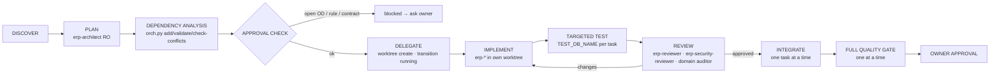

# ERP orchestration — PyCharm + Claude Code + ECC (+ optional JetBrains Central)

Entry point: **`/erp-orchestrator <request>`** (skill: `.claude/skills/erp-orchestrator/SKILL.md`).
Status only: `/erp-orchestrator status`. The general-purpose `/orchestrate` flow
(`docs/claude/ORCHESTRATION.md`) still exists; this is its **queued, worktree-pinned ERP variant**.

Set up 2026-11-16. Baseline at setup: `BASELINE_REPORT.md`.

## Components

| Layer | What | Where |
|---|---|---|
| Orchestration engine | Claude Code CLI 2.1.325 (main session = orchestrator) | `claude` in the PyCharm terminal |
| Model access | JetBrains Central CLI 2.5.0 local proxy → JetBrains AI (personal licence) | `CENTRAL_CLI.md` |
| IDE tools | PyCharm MCP server (`pycharm`, global scope, HTTP) — symbol search, inspections, run points | `claude mcp list` |
| Reusable knowledge | ECC vendored into `.claude/` (agents, skills, `rules/ecc/`) — commit `d2ef268`, **not** a plugin | `.claude/ECC_VENDORED.txt` |
| Agents | 9 `erp-*` agents (6 implementation, 3 read-only) wrapping the existing specialists | `AGENT_OWNERSHIP.md` |
| Skills | `erp-orchestrator` + 9 project skills routing to ECC skills | `.claude/skills/` |
| Queue / state machine | `.claude/state/queue.json` via `bin/orch.py` | below |
| Isolation | pinned git worktrees under `.claude/worktrees/<T-NNN>` (git-ignored) | below |
| Guard rails | `settings.json` deny rules + `hooks/guard_bash.py` (+ read-only mode) | `APPROVAL_POLICY.md` |
| Governance | `.claude/state/decisions-snapshot.md` (read-only) → canonical register | `docs/erp-transformation/12-decisions-register.md` |

## Lifecycle



Task states: `pending → ready → running → review → integration → completed`, plus `blocked`, `failed`.
Legal transitions and checks are enforced by `orch.py transition`:

| Into | Enforced |
|---|---|
| `ready` | dependencies `completed`; owned files set (implementation); criteria present |
| `running` | deps · **no ownership overlap with any running/review/integration task** · ≤4 implementation / ≤2 reviewer agents · worktree exists, on the task branch, descends from base SHA, no edits outside ownership |
| `integration` | `review.status == approved` |
| `completed` | `--note` with gate/test evidence |

## Worktree rule (critical)

The Agent tool's native `isolation: "worktree"` may create the worktree from the **default branch**
(`origin/HEAD` → `develop` @ `0c28a897`), not the session HEAD (`feature/version5` @ `e6dfc9b7`, 10 commits
ahead). This was observed here: leftover branch `worktree-agent-a72f3b374274863a8` is based on `develop`.
Therefore:

1. Never use `isolation: "worktree"` for ERP tasks. Use `orch.py worktree create T-NNN`, which runs
   `git worktree add -b <target_branch> .claude/worktrees/T-NNN <base_sha>` and then verifies it.
2. `orch.py base-check` compares session HEAD, approved base and default branch, and warns on mismatch.
3. A new worktree contains **committed** state only. The parent checkout's uncommitted work (including the
   OD-06 security package) is **not** in it. Tasks that depend on uncommitted work are `blocked` until the
   owner commits it and approves the new base SHA.
4. Existing worktrees are never removed or overwritten by the tooling (`create` refuses an existing path;
   `git worktree remove/prune` is denied for agents). The owner removes them manually.
5. Agents start every session with `orch.py worktree verify T-NNN` and stop if it fails.

## Resource policy (32 GB Apple Silicon)

- ≤4 implementation agents, ≤2 read-only reviewers at once (enforced for queue tasks).
- One full quality gate at a time; one migrating task per Django app; one `npm run build` at a time.
- Targeted tests in agents; full gate only by the integrator after integration.
- Per-task isolated test DB: `TEST_DB_NAME=test_lm_t_nnn` (supported by `backend/lmanagement/settings.py`),
  local Postgres only.
- Agents get file:line pointers from the index; no repo-wide rescans. Check memory with
  `vm_stat | head -5` / Activity Monitor before launching a 4-agent wave.

## Commands

```
ORCH="python3 .claude/orchestration/bin/orch.py"
$ORCH status | validate | base-check
$ORCH add --id T-001 --title "…" --agent erp-backend --owns backend/apps/x/a.py,backend/apps/x/tests/test_a.py \
     --skills django-backend,regression-first --decisions OD-02 --acceptance "…"
$ORCH check-conflicts T-001
$ORCH transition T-001 ready|running|review|integration|completed|blocked|failed [--note "…"]
$ORCH worktree create T-001 ; $ORCH worktree verify T-001
$ORCH review T-001 approved|changes-requested --reviewer erp-reviewer --note "…"
python3 .claude/orchestration/bin/test_orch.py     # engine self-test (temp repo)
python3 .claude/hooks/test_guard_bash.py           # guard self-test
```

## Files

`TASK_TEMPLATE.md` · `ACTIVE_TASKS.md` · `AGENT_OWNERSHIP.md` · `APPROVAL_POLICY.md` ·
`INTEGRATION_POLICY.md` · `CENTRAL_CLI.md` · `BASELINE_REPORT.md` · `bin/orch.py` · `bin/test_orch.py` ·
`../state/queue.json` · `../state/decisions-snapshot.md`.

## Recovery

- Queue corrupted → `git diff .claude/state/queue.json`; restore from the last good version by hand (the file
  is plain JSON; `orch.py validate` tells you what is wrong).
- Revert the whole setup → see "Rollback" in `BASELINE_REPORT.md` (all changes are additive and listed there).
- Central proxy down → `CENTRAL_CLI.md` § Recovery.
