# 07 — User Flows

---

## UF-01: Login

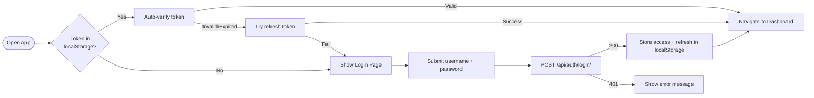

**Session Management**:
- Access token refreshed proactively 5 min before expiry
- After 30 min idle → auto-logout to `/login?reason=idle`
- After session expiry → `/login?reason=session_expired`

---

## UF-02: Create a New DFIA License

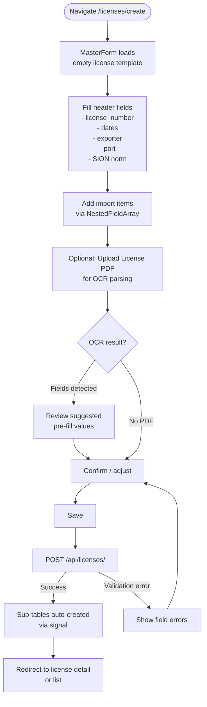

---

## UF-03: Upload Government Ledger File (Async)

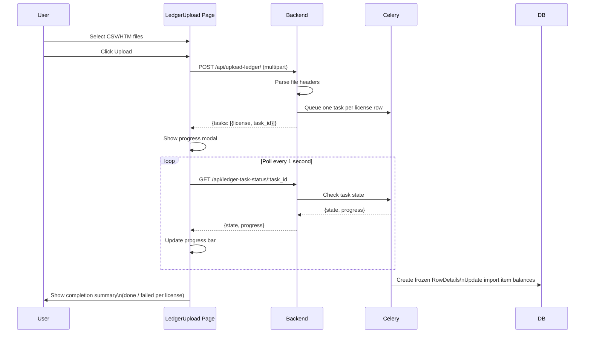

---

## UF-04: Create an Allotment

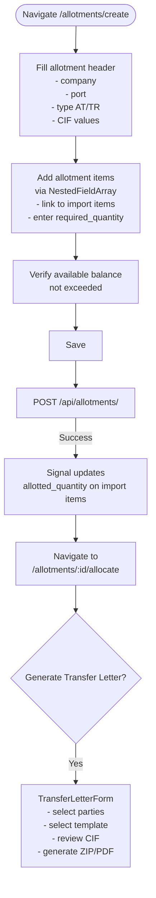

---

## UF-05: Generate a Transfer Letter

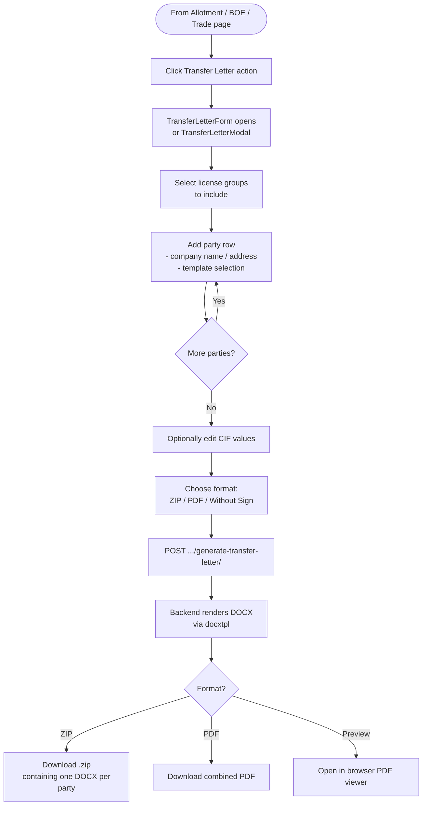

---

## UF-06: License Ledger Review

```mermaid
graph TD
    A([Navigate /license-ledger]) --> B[Select company\nfrom async dropdown]
    B --> C[Optionally filter:\n- license type\n- date range\n- ordering]
    C --> D[GET /api/license-ledger/\n?company=ID&purchase_date_from=...&...]
    D --> E[Display ledger grouped\nby license]
    E --> F{Drill down?}
    F -->|Click license| G[Navigate to\n/license-ledger/:id\n?license_type=DFIA]
    G --> H[LicenseLedgerDetail\nshows transaction-by-transaction\nwith running balance]
    H --> I{Export?}
    I -->|PDF| J[generatePDF()]
    I -->|Excel| K[generateExcel()]
    F -->|No| L[View summary table]
```

---

## UF-07: Dashboard Situational Awareness

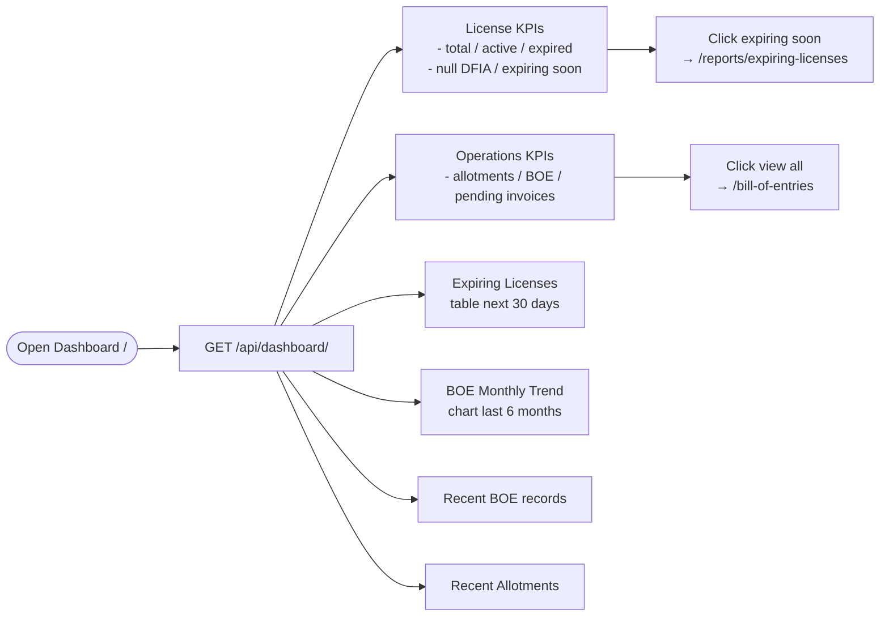

---

## UF-08: Task Management via Voice

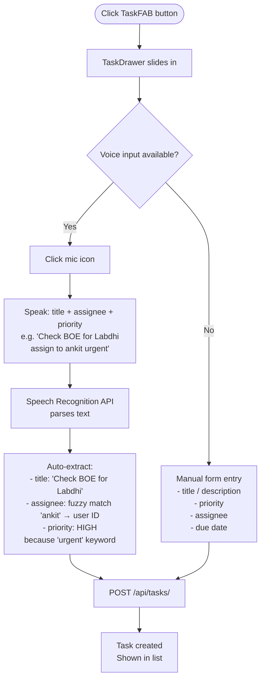

---

## UF-09: User & Role Management

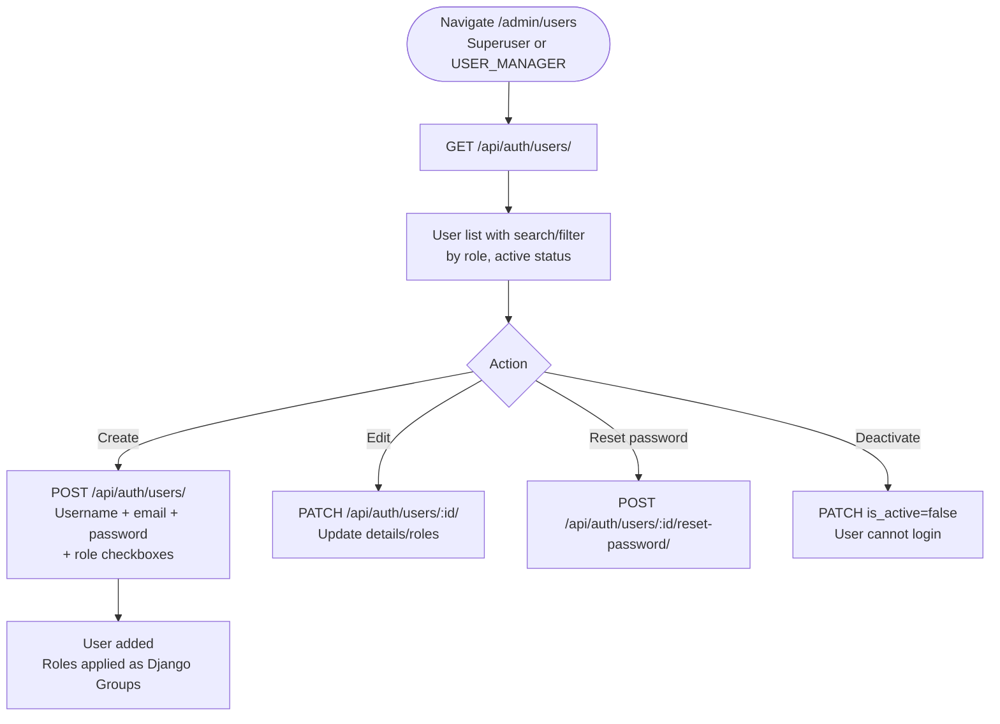

---

## UF-10: BOE Balance PDF Generation

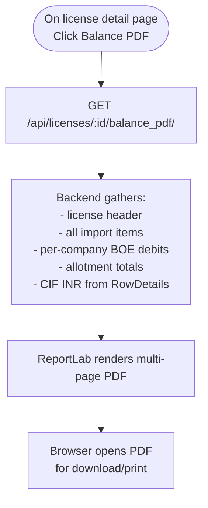

---

## UF-11: Master Data Sync Between Servers

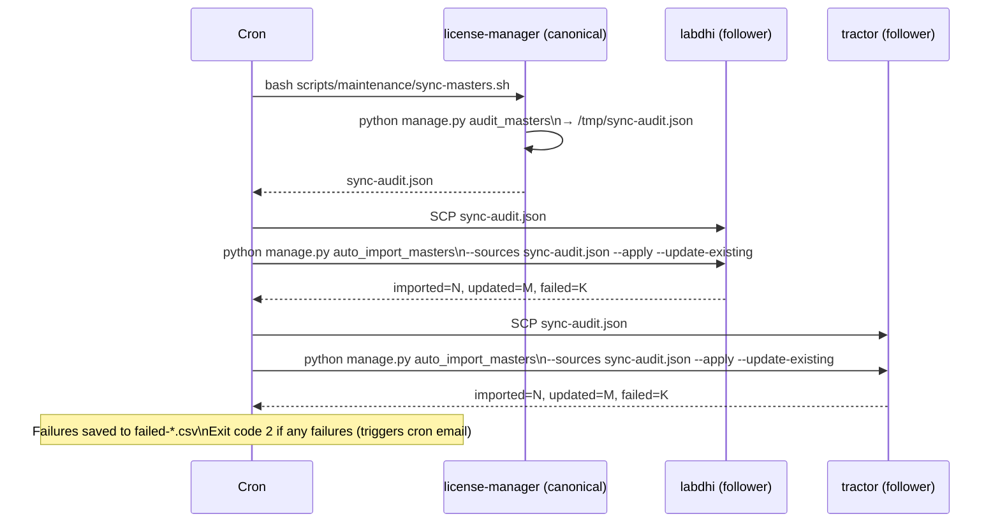

---

## UF-12: Delete a Trade (Purchase/Sale)

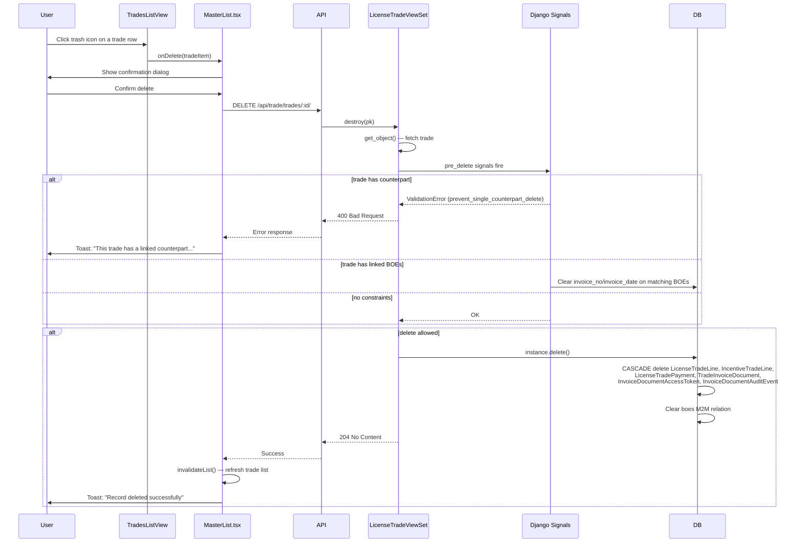

**Key points**:
- Only `TRADE_MANAGER` role can delete
- Paired trades (with `counterpart`) are **blocked** from single-side deletion
- Linked BOE invoice references are cleared, not deleted
- Child objects (lines, payments, documents) are CASCADE-deleted

---

## UF-14: Force Delete a Trade (Manual Override via Django Shell)

**Trigger**: When a trade must be deleted despite having a counterpart, audit records, or classification decisions — e.g., data cleanup after testing or error recovery.

```mermaid
sequenceDiagram
    participant Admin
    participant Shell as Django Shell
    participant Models as Trade Models
    participant DB

    Admin->>Shell: Open Django shell (python manage.py shell)
    Shell->>Models: Import LicenseTrade, TradePairAudit, SaleClassificationDecision

    Note over Admin,DB: Step 1: Clear counterpart link
    Admin->>Shell: trade = LicenseTrade.objects.get(pk=<ID>)
    Shell->>Models: Fetch trade and counterpart
    Admin->>Shell: trade.counterpart = None; trade.save()
    alt counterpart exists
        Admin->>Shell: counterpart.counterpart = None; counterpart.save()
    end
    Models->>DB: Update counterpart = NULL on both trades

    Note over Admin,DB: Step 2: Delete protecting audit records
    Admin->>Shell: TradePairAudit.objects.filter(source=trade).delete()
    Models->>DB: Delete TradePairAudit records
    Admin->>Shell: TradePairAudit.objects.filter(counterpart=trade).delete()
    Models->>DB: Delete more TradePairAudit records
    Admin->>Shell: SaleClassificationDecision.objects.filter(trade=trade).delete()
    Models->>DB: Delete SaleClassificationDecision records

    Note over Admin,DB: Step 3: Delete the trade
    Admin->>Shell: trade.delete()
    Models->>DB: CASCADE delete LicenseTradeLine, IncentiveTradeLine,<br/>LicenseTradePayment, TradeInvoiceDocument,<br/>InvoiceDocumentAccessToken, InvoiceDocumentAuditEvent
    Models->>DB: Clear boes M2M relation
    Models-->>Shell: Trade deleted
    Shell-->>Admin: Confirmation

    Note over Admin,DB: ⚠️ Audit trail permanently destroyed
```

**Key points**:
- No API endpoint exists for force delete — must use Django shell or direct database operations
- Requires Django superuser access
- The `counterpart` link must be cleared on **both** trades before deletion
- `TradePairAudit` and `SaleClassificationDecision` records must be deleted to satisfy PROTECT FK constraints
- `QuerySet.delete()` bypasses `pre_delete` signals but NOT `PROTECT` FK constraints
- Linked BOE invoice references are **NOT** cleared when using `QuerySet.delete()` (signals are bypassed)
- Use only for data cleanup, error recovery, or database maintenance — not for normal operations

---

## UF-15: Create Direct SALE Trade — Quantity Validation Error

**Trigger**: User creates a SALE trade without BOEs (direct sale bypass path), and the requested quantity exceeds the available quantity for one or more import items.

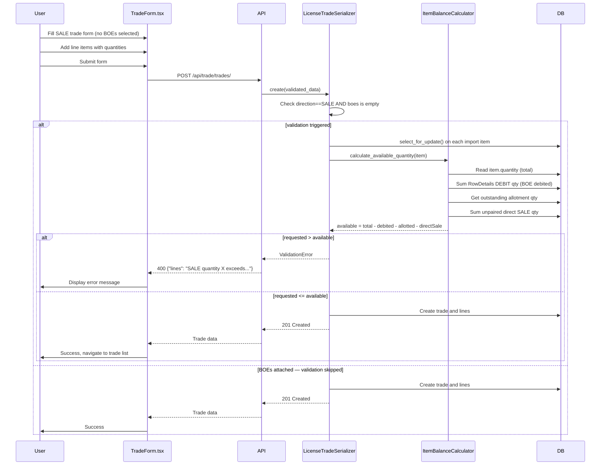

**Key points**:
- Validation only fires for SALE trades with no BOEs (`boes: []`)
- When BOEs are attached, the validation is skipped — the BOE linkage serves as the physical quantity debit
- Row locks (`select_for_update()`) prevent concurrent over-consumption
- The error message identifies the specific import item and shows both requested and available quantities
- User must either reduce quantities or attach BOEs to bypass the validation

---

## UF-13: Copy Trade to Counterpart (Purchase ↔ Sale)

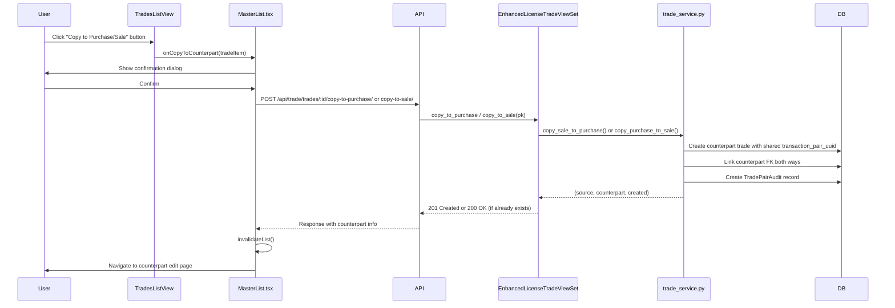

---

## UF-16: SION Planning — CIF Restriction per Item (Feature Request — Not Yet Implemented)

**Trigger**: User edits a SION planning rule and sets a CIF restriction percentage (2%, 3%, 5%, or 10%) to limit how much of an import item's total CIF can be planned.

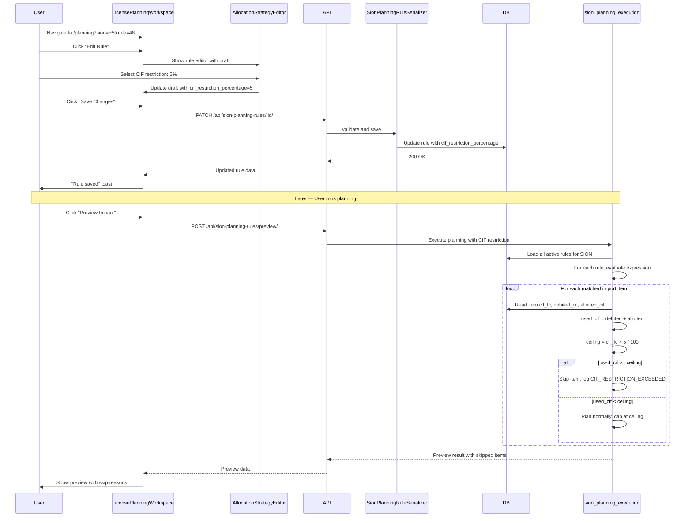

**Key points**:
- The CIF restriction is configured per rule (STANDARD strategy) or per row (SPLIT strategies)
- During planning, each matched import item is checked against its restriction ceiling
- Items exceeding the ceiling are skipped with diagnostic reason `CIF_RESTRICTION_EXCEEDED`
- Preview mode shows which items were skipped and why, before any plans are saved
- The restriction is a hard ceiling — no partial planning beyond the limit
- Allowed values: 2%, 3%, 5%, 10%, or None (no restriction)

---

## UF-17: SION Planning — Normal Execution Flow

**Trigger**: User runs SION auto-plan for a norm class (e.g., E5) to allocate import entitlements to export planning.

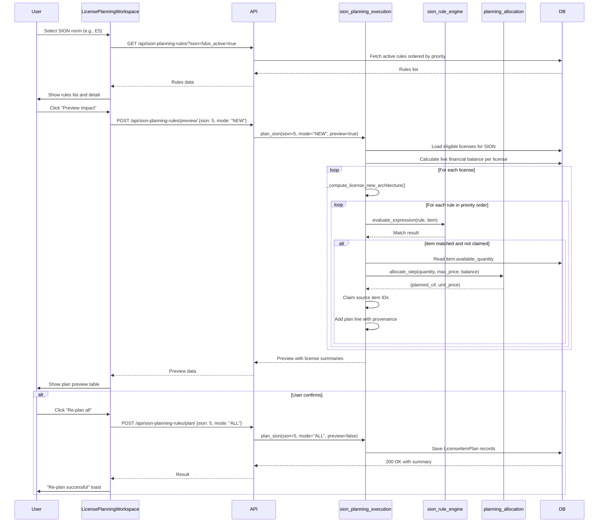

**Key points**:
- Preview is read-only — no database writes
- Planning uses a priority waterfall: higher-priority rules claim items first
- Each rule's expression tree is evaluated against import items
- CIF allocation respects the remaining balance ceiling
- Source items are claimed to prevent double-allocation across rules
- Full provenance is stored in `allocation_provenance` JSON field
