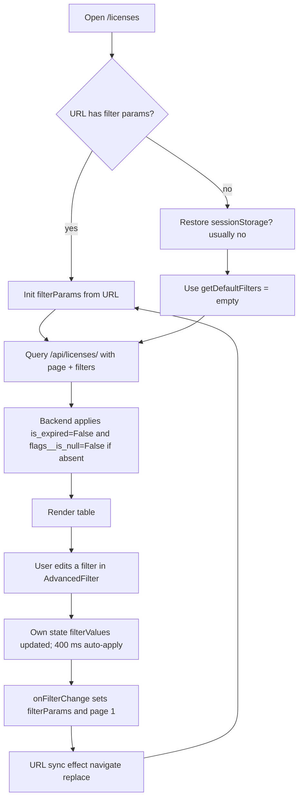

# Licence Listing — Repair & V1 Revamp

Route under repair: `/licenses` (SPA) → `GET /api/licenses/` (Django).
Status of this document: **Phase 1 (Explore) and Phase 2 (Critique) complete.** Implementation, verification and measurements are recorded in the sections marked *Implementation log* and *Verification* below as they land.

---

## 1. Purpose

The licence listing is the operational screen where licence managers find, filter and act on import licences (balances, expiry, purchase source, planning). Its filter state is the main entry point for every downstream workflow (edit, balance, planning, export). Current defects make the screen unreliable: filters can silently apply backend defaults the UI does not show, Back does not restore prior filters, some multi-select filters send the wrong key, and malformed inputs can produce HTTP 500s.

## 2. Entry points

| Layer | Entry point |
|---|---|
| Route | `frontend/src/routes/AppRoutes.tsx:107` — `/licenses` → `MasterList` (`ProtectedRoute` roles `LICENSE_MANAGER`, `LICENSE_VIEWER`) |
| Page component | `frontend/src/pages/masters/MasterList.tsx:98` (`MasterList`, shared with every master entity) |
| API | `backend/apps/license/urls.py:28` — `router.register("licenses", LicenseDetailsViewSet)` |
| Viewset | `backend/apps/license/views/license.py:213` — `LicenseDetailsViewSet` |
| Filter engine | `backend/apps/license/views/license.py:648` — `apply_advanced_filters` (override) → `backend/apps/core/views/master_view.py:316` (generic) |

## 3. Files

Frontend (current implementation):
- `frontend/src/pages/masters/MasterList.tsx` — URL sync, `filterParams` state, query, header, export, delete, pagination (1705 lines; shared).
- `frontend/src/components/AdvancedFilter.tsx` — the generic filter panel (303 lines).
- `frontend/src/components/DebouncedSearchInput.tsx`, `frontend/src/components/DebouncedAsyncSelect.tsx`, `frontend/src/components/DateRangeFilter.tsx`.
- `frontend/src/components/filters/FilterPanel.tsx` — `FilterPanel`, `FilterGrid`, `FilterField`.
- `frontend/src/components/ActiveFilters.tsx` and `MasterList.tsx:1639` (`MasterListActiveFiltersDisplay`).
- `frontend/src/pages/masters/masterListConfig.ts` — `getDefaultFilters` (licences: `{}`).
- `frontend/src/pages/masters/tables/LicensesTable.tsx` — row/accordion table (1441 lines). No sortable headers.
- `frontend/src/hooks/useDebounce.js` — `useDebouncedState`, `useDebouncedCallback`.
- `frontend/src/utils/filterPersistence.js` — sessionStorage persistence (not effective for licences; see FE-21).

Backend:
- `backend/apps/license/views/license.py` — viewset, filter config (lines 74–209), `apply_advanced_filters` (≈648–770), `get_queryset` (≈600–645).
- `backend/apps/core/views/master_view.py` — `create_viewset`, generic `apply_advanced_filters` (316–548), `list` payload (550–646).
- `backend/apps/core/filters.py` — `EnhancedSearchFilter`, `AdvancedOrderingFilter`, `CombinedFilterBackend` (no-ops for this viewset).
- `backend/apps/core/filtersets.py:83` — `LicenseFilterSet` (**not active** on this endpoint; see BE-04).
- `backend/apps/license/models/core.py` — `LicenseDetailsModel`; `balance_cif` is a property (201), not a column.
- `backend/apps/core/models.py:696` — `PurchaseStatus` (`code`, `label`, `is_active`, `display_order`).
- `backend/apps/core/views/__init__.py` / `backend/apps/core/urls.py:32` — `/masters/purchase-statuses/`.
- `backend/apps/license/services/validation_service.py:48,322` — ₹500 persisted `flags.is_null` threshold.

Tests (existing):
- Backend: `backend/apps/license/tests/test_license_advanced_filters_live_balance.py` (4 tests), `backend/apps/license/tests/test_license_list_balance_consistency.py`, `backend/tests/test_api_license.py::TestLicenseAPI`, `backend/tests/test_all_conditions.py::TestLicenseEndpoints`, `backend/tests/test_api_integration.py::TestLicenseAPIIntegration`.
- Frontend (Vitest 3.2.6): `frontend/src/pages/masters/MasterList.smoke.test.tsx:103` only renders the licences entity. No test covers the licence filter panel, URL round-trip, chips or pagination.
- E2E (Playwright): `frontend/playwright.config.ts` (`testDir: ./e2e`, auto-starts Vite on port 41731). No licence-list spec. Login helper uses `LM_USERNAME` / `LM_PASSWORD` (see `frontend/e2e/data-bearing.real.spec.ts:16`).
- Selenium: `tests/e2e/` at repo root (`test_pages_selenium.py`, ~25 `qa_*.py`).

## 4. Dependencies

- Frontend: React Router (`react-router-dom`, `useSearchParams` / `navigate`), TanStack Query v5 (`useQuery`, `placeholderData`), `react-select` (+ `react-select/async`), shadcn/ui primitives (`@/components/ui/*`), axios instance `frontend/src/api/axios`.
- Backend: DRF `ModelViewSet`, `PageNumberPagination` (`page_size` ≤ 200), `LicenseBalanceCalculator.calculate_financial_balance_for_licenses` (`backend/apps/license/services/balance_calculator.py`), `LicensePermission` (`backend/apps/accounts/permissions.py:32`).

## 5. Database tables

| Table (model) | Used for |
|---|---|
| `license_licensedetailsmodel` (`LicenseDetailsModel`) | `license_number`, `license_date`, `license_expiry_date`, `exporter_id`, `port_id`, `purchase_status_id`, `scheme_code_id`, `notification_number_id`, `file_number`, `registration_*` |
| `license_licenseflags` (1:1, `flags`) | `is_expired`, `is_active`, `is_incomplete`, persisted `is_null` (₹500 rule) |
| `license_licensebalance` (1:1, `balance`) | Stored `balance_cif` — **not** used for filtering (stale cache); see BE-03 |
| `license_licenseitemplan` | `is_planned` (Exists subquery) |
| `license_exportlicenseitem` | `export_license__norm_class` |
| `core_company` (exporter), `core_port`, `core_purchasestatus`, `core_schemecode`, `core_notificationnumber`, `core_sionnormclass` | Filter option sources |

Indexes: none added in this work yet. Any index must be justified by an `EXPLAIN` on the real query (Phase 8). Not done.

## 6. APIs

### 6.1 List endpoint (current contract — to be kept)

`GET /api/licenses/` — DRF pagination with MasterViewSet extras: `results`, `count`, `next`, `previous`, `total_pages`, `current_page`, `page_size`, `has_next`, `has_previous`, `list_display`, `filter_config`, `default_filters`, `search_fields`, `ordering_fields`.

| Query param | Semantics (current, verified by reading) | Notes |
|---|---|---|
| `search` | Splits on whitespace **and commas**, each term ANDed across `license_number`, `file_number`, `exporter__name` (icontains) | `EnhancedSearchFilter` (`core/filters.py:26`) |
| `license_number` | Exact-ish: CharField without comma → `icontains`; with comma → `__in` | Frontend sends this for 10-digit searches |
| `exporter` | CSV ids → `exporter__in`; single id → exact | |
| `exclude_exporter` | CSV ids → `NOT exporter__in` (NULL exporter kept) | |
| `port` / `exclude_port` | As exporter; exclude keeps NULL port | |
| `purchase_status` | CSV ids → `purchase_status__in`; unknown ids match nothing (no error) | Also accepts `purchase_status[]` |
| `scheme_code` | CSV **codes** → `scheme_code__code__in` (`value_field: code`) | Frontend sends ids today → BUG FE-05 |
| `notification_number` | CSV **codes** → `notification_number__code__in` | Same bug as scheme_code |
| `export_license__norm_class` | CSV ids → `export_license__norm_class__in` + `distinct()` | |
| `license_date__gte` / `__lte` (or `_from`/`_to`) | Inclusive DATE bounds | Malformed value → unhandled exception (BE-02) |
| `license_expiry_date__gte` / `__lte` (or `_from`/`_to`) | Inclusive DATE bounds | Null expiry excluded by bounds |
| `balance__balance_cif_min` / `_max` | **Live** balance (financial ledger formula), inclusive; computed in Python for every matching candidate | Malformed → `decimal.InvalidOperation` → 500 (BE-02); perf BE-03 |
| `is_expired` | `True` → expiry < today; `False` → expiry ≥ today **or NULL**; `all` → no filter; absent → backend default `False` | Date-based, not `flags.is_expired` |
| `flags__is_null` (alias `is_null`) | `True` → live balance < **200**; `False` → ≥ 200; `all` → none; absent → backend default `False` | Live ₹200 ≠ persisted ₹500 (BE-05) |
| `is_planned` | `True` → has ≥1 `LicenseItemPlan`; `False` → none; `all`/absent → none | |
| `ordering` | Only fields in `ordering_fields`; `balance_cif` is listed but is not a column | BE-01 |
| `page`, `page_size` | DRF pagination; `page_size` ≤ 200 | `page_size` default 25 |

Backend defaults (`default_filters`, `license.py:136-138`): absent `is_expired` applies `False` **silently**. Absent `flags__is_null` applies **no filter**, because the default lookup reads key `is_null` (`license.py:797`) while the default is keyed `flags__is_null` (BE-10). The frontend always sends both explicitly, so the UI is unaffected.

### 6.2 Option endpoints used by the filter panel

`/masters/companies/`, `/masters/ports/`, `/masters/purchase-statuses/` (current frontend adds `is_active=true`), `/masters/sion-classes/`, `/masters/scheme-codes/`, `/masters/notification-numbers/`. Each is a `MasterViewSet` with `search`. Single-record fetch `…/{id}/` is used to label selected ids.

### 6.3 Authoritative purchase-status mapping

The seed data is **not in the repo** (`core/migrations/0001_initial.py` creates the table only). Local dev DB `lmanagement`, table `core_purchasestatus` (read-only query, 2026-11-02):

| id | code | label | is_active |
|---|---|---|---|
| 1 | LG | LABDHI GLOBAL | t |
| 6 | OT | OT Purchase | f |
| 9 | LM | LM Purchase | t |
| 10 | N1 | NILESH SIR LOT 1 | t |
| 11 | PB | PURPLEHUB | t |
| 12 | N2 | NILESH SIR LOT 2 | t |
| 13 | N3 | NILESH SIR LOT 3 | t |
| 14 | N4 | NILESH SIR LOT 4 | t |

The target URL asks for ids `11,10,1,2,4,5,7`. **Ids 2, 4, 5 and 7 do not exist in this database.** Those ids cannot be labelled from authoritative data here. The UI must show them as "Unknown status #2" rather than invent a name, and the target URL cannot show "all seven values load" on this database. Confirm against the database the user is actually testing with before claiming E2E item 1 passes.

## 7. Business rules (current behaviour — preserved)

| Rule | Current behaviour | Source |
|---|---|---|
| BR-1 Default view hides expired licences | `is_expired=False` default; NULL expiry counts as not expired | `license.py` `apply_advanced_filters` |
| BR-2 Default view hides "null" licences | UI baseline sends `flags__is_null=False` (live balance ≥ ₹200). API default when the param is absent is **no filter** (BE-10) | `license.py:797` |
| BR-3 "Null" live threshold is ₹200 | Live filter | `license.py:700,704` |
| BR-4 Persisted `flags.is_null` threshold is ₹500 | Used for stored flag | `validation_service.py:322` |
| BR-5 Multi-select within one filter = OR; across filters = AND | Generic builder ANDs Q objects | `master_view.py:522-536` |
| BR-6 Exclude filters keep NULL rows | `~Q(field__in=…)` on nullable FK | Django semantics, `master_view.py:462-473` |
| BR-7 Balance is live, not the stored cache | Batched `calculate_financial_balance_for_licenses` | `license.py:315`, `BL-LEDGER-02` comment |
| BR-8 Stored `balance` and BOE/allotment figures are never written by listing | Listing is read-only | Verified by reading: list code path has no writes |

**Decision needed (not changed here):** BR-3 vs BR-4 (₹200 vs ₹500). Per Phase 9 of the brief this stays at ₹200 for the live filter until a business owner authorises a change. The UI must describe the rule explicitly ("live balance below ₹200").

## 8. User flow (current)



The loop `K → L → C` re-runs the init effect on every `location.search` change. It works today because the JSON comparisons stop it, but every filter edit now performs two state writes, one navigation and one init pass.

## 9. Filter inventory (Phase 1)

Each row lists the UI control, URL key (current), API param and backend behaviour. "Status" is the Phase 2 verdict from reading; live browser verification is pending (see §13).

| # | Filter | UI control (current) | URL key | API param | Backend | Verdict |
|---|---|---|---|---|---|---|
| 1 | Global search | Text, debounced 400 ms + 400 ms (FE-07) | `search` (10 digits → `license_number`) | `search` | AND of terms, icontains on 3 fields | Works; double debounce; no clear-to-URL bug found yet |
| 2 | Exporter | `DebouncedAsyncSelect` multi (companies) | `exporter` | `exporter` (ids) | `exporter__in` | Works in theory; value round-trip re-fetches per id (FE-04) |
| 3 | Notification number | Async multi, **sends ids** | `notification_number` | `notification_number` (**codes expected**) | `notification_number__code__in` | **BROKEN** (FE-05) — expected 0 matches |
| 4 | Purchase status | Async multi, sends array then CSV string | `purchase_status` | `purchase_status` (ids) | `purchase_status__in` | Works; per-id refetch on every round trip (FE-04); unknown ids unlabelled (FE-14) |
| 5 | Licence status | Button group All/Active/Expired (`is_expired`) | `is_expired` | `is_expired` | date based | Works; default hidden in chips (FE-06) |
| 6 | Exclude exporter | Async multi | `exclude_exporter` | `exclude_exporter` | `NOT exporter__in` | Works; contradictory with #2 allowed (FE-13) |
| 7 | Port | Async multi | `port` | `port` | `port__in` | Works |
| 8 | Exclude port | Async multi | `exclude_port` | `exclude_port` | `NOT port__in` | Works; contradictory with #7 allowed (FE-13) |
| 9 | Norm class | Async multi (`export_license__norm_class`) | `export_license__norm_class` | same | `__in` + distinct | Works; not verified in browser |
| 10 | Scheme code | Async multi, sends ids | `scheme_code` | `scheme_code` (**codes expected**) | `scheme_code__code__in` | **BROKEN** (FE-05) |
| 11 | Licence date range | Two native dates | `license_date__gte` / `__lte` | `license_date__gte/lte` | inclusive | Works; no clear button, no from≤to check (FE-08) |
| 12 | Expiry date range | Two native dates | `license_expiry_date__gte/lte` | same | inclusive | Same as 11 |
| 13 | Balance CIF min | number, 400 ms auto-apply | `balance__balance_cif_min` | same | live, Python-side | Works; malformed → 500 (BE-02); no min≤max check (FE-09) |
| 14 | Balance CIF max | number | `balance__balance_cif_max` | same | live | Same as 13 |
| 15 | Flags is null | Button group All/Yes/No | `flags__is_null` | same | live ₹200 | Works server-side; All/absent confusion (FE-03) |
| 16 | Is planned | Button group All/Yes/No | `is_planned` | same | Exists | Works; not verified in browser |
| 17 | Sort | None in UI (`ordering` accepted by API) | `ordering` | `ordering` | pk default (BE-02) | Missing UI; config comment says expiry-first but default is pk |
| 18 | Page / page size | Pager + size select | `page` (`page_size` not in URL) | `page`, `page_size` | DRF | Page ignored when URL has no filters (FE-11) |

Hidden / dead filters found:
- `LicenseFilterSet` (`core/filtersets.py:83`) declares `company`, `status`, `is_active`, `balance_cif_min`, `purchase_status`, etc. It is **not** applied to this endpoint (no `DjangoFilterBackend` in `filter_backends`). Its tests would pass while the endpoint ignores its behaviour. (BE-04)
- `status` (`filter_by_status`) is not exposed in the UI; if it were, it would use `flags.is_expired` while the UI uses the date rule. Two definitions of "expired" exist (BE-07).

## 10. Bug register (Phase 2)

Severity: **C** critical (wrong results or data-trust), **H** high (broken control / 500), **M** medium (inefficient or confusing), **L** low.

### Frontend

| ID | Sev | Bug | Evidence | Root cause |
|---|---|---|---|---|
| FE-01 | C | Five sources of truth for filter state: URL, `MasterList.filterParams`, `AdvancedFilter.filterValues`+`searchTerm`, derived `uiFilterParams`, sessionStorage | `MasterList.tsx:135, 318-385, 544-575`; `AdvancedFilter.tsx:40-60` | Generic panel owns state and mirrors the parent through JSON-compared effects |
| FE-02 | C | Browser Back does not restore earlier filters | `MasterList.tsx:573` `navigate({search}, {replace: true})` | Every filter change replaces the history entry |
| FE-03 | C | "Clear" shows All but backend still filters: absent `is_expired` / `flags__is_null` silently apply `False` | `AdvancedFilter.tsx` `handleResetFilters` → `{}`; backend `default_filters` in `license.py:139` | UI "absent" and backend "absent = default" differ; no explicit baseline in the URL |
| FE-04 | H | Multi-select re-fetches each selected id on every URL round trip (N GET requests, no cancellation, out-of-order `setSelectedOption`) | `DebouncedAsyncSelect.tsx` `loadSelectedOption` loop; value switches array ↔ CSV string | Value shape not normalised; labels resolved per id |
| FE-05 | H | `scheme_code` and `notification_number` filter by id, backend expects code → zero results | `AdvancedFilter.tsx` fk case omits `valueField`; `license.py:115-116` declares `value_field: code` | `value_field` from config is never passed to the widget |
| FE-06 | H | Chips: purchase status shows `11,10,1,…`; removing one chip removes all; from/to dates have identical labels; default-valued filters hidden | `MasterList.tsx:1639-1705` | Generic chip model; no per-value chips; default filter suppression |
| FE-07 | M | Search effective latency ≈ 800 ms (two 400 ms debounces) | `DebouncedSearchInput.tsx` (delay 400) → `AdvancedFilter.tsx` auto-apply (400) | Two stacked debounces |
| FE-08 | M | Dates: no clear control, no from ≤ to validation, each change commits | `AdvancedFilter.tsx` date_range case passes no `onClear`; `DateRangeFilter.tsx` | Generic component options not wired |
| FE-09 | M | Numbers: no min ≤ max validation, no decimal precision guard, intermediate values commit | `AdvancedFilter.tsx` range case | Generic component |
| FE-10 | M | "N active" excludes defaults, so 2 applied filters show 0 active and Clear is disabled | `AdvancedFilter.tsx` `activeEntries` filter on `defaultFilters` | Active count derived against defaults |
| FE-11 | M | `/licenses?page=3` (no other params) lands on page 1 | `MasterList.tsx:376-378` `setCurrentPage(1)` in else-branch | Else-branch ignores URL page |
| FE-12 | M | Pagination writes URL, which re-runs the init effect and resets filter state from the URL on every page change | `MasterList.tsx:318` deps `[entityName, location.search]` | Init effect coupled to `location.search` |
| FE-13 | M | Contradictory include and exclude selections allowed (same exporter/port in both): always empty, no explanation | `AdvancedFilter.tsx` independent selects | No cross-field rule |
| FE-14 | M | Ids missing from the authoritative options (or inactive) are unlabelled and silently filter | `DebouncedAsyncSelect` `fetchOptionById` returns null → selection dropped; purchase-status list uses `is_active=true` | Label source is the active list only |
| FE-15 | L | No sortable columns; config comment claims expiry-first ordering that the API does not apply | `LicensesTable.tsx` (no sort UI); `license.py:138` comment vs `ordering` | Missing feature; comment drift |
| FE-16 | L | Control heights inconsistent: react-select 44 px (AdvancedFilter) vs 38 px (DebouncedAsyncSelect) vs 40 px input | `AdvancedFilter.tsx` `rsControl`; `DebouncedAsyncSelect.tsx` `minHeight: 38px` | Ad-hoc styles |
| FE-17 | L | Filter panel width: `FilterField wide` uses `xl:col-span-2`; the "20 % width" regression was not re-measured | `components/filters/FilterPanel.tsx:26` | **Unverified** — measure in browser (§13) |
| FE-18 | L | `useDebouncedCallback` never settles superseded promises | `hooks/useDebounce.js` | Dropped promise chain |
| FE-19 | L | `shouldRestoreFilters()` has a side effect and reads an allotments-only flag during licence init | `utils/filterPersistence.js:70`; `MasterList.tsx:367` | Shared helper |
| FE-20 | M | Export uses `filterParams`, which can differ from the visible state | `MasterList.tsx` `handleExport` (licence branch — **to confirm**) | Parallel state |
| FE-21 | M | Dead licence branches in a 1705-line shared page make the real behaviour hard to reason about | `MasterList.tsx` `entityName === 'licenses'` branches | Shared page |

### Backend

| ID | Sev | Bug | Evidence | Root cause |
|---|---|---|---|---|
| BE-01 | H | `ordering=balance_cif` is advertised as valid but `balance_cif` is a property, so `order_by` raises `FieldError` → 500 (**to verify with a test**) | `license.py:254` (`ordering_fields`), `models/core.py:201` | Non-column in `ordering_fields` |
| BE-02 | H | Malformed input → 500: `balance__balance_cif_min=abc` (`Decimal` raises `InvalidOperation`); malformed dates → Django `ValidationError` (**to verify**) | `license.py:~716-721`; `master_view.py` date branch | No input validation before ORM |
| BE-03 | H | Performance: `is_null` and balance range load every matching id, compute live balance for all of them, then send an `id__in` list back to SQL. Cost grows with the whole licence table, not the page (**to measure**) | `license.py:696-704`, `~739-747` | Live balance is not a column, so the filter is evaluated in Python |
| BE-04 | M | `LicenseFilterSet` is dead for this endpoint; its tests and docstring describe behaviour that is not applied | `core/filtersets.py:83`; `license.py:251-252` | Filter backend list omits `DjangoFilterBackend` |
| BE-05 | M | Two "null" thresholds: live ₹200 (filter) vs persisted ₹500 (flag). Not unified, per the brief | `license.py:700,704`; `validation_service.py:48,322` | Historical; business decision pending |
| BE-06 | L | `is_expired=False` includes NULL expiry | `license.py` `Q(license_expiry_date__isnull=True)` | Intentional? Document as BR-1 |
| BE-07 | L | Two definitions of expiry: date (list) vs `flags.is_expired` (`filter_by_status`) | `license.py` vs `filtersets.py:392` | Legacy |
| BE-08 | M | Default ordering is `pk`, not the documented expiry-first order. No deterministic tiebreaker is guaranteed for `license_expiry_date` ties | `license.py:138` (`ordering` → `ordering_fields` only); `master_view.py` base queryset `order_by("pk")` | `ordering` never assigned as a view attribute |
| BE-10 | M | Absent `flags__is_null` applies no filter, whereas absent `is_expired` applies `False`. This document previously claimed both defaulted; that was wrong | `license.py:797` reads `default_filters.get('is_null')`; the default is keyed `flags__is_null` (`license.py:137`) | Key mismatch. Fixing it changes results for API callers that omit the param, so it is an open decision |
| BE-11 | H | N+1 on list: 25 queries for 5 licences and 65 for 25 | Per-row export-line norm class and transfer lookups. Fixed with list-scoped prefetches; now 17 queries at both sizes | Missing prefetch |
| BE-09 | L | `search` splits on commas as AND terms, but the UI uses comma as OR for ids. Documented, not changed | `core/filters.py:47` | Shared search behaviour |

## 11. Root-cause analysis

1. **Architectural (FE-01, FE-02, FE-12, FE-19, FE-21).** The licence page has no single authoritative filter model. `MasterList` holds `filterParams`, the generic `AdvancedFilter` keeps its own copy, and the URL is written from one and read by the other. Synchronisation depends on JSON comparisons and `skipNextAutoApply` flags, which is why small changes break Back, Clear and pagination. Fixing individual symptoms would leave the coupling in place.
2. **Contract drift (FE-03, FE-05, BE-04).** The frontend encodes "absent" as "send nothing", and the backend treats absent as "apply default". Multi-select widgets drop `value_field`, so the value sent is an id while the filter expects a code. The dead `LicenseFilterSet` shows that code can look correct while the endpoint does something else.
3. **Input handling (BE-02, FE-08, FE-09).** No layer validates ranges or dates before they reach the ORM. The backend trusts query strings and the frontend trusts itself.
4. **Live-balance cost (BE-03).** Live balance is the correct source (BR-7), but the filter pulls the whole candidate set into Python. The page size does not bound the work.

## 12. Proposed architecture

### 12.1 Frontend — one typed model, URL as the only source of truth

New module: `frontend/src/pages/licenses/` (page-scoped; no changes to other entities).

```mermaid
flowchart LR
  URL[(URL search params)] -->|parseLicenseListSearch| State[LicenseListState]
  State -->|serializeLicenseListSearch| URL
  State -->|toApiParams| Key[Query key + request params]
  Key --> Q[useQuery /api/licenses/]
  Q --> Table[LicensesTable + DataPagination]
  UI[Filter panel / chips / pager] -->|setFilters / setPage| Nav[navigate push or replace]
  Nav --> URL
  Opts[useLicenseFilterOptions] --> UI
```



Components:
- `licenseListFilters.ts` — pure module: `LicenseListFilters` type; `parseLicenseListSearch(search)` (malformed → defaults, unknown enums → defaults, CSV → sorted unique ids/codes, dates and decimals validated); `serializeLicenseListSearch(state)` (fixed key order, explicit `is_expired` and `flags__is_null` always present, empty values omitted, `page` always present); `toApiParams(state)` (the only place API names are produced); `validateLicenseListFilters(filters)` (date order, decimal range, contradiction rules); `activeChips(state, labels)`.
- `useLicenseListState.ts` — the only hook that reads/writes the URL (`useSearchParams`). Filter commits push a history entry; page changes push; normalisation of malformed URLs uses replace. Typed search input commits once after 350 ms (no per-keystroke history).
- `useLicenseListQuery.ts` — `useQuery({ queryKey: ['licences', 'list', canonicalQueryString], queryFn with axios signal, placeholderData: keepPreviousData })`. Stale responses cannot overwrite newer results because the key differs; the signal cancels superseded requests.
- `useLicenseFilterOptions.ts` — lazy option sources with `staleTime` 5 min. Purchase statuses load **all** rows (active and inactive) so labels resolve; inactive ones are marked. Ids with no authoritative label render as "Unknown #id".
- `LicenseListFilters.tsx` — the panel: search row, primary toolbar (Exporter, Purchase status, Licence status, Null balance), "More filters" disclosure (rest), active chips with per-value removal, "Clear all", active count (excluding nothing: the count is of *non-baseline* filters, and the baseline is shown as a note).
- `LicenseListPage.tsx` — header (count, Excel/PDF export, Add New), filters, table, pager, delete/ownership handlers copied from `MasterList` (no shared-code edits).

### 12.2 Filter semantics (decided here)

| Filter | Semantics | Conflicts |
|---|---|---|
| Exporter, Port, Purchase status, Norm class, Scheme, Notification | Within a filter: OR. Across filters: AND. | — |
| Exclude exporter / Exclude port | NOT IN. NULL rows kept. | Selecting the same id in include and exclude is blocked in the UI (option disabled with explanation). |
| Licence status (`is_expired`) | `all` / `False` / `True`. Absent is never sent. | — |
| Null balance (`flags__is_null`) | `all` / `False` / `True`. Absent is never sent. | — |
| Is planned | `all` / `True` / `False`. `all` is sent explicitly. | — |
| Licence date range | Inclusive both ends. From ≤ To. | Invalid range → inline error, not committed. |
| Expiry date range | As licence date. | — |
| Balance CIF min/max | Decimal, 2 dp max, inclusive, min ≤ max. Live balance. | Invalid → inline error, not committed. |

Baseline (default view) = `is_expired=False`, `flags__is_null=False`. "Clear all" returns to baseline, not to empty. The baseline is visible in the panel as "Hiding expired and null-balance licences" with a button to show all (`all`). This keeps BR-1 and BR-2 without a hidden default.

> Open business question: should "Clear all" return to the baseline (proposed) or to a truly empty URL that shows expired/null licences? The brief says "Clear All removes all optional filters". The baseline is not treated as optional here. Confirm before release.

### 12.3 URL contract

| Key | Format | Example |
|---|---|---|
| `search` | trimmed text ≤ 200 chars | `search=0310835340` |
| `exporter`, `exclude_exporter`, `port`, `exclude_port`, `purchase_status`, `export_license__norm_class` | CSV of positive integers, sorted, unique | `purchase_status=1,2,4,5,7,10,11` |
| `scheme_code`, `notification_number` | CSV of codes, sorted, unique | `scheme_code=DFIA` |
| `is_expired`, `flags__is_null`, `is_planned` | `all` / `True` / `False` | `is_expired=False` |
| `license_date__gte`, `license_date__lte`, `license_expiry_date__gte`, `license_expiry_date__lte` | `YYYY-MM-DD` | |
| `balance__balance_cif_min`, `balance__balance_cif_max` | decimal, ≤ 2 dp | `balance__balance_cif_min=500` |
| `page` | integer ≥ 1 (malformed → 1) | `page=1` |
| `page_size` | one of 10, 25, 50, 100, 200 (malformed → 25) | |

Keys stay exactly as today so existing bookmarks keep working. Legacy `_from`/`_to` are accepted on read and normalised on write.

Serialisation determinism: keys in a fixed order; CSVs sorted; so two equal states produce identical strings and identical query keys.

### 12.4 Requests and performance rules

- No request for uncommitted text (search commit after 350 ms; numbers after 500 ms and only when valid; dates on native change when valid).
- Option lists load on first menu open (`defaultOptions` false), `cacheOptions`, server-side search debounced 300 ms, `page_size=50`.
- Labels for selected ids come from the option cache first; only ids not yet cached are fetched individually, once, through the query cache.
- One committed change → one list request. Verified by counting requests in the browser.
- `placeholderData: keepPreviousData` to avoid flashing.

### 12.5 Backend changes (no API contract change)

- BE-01: remove `balance_cif` from `ordering_fields` (or map to an annotation); add test.
- BE-02: validate `balance__balance_cif_min/max` (Decimal, finite) and date params before the ORM; invalid → 400 with a field-level message, not 500. Keep accepting every currently valid input.
- BE-03: measure first (query count and time at realistic row counts). Only then decide: e.g., compute the live balance once per request on a bounded candidate set, or cache the candidate balance map per request. No index without `EXPLAIN` evidence.
- BE-08: apply the documented default ordering `license_expiry_date`, `license_number`, `id` as the default. Behaviour change for the default order; it is what the code comment already says. **Flag in release notes.**
- BE-04: remove or document `LicenseFilterSet` as unused for this endpoint, and add contract tests for the real behaviour (not the dead FilterSet).

## 13. UI / UX redesign

Layout (desktop ≥ 1280 px):

```
┌──────────────────────────────────────────────────────────────────────────────┐
│ Licences  · 1,234 licences                          [Excel] [PDF] [+ Add]   │
├──────────────────────────────────────────────────────────────────────────────┤
│ [🔍 Search licence no., file no., exporter                          ✕]       │
│ Exporter [▾ multi] Purchase status [▾ multi] Status [All|Active|Expired]     │
│ Null balance [All|Yes|No]   [More filters (3) ▾]                            │
│ Hiding expired and null-balance licences  [Show all]                         │
│ Chips: [Purchase: PURPLEHUB ×] [Purchase: LM ×] [Unknown #2 ×] …  [Clear all]│
├──────────────────────────────────────────────────────────────────────────────┤
│ Showing 1–25 of 1,234                                       Page size [25▾] │
│ table rows …                                                                 │
│ pager                                                                        │
└──────────────────────────────────────────────────────────────────────────────┘
```

Rules:
- One control height: 40 px for inputs, selects, segmented controls and buttons.
- Grid: `repeat(auto-fit, minmax(220px, 1fr))` for the primary toolbar; wide controls span 2 columns when the viewport allows. Every control's width equals its column (verified by measurement, §Verification).
- Advanced section: collapsed by default; expanded state is UI-only (not in the URL).
- Multi-selects: searchable, "Select all" only where the option list is short (purchase status, norm class); selected count shown in the trigger ("7 selected"); keyboard: arrows, Enter, Backspace removes last, Esc closes.
- Segmented controls use `role="radiogroup"` with explicit labels "All / Yes / No" and `aria-checked`.
- Chips: one per value for multi-selects, label prefix from the filter name, × removes only that value; date chips read "Licence date from 01-04-2026"; numeric chips read "Balance ≥ ₹500".
- Empty state: "No licences match these filters" with Clear all. Error state: inline alert with Retry.
- Loading: skeleton rows on first load; a small "Updating…" indicator on refetch while previous rows remain visible.

## 14. Implementation plan

| Step | Work | Owner | Gate |
|---|---|---|---|
| 1 | Backend: BE-01, BE-02 fixes; contract tests for each filter, include/exclude, NULL, boolean three-state, date/decimal boundaries, malformed input, pagination, ordering, permissions | backend-engineer | `pytest` on the licence list suite green |
| 2 | Backend: BE-03 measurement (query count, time, candidate size) and written decision | backend-engineer / performance-engineer | Numbers recorded in §Verification |
| 3 | Frontend pure model: `licenseListFilters.ts` + unit tests (parse, serialise, validate, chips, determinism) | frontend-engineer | Vitest green |
| 4 | URL hook + query hook + options hook + tests (history push/replace, no loops, page reset rules) | frontend-engineer | Vitest green |
| 5 | Panel and chips components + tests (keyboard, clear, validation, contradiction blocking) | frontend-engineer | Vitest green |
| 6 | `LicenseListPage` wiring; route `/licenses` → new page; export/delete/ownership carried over | frontend-engineer | Typecheck, lint, build |
| 7 | Browser verification on the target URL, screenshots, request counts, width measurements | qa / lead | Checklist in §Verification |
| 8 | Docs: `docs/V1_MASTER_TRACKER.md`, this file's implementation log | technical-writer / lead | — |

Scope guards: no edits to other entity pages; `MasterList` licence branches stay in place until the new route is verified, then are reviewed as a follow-up (FE-21).

## 15. Regression test plan

**Backend (pytest, Django TestCase, real Postgres):** every filter alone; combinations (exporter+purchase status, exporter+port, purchase status+expiry, balance+status, date+expiry, flags+purchase status, search+filters, exclude+include on the same id); NULL handling for exporter, port, expiry, notification; `flags__is_null` true/false/all/absent; `is_expired` true/false/all/absent; `is_planned` true/false/all; decimal boundaries (exactly 200 and 199.99 for the live ₹200 rule); date inclusive boundaries; malformed input (400 not 500); `ordering` allow-list; default ordering stability (ties broken by id); pagination with duplicate-free pages; permissions (LICENSE_VIEWER read, no write, unauthenticated 401); query-count ceiling for a page.

**Frontend (Vitest + Testing Library):** parse/serialise round-trips (deterministic, malformed input, legacy `_from`/`_to`); validation (date order, decimals, min ≤ max, contradiction); chips (one per value, per-value removal, clear all, labels, unknown ids); URL integration (MemoryRouter: initialise from URL, push on commit, replace on normalisation, Back restores prior state, page change keeps filters, filter change resets page, no loop); query behaviour (one request per committed change; no request per keystroke; stale responses ignored); loading/error/empty states; keyboard navigation in multi-select.

**E2E (Playwright, real app):** the target URL: option labels, chips, count matches API, remove one purchase status keeps six, page change keeps filters, reload keeps filters, Back restores, Clear all, request count per commit = 1, width of every control within its column.

## 16. Verification

*Status: measured on 2026-11-02 after implementation. Baseline was the HEAD copy served on port 5180; after was the working tree on port 5173.*

### 16.1 Browser: request storm (baseline vs after)

| Measure | Before (HEAD) | After |
|---|---|---|
| Licence-list requests on direct load of the target URL | ~1,876 in 5 s; ~5,951 in 12 s | 1 |
| `history.replaceState` calls during 5 s on direct load | 1,879 | 3 |
| Page renders results | No (stuck "Updating…", 0 records, filter panel not rendered) | Yes ("Showing 1–25 of 36 licences") |
| Requests for next page | not measurable (page never loaded) | 1 |
| Reload keeps page 2 and filters | not measurable | Yes |
| Browser Back returns to page 1 from page 2 | not measurable | Yes |
| Requests to unknown purchase-status ids | 2 per load, toasted "Resource not found" | 0 |

Screenshots: `screenshots/before-1440.png`, `screenshots/after-1440.png`, `screenshots/after-1024.png`.

### 16.2 Browser: Playwright spec (`frontend/e2e/licence-list.spec.ts`)

9/9 passed on two consecutive runs against the live app (`LM_REAL_E2E=1`, `PLAYWRIGHT_BASE_URL=http://localhost:5173`), and again after the backend changes. The spec is read-only.

Control measurements at 1440 px (visible controls, control box): search 480 × 34; Exporter 469 × 34; Purchase status 469 × 34; Licence status group 229 × 34; Flags is null group 229 × 34. Panel 1216 px wide.

Height note: the Tabler compact token `--tb-control-height-compact` is 34 px, and the app's rem scale is smaller than 16 px, so `h-10` computes to 33.75 px. Every filter control now uses the compact token, inline, so the theme's 38 px comfortable rule cannot override it.

### 16.3 Backend

- Contract suite (`test_license_list_filter_contract.py`, 45 tests) plus existing licence list suites: 135 passed on the live tree.
- Agent-reported: full `apps/license/tests` 2069 passed, 8 failed. The 8 predate this work: they fail identically on HEAD. Not independently re-run here.
- Pre-fix behaviour: `ordering=balance_cif` raised `FieldError`; malformed `balance…_min=abc` raised `InvalidOperation`; malformed dates raised `ValidationError`; `exporter=abc` raised `ValueError`. Each surfaced as a 500. Post-fix: ignored or 400.
- Default ordering: pk order before, `license_expiry_date, license_number, id` after.
- N+1 on the list: 25 queries for 5 licences and 65 for 25. After: 17 at both sizes.

### 16.4 BE-03 live-balance filter (200 licences, page size 25)

| Scenario | Queries | Wall ms (median) | SQL ms (median) | Matched | Candidate ids |
|---|---|---|---|---|---|
| a: no live filter (`flags__is_null=all`) | 16 | 33.8 | 16.0 | 200 | 200 |
| b: `flags__is_null=False` | 27 | 50.2 | 29.0 | 100 | 200 |
| c: `balance__balance_cif_min=500` | 27 | 50.5 | 25.0 | 100 | 200 |

The live filter adds about 11 queries and about 16–17 ms, and candidate ids equal the whole table. The cost grows with the table, not the page size. Not measured beyond 200 rows; no optimisation chosen yet.

Measurements to record (no claims without numbers):
- Requests per committed filter change (before / after).
- API response time (p50 / p95 over 10 runs) for the target URL.
- Database query count for the list endpoint (before / after), via `CaptureQueriesContext`.
- Filter interaction latency (click → rows updated).
- Rendered widths of FilterPanel, FilterGrid, each column, each control (px) at 1440 px and 1024 px.

## 17. Acceptance criteria

1. The target URL restores every filter from the URL on a fresh load; "All seven values" passes only where the seven ids exist (see §6.3); unknown ids show "Unknown #id".
2. `flags__is_null=False` shows "No" and `is_expired=False` shows "No"; neither appears as an extra hidden default.
3. Removing one purchase status keeps the other values and the rest of the filters.
4. Page changes keep filters; filter changes reset to page 1; page size changes keep filters.
5. Browser Back and Forward restore the previous filter state after committed changes.
6. Clear all returns to the baseline and reports it truthfully.
7. A single committed change issues exactly one list request; typing issues none until the debounce fires.
8. Scheme code and notification number filter by code and return the expected rows.
9. Invalid ranges and dates are blocked with a message; malformed URLs do not 500 or crash.
10. `ordering=balance_cif` and malformed numeric/date params return 400 or are ignored; never 500.
11. Lint, typecheck, Vitest, pytest for the licence list, and the production build all pass.

## 18. Remaining issues and open decisions

- Business: ₹200 (live filter) vs ₹500 (persisted flag) — keep ₹200 until authorised (BR-4, BE-05).
- Business: Clear all → baseline (proposed) vs empty.
- Data: ids 2, 4, 5, 7 absent from the local DB (§6.3). Confirm the database the target URL is for.
- Behaviour: default ordering changes from pk to expiry-first (BE-08). Confirm.
- Performance: BE-03 measured at 200 rows only (§16). No index or optimisation chosen yet.
- API default: BE-10. Should an absent `flags__is_null` apply `False` as the UI does, or stay unfiltered? Changing it alters results for existing API callers.
- Frontend: Select all (§13) not implemented. Invalid URL combinations (from > to, min > max, include and exclude on the same id) still issue the list request with the invalid values; they are only displayed as errors.
- Frontend: `is_planned=all` is omitted from the URL and API, not sent explicitly as §12.2 said. Backend treats absent as no filter, so results are identical.
- Frontend: the Flags is null label is the aria-label "Flags is null"; §13 suggested "Null balance". Confirm the wording.
- Malformed `is_expired` values are silently ignored, and exact `license_date=` is ignored entirely. Neither 500s.
- Other `MasterViewSet`s still 500 on malformed dates (out of scope, follow-up).

## 19. Implementation log

*Entries are appended as work lands.*

- **Backend** (`backend/apps/license/views/license.py`, `models/core.py`): BE-01 ordering allow-list fixed; BE-02 malformed input returns 400 on the licence endpoint; BE-08 default ordering; BE-11 list-scoped prefetches. New `backend/apps/license/tests/test_license_list_filter_contract.py`.
- **Frontend** (`frontend/src/pages/licenses/`, new): typed URL-state model, query and options hooks, filter panel, chips, list page. `AppRoutes.tsx` points `/licenses` at the new page. `MasterList` and `AdvancedFilter` untouched for other entities.
- **Frontend fixes during verification**: unified control heights on the compact token; purchase-status labels resolved from the loaded master list, with no per-id requests; the e2e spec signs in once (the API throttles sign-ins).
- **Verification**: §16. Gates: `tsc` clean; `eslint src/pages/licenses` clean; Vitest 58/58 for `src/pages/licenses`; Playwright 9/9.
- **Not done**: BE-10 decision; Select all; invalid-combination request blocking; `docs/V1_MASTER_TRACKER.md` update; release-note wording for the default ordering change.
