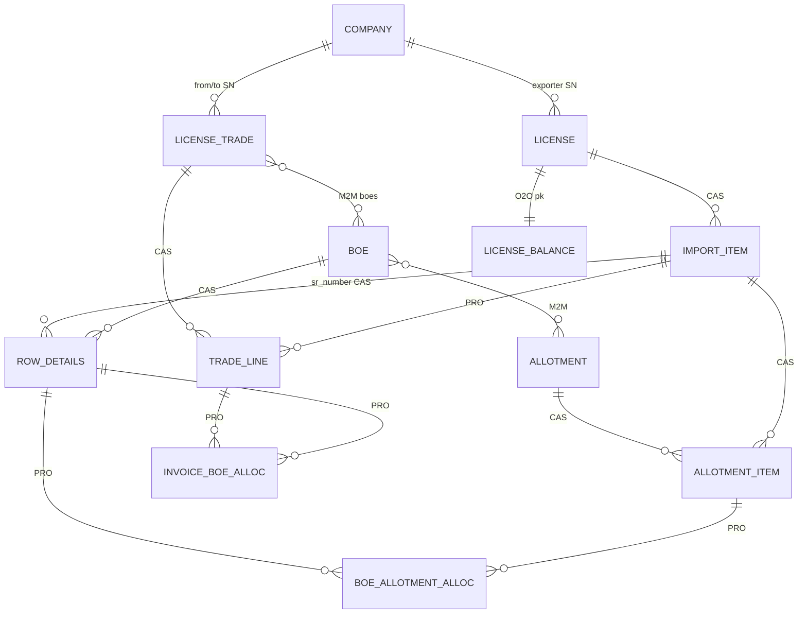
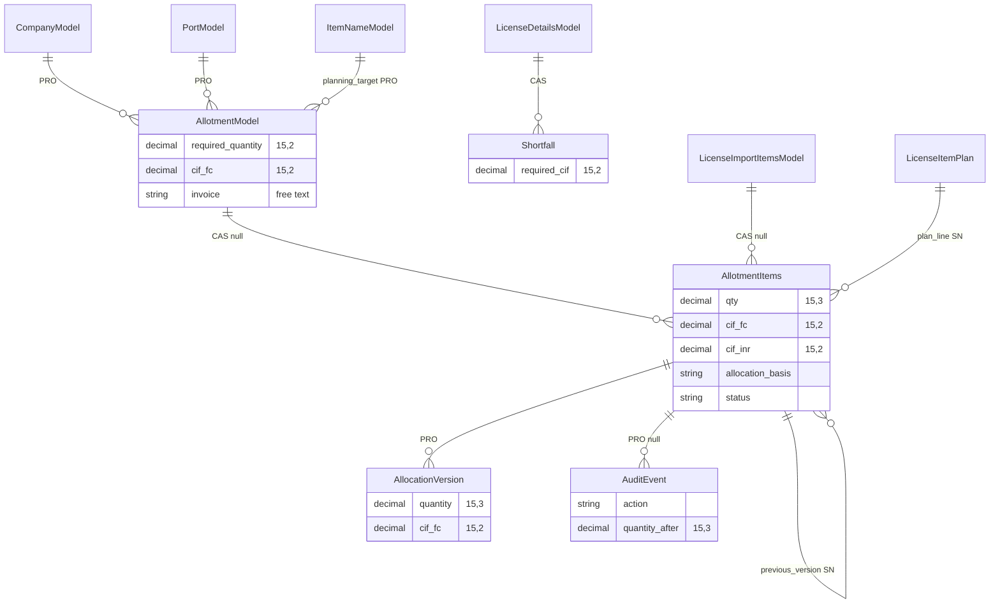
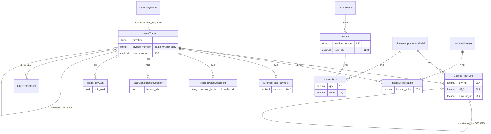
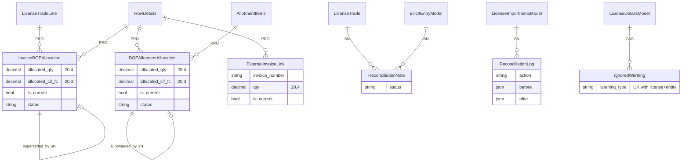
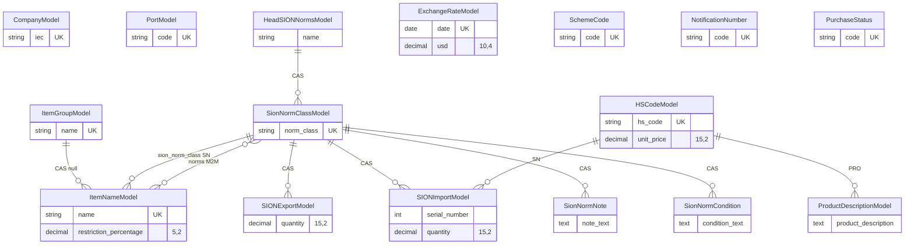
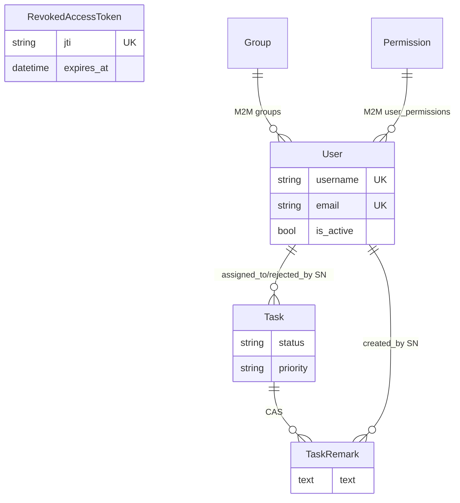

# Database ER Diagrams (Phase 1 discovery)

Derived statically from models (see `DATABASE_ARCHITECTURE.md` for file:line). Only keys and money/qty columns shown. `||--o{` = one-to-many, `}o--o{` = M2M. FK on_delete is noted in the relationship label (CAS = CASCADE, PRO = PROTECT, SN = SET_NULL).

## 1. Cross-domain overview


## 2. Licence cluster
```mermaid
erDiagram
    LicenseDetailsModel {
        string license_number UK
        date license_expiry_date
    }
    LicenseExportItemModel { decimal net_quantity "15,2" decimal cif_fc "15,2" }
    LicenseImportItemsModel {
        int serial_number "UK with license"
        decimal quantity "15,3"
        decimal cif_fc "15,2"
        decimal available_quantity "15,3 denorm"
        decimal debited_value "15,2 denorm"
        decimal allotted_value "15,2 denorm"
    }
    LicenseItemPlan { decimal planned_quantity "15,3" decimal remaining_quantity "cache" bool is_deleted }
    LicenseBalance { decimal balance_cif "15,2" }
    LicenseFlags { bool is_active }
    LicenseOwnership { fk current_owner }
    LicenseNotes { text notes }
    LicenseDocumentModel { file file }
    LicenseTransferModel { fk from_company fk to_company }
    LicensePurchase { decimal cif_inr "15,2" }
    IncentiveLicense { decimal license_value "15,2" decimal balance_value "15,2" }
    LicenseReplanRequest { string status }
    SionPlanningRule { fk sion_PRO int version }
    SionPlanningProfile { uuid uid UK }
    LicenseDetailsModel ||--o{ LicenseExportItemModel : "CAS"
    LicenseDetailsModel ||--o{ LicenseImportItemsModel : "CAS"
    LicenseDetailsModel ||--o{ LicenseItemPlan : "CAS"
    LicenseImportItemsModel ||--o{ LicenseItemPlan : "CAS"
    LicenseDetailsModel ||--|| LicenseBalance : "O2O"
    LicenseDetailsModel ||--|| LicenseFlags : "O2O"
    LicenseDetailsModel ||--|| LicenseOwnership : "O2O"
    LicenseDetailsModel ||--|| LicenseNotes : "O2O"
    LicenseDetailsModel ||--o{ LicenseDocumentModel : "CAS"
    LicenseDetailsModel ||--o{ LicenseTransferModel : "CAS"
    LicenseDetailsModel ||--o{ LicensePurchase : "CAS"
    LicenseDetailsModel ||--o{ LicenseReplanRequest : "CAS"
    SionPlanningRule ||--o{ LicenseItemPlan : "PRO"
    SionPlanningProfile ||--o{ SionPlanningRule : "via sion"
    SionPlanningProfile ||--o{ SionPlanningRun : "PRO"
    SionPlanningProfile ||--o{ SionPlanningAction : "PRO"
    SionPlanningProfile ||--o{ SionPlanningOutputMapping : "PRO"
    CompanyModel ||--o{ LicenseDetailsModel : "exporter SN"
    CompanyModel ||--o{ IncentiveLicense : "CAS"
    LicenseDetailsModel ||--o{ LicenseLedgerPackageItem : "PRO"
    LicenseLedgerPackageJob ||--o{ LicenseLedgerPackageItem : "CAS"
```
`license_balance_mv`, `item_balance_mv`, `dashboard_stats_mv` are materialized views (not models) over these tables.

## 3. Allotment cluster


## 4. Bill of Entry cluster
```mermaid
erDiagram
    BillOfEntryModel {
        string bill_of_entry_number "UK with date"
        date bill_of_entry_date "nullable"
        decimal exchange_rate "12,4"
    }
    RowDetails {
        fk sr_number "UK with boe+txn"
        string transaction_type
        decimal qty "15,3"
        decimal cif_fc "15,3"
        decimal cif_inr "15,3"
        bool is_frozen
        bool is_dispute
    }
    BillOfEntryModel ||--o{ RowDetails : "CAS null"
    LicenseImportItemsModel ||--o{ RowDetails : "sr_number CAS"
    BillOfEntryModel }o--o{ AllotmentModel : "allotment M2M"
    CompanyModel ||--o{ BillOfEntryModel : "PRO null"
    PortModel ||--o{ BillOfEntryModel : "PRO null"
    BillOfEntryModel ||--o{ Invoice : "license.Invoice CAS null"
```

## 5. Trade / invoice cluster


## 6. Reconciliation cluster

No DB unique constraint on the three allocation tables (see Finding 1).

## 7. Core masters cluster

All masters except ExchangeRate/Company/Port... carry `MasterSyncMixin` fields (`master_uid`, `sync_version`, `is_tombstone`). Infra tables (`MasterChange`, `CeleryTaskTracker`, `ActivityLog`, 7 `Sync*` tables) omitted.

## 8. Accounts cluster

Every `AuditModel` table has `created_by`/`modified_by` FK -> `User` SET_NULL (not drawn). `RevokedAccessToken` has no FK (keyed by `jti`).
