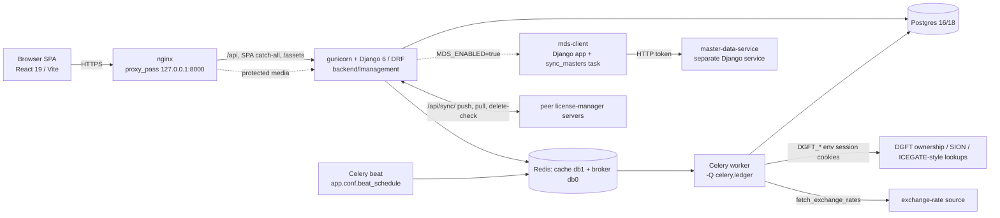
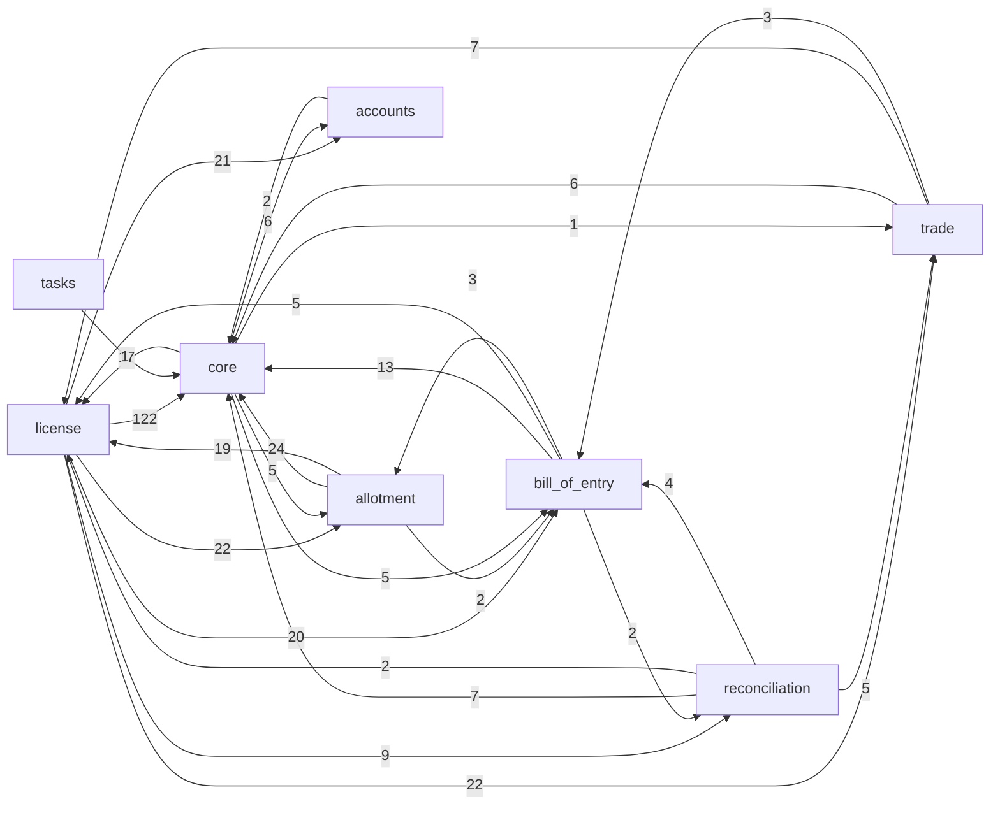

# Project Architecture — Current State (Phase 1 discovery)

Generated 2026-11-16 from `.claude/index/` + targeted reads. Descriptive only; no source changed.
Counts that include tests are marked (incl. tests).

## 1. System diagram

Notes: DGFT config is settings.py:49-60 (`DGFT_OWNERSHIP_URL`, `DGFT_SESSION_ID`, `DGFT_CSRF_TOKEN`, `DGFT_AWSALB`, ...), short-lived session values. Code: `apps/license/services/dgft_ownership.py`, `lmanagement/tasks.py` (legacy `fetch_file`, `dgft_shipping_details`, `fetch_data_to_model`, `delete_license_details_by_numbers`; Celery `add` demo task). No ICEGATE client was found by name; not verified beyond that.
Peer sync: `apps/core/sync/` (models, push, service, registry, tasks, views; URLs `/api/sync/{push,pull,delete-check,status}/`).

## 2. Backend structure

`backend/lmanagement/`: single `settings.py` (620 lines, **no settings split**), `urls.py` (80), `celery.py` (173), `tasks.py` (127), `wsgi.py`. No asgi.
INSTALLED_APPS (settings.py:122): django core + `django_extensions, rest_framework, rest_framework_simplejwt.token_blacklist, django_filters, corsheaders, whitenoise.runserver_nostatic, drf_spectacular` + local `apps.accounts, core, license, bill_of_entry, allotment, trade, reconciliation, tasks`; `mds_client` appended when `MDS_ENABLED` and importable (settings.py:610-617).
Middleware (settings.py:155): Security, WhiteNoise, CORS, Session, Common, `core.middleware.DisableCSRFForAPIMiddleware`, CSRF, Auth, Messages, XFrame, `core.middleware.ActivityLogMiddleware`.
Shared code: `backend/shared/pdf/builders.py` (only file), `backend/api_utils/form_schema.py` (only file); everything else shared lives in `apps/core` (the de-facto kernel).

Non-migration, non-venv Python LOC per app (incl. tests): license 100.8k, core 31.5k, allotment 8.5k, trade 6.5k, reconciliation 4.5k, bill_of_entry 4.3k, accounts 2.2k, tasks 0.45k. Total non-test non-migration ≈ 104k lines (apps+shared+api_utils+lmanagement).

Per-app layout:

| App | models | views | serializers | services | tasks | tests dir |
|---|---|---|---|---|---|---|
| accounts | models.py | views/ | serializers.py | services.py | tasks.py | tests/ + tests.py (both) |
| core | models.py (891) | views/ , cached_views.py | serializers/ | sync/, reports/, exporters/, utils/ (no services/) | tasks.py, tasks_materialized_views.py, sync/tasks.py | tests/ |
| license | models/ (core.py 2625) | views/, views_actions.py, views_incentive.py | serializers/ | services/ (~60 modules, exporters/), domain/, dtos/, parsers/, utils/ | tasks.py | tests/ |
| allotment | models/ | views.py, views_actions.py (1680), views_export.py | serializers.py | services/ | none | tests/ |
| bill_of_entry | models.py | views/, views_export.py (901) | serializers.py | services/, parsers/ | none | tests/ |
| trade | models.py (817) | views.py, views_invoice_documents.py | serializers.py | services/, 2 PDF builders at app root | none | tests/ + tests.py (both) |
| reconciliation | models.py | views.py | none (inline) | services/ | none | tests/ |
| tasks | models.py | views.py | serializers.py | services/ | (task-record model; not Celery tasks) | tests.py |

No `selectors` layer exists anywhere (grep of symbols/dirs); querying is in views/services/models.

Largest source files (non-test, `wc -l`):
2625 `apps/license/models/core.py` · 2400 `license/views/item_pivot_report.py` · 2149 `license/services/balance_calculator.py` · 2006 `license/services/exporters/license_balance_excel.py` · 1741 `license/services/sion_planning_execution.py` · 1682 `license/services/license_balance_ledger_builder.py` · 1680 `allotment/views_actions.py` · 1449 `license/services/canonical_planning_service.py` · 1367 `license/services/canonical_ledger_service.py` · 1311 `exporters/license_balance_pdf.py` · 1235 `license/views/license.py` · 1174 `license/utils/item_matcher.py` · 1134 `license/serializers/license.py` · 1012 `license/parsers/dfia_pdf.py` · 914 mgmt cmd `update_license_ownership.py` · 907 `core/views/master_view.py` · 901 `bill_of_entry/views_export.py`. ~24 files exceed the 800-line ceiling.

Most-depended-on backend files (dependents): `license/models/__init__` 294 · `core/models.py` 234 · `core/constants.py` 91 · `trade/models.py` 81 · `bill_of_entry/models.py` 70 · `allotment/models/__init__` 68 · `license/services/balance_calculator.py` 57 · `accounts/permissions.py` 36 · `canonical_ledger_service.py` 34 · `reconciliation/models.py` 26.

### App → app import map (imports.tsv, production code only, tests/migrations excluded; edge = #files importing)

Cycles (all bidirectional, i.e. no layering): license<->core (122 / 17), license<->allotment (22 / 19), license<->bill_of_entry (20 / 5), license<->trade (22 / 7), license<->reconciliation (9 / 2), allotment<->bill_of_entry (2 / 3), bill_of_entry<->reconciliation (2 / 4 via bill_of_entry→reconciliation and reconciliation→bill_of_entry), trade<->reconciliation (5 / 0 reverse via trade→reconciliation is 1 incl. tests), core<->accounts (6 / 2). `core` (the supposed kernel) imports license/allotment/bill_of_entry/trade in `core/openapi.py`, `core/cache_signals.py`, `core/utils/transfer_letter.py` and several management commands (`_item_linking.py`, `seed_e132_plan_items.py`, ...). Only `tasks` and `accounts` are near-leaf.
Test-inclusive counts are much higher (license→core 249, license→trade 49).

## 3. API surface

URL roots (`lmanagement/urls.py`): `admin/`, `api/health/`, `api/mds/status/`, `api/schema|docs|redoc/` (drf-spectacular, IsAuthenticated unless DEBUG), `api/media/<path>` (ProtectedMediaView), `api/auth/` (accounts), `api/` (license, allotment, bill_of_entry, trade, reconciliation, tasks — shared prefix), `api/masters/` (core), `api/sync/` (core.sync), JSON 404 for other `api/*`, then SPA catch-all `^.*$` -> `index.html`. DEBUG-only `/media/` and `/assets/` serving.

| App | Mount | Routers / notable routes |
|---|---|---|
| accounts | `api/auth/` | `users` ViewSet; `login/ logout/ me/` (+ refresh, password reset) |
| license | `api/` | 13 router registrations: `licenses, license-actions, license-items, license-item-plans, ...` |
| allotment | `api/` | `allotments`, `allotment-actions` |
| bill_of_entry | `api/` | `bill-of-entries`, `bill-of-entries/parse-pdf/` |
| trade | `api/` | `trades, lines, payments`, `invoice-documents/view/<token>/` |
| reconciliation | `api/` | `reconciliation` |
| tasks | `api/` | `tasks` |
| core | `api/masters/` | 15 router registrations (`companies, ports, hs-codes, head-norms, ...`) |

DRF defaults (settings.py:270-325): auth = `core.authentication.JWTAuthenticationFromQueryParam` then SessionAuthentication; permission = `IsAuthenticated` (finer classes in `accounts/permissions.py`, 36 dependents); pagination = `core.pagination.StandardPagination`, PAGE_SIZE 25; filter backend = `DjangoFilterBackend`; renderer = JSON only; throttles `core.throttling.BurstRateThrottle` + `UserRateThrottle` (rates: user 3000/h, burst 180/min, export 100/h, login 10/min, etc.; NUM_PROXIES=1); date formats `%d-%m-%Y`. JWT (simplejwt): access 30 min (env `ACCESS_TOKEN_MINUTES`), refresh 7 d, rotation + blacklist. **No API versioning** (`/api/` unversioned; OpenAPI VERSION "1.0.0" is doc metadata only). Query-param JWT auth (token in URL) is a security-surface note.

## 4. Celery

Config: `lmanagement/celery.py` (app + `beat_schedule` dict, 173 lines) + settings.py:346-384 (Redis broker = result backend via `REDIS_URL`, JSON serializer, prefetch 1). **django_celery_beat is not installed**; schedule is code-defined. Queues: only default `celery` is routed in `CELERY_TASK_ROUTES` (8 license/planning tasks), but `backend/deploy/celery.service` starts worker with `-Q celery,ledger` (a `ledger` queue is consumed but no task is routed to it — verify).
Tasks:
- `apps/license/tasks.py` (all `acks_late`): `planning.dispatch_replan_requests`, `planning.replan_sion_batch`, `planning.replan_license` (soft 240s/hard 300s), `planning.recover_pending_replan_requests`, `license.enqueue_license_ledger_package`, `license.build_license_ledger_package_item`, `license.finalize_license_ledger_package`, `license.cleanup_expired_ledger_packages`, `license.recover_license_ledger_package_jobs`, plus one more at line 109.
- `apps/core/tasks.py`: `core.tasks.fetch_exchange_rates` (deliberately NOT in beat, celery.py:76 comment; run via scripts). `apps/core/sync/tasks.py`: `sync.pull_from_peers`, `sync.push_changes`, `sync.process_media_tasks` (beat every 5 min when sync enabled). `mds_client.sync_masters` (every 5 min when MDS on).
- `lmanagement/tasks.py`: demo `add`, DGFT fetch tasks (legacy).
- `apps/core/tasks_materialized_views.py`, `apps/accounts/tasks.py`: present, not individually enumerated.
Beat entries (celery.py:43-154): `license.tasks.sync_all_licenses` daily 18:30 UTC; `identify_licenses_needing_update` 05:30 and 14:30 UTC; `cleanup_old_task_records` hourly; `planning.recover_pending_replan_requests` */5; `license.cleanup_expired_ledger_packages` daily 02:20; `license.recover_license_ledger_package_jobs` */5; conditional MDS and sync entries. Task-name quirk: `license.tasks.sync_all_licenses`, `identify_licenses_needing_update`, `cleanup_old_task_records` use non-namespaced / module-path names; I did not locate their definitions (grep for `@shared_task` / `.task(` did not list them) — **verify these beat entries resolve**.

## 5. Tests

- Canonical suite `backend/tests/` : 235 `def test_` in ~? files (test_api_*, test_all_conditions, test_authentication_query_param, ...).
- App suites `backend/apps/*/tests/` + `tests.py` in accounts/trade/tasks. Total `def test_` across apps tree (incl. canonical) is large; per-app counts were not tallied separately (shell glob failure) — rerun `grep -rc "def test_" backend/apps/<app>` for exact numbers. pytest.ini comment cites ~1855 tests total.
- `backend/pytest.ini`: `DJANGO_SETTINGS_MODULE=lmanagement.settings`, `testpaths = tests apps`, `--cov=. --cov-report=html` always on (this generates `backend/htmlcov`, 65M, untracked), markers slow/integration/unit/api/database. Backend rules require `--import-mode=importlib` for app tests. `backend/conftest.py` root.
- Root `tests/`: `tests/e2e/qa_phase*.py` (+conftest), `tests/deployment/test_auto_deploy.sh`; 189 `def test_` at root `tests/` (not in pytest testpaths, so not CI-collected).
- `mds` and `mds-client` have their own pytest.ini/runtests.py and CI jobs.

Stray scripts (tracked, clutter candidates):
- `backend/` (22): `deep_trace.py final_debug.py reconciliation_detailed.py test_all_queries.py test_pdf_e2e_simple.py test_pdf_parsing_e2e.py test_persistence_debug.py test_query_sequence.py test_split_fix.py test_transaction_commit.py trace_canonical_lines.py trace_persistence.py trace_sql.py verify_accounting.py verify_balance_detail.py verify_comprehensive.py verify_database_integrity.py verify_db.py verify_freeze_gates.py verify_ledger_0310833996.py verify_license2616.py verify_query_analysis.py`. `test_*.py` there match `python_files=test_*.py` but `testpaths` excludes the backend root, so not collected by default (collected if pytest is pointed at `.`).
- repo root (13): `parity_extract_pdf_excel.py parity_test_simple.py parity_verification.py reconciliation_comprehensive.py reconciliation_matrix_test.py reconciliation_test.py route-browser-test.js test_api_reconciliation.py validate_accounting.py verify_ledger.py verify_plans.py run_django.py run_django.sh` plus `accounting_validation.ipynb`, `verify_ledger_0310833996.ipynb`. (`run_django.*` is a dev launcher, not clutter.)

## 6. Infra

- `docker-compose.yml` (53 lines): only `postgres:16` + `redis:7` with volumes `lm_pgdata`, `lm_redisdata`; `docker/postgres/initdb`. No app/worker/nginx containers; no Dockerfile for the backend found. CLAUDE.md says local dev Postgres 18 vs compose 16 (version skew).
- nginx at repo root (6): `nginx-license-manager.conf` (118; license-manager.duckdns.org), `nginx-labdhi.conf` (93; labdhi.duckdns.org), `nginx-license-tractor.conf` (93; license-tractor.duckdns.org), `nginx-http-only.conf` (73; labdhi, HTTP bootstrap), `nginx-http-only-tractor.conf` (30; tractor bootstrap), `nginx-protected-media.conf` (23; snippet). All proxy to `127.0.0.1:8000`. Per-tenant/server copies with hardcoded server IPs and hostnames committed; near-duplicates (labdhi vs tractor differ by name/IP).
- `backend/deploy/`: tracked `celery.service` (example systemd, `/srv/lmanagement`, `-Q celery,ledger`, concurrency 4). Also `backend/setup/supervisord.conf`, `backend/setup/` (DB scripts, `reset_lmanagement.sql`). `scripts/deployment/license-manager-celery.conf` is a second Celery process definition (conflicts/duplicates `celery.service`; paths and queue args not compared). Note: dev guard blocks shell commands containing "deploy" paths, so these were not exhaustively read.
- `scripts/`: `dev-*.sh` at top level duplicate `scripts/dev/` (`services.sh`, `quality-gate.sh`, ...); `deployment/` (auto-deploy, deploy-license-manager, deploy-indexes, run-deploy, setup-ssl-tractor, verify-deployment, watchdog), `database/`, `imports/` (DGFT SION fetch), `maintenance/` (master sync/merge), `mds/` (onboard/migrate servers), `migration/`, `development/ci.yml` (stray copy of a CI file), `diagnostics/`, `test/`, `testing/` (two similarly named dirs), `orchestrator.py`.
- `master-data-service/` (37 tracked files; `deploy/{deploy-mds.sh,gunicorn.conf.py,mds.service,nginx-mds.conf}`), `mds-client/` (31 files, pyproject). **Conflict:** root `MDS_REMOVAL_REPORT.md` claims master-data-service was removed ("68 files deleted"), yet the directory is tracked, in CI, and `docs/architecture/ADR-001-master-data-service.md` describes it. Treat the report as stale/contradictory.
- CI `.github/workflows/ci.yml` (154 lines), jobs: `frontend` (lint, typecheck, unit tests, build), `backend` (py3.14, libpq, migrations check, canonical suite, app-level tests), `mds` (pytest + migrations check), `mds-client` (Django runner, sqlite). Only one workflow file. Local gate mirror: `scripts/dev/quality-gate.sh`.
- Env var names seen (no values read): `SECRET_KEY`, `REDIS_URL`, `DGFT_{OWNERSHIP_URL,SCRIPT_NUMBER...,SESSION_ID,CSRF_TOKEN,AWSALB,IEC_NUMBER,APP_ID,SCRIP_NUMBER,SCRIP_ISSUE_DATE}`, `MDS_ENABLED/MDS_BASE_URL/MDS_TOKEN`, `ACCESS_TOKEN_MINUTES`, `DEFAULT_FROM_EMAIL`, `CELERY_WORKER_PREFETCH_MULTIPLIER`, `LICENSE_REPLAN_*`, `LICENSE_PACKAGE_*_TIME_LIMIT`, `DEPLOY_PASSWORD` (see `deploy-secrets.env.example`; `deploy-secrets.env` is gitignored). settings.py:40 embeds a dev-only default SECRET_KEY guarded by a check at line 92.

## 7. Repo hygiene

- Root-level `*.md`: **258** files at repo root, all tracked (status/freeze/QA/audit/phase reports; plus `AGENTS.md`, `CLAUDE.md`, `KNOWN_ISSUES.md` that are legitimate). Also root `.txt` reports (`AUDIT_STATUS.txt`, `BUTTON_SYSTEM_AUDIT_SUMMARY.txt`, `PHASE_1_SETUP_STATUS.txt`, `QUALITY_GATES_SUMMARY.txt`, `VERIFICATION_COMPLETION_SUMMARY.txt`, `ledger_verification_report.txt`). 8 more `*.md` tracked in `backend/` root. `docs/` also has many status files (AGENT_STATE, PHASE_*, MODULE_* ...), and `docs/architecture/` mixes ADRs with GATE3_* reports.
- Tracked binaries/data (via `git ls-files`): `backend/DFIA_COPY/` 210 files / 217 MB (licence PDFs, real business data); `exc_pdf/` exchange-rate PDFs (1.6 MB); `3011009264 SONALIKA TRACTOR.pdf` at root; `artifacts/` (~19 MB, screenshots) + `backend/artifacts`, `adf/`, `audit_evidence/` (170 files in these combined); `backend/models.png`; `backend/theme/` (7 template html); `backend/staticfiles` (1 tracked file; dir otherwise gitignored); `.DS_Store` tracked (currently modified); `backups/` 39 MB on disk, 0 tracked (untracked locally).
- Not tracked (good, on disk only): `backend/htmlcov` (65 MB), `backend/media` (1.1 GB), `celerybeat-schedule*`, `__pycache__`. No tracked `.pyc` in apps/shared. `.gitignore` covers media/, staticfiles/, *.sql, *.csv, *.log. `backend/celerybeat-schedule*` is local file-based beat state (not django_celery_beat).
- Root also has `Brewfile`, `deploy-secrets.env.example`.

## Frontend

See FRONTEND_STRUCTURE.md

## 9. Findings and modernization candidates (ranked)

| # | Finding | Evidence | Blast radius | Class |
|---|---|---|---|---|
| 1 | 258 root `*.md` + 6 `.txt` reports obscure the real docs | `git ls-files` root md count | 0 code deps | SAFE/reversible: move to `docs/archive/` (git mv). Check CLAUDE.md/README links first |
| 2 | Ad-hoc scripts at `backend/` (22) and root (13) + 2 notebooks; `test_*.py` in backend root can be collected by pytest | section 5 list | none import them (not in production import graph; verify with `grep dependents.tsv`) | SAFE: move to `scripts/adhoc/` or delete after owner OK |
| 3 | Tracked business data/binaries: `backend/DFIA_COPY` 217 MB, `exc_pdf/`, root PDF, `artifacts/`, `audit_evidence/`, `models.png`, `.DS_Store` | section 7 | none in code; history stays heavy | SAFE going forward (`git rm --cached` + .gitignore); history rewrite NOT safe (requires approval). Data-sensitivity review of DFIA PDFs advised |
| 4 | App import cycles; `core` imports license/allotment/bill_of_entry/trade (core 234 dependents) | section 2 graph; `core/cache_signals.py`, `core/openapi.py` | license/models 294, core/models 234 | Changes imports; needs staged work: lazy imports/string refs, move cross-app signal wiring out of core, introduce interface modules. Not API-contract changing |
| 5 | God files > 800 lines (24); `license/models/core.py` 2625, `item_pivot_report.py` 2400, `balance_calculator.py` 2149 (57 dependents), `allotment/views_actions.py` 1680 | section 2 | balance_calculator 57, canonical_ledger_service 34 | Split behind re-export `__init__` keeps import paths (reversible); balance math = BUSINESS-RULE guarded, needs cif-balance-auditor |
| 6 | No selectors layer; views hold query logic (views_actions, item_pivot_report views) | layout table | per-view | Incremental, reversible; no contract change |
| 7 | Beat/queue inconsistencies: `ledger` queue consumed but nothing routed there; beat names `license.tasks.sync_all_licenses`, `identify_licenses_needing_update`, `cleanup_old_task_records` not found by task-decorator grep; Celery config duplicated (`backend/deploy/celery.service`, `scripts/deployment/license-manager-celery.conf`, `backend/setup/supervisord.conf`) | section 4, 6 | runtime scheduling | Verify first (could be silent no-ops); fixes are config-only but behavior-visible |
| 8 | Infra config duplication: 5 nginx conf copies with hard-coded IPs/hosts; `scripts/dev-*.sh` vs `scripts/dev/`; `scripts/test` vs `testing`; stray `scripts/development/ci.yml`; compose has only DB+Redis, PG 16 vs dev 18 | section 6 | deployment only | Templating nginx (envsubst) is safe for repo, but touches servers: requires human approval to roll out |
| 9 | Contradictory MDS status: `MDS_REMOVAL_REPORT.md` vs tracked `master-data-service/` + CI job + ADR-001 | section 6 | mds 37 files, mds-client 31 | Documentation correction only (safe); any actual removal changes settings/INSTALLED_APPS/beat |
| 10 | Test layout: `tests/` (canonical) vs `apps/*/tests` vs `tests.py` coexisting (accounts, trade, tasks); root `tests/e2e` not collected; coverage HTML forced on every run | pytest.ini | CI gate | Low-risk consolidation; changing `testpaths`/`addopts` alters CI |
| 11 | No API versioning, single shared `/api/` prefix across 6 apps (route collision risk), query-param JWT auth | urls.py, settings.py:272 | all 110 frontend `api/axios.js` dependents | API CONTRACT: do not change without explicit approval; add `/api/v1` alias only additively |
| 12 | Single 620-line `settings.py` (env checks inline, DGFT session secrets as settings) | settings.py | all | Split into base/dev/prod package is reversible but touches `DJANGO_SETTINGS_MODULE` in CI, systemd, pytest.ini, scripts |
| 13 | Legacy `lmanagement/tasks.py` (demo `add`, DGFT captcha fetch) | tasks.py:16-120 | check dependents | Likely dead; verify then remove (safe if unused) |

Safe/reversible (no import or API change): 1, 2, 3 (forward only), 9, 13 (after verification), 8 (repo side). Changes imports: 4, 5, 6, 10, 12. Changes API contract/runtime: 11, 7 (behavioral), 12 (deploy).

Verification gaps in this report: per-app test counts, beat task definitions (item 7), contents of `scripts/deployment/*` and `backend/setup/supervisord.conf` (guard hook blocked shell reads of "deploy" paths), frontend (separate doc).
