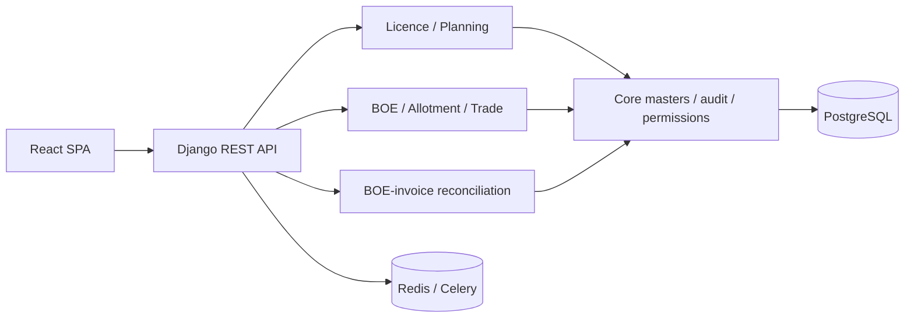

# Repository and architecture assessment

## Evidence and architecture map

Direct evidence: `backend/lmanagement/urls.py:31-79`, `frontend/package.json`, `backend/requirements.txt`, app URL modules and model/migration inventory. Django 6/DRF, PostgreSQL/psycopg, Redis/Celery and a React 19/Vite SPA are declared. The URL-level modules are accounts, core/masters/sync, license, allotment, BOE, trade, reconciliation and tasks. There are 57 licence migrations and 128+ application migrations visible by file count.

## Strengths

- OpenAPI, protected media, health/MDS routes and SPA fallback are centrally composed (`lmanagement/urls.py:31-79`).
- Default authentication, role classes, JWT rotation/blacklist and production fail-closed configuration are present (`settings.py:270,328,503,562`; `accounts/permissions.py:5`).
- Planning/allotment/reconciliation use atomic sections and row locks in material mutation paths.

## Findings

| ID | Priority | Evidence | Scope implication |
|---|---|---|---|
| ARC-01 | P2 | Planning logic spans canonical, enforcement, rule-engine, lifecycle and view modules. | Publish bounded service contracts; reports/UI consume service DTOs. |
| SEC-01 | P0 external SaaS/P1 internal | Global roles, unscoped plan/BOE/SION reads (`accounts/models.py:42`, `item_plan.py:118`, `sion_planning_rule.py:224`, `boe.py:135`). | Tenant/membership and mandatory scoped query boundary precede external SaaS. |
| SEC-04 | P1 | `CompanyModel` combines counterparty, GST/PAN, branding and bank fields (`core/models.py:226`). | Separate tenant, legal entity/counterparty and bank account concepts. |
| OPS-01 | P2 | Celery supports planning/ledger-package work (`settings.py:346`). | Demonstrate idempotency, retries, alarms and recovery before scale-up. |

## Target and migration

Retain a tenant-aware modular monolith: tenant/membership context; explicit licence/restriction, allocation, accounting and reconciliation application services; immutable event/audit records; reporting read models sourced only from authoritative services. Migrate query scoping first, then restriction SSOT, then accounting. Do not combine tenant backfill, restriction redesign and journal rollout in one release.

**Limitation:** the mandated `.Codex/index/` dependency graph was absent, so exact dependency/blast-radius counts were unavailable.
