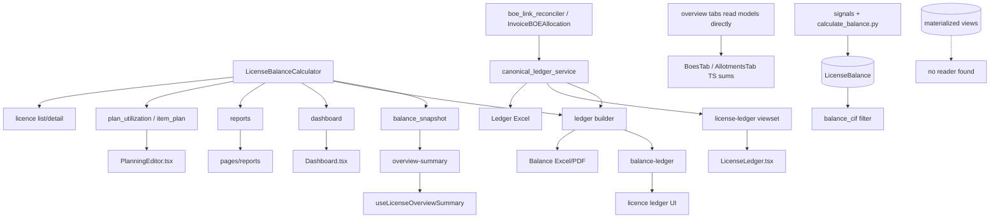
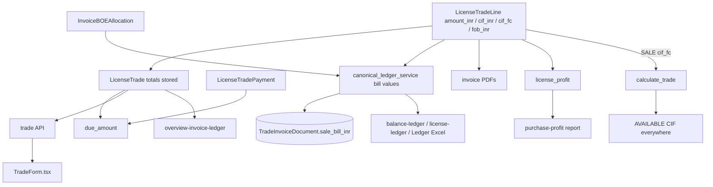

# ERP financial dependency map (Phase 3, 2026-11-17)

Read-only. "Verified" edges were read in code; dotted edges are unverified/inferred. Baseline: `feature/v5` @ `9fec5b48`.
There is **no finance/accounting module** (no journal, voucher, GL, client or payment ledger) — "Finance posting",
"Client ledger" and "P&L" in the master prompt's example chain do not exist as code; the nearest equivalents are the
licence financial ledger (`canonical_ledger_service`) and the purchase-profit report.

## Family 1 — licence balance and allotment totals

Source: `backend/apps/license/services/balance_calculator.py` — `calculate_credit` :92, `calculate_debit` :459,
`calculate_boe_debit_total` :512, `calculate_allotment` :970, `calculate_trade` :1063, `calculate_balance` :1360,
`calculate_financial_balance` :1583 (bulk :1665), `ItemBalanceCalculator` :1714.

| Consumer | Source calc | Endpoint | Frontend | Cached? | Notes |
|---|---|---|---|---|---|
| Overview summary | `license_overview_summary.py` → `balance_snapshot.get_snapshot_bulk` (:63, bulk calls :157-158) | `licenses/<id>/overview-summary/` | `useLicenseOverviewSummary.ts` | live | see double-count audit |
| Overview tabs (BOEs, allotments, items, invoices) | `license_overview_{boes,allotments,items,invoices}.py` read models directly | `overview-boes/-allotments/-items/-invoice-ledger` | `BoesTab.tsx:87`, `AllotmentsTab.tsx:71-72` | live | **client-side TS sums** of `cif_fc`/qty |
| Licence ledger | `license_balance_ledger_builder.py` → `canonical_ledger_service.py`, `calculate_balance` | `licenses/<id>/balance-ledger/` (+recalculate, hide/restore BOE) | `useLicenseBalanceLedger.ts`, `useLicenceLedger.ts`, `LicenceFinancialSummary.tsx` | FE query cache | |
| Financial ledger | `canonical_ledger_service.py:750-830` (purchase/sale bill INR, profit_loss) | `license-ledger` viewset | `LicenseLedger.tsx`, `licenseLedgerData.ts:183-184` | live | TS fallback sum of purchase/sale totals |
| Licence list/detail | `license/api/views/license.py:314,331` bulk financial balance; serializers :317, :898 | licence viewset | `LicenceCard.tsx` (inf) | live | |
| Dashboard | `dashboard.py:135,250` bulk financial balance | `dashboard/` | `Dashboard.tsx`, `dashboardContract.ts` | live (`dashboard_stats_mv` unread) | |
| Reports | license report :119, active DFIA :114, item pivot generate :122/:460 (+`calculate_allotment` :436), pivot row :163, item report :307/:376, planned report :222 | `reports/*` | `pages/reports/*` | live | TS sums: `itemPivotReportUtils.ts:86-93`, `ItemReportTable.tsx:382-403`, `C969EntitlementTable.tsx:178` |
| Balance Excel/PDF | `exporters/license_balance_excel.py:37` financial balance; ledger builder | not traced | — | live | comment :284 references stored allotted value |
| Ledger Excel | `canonical_ledger_service` | not traced | — | live | embeds cif_inr, bills, profit |
| Planning workbench | `plan_utilization.py:123` (Item calc), `item_plan.py:144` (bulk), `CanonicalPlanningService` :191-267, `allotment/api/views_actions.py:928` | `plan-utilization`, item-plan actions | `PlanningEditor.tsx` (TS sums :437, :696-704, :733, :911, :1054) | `LicenseItemPlan.remaining_balance` stored (inf) | |
| Reconciliation | `boe_link_reconciler.py`, `InvoiceBOEAllocation.allocated_cif_inr` (read `canonical_ledger_service.py:1096`) | `ledger.py:138` reconcile | `ReconciliationIssues.tsx` | stored rows | |
| Stored balance | `LicenseBalance` refreshed by `license/signals.py:328`, `core/scripts/calculate_balance.py` | — | — | **stored** | read by `core/filtersets.py:135` (`balance_cif` filter) |
| Materialized views | `core/materialized_views.py` (`license_balance_mv`, `item_balance_mv`, `dashboard_stats_mv`) | none | none | stored | no reader found outside refresh/tests |

## Family 2 — trade line amounts

Source: `backend/apps/trade/models.py` — header totals :222-224, `due_amount` :357 (derived), line CIF/FOB/amount
fields :540-547, `compute_amount` :562, `save` :568-571, `recompute_totals` :372-389, `TradeInvoiceDocument.sale_bill_inr`
:708, `LicenseTradePayment` :650.

| Consumer | Source | Endpoint | Frontend | Cached? | Notes |
|---|---|---|---|---|---|
| Trade API | `trade/api/serializers.py:46,250` due amount; :428 item availability | `trades/`, `lines/`, `payments/` | `TradeForm.tsx:519-521`, `NestedFieldArray.tsx:809-830` | header totals stored | TS sums of amount/cif/payments |
| Trade service | `trade_service.py:105-117, 273-285` copies totals and line cif/fob/amount to counterpart | — | — | stored | stale-copy risk; `views.py:588` compares pair totals |
| Invoice documents | `invoice_document_service.py:78-151` stores `sale_bill_inr` from ledger side (`canonical_ledger_service.py:1258-1276`) | `invoice-documents/view/<token>/` | — | stored | |
| PDFs | `purchase_invoice_pdf.py:332,382,424`; `bill_of_supply_pdf.py:343,393,437` | — | — | live | sum `total_cif_inr` locally |
| Licence financial ledger / profit | `canonical_ledger_service.py:1258` sums line `amount_inr`; :1082-1177 BOE `allocated_cif_inr` else line `cif_inr`; `license_profit.py:348,396` | `balance-ledger`, `license-ledger`, `reports/license-purchase-profit/` | `LicenseLedger.tsx` | live | profit = sale bill − purchase bill (INR) |
| Overview invoices | `license_overview_invoices.py:32-52` | `overview-invoice-ledger` | `InvoicesTab.tsx` | live+stored | |
| Balance engine | `calculate_trade` (SALE `cif_fc`) | via all Family 1 consumers | — | — | **cross-family edge**: line `cif_fc` feeds AVAILABLE CIF |
| Finance / accounting | none | | | | |

## Regression tests required per consumer (for any fix)

- Overview summary fix: `test_license_overview_summary_view.py`, `test_ledger_summary_reconciliation.py`,
  `test_balance_cif_single_source.py`, `test_license_list_balance_consistency.py`, plus new scenario fixtures.
- Trade line fix: `test_trade_service.py`, `test_trades_contract_parity.py`, `test_paired_trade_serializer.py`,
  `test_invoice_document_service.py`, `test_financial_ledger_export_dto.py`, `test_license_purchase_profit_report.py`,
  frontend `tradeFormHelpers` tests, plus new line-computation tests.
