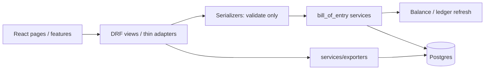

# Current state and target architecture

## Current state (after Phase A + Phase B)

| Area | Location | State |
|---|---|---|
| BOE register (list/cards) | `frontend/src/features/bill-of-entry/BoeCardList.tsx`, `BoeRecordWorkspace.tsx` | Licence-parity compact UI (iter 1). Card BOE number links to detail page (B1). |
| BOE detail page | `frontend/src/pages/bill-of-entry/BoeDetailPage.tsx` (+ `.test.tsx`) | New, route `/bill-of-entries/:id` (B1). Uses ModuleWorkspace. |
| Shared record tabs | `frontend/src/features/bill-of-entry/boeRecordTabs.tsx` | `buildBoeRecordTabs`, used by card and detail page (B1). |
| BOE form | `frontend/src/pages/masters/MasterForm.tsx` | BOE-only dirty guard, sticky bars, save wrapper, gated on `isBoeForm` (B2). |
| Guard hook / sticky bar | `frontend/src/hooks/useUnsavedChangesGuard.ts`, `frontend/src/components/form/StickyFormBar.tsx` | New (B2). |
| Save orchestration | `backend/apps/bill_of_entry/services/boe_service.py` `save_boe_with_rows` (l.1284) | Create/update moved out of serializer (B3). |
| Serializer | `backend/apps/bill_of_entry/api/serializers.py` | Thin: validate + delegate. Re-exports moved helpers. 878 to 418 lines (B3). |
| Export | `backend/apps/bill_of_entry/api/views_export.py` | Thin adapter (validate, queryset, dispatch) (B4). |
| Exporters | `backend/apps/bill_of_entry/services/exporters/` (`grouped_pdf`, `grouped_xlsx`, `port_xlsx`, `grouping`, `queryset`, `common`) | New package (B4). |
| Permissions | `backend/apps/accounts/permissions.py` (~l.156-169) | BOE_VIEWER limited to invoice-no POST (D2). |

## Target architecture (rules applied)

Principles applied: thin views and serializers; financial writes in services under `transaction.atomic`; no balance math changed (frozen by owner, see `owner-decisions.md`).

## Architecture ratchet

`backend/tests/architecture/test_architecture.py` FINANCIAL_WRITE_BASELINE: the `('bill_of_entry', 'serializers', 'RowDetails')` entry (was 4) is removed; the test only asserts growth, so this is a reduction, not a removal of the test. Verified by grep: no such key remains.

## Open architecture items

| Item | Ref |
|---|---|
| Cross-app import `services/boe_service.py` to `apps.license.services.effective_cif_mode` (same edge serializers had before) | B3 review |
| `allotment/api/views_export.py` duplicates BOE export helpers; shared exporters base later | B4 remaining |
| `exporters/common.py` duplicates OPENPYXL/REPORTLAB availability flags | B4 remaining |
