# Authoritative restructure blueprint

## Purpose

This is the entry-point blueprint for a database-first, parallel rebuild of License Manager. It consolidates the active conclusions of prior discovery, audit, assessment and rebuild planning into one implementation direction. It is not production evidence and does not authorise code, schema, data or deployment changes.

## Current evidence posture

| Statement | Status | Evidence reference |
|---|---|---|
| Repository baseline is `develop` / `d2cb2446ba01e0e23e6ef3570f6449bdd001cf65`. | CONFIRMED | `docs/assessment/ASSESSMENT_STATUS.md`; Git baseline 2026-10-31 |
| Architecture is Django/DRF plus React/TypeScript with licence, allotment, BOE, trade, reconciliation and task domains. | CONFIRMED static scope | `docs/assessment/EXECUTIVE_SUMMARY.md`; `docs/enterprise-rebuild/03-current-system/application-inventory.md` |
| Production deployment, schema, data, backups/restores and deployed commit are known. | NOT_ASSESSED | `docs/enterprise-rebuild/00-programme/audit-status.json` |
| Full double-entry accounting exists. | NOT FOUND in reviewed static evidence | `docs/assessment/ACCOUNTING_SCOPE_AND_GAP_ANALYSIS.md` |
| Server-enforced company isolation is proved. | NOT DEMONSTRATED | `docs/assessment/SECURITY_AND_SAAS_READINESS.md` |

## Rebuild sequence

```mermaid
flowchart LR
  A[Freeze evidence baseline] --> B[Database/migration and business-rule contracts]
  B --> C[Company scope and audit foundation]
  C --> D[Canonical licence/restriction/usage services]
  D --> E[BOE/trade/reconciliation and reports]
  E --> F[Frontend compatibility workflows]
  F --> G[Accounting after operational parity]
  G --> H[Dry migration and reconciliation]
  H --> I[Staging UAT, recovery and approved cutover]
```

## Non-negotiable architecture choices

1. Use a maintainable modular monolith unless new evidence makes a service split necessary.
2. Preserve historical facts and add corrections as traceable reversal/amendment events; do not overwrite data to force report parity.
3. Require server-side company membership/object scope for every query, write, export, file and background task.
4. Make the balance ledger and restriction resolver authoritative; UI, exports and reports consume their read models instead of reimplementing formulas.
5. Treat a percentage as a rule parameter, not a shared-pool identity. Named versioned pools are required for independent 2%, 3%, 5% and 10% groups.
6. Build accounting only after operational source events and company boundaries are trustworthy. Posted accounting entries must be immutable and balanced.

## Authoritative document map

| Subject | Authoritative document |
|---|---|
| Programme/status/decisions | `00-programme/` documents |
| Database and balance evidence | `01-database/database-audit.md`, `01-database/licence-balance-analysis.md` |
| Rules/exceptions | `02-business-rules/business-rules-catalogue.md` |
| Current implementation evidence | `03-current-system/` documents |
| Target architecture/accounting/security | `04-target-architecture/` documents |
| Data preservation/cutover | `05-data-migration/` documents |
| Quality/release gates | `06-quality-and-testing/` documents |
| Assignable delivery work | `07-implementation/` documents |

