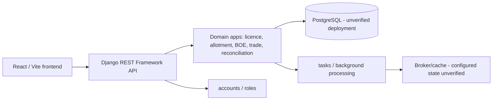

# Architecture as-is - preliminary

The current codebase is evidenced as a Django/DRF backend and a React/TypeScript frontend. The backend domain set includes accounts, core, licence, allotment, BOE, trade, reconciliation and tasks. Local HTTP endpoints for root, health and schema responded; sampled unauthenticated business endpoints required authentication.

## Confirmed limitations

- The diagram is a codebase-level working hypothesis, not a production topology.
- Production host configuration, deployed commit, database version, worker/scheduler setup, backup retention and monitoring are NOT_ASSESSED.
- Existing global-role and unscoped-query evidence means company isolation is not demonstrated. This is a P0 rebuild foundation requirement.

