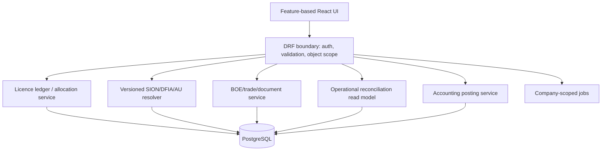

# Target architecture

The rebuild target is a modular monolith: React/TypeScript frontend, Django/DRF API, PostgreSQL, scoped background jobs and controlled file storage. This is a proposal for a small team, not a claim that all current components match it.

Shared principles: authoritative rule owners; explicit transactions and idempotency; no frontend formula ownership; read models for reports; append-only audit/correction history; contract tests; structured errors/logs; company scope in APIs, exports, files and jobs.

## Enforceable boundary direction

This target is incremental. It does not claim that current modules already
conform, and it does not introduce a new framework or dependency.

| Boundary | Current evidence | Intended owner and allowed dependency direction | Compatibility proof |
|---|---|---|---|
| Domain calculations | `balance_calculator.py` is used by 57 static dependents; planning and ledger services own additional calculations. | One approved domain/read-model service owns each calculation. Views, serializers, reports and exports consume its DTOs; they do not recreate formulas. | Golden balance/reversal cases plus API/report/export parity. |
| API/application | Some view actions contain direct model lookups and view-specific projections. | Views authenticate, validate and scope; application services execute use cases; serializers map stable DTOs. Application services do not depend on DRF views. | Object-scope, API-contract and transaction tests. |
| Persistence | Models are broadly imported by views, services, tasks and reports. | Models and repositories remain beneath domain/application services; destructive correction paths require approved state/reversal policy. | Migration, retention and correction-history tests. |
| Asynchronous work | Tasks and recovery/replan services have intentional lazy mutual imports. | Tasks are adapters that submit identifiers to application services; service-to-task dispatch becomes a narrow port only when the affected workflow changes. | On-commit, idempotency, retry and lost-worker recovery tests. |
| Reporting | Pivot and ledger paths include competing projections. | Report/export renderers consume named read DTOs and never redefine financial ownership. | JSON, Excel and PDF parity fixtures. |
| Frontend | `api/axios.js` is a high-coupling transport seam. | One configured transport client; feature API modules own endpoint DTO adaptation; components own presentation only. | Feature render, auth-refresh, TypeScript and lint checks. |

## Controlled implementation order

1. **AR-005 (complete):** remove raw request-payload logging with no behavior
   change.
2. **AR-001 (blocked):** obtain company/deletion policy, then add scope tests
   before changing direct object lookups.
3. **AR-003 (blocked):** approve the balance event lifecycle before extracting
   or redirecting financial calculations.
4. **AR-002 (pending):** create a versioned pivot DTO contract and consumer
   parity fixture before changing either field name.
5. **AR-004/AR-006 (incremental):** improve task-dispatch and frontend feature
   seams only alongside an otherwise approved feature change.

The detailed evidence and acceptance requirements are in
`architecture-findings-register.md`; assignable work is in the developer task
register.

