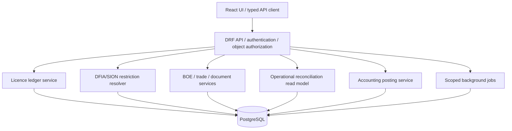

# Target architecture - proposed, pending approval

Use a modular Django/DRF monolith with React/TypeScript frontend, PostgreSQL, controlled background jobs and a single authoritative service per business metric. This is proposed because the target business has a small technical/operations team; microservices are not justified by current evidence.

All services receive company context, validate object ownership and write immutable audit events for material actions. Accounting posting consumes approved business events, never draft screen opens.

