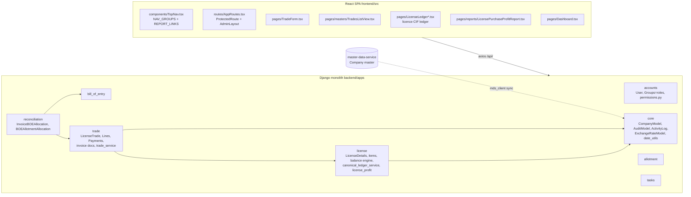
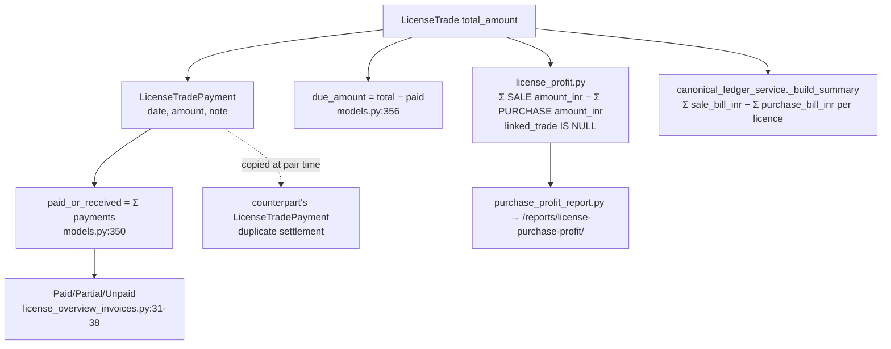
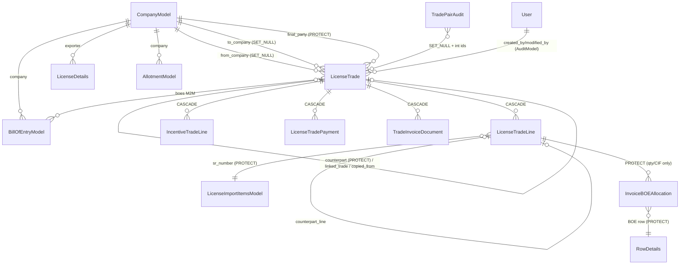

# 01 — Existing architecture and workflow maps

Paths are relative to `backend/apps/` or `frontend/src/` unless they are absolute. "(inferred)" marks a statement
that was not read in code.

## 1. Architecture map



- Layering (ADR-003, `docs/modernization/ARCHITECTURE_RULES.md`) puts core and masters below licensing, which sits
  below allotment, BOE and trade, which sit below reconciliation. It is enforced by `backend/tests/architecture/`
  (ratchets on view ORM writes, financial writes outside `services/`, cross-app import edges, cycles and a single
  balance engine).
- URL root: `lmanagement/urls.py:44-52` mounts `api/auth/`, `api/` (license, allotment, bill_of_entry, trade,
  reconciliation, tasks), `api/masters/` and `api/sync/`, with an `^api/` 404 catch-all at :56.
- DRF defaults: JWT then session authentication, `IsAuthenticated`, `StandardPagination` (25), date format `%d-%m-%Y`
  (`lmanagement/settings.py:270-289`).
- Celery beat (`lmanagement/celery.py:43`) runs replan recovery, ledger cleanup and ledger-job recovery. No task
  touches trade money.

## 2. Trade → invoice workflow (as built)

```mermaid
sequenceDiagram
  actor U as User (TRADE_MANAGER)
  participant F as TradeForm.tsx
  participant S as LicenseTradeSerializer.create/update
  participant P as line_pricing.apply_server_pricing
  participant M as LicenseTrade.recompute_totals
  participant C as trade_service (copy/sync)
  participant D as invoice_document_service / PDFs
  U->>F: direction, from/to company, invoice no/date, lines, payments
  F->>S: POST /api/trades/ (payments as JSON string)
  S->>S: atomic; lock items; SALE qty check (no BOE)
  S->>S: create header, snapshot_parties (PAN/GST/address)
  S->>P: price lines unless amount_override
  S->>S: create incentive lines + LicenseTradePayment rows
  S->>M: subtotal=Σ amount_inr, roundoff to ₹, total (queryset.update)
  S->>S: set BOEs M2M, stamp boe.invoice_no
  opt auto_create_paired / counterpart exists
    S->>C: _copy_to_counterpart / sync_to_counterpart (errors logged, not raised)
  end
  U->>D: generate-bill-of-supply (SALE) / generate-purchase-invoice (PURCHASE)
  D-->>U: PDF; SALE persisted as immutable TradeInvoiceDocument version
```

Key facts (all in `trade/models.py` unless noted):

- `direction` is PURCHASE, SALE, COMMISSION_PURCHASE or COMMISSION_SALE (:143-161). The licence type is DFIA or
  INCENTIVE.
- Invoice numbering: `get_next_invoice_number` (:74) builds `<company prefix>/<Indian FY>/<NNNN>` per direction, with
  commission prefixes `COM-` and `COM-P-`. It takes max+1 in Python with **no lock or sequence table**. A second,
  unused `next_invoice_number` (:431) does use `select_for_update`.
- Uniqueness (:302-327): a purchase is unique on (supplier, invoice_no) and a sale on (buyer, invoice_no). **Commission
  directions are not covered.**
- There is no lifecycle status. `final_party_status` (:275) is sale classification, not accounting.
- Totals are Decimal(20,2): `subtotal_amount`, `roundoff`, `total_amount` (:222-224). There are no tax, TDS, currency,
  exchange-rate, payment-terms or due-date fields on the header. Foreign currency exists only per line (`cif_fc`,
  `exc_rate`).
- Documents: SALE produces a Bill of Supply PDF (`bill_of_supply_pdf.py`), stored as a versioned
  `TradeInvoiceDocument` with a `sale_bill_inr` snapshot. PURCHASE uses the uploaded `purchase_invoice_copy` plus a
  generated purchase-invoice PDF. HSN is fixed at 49070000.

## 3. Existing finance workflow (as built)



- That is the whole "finance" surface. There is no bank or cash account, no allocation of one payment across several
  invoices, no advances, no party statement, no ageing, no expense outside a trade and no loans.
- Payments are edited only as a nested array on the trade (`pages/masters/NestedFieldArray.tsx:622-626`, with a
  "Total Paid" footer). There is no payment, receivable or payable screen.

## 4. Database relationship diagram (finance-relevant subset)



- `CompanyModel` (`core/models.py:226`) holds IEC (unique natural key), PAN, GSTIN, contact details, address, branding
  and **one** bank account (`bank_account_number`, `bank_name`, `ifsc_code`, `account_type`). It has no state code,
  no own/self flag and no entity type. It is mirrored from MDS `masters.Company` via `MasterSyncMixin`.
- "Labdhi" appears only in tests and a docstring. No own-entity list exists in code or data fixtures.
- Latest migrations: accounts 0006, core 0019, license 0057, allotment 0015, bill_of_entry 0013, reconciliation 0005,
  tasks 0001, trade 0011 (0012 uncommitted).

## Frontend shape (for later phases)

- Navigation is `components/TopNav.tsx` with `NAV_GROUPS` (Licenses, Operations), Reports and Masters dropdowns. The
  menus are one level, open on hover with a delay and are filtered by role. `layout/Sidebar.tsx` is unused (inferred).
- **The `feature/nav-redesign` worktree (another session, no commits yet) is replacing this** with
  `components/navigation/navConfig.ts`, which uses multi-column groups. New Accounting, Banking, Tax and Reports menus
  must be added there after it lands, not to `TopNav.tsx`.
- Routes use explicit `<ProtectedRoute requiredAnyRole><AdminLayout><Page/></AdminLayout></ProtectedRoute>` blocks.
  Reports use the `REPORT_ROUTES` tuple array. Roles live in `routes/authorizationRoles.ts`, mirroring
  `accounts/permissions.py`.
- Reusable pieces:
  - `components/data-table/DataTable` (TanStack, with numeric columns, a footer row and server sorting) and
    `hooks/useListQuery` (URL-synced).
  - `FilterPanel` and `DateRangeFilter`, `PageHeader`, `StatCard`, `PermissionGate`, `ConfirmDialog`.
  - Blob-download export helpers. Excel and PDF files are generated on the server.
- Money display: `utils/numberFormatter.js` `formatIndianNumber` uses `parseFloat`, so it is not safe beyond about
  15 significant digits. Accounting screens should render the Decimal strings from the API and never recompute
  totals.
