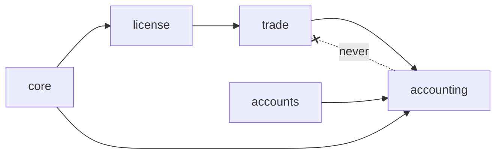

# 04 — Accounting integration design (PROPOSED — not approved, nothing built)

Principle: **the Trade record is the parent business transaction, and the voucher is its financial representation.**
One trade can produce several vouchers (invoice, TDS, payments, adjustments), each traceable back to it. No module
keeps its own balance. Every balance is a GL query.

## 1. App boundaries

One new Django app, `backend/apps/accounting`, uses the ADR-003 layers (`api/`, `services/`, `selectors/`, `domain/`,
`tasks.py`, `tests/`). Banking, tax, expenses and loans start as **sub-packages** of it (`accounting/banking`,
`accounting/tax`, `accounting/expenses`, `accounting/loans`, `accounting/reports`). They become separate apps only if
they grow. This keeps one dependency edge rather than six.



- Accounting **reads** trade through `trade/selectors` (to be added) and registers its own signal receivers and
  pre-delete guards on trade models.
- Trade code never imports accounting (this keeps `test_no_new_app_dependency_cycles` green). One new edge, trade →
  accounting, is added to the import-edge ratchet baseline.
- `domain/` stays pure: posting-rule evaluation, voucher balancing, TDS and interest math as plain Decimal functions.

## 2. Core models (Phase A)

| Model | Key fields | Integrity |
|---|---|---|
| `LegalEntity` (AD-01) | `company` 1:1 → `core.CompanyModel` (PROTECT), `code`, `legal_name`, `gstin`, `pan`, `tan`, `state_code`, `books_start_date`, `is_active` | unique company, unique code |
| `FinancialYear` | `entity`, `label` ("2026-27"), `start`, `end`, `status` OPEN/CLOSED | unique (entity, label); no overlap (exclusion constraint) |
| `AccountingPeriod` | `fy`, `month`, `status` OPEN/SOFT_LOCKED/LOCKED, `locked_by/at` | unique (fy, month) |
| `AccountGroup` | `entity`, `parent`, `name`, `nature` ASSET/LIABILITY/INCOME/EXPENSE/EQUITY, `report_head` (BS/PL line) | tree; nature inherited |
| `Account` (ledger) | `entity`, `group`, `code`, `name`, `kind` (GENERAL/PARTY/BANK/CASH/TAX/SUSPENSE), `party` → CompanyModel (PROTECT, nullable), `bill_wise` bool, `is_active` | unique (entity, code); unique (entity, party, control role) |
| `VoucherType` | `entity`, `code` (PUR, SAL, PAY, RCT, CON, JNL, DN, CN, EXP, COM, LNR, LNP, INTA, INTP, OPN), `numbering_prefix` | seeded |
| `VoucherSequence` | `entity`, `fy`, `voucher_type`, `next_no` | row-locked (`select_for_update`); gap-free on post |
| `Voucher` | `entity`, `fy`, `period`, `type`, `number` (null until posted), `date`, `status` DRAFT/APPROVED/POSTED/REVERSED/CANCELLED, `narration`, `source_type`, `source_id`, `source_event`, `source_version`, `idempotency_key` (unique), `reverses` → Voucher, `created/approved/posted_by/at`, `posted_snapshot` JSON | unique (entity, fy, type, number); unique `idempotency_key`; status transitions via service only |
| `VoucherLine` | `voucher`, `account`, `party` snapshot, `debit`, `credit` (Decimal 20,2, ≥0, exactly one >0), `amount_fc`, `currency`, `fx_rate`, `cost_centre`, `trade` → LicenseTrade (PROTECT, nullable), `bill_ref` | CHECK (debit ≥ 0 AND credit ≥ 0 AND (debit = 0) <> (credit = 0)) |
| `BillReference` + `BillAllocation` | bill = invoice-side open item (party, trade, due date, amount); allocation = payment/receipt/CN line ↔ bill, amount | Σ allocations ≤ bill amount (service + constraint trigger) |
| `AccountingAuditEvent` | append-only: actor, action, voucher, before/after JSON, at | no update/delete (DB trigger or permission) |
| `PostingOutbox` | `event_type`, `source_type/id/version`, `payload`, `status`, `attempts`, `error`, `idempotency_key` unique | written in the trade's transaction (via `on_commit`) or by explicit post |
| `PostingRule` | `entity`, `event_type`, `condition` (direction, licence type, tax treatment), `lines` template (account role → debit/credit, amount expression from a whitelisted field set) | versioned, effective-dated |

**Balanced-voucher guarantee:**

1. The service checks Σdebit = Σcredit before it sets POSTED.
2. A **deferrable Postgres constraint trigger** on `VoucherLine`/`Voucher` rejects any commit where a POSTED voucher
   is unbalanced. This keeps the guarantee even against raw SQL.
3. POSTED rows are immutable. An update trigger allows only the POSTED → REVERSED status change.

## 3. Trade → accounting integration

```mermaid
sequenceDiagram
  participant T as Trade (unchanged API)
  participant G as accounting guard receivers
  participant O as PostingOutbox
  participant W as Celery worker / explicit post service
  participant E as Posting engine
  T->>T: user clicks "Post to books" (new action, ACCOUNTS_MANAGER) — AD-06
  T->>O: enqueue trade.purchase_invoice_posted {trade_id, version_hash}
  W->>O: claim row (select_for_update skip_locked)
  W->>E: build voucher from PostingRule + trade snapshot
  E->>E: validate Σlines = trade.total_amount, pair class (AD-03), period open, party account exists
  E->>E: insert Voucher(idempotency_key=entity:TRADE:id:event:version) — unique → duplicate delivery is a no-op
  E->>E: post: number from VoucherSequence, status POSTED, audit event, BillReference
  T->>G: later edit/delete of a posted trade
  G-->>T: delete → refused; edit → marks source "changed since posting" (drift report); re-post = reversal + new voucher with version+1
```

- **Events:** `trade.purchase_invoice_posted`, `trade.sales_invoice_posted`, `trade.commission_recorded`,
  `trade.trade_cancelled` (reversal), `trade.trade_reversed`. Payments and receipts are accounting-native vouchers,
  not trade events (AD-04).
- **Idempotency key:** `{entity}:{source_type}:{source_id}:{event}:{source_version}`. `source_version` is a hash of
  the posted fields (header totals, parties, lines). Re-delivering the same version is a no-op. A new version needs a
  reversal first.
- **Synchronous vs asynchronous:** the explicit post action runs synchronously inside one transaction, so the user
  sees the result. The outbox handles bulk or retry posting and the cut-over backfill.

### Posting rules (illustrative; accounts come from the AD-08 CoA, rates from AD-05 configuration)

| Event | Dr | Cr |
|---|---|---|
| Purchase invoice (taxable value V, input GST G if any) | Purchases / Licence stock V; Input GST G | Supplier V+G |
| TDS on purchase (amount D, config-driven section) | Supplier D | TDS Payable (section) D |
| Supplier payment P | Supplier P | Bank P |
| Sales invoice (V, output GST G if any) | Customer V+G | Sales V; Output GST G |
| TDS deducted by customer D | TDS Receivable D | Customer D |
| Customer receipt R | Bank R | Customer R |
| Commission purchase (expense) | Commission Paid; Input GST | Agent |
| Commission sale (income) | Agent | Commission Received; Output GST |
| Round-off | Round-off (Dr or Cr) | — balancing |

Worked example (prompt §5): V = 10,00,000, G = 1,80,000, D = 20,000.

- Supplier credit is 11,80,000. The TDS voucher debits the supplier 20,000, so the payable is 11,60,000.
- Paying 11,60,000 in one or more payments allocates against the bill, and the outstanding becomes 0 (SETTLED).

**Licence trades:** today they carry no GST and are billed on a Bill of Supply. G = 0 unless AD-05 says otherwise.
Licence-utilisation (CIF) balances are never read or written by accounting.

## 4. Multi-entity books (AD-01)

- Every accounting row carries `entity`. Selectors require an entity, or an explicit consolidated scope.
- **Entity is a book dimension, not an authorisation boundary.** OD-04 (single-tenant) stands, so users with
  accounting roles see all entities. Restricting by entity would be a new owner decision.
- The posting entity for a trade:
  - PURCHASE: `to_company`'s LegalEntity.
  - SALE: `from_company`'s LegalEntity.
  - If that company is not a LegalEntity, the trade is not postable (shown in a report).
- **Intercompany:** a pair classified `INTERCOMPANY` posts a sale in entity A and a purchase in entity B. Both lines
  use the "Intercompany – <entity>" accounts, which eliminate on consolidation.

## 5. Permissions (AD-07)

`accounts/permissions.py` gains `AccountingPermission(BaseRolePermission)`, with deny-by-default per action like
`ReconciliationPermission`:

| Action | Role |
|---|---|
| read | ACCOUNTS_VIEWER / MANAGER / APPROVER |
| draft create/edit | ACCOUNTS_MANAGER |
| approve / post / reverse | ACCOUNTS_APPROVER |
| period lock | ACCOUNTS_APPROVER |
| CoA / posting rules | ACCOUNTS_APPROVER |

The maker ≠ checker rule is enforced in the service. Superusers keep the existing bypass, but posting is still
audited.

## 6. Cut-over (AD-02)

1. Choose the cut-over date C (FY start).
2. Load the CA-signed opening trial balance per entity as one OPN voucher.
3. Load open bills (party, invoice, due, amount) as `BillReference` rows linked to existing trades where they match.
   They create no new GL lines, because the OPN voucher already holds the party totals.
4. Trades with `invoice_date ≥ C` post normally. Trades before C are never posted. A reconciliation report shows
   that Σ open bills = OPN party balances, and lists every trade before C that is still unpaid.
5. Rehearse on the sanitised production snapshot (OD-17) before running it on production.

## 7. What deliberately does NOT change

- Trade APIs, fields, numbering, PDFs, `paid_or_received` and `due_amount`, except the guarded behaviour on posted
  trades, which waits for AD-06 approval.
- The licence balance engine, ledgers, profit reports, MDS and the company master schema.
