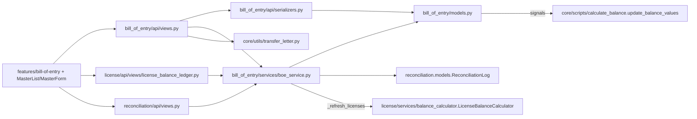

# Module architecture map — BOE, Licence, Allotment

Layering target: ADR-003 (`docs/decisions/ADR-003-backend-modular-monolith.md`). Refs at base `9fc44ad3`.
WS5 is editing `boe_service.py`, `api/serializers.py`, `api/views.py`, `api/views_export.py`, `reconciliation/api/views.py`: *verify line numbers after WS5*.

## 1. BOE app layout (`backend/apps/bill_of_entry/`)

| Layer | Path | Notes |
|---|---|---|
| Models + signals | `models.py` | `BillOfEntryModel` `unique_together(number, date)` `:234`; `RowDetails` frozen guard in `save()` only `:432-440`; signals `:463-559` recompute item balance (sync) and BOE `exchange_rate` (on_commit). |
| Visibility helpers | `models.py:57` `annotate_and_exclude_hidden`, `:143` `genuinely_hidden_boe_ids` | Hidden = `invoice_no='OTH'` with a HIDE log. |
| API views | `api/views.py` | `BillOfEntryViewSet` built on `MasterViewSet.create_viewset` (`:103`); `perform_*` atomic in `core/views/master_view.py:148-216`. Shim: `views/boe.py`. |
| Serializers | `api/serializers.py` | Nested create/update `:296-467`; writes `RowDetails` and `Allotment.is_boe`. Baseline `('bill_of_entry','serializers','RowDetails'): 4` (`tests/architecture/test_architecture.py:229`). Shim: `serializers.py`. |
| Export | `api/views_export.py` (901 lines, synchronous) | `add_grouped_export_action` `:56`, action `export` `:61`. |
| PDF parse | `api/views_parse_pdf.py` | `BOEPdfParseView` `:191`, `@transaction.atomic` `:202`, may create `CompanyModel` (`:229-230`). |
| Services | `services/boe_service.py` | All BOE business actions (table below). No `selectors/`, no `domain/`. |

## 2. BOE operation ownership

| Operation | Endpoint | Owner function | Input | Output | Validation | Transaction | Audit |
|---|---|---|---|---|---|---|---|
| Create | `POST /api/bill-of-entries/` | `BillOfEntrySerializer.create` `api/serializers.py:296` | nested BOE + `item_details` | serialized BOE | serializer `validate*` `:64-111` (CIF ceiling) | `MasterViewSet.perform_create` atomic `master_view.py:165` | none (AuditModel fields only) |
| Update | `PUT/PATCH /api/bill-of-entries/{id}/` | `BillOfEntrySerializer.update` `:328` | nested | serialized BOE | same; orphan rows deleted in a savepoint, `ProtectedError` → 400 `{'item_details': ...}` (post-change `api/serializers.py:474-500`) | `perform_update` atomic `master_view.py:181` | none |
| Delete | `DELETE /api/bill-of-entries/{id}/` | `MasterViewSet.perform_destroy` `master_view.py:184` | id | 204 | `ProtectedError` → 400 `:198-214` | atomic `:202` | none |
| Fetch allotment details | `GET .../fetch-allotment-details/` | `boe_service.fetch_allotment_item_details` `:99` | `allotment_id`, `boe_id?` | prefill dict | `allotment_id` required → 400 (`views.py:226`) | read | n/a |
| Transfer letter | `POST .../{id}/generate-transfer-letter/` | `core/utils/transfer_letter.py:356` `generate_transfer_letter_generic` | form | file | `TransferLetterPermission` | read | none |
| Update product name | `POST .../{id}/update-product-name/` | `update_product_name_for_boe` `:17` | — | `{success, message, ...}` | 400 when "No items" (`views.py:248`) | single `save(update_fields)` | none |
| Bulk product names | `POST .../bulk-update-product-names/` | `bulk_update_product_names` `:55` | — | summary | — | per-row save | none |
| Resolve dispute | `POST .../{id}/resolve-dispute/` | `resolve_dispute` `:179` | — | summary | — | — | none |
| Merge (BOE side) | `POST .../{id}/merge/` | `merge_boe` `:203` | `source_boe_id` | summary | `ValueError` → 404/400 `{'error'}` | atomic + `select_for_update` on both BOEs ordered by id (post-change `boe_service.py:252`) | `MERGE_BOE` log written in the service (post-change `boe_service.py:327`) |
| Merge (recon side) | `POST /api/reconciliation/merge-boe/` | same `merge_boe`, via `reconciliation/api/views.py:164` | target, source | summary | `{'detail'}`; non-integer ids → 400 | service atomic + locks | `MERGE_BOE` log in the service (single writer) |
| Update invoice no | `POST .../{id}/update-invoice-no/` | `update_invoice_no` `:321` | `invoice_no` | summary | `AccountAccessPermission` | `save(update_fields=["invoice_no"])` `:334` | none (escalation 1) |
| Hide / restore | `POST /api/licenses/{id}/hide-boe/`, `restore-boe/`, `-bulk` | `hide_boe` `:487`, `restore_boe` `:537`, `hide_boes_bulk` `:580`, `restore_boes_bulk` `:636` | boe id(s), reason | summary | BOE_MANAGER **and** LICENSE_MANAGER (`accounts/permissions.py:298-301`) | atomic `:402`, `:455` | `HIDE_BOE`/`RESTORE_BOE` log + `_refresh_licenses` `:476` |
| Export | `GET .../export/?_export=pdf|xlsx|port_xlsx` | `api/views_export.py` | filters | file | 400/503 `text/plain` (`:42`) | read | n/a |
| Parse PDF | `POST /api/bill-of-entries/parse-pdf/` | `BOEPdfParseView` | file, `create_company` (default true) | prefill | 400/422 `{'detail'}` | atomic | none |
| Ledger import of BOE rows | `license/api/views/ledger_upload.py` | `backend/scripts/parse_ledger.py` (licence-owned; disconnects `update_stock`/`delete_stock` at `:404-405`) | ledger file | rows | parser | script | none |

Hosting is split: hide/restore endpoints live on the licence viewset (`apps/license/api/views/license_balance_ledger.py:184-268`), logic in `boe_service`. Legacy duplicate: `apps/core/scripts/ledger.py`.

App-cycle baseline: one SCC `{accounts, allotment, bill_of_entry, core, license, trade}` (ratchet `test_no_new_app_dependency_cycles`).

## 3. Licence and Allotment module map (real structure)

| Concern | Licence (`backend/apps/license/`) | Allotment (`backend/apps/allotment/`) |
|---|---|---|
| API | `api/views/*.py` (license, license_items, license_balance_ledger, ledger, ledger_upload, reports, item_pivot_*); `api/serializers/{license,_license_write,ledger,incentive}.py` | `api/{views,views_actions,views_export,serializers}.py` (+ root shims) |
| Services | `services/` incl. `balance_calculator.py` (`LicenseBalanceCalculator` `:80`), `effective_cif_mode.py`, `condition_pool.py`, `exporters/` | `services/{allocation_service,allocation_availability,paired_allocation_max,validation_service,filter_service,audit_service}.py` |
| Domain | `domain/transaction_semantics.py` | — |
| Signals | `signals.py` (`update_license_flags` `:280`) | `signals.py` |
| Writes from serializers | yes (`_license_write.py`) — not a backend reference | partly |
| Frontend feature | `features/licenses` (`LicenseRecordWorkspace`, `LicenceCard`, `useLicenceRowActions`, `licenceActionItems`) — **UI reference** | `features/allotment` (`AllotmentRecordWorkspace`, `useAllotmentDetail`, `DetailQueryBoundary`, `allotmentCardActions`) |

| Concern | BOE frontend (`frontend/src/features/bill-of-entry/`) |
|---|---|
| Routes | `/bill-of-entries`, `/create`, `/:id/edit` render `MasterList`/`MasterForm` (`routes/AppRoutes.tsx:175-189`) |
| List | `BoeCardList.tsx` (uses legacy `primitives/EntityCard`), `BoeItemsTable.tsx`, `boeCardActions.ts` (WS2) |
| Record | `BoeRecordWorkspace.tsx` (`DetailTabs`), `tabs/{Overview,BoeDetails,AllotmentMapping,LicenceMapping,Documents,EditOptions}Tab.tsx` |
| API client | `api/boeApi.ts`: CRUD, export (pdf/xlsx/port_xlsx), `mergeBOE` only; other actions are raw `api.post` (deferred) |
