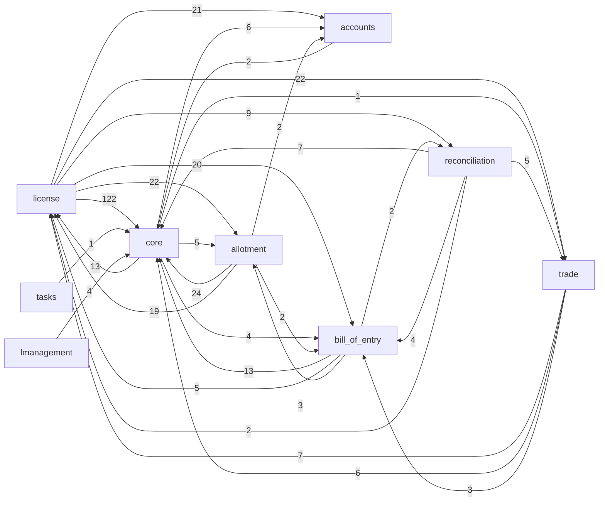
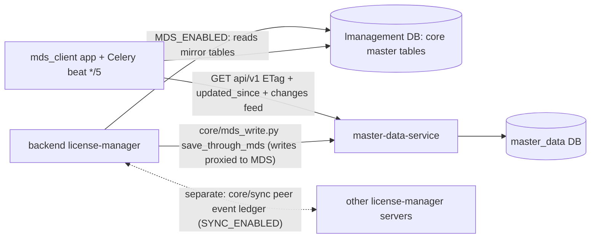

# 02 - Current Architecture (as-is, verified against code)

Date 2026-11-15, branch `feature/version5`. Evidence is `file:line` or index/grep output. Earlier "FROZEN"/"PRODUCTION READY" reports were not relied on. Nothing was executed (no tests/gates run in this task).

## 1. Shape in one paragraph
One Django 6 / DRF monolith (`backend/`, 8 apps, 89 models, ~104k non-test LOC) behind a React 19 SPA that Django also serves (SPA catch-all `lmanagement/urls.py:77`). Postgres + Redis (cache db + Celery broker). An optional second Django service (master-data-service, MDS) plus a client package (`mds-client`) mirror 17 master tables, OFF by default (`settings.py:607`). A second, separate mechanism (`core/sync`, peer-to-peer event ledger, `SYNC_ENABLED`) also replicates masters between servers. License domain code is ~58% of backend LOC.

## 2. Layering: intended vs actual
Intended (per `.claude/agents/django-architect.md`): views -> serializers -> services -> models.

| Layer | Reality | Evidence |
|---|---|---|
| Views | Mixed: thin in `accounts`, `tasks`, `reconciliation`; **fat** in license reports, allotment actions, exports | see 5 |
| Serializers | Contain write orchestration (nested create/update for licences), not just validation | `license/serializers/_license_write.py:303` `update()` = 593 lines |
| Services | Exist in all apps except `core` (`license` has ~70 modules) but are called inconsistently; views re-implement Decimal/aggregate logic | views with `Decimal`/`Sum(` hits: `allotment/views_actions.py` 65, `item_pivot_report.py` 47, `expiring_licenses_report.py` 38, `active_licenses_report.py` 38 |
| Models | **Fat**: balance/CIF math lives on model methods, 138 defs in one file | `license/models/core.py` (2,625 LOC): `balance_cif` :201, `get_balance_cif` :330, `cif_value_balance_glass` :552, `cif_value_balance_biscuits` :643, `get_per_cif` :783, `available_value_calculated` :1034 |
| Signals | Carry business logic (balance, `is_allotted`, trade-line quantities, stock) | `license/signals.py` (~23 receivers), `allotment/signals.py`, receivers defined **inside model files** in `bill_of_entry/models.py`, `trade/models.py`, `allotment/models/core.py`, `license/models/core.py` |

### Where business logic lives (CIF / balance / allocation)
| Concern | Locations (competing implementations) |
|---|---|
| Licence/item balance | model methods (`license/models/core.py`), `services/balance_calculator.py` (2,149), `balance_snapshot.py`, `canonical_ledger_service.py` (1,367), `license_balance_ledger_builder.py` (1,682), `LicenseBalance` table updated by signal `update_balance` (`license/signals.py`) |
| Parallel/dual-run migration | `services/ledger_dual_run.py` (`LedgerDualRun`, comparison reports) - evidence a canonical-vs-legacy ledger migration is unfinished; also `sion_shadow_comparison.py`, `compare_sion_planner` commands |
| Planning | `database_driven_sion_planner.py`, `canonical_planning_service.py` (1,449), `sion_planning_execution.py` (1,741), per-norm planners `e126_plan.py, e132_plan.py, e5_plan.py, milk_planner.py`, legacy importer `sion_legacy_*` |
| Allocation | `allotment/views_actions.py:1072` `_allocate_items_atomic` (497 lines in a view) AND `allotment/services/allocation_service.py` AND `reconciliation/services/allocation_service.py` (same name, two apps) |
| Reporting | views in `license/views/*_report.py` plus `services/report_service.py`, `plan_reporting.py`, `purchase_profit_report.py` |

Doc references `docs/architecture/CALCULATION_OWNERSHIP.md` and `GATE3_*` describe a "single source of truth"; code shows at least 4 live balance paths (above). Treat the docs as aspiration; escalate per CLAUDE.md section 2 before any consolidation.

## 3. Cross-app dependency graph (from `imports.tsv`, non-test, non-script, includes lazy imports)

Edge label = number of importing files.

### Circular dependencies (app level)
Bidirectional pairs: `license<->core`, `license<->allotment`, `license<->trade`, `license<->bill_of_entry`, `license<->reconciliation`, `core<->allotment`, `core<->bill_of_entry`, `core<->accounts`, `core<->trade`, `bill_of_entry<->allotment`, `bill_of_entry<->reconciliation`, `reconciliation<->license` (reconciliation->trade is one-way). Note several pairs involve `core` importing domain apps, which inverts the dependency direction (core should be the leaf).

Mitigation in code = **function-local imports** to dodge import-time cycles: `allotment/models/core.py:448`, `bill_of_entry/models.py:102,161,454`, `core/cache_signals.py:423` (all import `license`/`reconciliation` models inside functions). Module-level model cycle risk remains: `license/models/core.py:22-23` imports `allotment.models` and `bill_of_entry.models`, while those import back lazily. Anything touching import order can break startup.

Core imports from domain apps (should not): `core/cache_signals.py` (license), `core/views/media.py` (trade), `core/management/commands/clean_duplicate_rowdetails.py` (bill_of_entry), `core/management/commands/convert_docx_to_pdf.py` (allotment scripts).

Blast radius hot spots (`CODE_MAP.md`): `license/models/__init__.py` 294 dependents, `core/models.py` 234, `core/constants.py` 91, `trade/models.py` 81, `bill_of_entry/models.py` 70, `allotment/models/__init__.py` 68, `license/services/balance_calculator.py` 57, `accounts/permissions.py` 36, `license/services/canonical_ledger_service.py` 34.

## 4. God files
| File | LOC | Why |
|---|---|---|
| `license/models/core.py` | 2,625 | 33 models in 2 files + balance math + signals |
| `license/views/item_pivot_report.py` | 2,400 | view + report builder; `generate_report` 649 lines (:598), `_build_license_row` 547 (:1248) |
| `license/services/balance_calculator.py` | 2,149 | 57 dependents, central money math |
| `license/services/exporters/license_balance_excel.py` | 2,006 | `build_bulk_balance_excel` 759 lines |
| `license/services/sion_planning_execution.py` | 1,741 | `_compute_license_new_architecture` 773 lines (:394) |
| `license/services/license_balance_ledger_builder.py` | 1,682 | `build_financial_ledger` 526 lines (:194) |
| `allotment/views_actions.py` | 1,680 | view with `_allocate_items_atomic` 497 lines (:1072) |
| `core/models.py` | 891 | 30 models: masters + sync + audit + celery tracker in one file |
| `core/views/master_view.py` | 907 | `create_viewset` factory, 706 lines (:202) |
| `bill_of_entry/views_export.py`, `allotment/views_export.py` | 901 / 774 | `add_grouped_export_action` 846 / 722 lines, near-duplicate |
| `trade/bill_of_supply_pdf.py`, `purchase_invoice_pdf.py` | 793 / ~700 | PDF generation in app root, 726/675-line functions |
| `license/utils/item_matcher.py` | 1,174 | `get_item_filters` 781 lines |
Frontend: `ItemPivotReport.tsx` 1,951; `AllotmentAction.tsx` 1,833; `MasterList.tsx` 1,729; `TradeForm.tsx` 1,644.

## 5. Fat views and serializers (LOC)
| File | LOC |
|---|---|
| `license/views/item_pivot_report.py` | 2,400 |
| `allotment/views_actions.py` | 1,680 |
| `license/views/license.py` | 1,235 |
| `core/views/master_view.py` | 907 |
| `bill_of_entry/views_export.py` | 901 |
| `license/views/sion_planning_rule.py` | 788 |
| `license/views/item_report.py` | 785 |
| `allotment/views_export.py` | 774 |
| `license/views/license_purchase_profit_report.py` | 763 |
| `trade/views.py` | 719 |
| `license/views/expiring_licenses_report.py` | 698 |
| `license/views/ledger.py` | 693 |
| `license/views/active_licenses_report.py` | 662 |
| `core/views/views.py` | 629 |
Serializers: `license/serializers/license.py` 1,134; `_license_write.py` 895; `incentive.py` 671; `trade/serializers.py` 634; `core/serializers/fields.py` 503; `bill_of_entry/serializers.py` 438.

## 6. Settings structure (`lmanagement/settings.py`, 620 lines, single file)
- No dev/prod split; behaviour switched by env (`DEBUG`, `DJANGO_ENVIRONMENT`, `IS_PRODUCTION`) at `:45-46,436,500`. `.env` / `.env_dgft` loaded via python-dotenv (`:24-35`).
- Mixed concerns in one file: DGFT scraping session credentials (`DGFT_SESSION_ID`, `DGFT_CSRF_TOKEN`, `DGFT_AWSALB` at `:53-60` - scraped browser session values as settings), CORS regex lists (`:418-500`), Celery (`:346-384`), SYNC (`:587-589`), MDS (`:607-620`), email.
- `INSTALLED_APPS` adds `mds_client` dynamically (`:610-620`) and silently flips `MDS_ENABLED=False` on ImportError.
- Cache and broker share `REDIS_URL` env default (db 1 vs db 0 only for defaults; if `REDIS_URL` is set, both resolve to the same DB): `settings.py:346,391`.
- `ROOT_URLCONF` templates dir points at `frontend/dist` (`:~185`): backend build depends on a frontend build artefact.

## 7. Auth mechanism
| Aspect | Current | Evidence |
|---|---|---|
| Authn | SimpleJWT bearer (access 30 min, refresh 7 d, rotation + blacklist) + DRF `SessionAuthentication` fallback | `settings.py:270-278,328-342` |
| Custom authn | `JWTAuthenticationFromQueryParam`: accepts `access_token` in the URL query for GET/HEAD on paths containing `download, pdf, excel, export, ...` (keyword match on path) | `core/authentication.py:12-26` |
| Revocation | refresh blacklist via `token_blacklist`; extra `RevokedAccessToken` model | `accounts/models.py` |
| Authz | Django Groups as roles; `BaseRolePermission` subclasses per module (17 classes) | `accounts/permissions.py:5-166`, `accounts/models.py:110-118` |
| Tenancy | **None**: `User` has no company FK; ledger access explicitly "not dependent on a user-company" | `accounts/permissions.py:136` |
| CSRF | custom middleware disables CSRF for `/api/` | `core/middleware.py:7-36` |
| Rate limits | burst/user/staff/login/export throttles | `settings.py:290-312` |
| Client token storage | `localStorage` access + refresh | `frontend/src/api/axios.js:30,126` |
| Public endpoints | health, login, password reset, invoice-doc token view | see 01 section 2a |

## 8. API versioning and URL layout
- **No versioning** on the main API: `/api/...` unversioned, six domain apps mounted at the same `api/` root so routes are flat and namespaces can collide (`urls.py:46-51`). Only MDS uses `/api/v1/` (`master-data-service/mds/urls.py:13`).
- Response envelope is DRF default; custom date format `%d-%m-%Y` (`settings.py:~288`), JSON-only renderer; pagination `StandardPagination` page size 25.
- OpenAPI via drf-spectacular at `/api/schema/` (login-gated unless DEBUG).
- Mix of `ViewSet` routers and ~15 bare `path()` report/utility views in `license/urls.py:43-61`; `core.views.master_view.create_viewset` generates master viewsets by factory (`master_view.py:202`).

## 9. Celery / Redis usage
- Redis: Celery broker + result backend, Django cache (django-redis), cache invalidation via signals (`core/cache_signals.py`, 11 receivers), materialized views refreshed by tasks (`core/tasks_materialized_views.py`, `core/materialized_views.py` 478 LOC).
- Tasks: replan (`planning.*`), ledger package jobs (`license.*`), FX fetch, MDS and peer sync. Only these tasks have routing/time limits (`settings.py:354-383`).
- **4 of 9 default beat entries target unregistered tasks** (`celery.py:47,59,67,83`): `license.tasks.sync_all_licenses`, `identify_licenses_needing_update` (x2), `cleanup_old_task_records`. Also `core.tasks.fetch_exchange_rates` deliberately not scheduled (`celery.py` comment ~line 77).
- Worker unit file consumes queue `ledger` (`backend/deploy/celery.service:19`) but routes in settings all use queue `celery`; `QUEUE` constant in `license/tasks.py` should be verified.
- Audit logging done with a raw daemon thread per request instead of a task/queue (`core/middleware.py:99-152`).

## 10. MDS integration

- Local DB keeps a read-only mirror of 17 master models so FKs/joins still work (`apps/core/MDS_SYNC.md`). Writes route through MDS only when `MDS_ENABLED` and the model is in `MDS_MODELS` (`core/mds_write.py:70-80`, `master_view.py:121-165`). Status endpoint `/api/mds/status/`.
- Duplicated model definitions: 17 masters are defined in both `core/models.py` and `master-data-service/masters/models.py`, kept consistent by convention plus `mds_payload.py` / `keys.py` (synthetic keys). No shared schema package.
- Two overlapping master-replication mechanisms (MDS and `core/sync`) coexist; both default OFF.
- `MDS_REMOVAL_REPORT.md` at repo root claims MDS was removed - false per code.

## 11. Deployment shape (read only)
- `docker-compose.yml`: dev only - Postgres 16 + Redis 7 on 127.0.0.1; Django, Celery, Vite run natively (`docker-compose.yml:1-8`). CI uses Postgres 16, local dev 18 (CLAUDE.md).
- Production appears to be bare-metal/VM: systemd unit `backend/deploy/celery.service` (example paths `/srv/lmanagement`, user `www-data`), `backend/setup/supervisord.conf`, root-level `nginx-*.conf` x6 (per-customer: labdhi, tractor, protected-media, http-only variants), a `scripts/` release folder with SSL setup, watchdog and auto-release scripts (not opened - guarded path), gunicorn for MDS (`master-data-service/deploy/gunicorn.conf.py`). WhiteNoise serves static; nginx X-Accel for protected media (`MEDIA_X_ACCEL_REDIRECT`, `settings.py:255`).
- No production Dockerfile, no IaC, no container build in CI. CI (`.github/workflows/ci.yml`): frontend lint/typecheck/test/build; backend `makemigrations --check`, `tests/`, `apps/license/tests apps/core/tests`; MDS and mds-client jobs. Other app tests are not in CI (01 section 8).
- Per-customer nginx confs and multiple server names suggest several single-tenant installs (Labdhi, Tractor) synchronised by `core/sync`/`scripts/mds/onboard-server.sh` rather than one multi-tenant instance - needs human confirmation.

## 12. Top 10 architectural problems (ranked by risk)

| # | Problem | Evidence | Target (modular monolith) |
|---|---|---|---|
| 1 | **Multiple competing balance/CIF implementations**; model methods, calculators, canonical ledger, `LicenseBalance` table + signals, with an unfinished dual-run. Risk of silent financial divergence. | `license/models/core.py:201,330,552,643,783`; `services/balance_calculator.py` (57 dependents); `canonical_ledger_service.py`; `ledger_dual_run.py`; `license/signals.py` update_balance | One `licensing.ledger` domain service as the only writer/reader of balances; models hold data only; characterisation tests (exist: `test_ledger_characterization_option_c.py`) gate the cutover; `cif-balance-auditor` sign-off |
| 2 | **Business logic in signals spread across model files**, multiple handlers per sender (e.g. `LicenseImportItemsModel` post_save at `license/signals.py:157` and `:416`; `AllotmentItems` `:175`/`:517`; `RowDetails` `:187`/`:533`), implicit ordering, recursion avoided by `queryset.update()` hacks | `license/signals.py:157-549`; receivers in `bill_of_entry/models.py`, `trade/models.py`, `allotment/models/core.py` | Replace with explicit service calls inside `transaction.atomic()` + `on_commit` domain events; keep signals only for cache/audit |
| 3 | **Cyclic app dependencies, `core` depends on domain apps**; cycles hidden by function-local imports | `bill_of_entry/models.py:102,161,454`; `allotment/models/core.py:448`; `core/cache_signals.py:423`; graph in 3 (license<->5 apps) | Define layers: `core`/`masters` (leaf) < `licensing` < `allotment`, `bill_of_entry`, `trade` < `reconciliation`; use string FKs, move cross-app reads behind per-app `selectors`/`services` interfaces; add import-linter contract in CI |
| 4 | **Broken scheduled jobs**: 4/9 beat entries reference non-existent tasks; the advertised nightly sync and twice-daily balance refresh are not running | `lmanagement/celery.py:47,59,67,83` (grep shows no definitions) | Remove or implement; add a CI test asserting every beat task name is in `app.tasks`; document scheduled jobs |
| 5 | **No tenancy / row-level authorization**; roles only gate by module, no company scoping | `accounts/permissions.py:136`; `User` has no company FK (`accounts/models.py`); related findings in `D1_COMPANY_BOUNDARY_FINDINGS.md`, `REMEDIATION_SUMMARY_P0_P1_IDOR.md` (unverified) | Decide model (single-tenant installs vs `Organization` FK) before ERP expansion; add object-level permission/queryset scoping layer; human decision |
| 6 | **Fat views / god functions** carry orchestration (allocation 497 lines in a view; reports 600+ lines; duplicated export builders) | `allotment/views_actions.py:1072`; `license/views/item_pivot_report.py:598,1248`; `bill_of_entry/views_export.py:56`, `allotment/views_export.py:53`; 103 functions >100 LOC | Views become parse -> call service -> serialize; extract report/export builders to `services/`; one shared grouped-export component |
| 7 | **Auth hardening gaps**: JWT in `localStorage`; JWT accepted in query string by path keyword match; CSRF disabled by middleware while `SessionAuthentication` is still enabled; unversioned API | `frontend/src/api/axios.js:30`; `core/authentication.py:12-26`; `core/middleware.py:7-36`; `settings.py:270-278`; `urls.py:46-51` | HttpOnly cookie or short-lived signed download URLs; drop SessionAuthentication for `/api/` or keep CSRF; introduce `/api/v1/` prefix with compatibility alias (contract change - needs approval) |
| 8 | **Test/CI coverage gap and clutter**: ~268 app tests (allotment, trade, reconciliation, accounts, BOE, tasks) not in CI; 22 ad-hoc `backend/` root scripts, 11 root scripts, 258 root `.md` reports with false claims | `.github/workflows/ci.yml:108,111`; `backend/pytest.ini` testpaths; 01 section 9 | Run `pytest` over all `apps/` in CI; archive scripts/reports to `docs/archive/` (human approval to delete); one source of truth doc per topic |
| 9 | **Master-data duplication / two replication systems**: 17 masters defined twice (core + MDS), plus separate `core/sync` peer ledger, both optional; documentation claims MDS removed | `core/models.py` vs `master-data-service/masters/models.py:1-362`; `settings.py:587-620`; `MDS_REMOVAL_REPORT.md` | Decide single master strategy (module `masters` inside monolith, MDS retired, or MDS authoritative); remove the other mechanism; human decision |
| 10 | **Operational shape**: single 620-line settings with no env split and scraped DGFT session values as settings; per-request audit-log daemon thread; Redis broker/cache share config; no production container/IaC; Celery unit consumes `ledger` queue not routed in settings | `settings.py:45,53-60,346,391`; `core/middleware.py:99-152`; `backend/deploy/celery.service:19` | `settings/{base,dev,prod,test}.py`; move DGFT secrets to a secrets store; write `ActivityLog` through Celery/outbox; separate Redis DBs; reproducible container build + health checks |

## 13. Items needing human decision
1. Tenancy model (problem 5) and whether per-customer installs remain.
2. Master-data strategy: keep MDS, `core/sync`, or fold into the monolith (problem 9).
3. API versioning / auth token transport change (problem 7) - alters contracts; escalate per `.claude/rules/backend.md`.
4. Canonical balance owner (problem 1) - BUSINESS-RULE CHANGE gate; requires `cif-balance-auditor`.
5. Approval to archive/delete root scripts and reports and to review `3011009264 SONALIKA TRACTOR.pdf`.
6. Confirm queue name `ledger` vs `celery` in production worker config.
