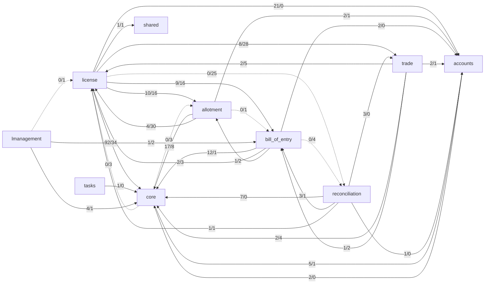

# Backend audit 01 - Structure and coupling

Scope: `backend/apps/*`, `backend/shared`, `backend/api_utils`, `backend/lmanagement`. Read-only audit, branch `feature/v5` (HEAD b68ec7fd). Builds on `docs/modernization/PROJECT_ARCHITECTURE.md` and `BACKEND_STRUCTURE.md`; section 0 lists what is now stale.

Method: AST pass over every `.py` (relative imports resolved). "Production" = not under `tests/`, `test_*.py`, `conftest.py`, `migrations/` or `management/`. Helper `scripts/` packages inside apps count as production (they are imported by production code). Counts are import statements, not files. "Module-level" = column 0, "local" = indented (function/method/`if TYPE_CHECKING`/`try`). LOC = physical lines. Edge counts are production-to-production only, so management commands, tests and migrations are excluded.

## 0. Corrections to earlier docs

| Earlier claim (PROJECT_ARCHITECTURE.md:81-90,160) | Now |
|---|---|
| core -> license 17, core -> allotment 5, core -> bill_of_entry 5, core -> trade 1 | After ca9dad8b: core -> license 3, core -> allotment 3, core -> bill_of_entry 0, core -> trade 0. All 6 are function-local. core -> accounts is 5 module-level + 1 local, which was not in the old graph. |
| "core imports domain apps" | The import graph is clean, but core still reaches the domain at runtime through `apps.get_model("license"/"bill_of_entry"/"trade", ...)`. Production sites: `core/openapi.py:86`, `core/cache_signals.py:424`, `core/scripts/ledger.py:125,164,222,223,295`, `core/views/media.py:64,71,78,85`, `core/scripts/calculate_balance.py:147,207`. The index does not see these, so the coupling is hidden, not removed. Management commands and migrations 0014-0016 add more. |
| Cycles are "bidirectional" | Confirmed, but there is no file-level import cycle at module level (Tarjan SCC over module-level file edges = empty). All app cycles are held together by function-local imports and by `apps.get_model` / string FKs. |

## 1. Per-app layout

Files and LOC are production only unless stated. Tests = files under `tests/` or `test_*.py` inside the app. Backend-wide, `backend/tests/` holds 17 more test files (3,941 LOC) that are not attributed to any app.

| App | Files | LOC | Tests (files / LOC) | Migrations | Mgmt cmds |
|---|---|---|---|---|---|
| license | 132 | 53,870 | 186 / 41,733 | 58 | 27 |
| core | 78 | 17,607 | 26 / 8,019 | 20 | 38 |
| allotment | 24 | 5,602 | 13 / 2,676 | 17 | 5 |
| trade | 16 | 4,911 | 10 / 1,542 | 12 | 3 (12 LOC) |
| bill_of_entry | 16 | 3,866 | 3 / 508 | 15 | 0 |
| reconciliation | 10 | 2,420 | 7 / 1,840 | 6 | 4 |
| accounts | 14 | 1,039 | 3 / 353 | 7 | 5 |
| tasks | 9 | 424 | 1 / 29 | 2 | 0 |
| lmanagement (project pkg) | 6 | 1,025 | 0 | n/a | n/a |
| shared | 3 | 355 | 0 | n/a | n/a |
| api_utils | 2 | 67 | 0 | n/a | n/a |

Layout shape (M = module, P = package):

| App | models | views | serializers | services | other layers | Celery tasks |
|---|---|---|---|---|---|---|
| license | P: `models/core.py` (2,624) + `invoice.py` | P `views/` (22 files) + loose `views_actions.py`, `views_incentive.py` | P `serializers/` (4 files, 3,003 LOC) | P `services/` (~62 modules + `exporters/`, `sion_planner_config/`) | `domain/transaction_semantics.py` (527, only domain pkg in repo), `dtos/__init__.py` (1 line, empty), `utils/` (3), `parsers/dfia_pdf.py`, `item_report.py`, `tables.py`, `table_columns.py`, `signals.py` (599) | `tasks.py` (591, 10 tasks) |
| core | M `models.py` (891) + `sync/models.py` | P `views/` (7) + `sync/views.py` | P `serializers/` (3) + `sync/serializers.py` | none (logic in `utils/`, `scripts/`, `sync/service.py`) | `exporters/{excel,pdf}`, `reports/`, `filters.py`, `filtersets.py`, `cache_*.py`, `materialized_views.py`, `mds_write.py`, `mds_payload.py`, `middleware.py`, `throttling.py`, `authentication.py`, `pagination.py`, `openapi.py`, `scripts/` (5), `sync/` (14-file sub-app) | `tasks.py`, `tasks_materialized_views.py` (5), `sync/tasks.py` (3), 1 in `cache_utils.py` |
| allotment | P: `models/{core,allocation_version,audit_event,shortfall}.py` | M `views.py` + `views_actions.py` + `views_export.py` | M `serializers.py` | P `services/` (5) | `scripts/` (aro, allotment_pdf, pdf_coordinate_finder), `signals.py` | none |
| trade | M `models.py` (817) | M `views.py` + `views_invoice_documents.py` | M `serializers.py` | P `services/` (5) | `bill_of_supply_pdf.py`, `purchase_invoice_pdf.py` at app root | none |
| bill_of_entry | M `models.py` (560) | P `views/` (2) + `views_export.py` | M `serializers.py` | P `services/boe_service.py` | `parsers/boe_pdf.py`, `scripts/boe.py` (DGFT/ICEGATE fetch) | none (fetch task lives in `lmanagement/tasks.py`) |
| reconciliation | M `models.py` (578) | M `views.py` (no serializers; inline) | none | P `services/` (4) | none | none |
| accounts | M `models.py` (134, only `RevokedAccessToken`) | P `views/` (3) | M `serializers.py` | M `services.py` (24 LOC) | `permissions.py` (318), `signals.py` | `tasks.py` (1 line, empty) |
| tasks | M `models.py` | M `views.py` | M `serializers.py` | P `services/task_service.py` | none | none (name collides with the Celery `tasks.py` convention; this app is a user to-do tracker) |

No app uses `selectors/`, `filters/` package, or `domain/` except license. Mixed conventions: `views.py` vs `views/` vs `views_*.py`, `serializers.py` vs `serializers/`, `models.py` vs `models/`.

### Five largest production files per app

| App | 1 | 2 | 3 | 4 | 5 |
|---|---|---|---|---|---|
| license | models/core.py 2,624 | views/item_pivot_report.py 2,400 | services/balance_calculator.py 2,160 | services/exporters/license_balance_excel.py 2,006 | services/sion_planning_execution.py 1,744 |
| core | views/master_view.py 907 | models.py 891 | utils/transfer_letter.py 836 | sync/service.py 739 | utils/pdf_helpers.py 686 |
| allotment | views_actions.py 1,680 | views_export.py 774 | models/core.py 495 | views.py 395 | serializers.py 365 |
| trade | models.py 817 | bill_of_supply_pdf.py 793 | purchase_invoice_pdf.py 741 | views.py 719 | serializers.py 634 |
| bill_of_entry | views_export.py 901 | services/boe_service.py 676 | models.py 560 | serializers.py 467 | scripts/boe.py 333 |
| reconciliation | services/allocation_service.py 757 | models.py 578 | services/queries.py 485 | views.py 316 | services/boe_link_reconciler.py 186 |
| accounts | permissions.py 318 | views/password.py 152 | serializers.py 139 | models.py 134 | views/user_management.py 79 |
| tasks | views.py 139 | models.py 98 | services/task_service.py 85 | serializers.py 56 | admin.py 26 |
| lmanagement | settings.py 620 | celery.py 177 | tasks.py 127 | urls.py 80 | wsgi.py 16 |
| shared / api_utils | shared/pdf/builders.py 355 | api_utils/form_schema.py 67 | | | |

### De-facto responsibility

| App | What it actually owns |
|---|---|
| license | Licence aggregate (header, export/import items, documents, transfers, purchases, incentive licences); CIF balance engine; SION planning engine (rules, profiles, canonical planner, e1/e5/e126/e132 planners); ledger build/export/package pipeline (Excel/PDF); item-pivot / inventory / expiring / active reports; DFIA PDF parsing; dashboard; 10 Celery tasks. It is the application, not a bounded context. |
| core | Master data (company, port, HS code, SION norms, item names/groups, units, exchange rates, scheme codes); master-data-service sync (`sync/`, `mds_*`); cache invalidation (`cache_signals`); platform plumbing (throttling, pagination, middleware, activity log, health, protected media); materialized views; export/PDF framework; plus domain code that does not belong (transfer letter, balance calculation script, ledger parser). |
| allotment | Allotment + items (allocation of licence import items), allocation versions/audit/shortfall; `AllotmentActionViewSet` (available-licences search, allocate, delete item, PDF, transfer letter) which is the allocation business logic living in a view; ARO/allotment PDF scripts. |
| trade | Licence trade (sale/purchase), lines, payments, invoice numbering, GST/classification, invoice document PDFs and secure links; incentive trade lines. |
| bill_of_entry | BOE header + row details (debit rows), hide/restore service, BOE PDF parse, BOE fetch script, export. |
| reconciliation | Invoice <-> BOE allocation ledger, external invoice links, warnings, health queries. |
| accounts | JWT auth views, password flows, user management, role permissions (`permissions.py`, 34 production dependents). |
| tasks | Internal user task tracker (Task/TaskRemark). Unrelated to Celery. |
| lmanagement | Settings, Celery app, URL root, and 5 Celery tasks including the BOE fetch task. |

## 2. App responsibility matrix

URL mounts from `lmanagement/urls.py:261-269`. Dependencies are production import edges (module-level/local counts, section 3).

| App | Owns (models) | Exposes (URLs, under /api/) | Main services | Depends on | Depended on by |
|---|---|---|---|---|---|
| accounts | RevokedAccessToken (User is Django `auth`/custom elsewhere) | `auth/{login,logout,me,refresh,change-password,password-reset*}`, `auth/users` | `services.create_user`, `permissions.*` | core (2) | allotment, bill_of_entry, core, license (21), reconciliation, trade |
| allotment | AllotmentModel, AllotmentItems, AllocationVersion, AuditEvent, Shortfall | `allotments`, `allotment-actions` | `services/allocation_service`, `validation_service`, `allocation_availability`, `filter_service`, `paired_allocation_max` | accounts, bill_of_entry, core (25), license (34) | bill_of_entry, core (local), license (26) |
| bill_of_entry | BillOfEntryModel, RowDetails | `bill-of-entries`, `bill-of-entries/parse-pdf/` | `services/boe_service` (hide/restore) | accounts, allotment, core, license, reconciliation | allotment, license (25), lmanagement, reconciliation, trade |
| core | 26 classes in `models.py`: CompanyModel, PortModel, ItemHead/Group/NameModel, HSCodeModel, HeadSIONNorms, SionNormClass, SIONExport/ImportModel, SionNormNote/Condition, ProductDescription, TransferLetterModel, UnitPriceModel, InvoiceEntity, SchemeCode, NotificationNumber, PurchaseStatus, ExchangeRateModel, MasterChange, CeleryTaskTracker, ActivityLog; `sync/models.py` | `masters/*` (15 viewsets + throttle-*), `sync/*`, `health`, `mds-status`, `media` (at project root) | `sync/service`, `mds_write`, `cache_utils`, `scripts/calculate_balance` | accounts, allotment (local), license (local) | accounts, allotment, bill_of_entry, license (126), lmanagement, reconciliation, tasks, trade |
| license | 33 classes: LicenseDetails, ExportItem, ImportItems, Document, Transfer, Purchase, IncentiveLicense, Balance, Flags, Ownership, Notes, ItemPlan, ReplanRequest, 8 SionPlanning* config models, LedgerPackage* (5), LedgerRecoveryAudit, Status/Office/AlongWith/Date, InwardOutward, **Invoice, InvoiceItem (unused)** | 13 routers + 14 paths: `licenses`, `license-actions`, `license-items`, `license-item-plans`, `sion-planning-rules`, `license-ledger`, `*-report`, `item-pivot`, `dashboard`, `upload-ledger`, ... | `balance_calculator`, `canonical_ledger_service`, `license_balance_ledger_builder`, `sion_planning_execution`, `canonical_planning_service`, `plan_enforcement`, exporters | accounts (21), allotment (26), bill_of_entry (25), core (126), reconciliation (25), shared, trade (36) | allotment (34), bill_of_entry, core (local), lmanagement, reconciliation, trade (7) |
| reconciliation | ReconciliationNote, ReconciliationLog, InvoiceBOEAllocation, BOEAllotmentAllocation, ExternalInvoiceLink, IgnoredWarning | `reconciliation` | `allocation_service`, `queries`, `boe_link_reconciler`, `warning_service` | accounts, bill_of_entry, core, license, trade | bill_of_entry (4), license (25) |
| tasks | Task, TaskRemark | `tasks` | `task_service` | core (`AuditModel` only) | none |
| trade | LicenseTrade, SaleClassificationDecision, LicenseTradeLine, IncentiveTradeLine, LicenseTradePayment, TradePairAudit, TradeInvoiceDocument, InvoiceDocumentAccessToken, InvoiceDocumentAuditEvent | `trades`, `lines`, `payments`, `invoice-documents/view/<token>/` | `trade_service`, `invoice_document_service`, `invoice_secure_links`, `final_party_classification`, `sale_classification_review` | accounts, bill_of_entry, core, license (7) | license (36), bill_of_entry, reconciliation |
| lmanagement | none | root urls, health, media | Celery app, 5 tasks (BOE fetch etc.) | bill_of_entry, core, license | none |
| shared | none | none | `pdf/builders.py` | none | license (2) |
| api_utils | none | none | `form_schema.py` | none | none (dead) |

### Models in the "wrong" app

| Model / group | Lives in | Evidence | Better home | Note |
|---|---|---|---|---|
| Invoice, InvoiceItem | `license/models/invoice.py:1-253` (re-exported `models/__init__.py:8`) | Zero references outside the file and migrations (grep across apps/ and lmanagement/ incl. tests). Tables remain in DB (migration `license/0011`). | trade, or delete after DB check | Dead model pair carrying 253 LOC and a `core.InvoiceEntity` FK. SCHEMA CHANGE if removed. |
| LicensePurchase (`license/models/core.py:2215`, 109 LOC), LicenseTransferModel (2019) | license | They carry a company/FK to trade (`LicenseLedgerRecoveryAudit` has FK to `trade.LicenseTrade` at 2589) | trade (purchase) | license -> trade is the heaviest non-core edge (8 module + 28 local). |
| IncentiveLicense (`core.py:2079`, 131 LOC) + `views_incentive.py`, `serializers/incentive.py` | license | Incentive licences are a separate product with `trade.IncentiveTradeLine` pointing at it | new `incentive` or trade | trade signals update it (`trade/models.py:801,811`), so trade already depends on it. |
| SionPlanning* (8 models), LicenseItemPlan, LicenseReplanRequest | license | Planning engine config; 1,744 + 1,449 LOC engines | `planning` app | Self-contained but referenced by allotment (21 imports of `license.services.*`). |
| LicenseLedgerPackageJob/Item, LicensePackageArtifact/AuditEvent, LicenseLedgerRecoveryAudit | license | Export/packaging pipeline state | `ledger` / `exports` | |
| CompanyModel, PortModel, ExchangeRateModel, InvoiceEntity, TransferLetterModel, SchemeCode, NotificationNumber, PurchaseStatus | `core/models.py` | Company masters are shared reference data and fine; `TransferLetterModel` (`core/models.py:598`) and `InvoiceEntity` (641) are transaction artefacts of allotment/trade, and `core/utils/transfer_letter.py` imports `allotment.scripts.*` back | allotment / trade | core -> allotment local imports exist only for this (core/utils/transfer_letter.py:34,436,554). |
| SIONExport/Import, SionNorm*, HSCode, ItemName/Group/Head | core | Domain masters of DGFT SION norms; 92 non-test dependents on `core/models.py` | keep, but a `masters` rename of core would clarify | Synced through MDS; moving them is a SCHEMA CHANGE risk. |
| CeleryTaskTracker, ActivityLog, MasterChange, SyncPeer etc. | core | Platform/ops models | keep (or `platform`) | |
| `LicenseDetailsModel` business methods | `license/models/core.py:91-850` (80 methods, 764 LOC) | `get_rbd`, `get_pko`, `get_wpc`, `get_cheese`, `cif_value_balance_biscuits` (643, 92 LOC), `get_glass_formers`, `cif_value_balance_glass` ... product-specific SION arithmetic on the entity | services/ (norm calculators) | Domain logic in the model. |

## 3. Dependency map

Counts are `module-level / function-local` production import statements, source -> target. Only apps, no self edges. Mermaid solid = at least one module-level import, dashed = function-local only.

Totals: 33 directed app edges, 274 module-level + 188 local statements (approx; sums of the table above). `tasks`, `lmanagement` and `shared` have no inbound edges except license -> shared; nothing imports `tasks` or `lmanagement` or `api_utils`.

Hidden (not in the numbers above): `apps.get_model(...)` from core into license / bill_of_entry / trade (section 0), string FKs `"license.*"`, `"trade.LicenseTrade"` (`license/models/core.py:2589`), and core migrations 0014-0016 touching license/bill_of_entry/allotment tables.

### Cycles

App-level, module-level edges only (7 cycles, three are compositions of the 2-cycles):

1. accounts -> core -> accounts (accounts/views/auth.py:10-11 imports `core.middleware`, `core.throttling`; core/views/*.py and `core/serializers/models.py:3` import `accounts.permissions`)
2. allotment <-> license (allotment 4 module-level -> license; license 10 -> allotment)
3. bill_of_entry <-> license (2 vs 9)
4. license <-> trade (8 vs 2)
5. allotment -> license -> bill_of_entry -> allotment
6. bill_of_entry -> license -> trade -> bill_of_entry
7. allotment -> license -> trade -> bill_of_entry -> allotment

Including function-local imports: 74 elementary cycles (length <= 5). The nine 2-cycles that generate all of them:

| Pair | Direction counts (mod/local) |
|---|---|
| accounts <-> core | 2/0 vs 5/1 |
| allotment <-> bill_of_entry | 0/1 vs 1/2 |
| allotment <-> core | 17/8 vs 0/3 |
| allotment <-> license | 4/30 vs 10/16 |
| bill_of_entry <-> license | 2/3 vs 9/16 |
| bill_of_entry <-> reconciliation | 0/4 vs 3/1 |
| core <-> license | 0/3 vs 92/34 |
| license <-> reconciliation | 0/25 vs 1/1 |
| license <-> trade | 8/28 vs 2/5 |

Intended layering (accounts/core at the bottom, license/allotment/bill_of_entry/trade above, reconciliation top) is violated by exactly these pairs. Pairs 1, 5 and 8 (core upward, reconciliation <-> license) are the cheapest to break.

## 4. Public-interface analysis

Classification of cross-app production imports by target: `models` = model classes; `permissions/constants/decimal_utils` = published shared surface of core/accounts; everything else = internals.

| Edge | Models only | Shared surface | Internals (services/views/scripts/tasks/signals/utils) |
|---|---|---|---|
| license -> core | 50 | 33 constants + 13 utils + 11 reports | ~15 (`views.master_view` x3, `serializers.*` x3, filters/filtersets/throttling/cache_utils) |
| license -> trade | 33 | | 3 (`trade.services.invoice_document_service`) |
| license -> allotment | 26 | | 0 |
| license -> bill_of_entry | 21 | | 4 (`boe_service` hide/restore) |
| license -> reconciliation | 18 | | 7 (`allocation_service`, `warning_service`, `boe_link_reconciler`) |
| allotment -> license | 9 | | 25 (`license.services.*` x21, `license.tasks` x2, `license.serializers` x2) |
| core -> allotment / license | 0 | | 6 (transfer_letter, calculate_balance, dead license_script) |
| reconciliation -> trade/bill_of_entry/license | 6 | | 4 |
| trade -> license | 3 | | 4 (`license.services.*`, `license.tasks`) |
| bill_of_entry -> license | 3 | | 2 (`effective_cif_mode`, `license.signals`) |

None of the apps defines a public API module (`api.py`, `__init__` exports, selectors). The de-facto public surface is `<app>.models` plus whatever `services/` module is convenient. The most reached-into internals are in `license` (allotment imports 21 service functions) and the `core.scripts.calculate_balance` helper.

### Top 20 cross-app internal imports

Excludes models and the `accounts.permissions` / `core.constants` surface. `L` = function-local.

| # | From -> To (symbol) | Count | Sites (file:line) |
|---|---|---|---|
| 1 | license -> core.utils.decimal_utils (`to_decimal`, `round_decimal_down`) | 9 | models/core.py:45, services/balance_calculator.py:20, canonical_ledger_service.py:56, ... |
| 2 | license -> core.scripts.calculate_balance (`calculate_*`, `update_balance_values`) L | 8 | models/core.py:979,1963, serializers/_license_write.py:733, signals.py:564,577, services/custom_ledger_pdf.py:75 |
| 3 | allotment -> license.services.plan_enforcement L | 5 | views_actions.py:83,182,594,855,1265 |
| 4 | license -> bill_of_entry.services.boe_service (`hide_boe*`, `restore_boe*`) L | 4 | views/license_balance_ledger.py:198,215,237,253 |
| 5 | license -> core.reports.envelope (`validate_envelope`) | 4 | views/active_licenses_report.py:23, expiring_licenses_report.py:24, inventory_balance_report.py:25, services/purchase_profit_report.py:171 |
| 6 | license -> core.reports.export_naming (`build_export_filename`) | 4 | the 4 report views |
| 7 | license -> trade.services.invoice_document_service L | 3 | services/license_ledger_export.py:20, license_ledger_package.py:225, tasks.py:354 |
| 8 | license -> reconciliation.services.allocation_service L | 3 | services/license_balance_ledger_builder.py:267,1029,1173 |
| 9 | allotment -> license.services.condition_pool (`available_value_bulk_map`) L | 3 | views_actions.py:499,548,932 |
| 10 | allotment -> core.scripts.calculate_balance (`update_balance_values`) L | 3 | models/core.py:449, views_actions.py:1520,1612 |
| 11 | core -> allotment.scripts.{aro,allotment_pdf} L (inverted layering) | 3 | utils/transfer_letter.py:34,436,554 |
| 12 | core -> license.services.balance_calculator L (inverted layering) | 2 | scripts/calculate_balance.py:29,148 |
| 13 | license -> reconciliation.services.warning_service L | 2 | views/license_balance_ledger.py:141,169 |
| 14 | license -> reconciliation.services.boe_link_reconciler L | 2 | services/license_balance_ledger_builder.py:506,1030 |
| 15 | allotment -> license.services.item_usage / plan_grouping / replan_requests / validation_service / balance_calculator L | 10 total | views_actions.py:558,934,896,1235,1551,1617; services/allocation_service.py:52,179,246 |
| 16 | allotment -> license.tasks (`replan_license_task`) L | 2 | views_actions.py:1552,1618 |
| 17 | reconciliation -> license.tasks (`update_all_license_balances`) L | 1 | views.py:295 |
| 18 | reconciliation -> trade.services.trade_service, bill_of_entry.services.boe_service | 2 | views.py:27,30 |
| 19 | bill_of_entry -> license.services.effective_cif_mode; -> license.signals L | 4 | serializers.py:7, services/boe_service.py:481 |
| 20 | bill_of_entry -> core.utils.transfer_letter; license/bill_of_entry -> core.views.master_view (view-to-view reuse) | 4 | views/boe.py:16; license/views/license.py:19, views_incentive.py:4 |

Worst structural smell: `allotment/views_actions.py` contains all of the allocation business logic and makes 30 local imports from `license` (rows 3, 9, 10, 15, 16), so the allotment <-> license cycle is concentrated in one 1,680-line file.

## 5. Oversized modules (> 800 production LOC, 21 files)

| File | LOC | Classes / top-level funcs / methods | Cohesive pieces inside and suggested split |
|---|---|---|---|
| license/models/core.py | 2,624 | 31 / 4 / 132 | (a) licence aggregate: LicenseDetails (91-850), ExportItem (860), ImportItems (902), Document, Transfer (2019), Notes/Balance/Flags/Ownership; (b) planning: LicenseReplanRequest 1194, LicenseItemPlan 1267, SionPlanning* 1396-1858; (c) incentive 2079 + purchase 2215; (d) ledger package pipeline 2435-2611. Split into `models/{license,items,planning,incentive,purchase,ledger_package}.py` re-exported from `__init__` (names and `app_label` unchanged, no migration). Move LicenseDetails product methods (get_rbd ... cif_value_balance_biscuits 643-738) to a service. |
| license/views/item_pivot_report.py | 2,400 | 2 / 16 / 8 | `ItemPivotReportView.generate_report` 598-1246 (649 LOC), `_build_license_row` 1248-1794 (547), `export_to_excel_streaming` 1796-2273 (478), `build_notification_summary` 238-376 (138), `ItemPivotViewSet` 2275. Move generate_report/_build_license_row into `services/item_pivot_service.py` (exists, 819 LOC); move Excel writers (1-530, 1796+) into `services/exporters/item_pivot_excel.py`; keep the view as a thin shell. |
| license/services/balance_calculator.py | 2,160 | 2 / 3 / 56 | `LicenseBalanceCalculator` is 42 methods: credit/debit/BOE-debit (92-615), allotment (711-1008), trade/purchase (1008-1314), balance composition (1315-1496), opening and financial balance (1497-1712), then `ItemBalanceCalculator` 1714. Split along the component boundaries, each with single and `_for_licenses` bulk variants: `credit.py`, `debit_boe.py`, `allotment.py`, `trade.py`, `balance.py`, `item_balance.py`; keep a facade class with the same public method names. CIF-critical: BUSINESS-RULE, needs cif-balance-auditor. |
| license/services/exporters/license_balance_excel.py | 2,006 | 0 / 8 / 0 | `build_balance_excel_unused` 8-322 (315 LOC, dead per its name, and `license/views/license.py:962` has `balance_excel_unused`), one writer per sheet (financial 325, customs 525, timeline 662, reconciliation 776 (239), audit log 1017), `build_balance_excel` 1166, `build_bulk_balance_excel` 1248-2006 (759 LOC). Split per sheet into `exporters/excel/sheets/*.py`; delete the `_unused` builder after confirming. |
| license/services/sion_planning_execution.py | 1,744 | 4 / 7 / 14 | Pure helpers 32-195 (solver, unit-value selection, config validation), `ResolvedPlannerConfiguration` 195, `SionPlanningExecutionService` 287-1744 where `_compute_license_new_architecture` is 773 LOC, `_group_preview` 178, `plan_sion` 203. Extract the solver/config helpers to `planning/solver.py`, break `_compute_license_new_architecture` into stage functions; coordinate with `canonical_planning_service.py` (1,449) which overlaps in purpose. |
| license/services/license_balance_ledger_builder.py | 1,683 | 1 / 7 / 8 | Helpers 35-185 (invoice/BOE maps), builder methods: `build_financial_ledger` 526 LOC, `build_customs_ledger` 269, `build_timeline` 228, `build_invoice_boe_relationships` 161, `build_warnings`, `build_reconciliation_summary`. One module per ledger kind + shared `_maps.py`. |
| allotment/views_actions.py | 1,680 | 4 / 0 / 11 | `AllotmentActionViewSet` 51-1680: `available_licenses` 454 LOC + `_available_licenses_plan_mode` 364 (search, belongs in `allotment/services/availability_search.py`; `allocation_availability.py` already exists), `_allocate_items_atomic` 497 LOC (belongs in `allocation_service`), `delete_allotment_item` 66, `allocation_initialization` 59, `generate_pdf`/`generate_transfer_letter` 40. View should keep only parsing, permissions and response shaping (~250 LOC). |
| license/services/canonical_planning_service.py | 1,449 | 11 / 3 / 25 | 9 exception/error classes 141-200 -> `planning/errors.py`; strict input parsing (`_strict_*`, `_normalize_request` 898-1090); assertions 1093-1177; waterfall/allocation 1178-1357; plan id/summary 1358-1449; public `build_canonical_plan`, `plan_sion_for_licenses`. |
| license/services/canonical_ledger_service.py | 1,367 | 1 / 20 / 4 | `CanonicalLedgerService` 72-619 then 14 private `_extract_*`/`_build_summary` (686, 144 LOC) /`_fetch_transactions` (1021, 167 LOC). Split `extract.py` (metadata/norm/name extraction), `summary.py`, `transactions.py`. |
| license/services/exporters/license_balance_pdf.py | 1,311 | 0 / 6 / 0 | `build_balance_pdf_response` 592-1311 (720 LOC) plus 4 section builders 25-590. One function per ledger section already exists; move the response function to composition only. |
| license/views/license.py | 1,260 | 1 / 1 / 21 | `LicenseDetailsViewSet` 213-1260: list/query building (`get_queryset` 571, `apply_advanced_filters` 673, 130 LOC), `retrieve` 347 (140), exports (`balance_pdf`, `*_excel`, `*_unused`), `merged_documents` 1017 (178) + `documents`, `auto_plan` 969, `item_usage` 848. Split filter logic to `license_filters.py` (a `services/license_ledger_filters.py` exists), documents to its own viewset mixin. |
| license/utils/item_matcher.py | 1,174 | 0 / 10 / 0 | `get_item_filters` 25-805 (781 LOC, a rule table disguised as a function: data); packaging classification 836-1100; `bulk_auto_link_license_items` 971; `match_import_item_to_items` 1102. Turn the rule table into data (`item_filter_rules.py`), packaging into `packaging.py`. |
| license/serializers/license.py | 1,163 | 13 / 2 / 39 | `LicenseDetailsSerializer` 490-1068 (579 LOC), `LicenseImportItemSerializer` 165 (298), plan-presentation serializers 1077-1163. Split `import_item.py`, `details.py`, `plan_presentation.py`. |
| license/parsers/dfia_pdf.py | 1,012 | 0 / 21 / 0 | text acquisition (QR, OCR, digital) 583-720; item parsing `_parse_items` 720 (212 LOC); condition-sheet parse 303-554; `parse_dfia_pdf` 934. Split `acquire.py`, `items.py`, `conditions.py`. |
| core/views/master_view.py | 907 | 4 / 0 / 8 | `MasterViewSet.create_viewset` 202-908 is a 706-LOC factory building viewsets with closures. Extract filters/pagination classes (36-80) to `core/filters.py`, and split the factory into mixins (list, export, sync-guard). |
| bill_of_entry/views_export.py | 901 | 0 / 3 / 0 | `add_grouped_export_action` 56-901 (846 LOC). Near-duplicate of `allotment/views_export.py:53` (722 LOC) and shares `_decimal_or_default` byte-for-byte (section 7). Extract shared export-action skeleton into `core/exporters`. |
| license/serializers/_license_write.py | 895 | 1 / 3 / 4 | `LicenseWriteMixin.update` 303-895 (593 LOC), `create` 198 (104). Split sub-table write helpers (40-90) and per-section update steps. |
| core/models.py | 891 | 26 / 3 / 62 | Abstract bases 96-190 (AuditModel, SyncTimestampModel, SyntheticUidMixin), company/port/exchange masters, item/HS masters, SION norm masters 440-600, platform models (CeleryTaskTracker 775, ActivityLog 832). Split into `models/{base,company,items,sion,platform}.py`. 236 dependents: keep names re-exported. |
| core/utils/transfer_letter.py | 836 | 0 / 10 / 0 | `generate_transfer_letter_generic` 357-622 (265 LOC), data prep per document type 624-836 (allotment/BOE/trade), file ops 154-356. Domain code; move to `allotment/services/transfer_letter.py` (its only non-core imports are allotment scripts). |
| license/services/item_pivot_service.py | 819 | 1 / 8 / 1 | `ItemPivotService.build` 131-700 is one 570-LOC method; `_c969_entitlement_report` 724 (95 LOC) is a separate report. |
| trade/models.py | 817 | 9 / 9 / 18 | `LicenseTrade` 138-474 (336 LOC with invoice numbering helpers 36-136), lines 495-650, documents/tokens/audit 693-778, signal handlers 779-817. Split `models/{trade,lines,documents}.py` + `signals.py`. |

Near the threshold (700-800): trade/bill_of_supply_pdf.py 793, allotment/views_export.py 774, trade/purchase_invoice_pdf.py 741, core/sync/service.py 739, license/item_report.py 732 (dead), license/tables.py 731, trade/views.py 719.

## 6. Shared code

### backend/shared (355 LOC, 1 consumer: license, 2 sites)

`shared/pdf/builders.py`: 13 ReportLab helpers (style factories, table-style command lists, footer drawing, `format_indian_number`, `pl_paragraph`). Genuinely generic except `make_profit_loss_style`, `pl_color_name`, `pl_paragraph` (profit/loss colouring, trading vocabulary). It competes with `core/exporters/pdf/{base_pdf,styles,table_builder}.py` and `core/utils/pdf_utils.py`, so there are four PDF helper locations (plus `core/utils/pdf_helpers.py`, dead).

### backend/api_utils (67 LOC)

`form_schema.py: model_to_form_schema`. Zero importers, zero URL/task/command references. Dead.

### core/utils and other core helpers

| File | LOC | Dependents (non-test) | Verdict |
|---|---|---|---|
| utils/decimal_utils.py | 268 | 22 | Generic (to_decimal, round_decimal_down). Core of CIF arithmetic precision, so changes are BUSINESS-RULE. Keep. |
| utils/date_utils.py | 450 | 3 | Generic. |
| utils/exceptions.py | 32 | 4 | Generic (`api_error`); also holds a `_safe_int` duplicate (section 7). |
| utils/validation.py | 674 | 2 | Mixed: generic validators (decimal range, choices, email) plus domain (`validate_license_number`, `validate_iec_number`, `validate_gst_number`, `validate_pan_number`, `validate_balance_sufficient`). Domain half belongs in a `masters`/`parties` validator module. |
| utils/pdf_utils.py | 415 | 2 | `BusinessPDFExporter`: semi-generic, overlaps `core/exporters/pdf`. |
| utils/pdf_helpers.py | 686 | 0 | Dead. Also contains `num_to_words_indian` (also copied twice in trade). |
| utils/transfer_letter.py | 836 | 3 | Domain in disguise: merges licence docs, builds allotment/BOE/trade data, calls allotment scripts. |
| scripts/calculate_balance.py | 216 | 10 | Domain in disguise and load-bearing: available/debited/allotted quantity and value for an import item, `update_balance_values` (used by bill_of_entry/models.py:455, allotment/models/core.py:449, license signals/serializers/views). It imports `license.services.balance_calculator` (core -> license) and uses `get_model` for license models. CIF/balance math: BUSINESS-RULE. Belongs in license (or a `balance` package). |
| scripts/ledger.py | 327 | 1 | Domain: DGFT ledger text parser + bulk create of license items and BOE details through `get_model`. Belongs in license/bill_of_entry. |
| scripts/calculation.py | 154 | 1 | Domain: oil/milk distribution optimisers. Belongs in license planning. |
| scripts/company_names.py (125), scripts/license_script.py (111) | | 0 | Dead scripts (license_script imports non-existent `LicenseDetailModel`, `scripts/license_script.py:86`). |
| constants.py | 94 | 57 (92 incl. tests) | Mixed: generic (KG/PCS, USD, DEC_0) and domain (ARO/AT row types, DFIA scheme "26", notification norms N2009/N2015/N2023, purchase statuses GE/MI/IP/SM/OT/CO/RA/LM). Most-imported non-model file in the repo; stable. Keep, document as shared vocabulary. |
| helpers.py | 107 | 2 | `_sync_nested`, a DRF nested-writer helper. Generic. |
| filters.py (564) / filtersets.py (418) | | 3 / 3 | `filters.py` generic DRF backends; `filtersets.py` contains `BOEFilterSet` (bill_of_entry domain, imported only by `bill_of_entry/views/boe.py:14`) next to master filtersets. Move BOE one to bill_of_entry. |
| reports/{envelope,export_naming,renderers}.py | | used by 4 license report views | Generic report plumbing. Keep. |
| cached_views.py | 146 | 0 | Dead (self-reference in docstring only). |
| signals_materialized_views.py | 152 | 0 | Dead or never wired: not imported by `core/apps.py` (`ready` imports `openapi`, `cache_signals`, `sync.signals` only), so its 4 receivers never register. Verify before deleting; it carries `refresh_materialized_views_on_*` dispatch_uids. |
| authentication.py | 75 | 1 | Core auth class; imports `accounts.models.RevokedAccessToken` locally (core -> accounts). |
| templatetags/core_tag.py | 33 | 0 py | Used by Django templates (`core/templates/**`: ``) so alive if those templates are. |

## 7. Misc smells

### Dead or orphaned modules (no production importer, not URL/task/command/migration/autoloaded; verified with grep)

| Module | LOC | Evidence |
|---|---|---|
| api_utils/form_schema.py (+ package) | 67 | no references anywhere |
| core/cached_views.py | 146 | no references |
| core/signals_materialized_views.py | 152 | no references; not loaded in `apps.py` |
| core/utils/pdf_helpers.py | 686 | no references |
| core/scripts/license_script.py | 111 | no references; broken import |
| core/scripts/company_names.py | 125 | no importers (only unrelated word hits) |
| license/item_report.py | 732 | not imported (URLs use `views/item_report.py`); only importer of `license/tables.py` (731) apart from tests |
| license/tables.py | 731 | importers: `license/item_report.py` (dead) + `tests/test_tables.py` |
| license/table_columns.py | 160 | only `tests/test_table_columns.py` |
| license/services/item_pivot_aggregation.py | 202 | no references |
| license/services/report_service.py | 300 | no references |
| license/models/invoice.py | 253 | models unused (section 2) |
| license/dtos/__init__.py | 1 | empty package |
| accounts/tasks.py | 1 | empty |
| accounts/services.py (`create_user`) | 24 | no importer found |

Test-only production modules (candidates for archive, importers are tests): `license/services/{auto_plan_shared 123, balance_snapshot 303, ledger_dual_run 310, sion_percentage_capacity 460, split_by_percentage_planner 418, split_by_percentage_requirement_calculator 224}`, `allotment/scripts/pdf_coordinate_finder.py 120`. Total dead + test-only: about 5,200 LOC. `license/views/license.py:962` and `exporters/license_balance_excel.py:8` carry `*_unused` functions.

Uncollected tests: `accounts/tests.py` (185 LOC), `trade/tests.py` (3), `tasks/tests.py` (29) never run because `pytest.ini:3` is `python_files = test_*.py`; `accounts/` and `trade/` also have a `tests/` package that shadows `tests.py`. Also `license/management/commands/test_ledger_api.py` is a command named like a test.

Index false positives to remember: the index misses `from .services import queries` style imports (reconciliation/services/queries.py and tasks/services/task_service.py look dead in `dependents.tsv` but are used by `reconciliation/views.py:33`, `tasks/views.py:11`).

### Duplicate functions (same name, 2+ production files)

| Function | Locations | Same body? |
|---|---|---|
| `add_grouped_export_action` | bill_of_entry/views_export.py:56 (846), allotment/views_export.py:53 (722) | near-duplicate |
| `_decimal_or_default` | bill_of_entry/views_export.py:45, allotment/views_export.py:42 | identical |
| `_to_decimal` | bill_of_entry/models.py:31, allotment/models/core.py:28 | identical (also duplicates `core.utils.decimal_utils.to_decimal`) |
| `update_stock`, `delete_stock`, `_update_balance_sync` | bill_of_entry/models.py:466,484,451; allotment/models/core.py:463,481,445 | near-identical |
| `_match_or_create_company`, `_match_port`, `_decimal` | bill_of_entry/views/parse_pdf.py:41,35,26; license/views/parse_pdf.py:45,67,36 | near-identical |
| `_to_iso_date` | bill_of_entry/parsers/boe_pdf.py:51, license/parsers/dfia_pdf.py:225 | near |
| `num_to_words_indian` | core/utils/pdf_helpers.py:31 (dead), trade/purchase_invoice_pdf.py:12, trade/bill_of_supply_pdf.py:13 | near |
| `_norm_hsn`, `_rule_nuts`, `_effective_rate` | license/services/e126_plan.py:91,122,401; e132_plan.py:94,126,459 | identical |
| `_agg_from`, `_allocate_buckets`, `_allocate_step`, `_classify_records`, `_classify_and_allocate`, `_hsn_matches`, `_hsn_or_desc`, `_has_word`, `_d` | e126_plan.py and e132_plan.py (lines 100-460) | near-identical; two plan files are about 60% shared code |
| `_as_decimal` | license/table_columns.py:13, license/tables.py:12 | identical |
| `_decimal` / `_d` / `_quantize` / `quantize_2dp` / `q2` | 7 `_decimal` variants across bill_of_entry/license, plus `quantize_2dp` in balance_calculator.py:39 and canonical_ledger_service.py:64, `q2/q4` in trade/models.py:23,31 | each reimplements `core.utils.decimal_utils` |
| `_safe_int` | core/utils/exceptions.py:24, license/views/item_report.py:21, active_licenses_report.py:28, item_pivot_report.py:197 | near |
| `_render_detail` | license/services/exporters/financial_ledger_pdf_renderer.py:275, financial_ledger_excel_renderer.py:102 | parallel (expected) |
| `create_simple_table` | core/exporters/excel/workbook_builder.py:356, core/exporters/pdf/table_builder.py:160 | parallel (expected) |

### Other

- `lmanagement/tasks.py` imports `bill_of_entry.scripts.boe` and hosts domain Celery tasks; every other app keeps tasks in its own `tasks.py`.
- Four apps, one Django project, but only `license` has `services/` depth; allotment and bill_of_entry keep business logic in views and models (`allotment/views_actions.py`, `bill_of_entry/models.py` stock methods).
- `apps/license/signals.py` (599 LOC) holds balance recomputation logic and calls `core.scripts.calculate_balance` (8 sites above); `core/cache_signals.py` registers cross-app cache invalidation by `get_model`.
- Naming: `apps.tasks` (to-do) vs Celery `tasks.py` in four places; `core` is both "masters" and "platform"; `license/models/core.py` shadows the app name `core`.
