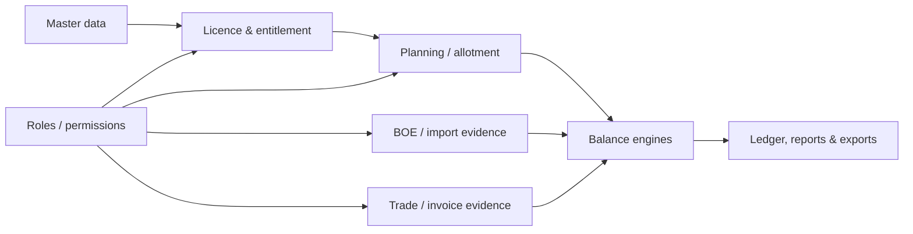

# Product vision

**Proposed for V1.** License Manager remains a Django/React modular monolith for DFIA/SION licences, export/import evidence, BOEs, allotments, trade and operational reporting. V1 should make consequential balances, allocations and provenance explainable while preserving validated legacy workflows behind explicit contracts.

It is not evidenced as a tenant-isolated SaaS, double-entry accounting system, or bank-reconciliation product. Those are separate product decisions, not implied V1 commitments.

Evidence: [assessment executive summary](../../assessment/EXECUTIVE_SUMMARY.md) (**Inferred from static inspection**) and current source inventory (**Verified by code**).
