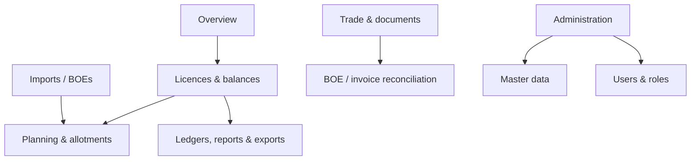

# Information architecture

**Proposed for V1.** Navigation follows work rather than model names:

Route registry becomes the sole declarative source for navigation labels, feature role hints, breadcrumbs, icons and route metadata. API authorization is not derived from it. Page headers expose one primary action, contextual secondary actions, saved filters where useful, and a visible data/provenance timestamp for financial surfaces.
