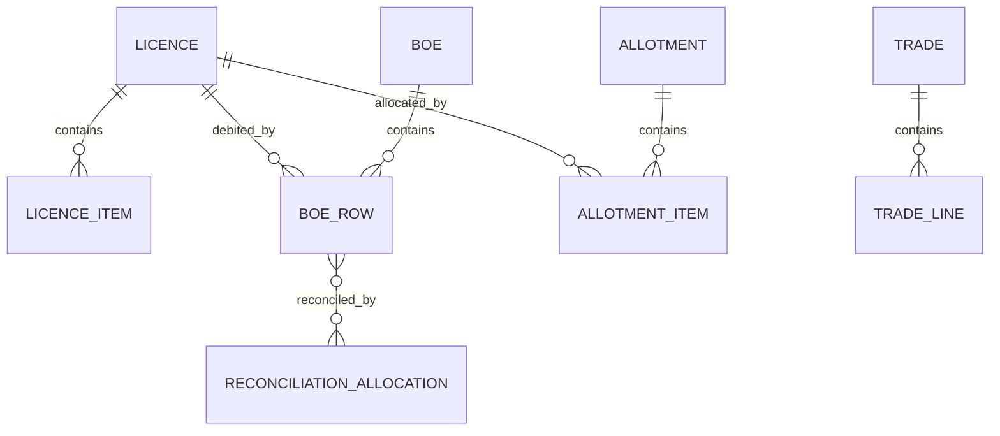

# Domain model

**Verified by code/static inspection.** Principal entities: licences and licence items; BOEs and rows; allotments, allotment items, allocation versions and shortfalls; trade documents, lines and payments; reconciliation allocations; core masters/sync state; task/replan/ledger-package state; users/roles; audit/activity records; and SION planning state.

This is conceptual, not a migration-ready physical ERD. FK deletion behaviour, exact constraints and indexes remain covered by the existing enterprise-rebuild schema evidence and must be revalidated against migrations before DDL changes.
