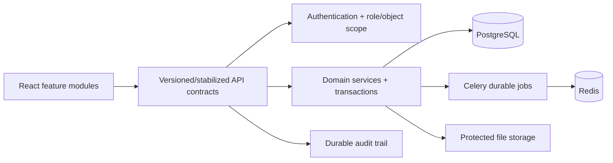

# Target architecture

**Proposed for V1.** Retain the Django/React modular monolith. Introduce compatibility boundaries before structural replacement.

Architecture changes: move calculations behind named domain-service contracts; keep Django apps as domains; use DTO serializers and explicit transaction boundaries for allocation/reconciliation; preserve routers while adding contract tests; isolate jobs with idempotency keys, lifecycle status and recovery; retain current API client while migrating feature-by-feature. Do not introduce microservices or replace persistence without an evidenced need.

Acceptance: old/new outputs are compared on golden datasets; each changed contract has API, permission and consumer tests; migrations are additive/verified/forward-recoverable.
