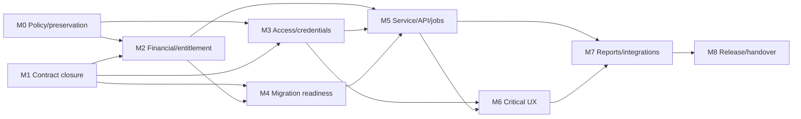

# Milestone register

**Proposed for V1.** This execution register expands the ordered [roadmap](implementation-roadmap.md), [dependency map](dependency-map.md), [risk register](risk-register.md), and traceability [closure protocol](../09-traceability/contract-closure-protocol.md). It authorizes no production, policy, data, or source-code change.

Estimates are relative (`S`, `M`, `L`, `XL`) rather than dates and remain estimates: policy, live-data evidence, API contracts, or external systems can change them. Each task must identify its exact `API-*`, `UI-*`, workflow, model/migration, and acceptance-test IDs before implementation.

## M0 — policy and preservation gate

| Field | Execution definition |
| --- | --- |
| Objective / priority / estimate | Preserve the baseline and obtain or explicitly defer D1–D6. **P0, M** (coordination-dependent). |
| Scope / exclusions | Record policy, owner, effective date, exceptions and non-goals for company/object scope, balances, SION, credentials, accounting scope and audit durability; preserve branch/legacy/ignored artifacts. **Excludes** changing behavior, data, schema or production. |
| Prerequisites / dependencies | Current preservation/decision registers and accountable business/security/accounting owners. Blocks policy-affecting work in M2–M7. |
| Expected areas / tasks | Documentation and golden-fixture selection only. Freeze decisions; select representative non-production cases; map each decision to affected `API-*`/`UI-*` IDs and R1–R3/R7. |
| Evidence / acceptance | Decision log has named approver and approved limitation/fallback where deferred; reproducible golden-fixture specification; preservation check. No implicit policy appears in a later task. |
| Recovery / risks / next | No source/data rollback needed. Stop affected work rather than infer policy. **Next:** M1/M4 discovery may run in parallel; M2/M3 await relevant approval. |

## M1 — contract and traceability closure

| Field | Execution definition |
| --- | --- |
| Objective / priority / estimate | Convert static/runtime discovery into individually auditable API, route, function, task and test contracts. **P1, XL** (354 APIs, 57 routes, 8,046 symbols; sliceable). |
| Scope / exclusions | Close consumer, DTO, authorization/scope, state/data effect, error/recovery and test fields. **Excludes** refactoring an incomplete contract merely to simplify documentation. |
| Prerequisites / dependencies | Current registers, dynamic registration/runtime evidence and D1/D4 for policy-dependent closure. |
| Expected areas / tasks | Documentation plus later characterization tests in DRF views/serializers/services, frontend pages/hooks, tasks/signals and commands. Apply closure protocol by risk batch; reconcile OpenAPI/schema gaps; attach exact tests and consumer paths. |
| Evidence / acceptance | Direct source/fixture/negative-role/object-scope/error-recovery/browser-state evidence. Every registered record has full fields or a precise owner-approved exclusion; family maps never satisfy the exit alone. |
| Recovery / risks / next | Preserve current references; R4 requires runtime reconciliation. **Next:** M2/M3/M5 consume only closed or approved contracts. |

## M2 — financial and entitlement characterization

| Field | Execution definition |
| --- | --- |
| Objective / priority / estimate | Freeze current output contracts before balance, allocation or planning redesign. **P0, L** (D2/D3 and fixture dependent). |
| Scope / exclusions | Customs/financial balances, rounding, hidden/restored BOEs, allocation/release, item availability, SION/restriction pools, replan/report provenance. **Excludes** merging formulas, entitlement-policy change or cached projection as debit authority. |
| Prerequisites / dependencies | D2/D3 approval or preserve-current fallback; M1 affected contracts and representative fixtures. |
| Expected areas / tasks | License balance/planning/replan services; allotment, BOE/trade/reconciliation consumers; ledger/report endpoints and frontend balance/allocation pages. Name each engine/as-of source; build golden positive/zero/rounding/reversal/hidden cases; characterize locks/on-commit replan. |
| Evidence / acceptance | Replayable calculation/API/report fixtures and stale/race allocation tests. Customs and Financial outputs stay separately reproducible and every display names source/provenance. |
| Recovery / risks / next | Retain old calculation/read path; forward-correct discrepancies through reconciliation. R1/R3 block release. **Next:** M4/M5. |

## M3 — authorization, documents and credential policy

| Field | Execution definition |
| --- | --- |
| Objective / priority / estimate | Apply approved D1/D4 policy consistently to APIs, downloads, exports, jobs and client behavior. **P0/P1, L**. |
| Scope / exclusions | Permission/action matrices, object/company rules, protected media, capability links, query-token compatibility and client credential posture. **Excludes** assumed tenancy or auth replacement without compatibility plan. |
| Prerequisites / dependencies | D1/D4, M1 consumer map, and controlled proxy/deployment test environment. |
| Expected areas / tasks | Permissions/authentication/querysets, protected media/proxy, export/package jobs and Axios/Auth context. Add direct anonymous/wrong-role/partial-role/approved-scope tests; inventory download consumers; inspect deployed proxy safely; design CSRF/CSP/cookie migration only if approved. |
| Evidence / acceptance | Direct API/media negative tests, approved allowed/denied company fixtures, revocation/download tests, staging proxy proof and browser denied/recovery states. Server behavior matches approved policy. |
| Recovery / risks / next | Use compatibility endpoint/feature flag where policy changes; preserve authenticated blob fallback. R2/D4 govern rollback. **Next:** M5/M6. |

## M4 — additive data and migration readiness

| Field | Execution definition |
| --- | --- |
| Objective / priority / estimate | Make each data change reconcilable and recoverable before rollout. **P1, L** (live-schema/backup environment dependent). |
| Scope / exclusions | Schema/data-quality reconciliation, additive constraints/indexes/backfills, backup/restore and forward recovery. **Excludes** destructive cleanup, drops and production migration. |
| Prerequisites / dependencies | M2 sources of truth; approved isolated/staging DB inspection; backup/restore environment; M1 model/lifecycle contracts. |
| Expected areas / tasks | Licence/allotment/BOE/trade/reconciliation/job models/migrations, data commands/runbooks. Compare live schema; name drift/duplicates; define batch/checkpoint/validation; rehearse backup, restore and forward correction. |
| Evidence / acceptance | Migration graph/schema diff, fixture upgrade/forward-recovery, before/after validation queries and restore drill. Every migration names predecessor/population/compatibility/rollback or forward recovery. |
| Recovery / risks / next | Expand/backfill/dual-read/contract sequence only; halt contract step and forward-correct on failure. **Next:** M5. |

## M5 — service, API and durable-job boundaries

| Field | Execution definition |
| --- | --- |
| Objective / priority / estimate | Stabilize consequential services, transactions and asynchronous recovery incrementally. **P1, XL**. |
| Scope / exclusions | Allocation/release, BOE correction, trade/reconciliation, ledger package/download, replan, sync and document processing. **Excludes** microservice/infrastructure replacement absent evidence. |
| Prerequisites / dependencies | M1 contracts, M2 financial paths, M3 guarded paths and M4 compatible data shapes. |
| Expected areas / tasks | Django services/viewsets/serializers/tasks/signals, OpenAPI, Celery/sync/storage and focused tests. Clarify DTOs compatibly; preserve locking/`atomic`/on-commit; add idempotency/retry states; resolve OpenAPI warnings; expose state transitions. |
| Evidence / acceptance | Rollback, duplicate/race, broker/worker/storage failure, idempotency-key, schema and direct authorization tests. Changed high-consequence operation has data-effect/recovery and compatibility/rollback proof. |
| Recovery / risks / next | Maintain old reader/API during compatibility; replay jobs idempotently/forward repair. R5/R8 prohibit release without recovery proof. **Next:** M6/M7. |

## M6 — design system and critical workflow delivery

| Field | Execution definition |
| --- | --- |
| Objective / priority / estimate | Modernize shared UI and high-frequency workflows without functional loss. **P1, XL**. |
| Scope / exclusions | Shell/navigation, form/table/error primitives, then licence, planning/allocation, BOE, trade, reconciliation and ledger routes. **Excludes** cosmetic replacement before the route/API/state contract closes. |
| Prerequisites / dependencies | M3 access behavior, M5 API contracts, route/action register and design-system specification. |
| Expected areas / tasks | `frontend/src` routes/pages/components/hooks/services/tokens and browser/component tests. Implement loading/empty/error/denied/retry patterns; migrate per workflow; preserve filters/deep links; add financial/destructive confirmation/provenance; repair E2E harness/fixture/contrast defect. |
| Evidence / acceptance | Component/browser L/E/S/D, keyboard/responsive/axe, direct API negative, visual/financial golden evidence. Each migrated `UI-*` gate retains behavior and accessible recovery states. |
| Recovery / risks / next | Preserve legacy route/component/API compatibility until accepted; route-scoped rollback, never data rollback. R6/R10 block browser-ready claims. **Next:** M7. |

## M7 — reports, integrations and operational gates

| Field | Execution definition |
| --- | --- |
| Objective / priority / estimate | Deliver protected, attributable exports/integrations and make operation observable/testable. **P1, L**. |
| Scope / exclusions | Report provenance, PDF/Excel/storage, peer sync/MDS, command controls, observability and CI gates. **Excludes** asserting GL/bank or compliance audit capability without D5/D6. |
| Prerequisites / dependencies | M3 document policy, M5 job/integration contracts, M6 routes and staging worker/storage/proxy/peer services. |
| Expected areas / tasks | Report endpoints/templates, storage/proxy, sync/MDS clients, commands, Celery, CI and deployment/observability config. Reconcile schema-gap reports; attach as-of source; exercise peer/media/replay failures; define dry-run/backup controls; add stratified CI gates. |
| Evidence / acceptance | Generated-file ACL/content, worker/storage/proxy drill, sync conflict/replay, command dry-run/restore and repaired Playwright/axe results. Reports have provenance/access; integrations have recovery evidence; CI diagnoses P0 regressions. |
| Recovery / risks / next | Retain legacy report read path; pause/replay failed sync from durable cursor; runbook forward recovery. **Next:** M8. |

## M8 — performance, UAT, release readiness and handover

| Field | Execution definition |
| --- | --- |
| Objective / priority / estimate | Prove the release is correct, operable and recoverable. **P2, L** (environment/UAT dependent). |
| Scope / exclusions | Performance/security regression, UAT, deploy/worker/proxy/backup drills, runbooks and final traceability review. **Excludes** treating unit-test green as operational evidence. |
| Prerequisites / dependencies | M0–M7 exits, approved exceptions, representative staging data, UAT and deploy/backup access. |
| Expected areas / tasks | CI/release configuration, target-like infrastructure, monitoring/logging, all P0/P1 workflows/docs. Establish budgets; run approved load/soak; execute UAT; rehearse deploy/rollback/restore/worker loss; reconcile docs/legacy disposition. |
| Evidence / acceptance | Recorded budgets; passing P0/P1 contract suite; signed UAT exceptions; deployment/restore/rollback evidence; final completion audit. All P0/P1 risks are closed or owner-accepted with expiry. |
| Recovery / risks / next | Release only with tested rollback/forward-recovery and verified backup. Approved P2/P3 becomes separate post-V1 backlog. |

## Parallelism and critical path

M1 characterization and M4 non-destructive schema discovery may run while M0 decisions are pending. M2/M3 are the correctness/access critical path. No later milestone may turn an unresolved D1–D6 policy into an implicit implementation decision.
