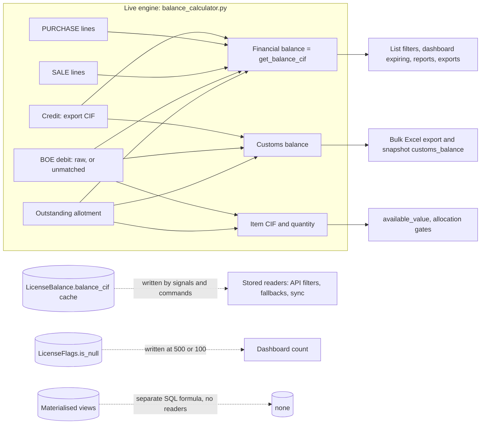

# DFIA Existing Implementation Gap Analysis

| Field | Value |
|---|---|
| Document | DFIA Existing Implementation Gap Analysis |
| Version | 0.1 (draft for review) |
| Status | **Draft** — not reviewed by the owner, not Approved, not Frozen |
| Date | 2026-11-01 |
| Measured against | `DFIA_BALANCE_MANAGEMENT_MASTER_SPECIFICATION.md` v0.1 (Draft, 212 lines, identical at `version-v1` tip `400e04c0`) |
| Method | Read-only source reading (grep and line reads). No source, migration, data, configuration or test was changed. No pytest run, no database access, no management command that writes, no Celery run. |
| Authority used | UD-002 (Approved, owner), UD-003 and UD-004 (answered), BD-01 (OPEN), Q-017 (see §7, records disagree), Q-022 (open) |

Labels used throughout:

- **VERIFIED** — read in the source at the cited `file:line`. Static reading only; no runtime run.
- **SUSPECTED** — inference from the code or the audit record, not reproduced.

Line numbers refer to the `version-v1` tip (`400e04c0`). The working tree now checked out is `feature/version-4` (see §7.3). For every cited balance-engine file the lines are identical at that HEAD, with one exception: `backend/apps/license/views/license.py` gained a 26-line logging-only `update()` override at line 541, so cited lines after 540 in that file are +26 at HEAD.

> This document does not choose any business rule. Where the code and an approved or open rule disagree, both sides are recorded and the owner decision is listed in §8.

---

## 1. Scope and summary of findings

- **What was measured:** every place that calculates, stores, displays or exports a DFIA balance (available CIF, available quantity, allotted/reserved CIF, BOE utilisation, invoice utilisation, Null DFIA, licence flags, dashboard, reports, Excel/PDF exports, API serializers, cached and materialised balances, Celery, database triggers, frontend arithmetic). Entity mapping for spec §11.
- **Headline:**
  - The "balance" is produced by at least seven independent computations, and at least four different figures are named "balance CIF" or "customs balance" (§2, §3).
  - The financial engine that drives `balance_cif` conflicts with approved UD-002 in three cases (GAP-001). Its treatment of an unconsumed allotment depends on whether a BOE is linked to the parent allotment, not on any rule (GAP-002). This is the substance of BD-01 and is recorded, not decided.
  - Null DFIA is defined as 500, 200, 100, 1,000/20,000 or product-specific values depending on the consumer (§6).
  - Stored caches and flags are not refreshed by all balance-changing writes, and the scheduled refresh task is undefined (GAP-009).
  - Quantity and foreign-currency CIF are computed (item level, and licence level for CIF FC). CIF INR is not computed as a balance dimension by any DFIA engine (GAP-017).

---

## 2. Summary table of calculation locations

Columns: **Canonical?** = computed by `LicenseBalanceCalculator` or `ItemBalanceCalculator` (`backend/apps/license/services/balance_calculator.py`) or a documented composition of them. **Conflict** = none / partial / conflict against the master spec or an approved rule.

### 2a. Canonical engine (`balance_calculator.py`)

| # | Location (file:line) | Function / class | Formula, in plain English | Canonical? | Spec conflict | Action (future, not decided here) |
|---|---|---|---|---|---|---|
| C-01 | `balance_calculator.py:1349` (batch `:1315`) | `LicenseBalanceCalculator.calculate_balance` | Credit (sum of export-item `cif_fc`) minus (non-hidden raw BOE debit + outstanding allotment), floored at 0. A "Customs" figure with no sale term. | Yes (customs variant) | Partial (floor; §7 needs signed values; GAP-013) | Keep only as an explicitly named customs figure (GAP-004). |
| C-02 | `balance_calculator.py:1406` (batch `:1434`) | `calculate_customs_balance` | As C-01 but includes hidden BOE debit. Equals the Customs Ledger running total. | Yes | Partial (floor; GAP-013) | Keep as the literal customs figure, labelled as such. |
| C-03 | `balance_calculator.py:1582` (`_calculate_financial_balance`), batch `:1654`; exposed as `models/core.py:330` `get_balance_cif` | `calculate_financial_balance` | Opening balance + purchase credit − **all** SALE line `cif_fc` − unmatched BOE debit − outstanding allotment, floored at 0. This is the figure that the list, filters, dashboard, most reports and the generic export call "Balance CIF" (the bulk Excel export is the exception, GAP-005). | Yes | **Conflict** with UD-002 in three cases (GAP-001); floor (GAP-013) | Resolve Q-016 first (§8), then align. |
| C-04 | `balance_calculator.py:1486` (batch `:1534`) | `calculate_opening_balance` | Three-way gate: if hidden BOE debit > 0, original credit − hidden − purchase; else if any purchase, 0; else original credit. | Yes | Partial (hidden-BOE rule, Q-004 record conflict; GAP-024) | Depends on Q-004. |
| C-05 | `balance_calculator.py:970` (batch `:1196`); row annotation `:711–840` | `calculate_allotment`, `_annotate_allotment_contribution` | For each allotment item: `cif_fc − min(cif_fc, active BOE-allocated CIF)`, floored at 0, **but forced to 0 for the whole item if any BOE is M2M-linked to the parent allotment** (`:825–826`, `:835`, `:1251–1252`). Includes all allotment types. | Yes | **Conflict** with §10 reading and partial vs §4.2 (GAP-002, GAP-003) | Decide BD-01 (§8). |
| C-06 | `balance_calculator.py:459` (batch `:645`); `get_debit_rows` `:369`; `_linked_boe_debit_exclusion_case` `:294`; `resolve_boes_represented_by_invoice` `:210` | `calculate_debit` | Unmatched BOE debit: each debit row contributes `cif_fc − min(cif_fc, own formal allocation + linked-candidate full CIF)`, floored at 0. A BOE with any "represented" link has its unallocated sibling rows excluded entirely. | Yes | **Conflict** with UD-002 (unbilled siblings, partial billing; GAP-001, GAP-023) | As GAP-001. |
| C-07 | `balance_calculator.py:512` (batch `:542`) | `calculate_boe_debit_total` | Raw, unconditional, non-hidden BOE debit `cif_fc`. | Yes | Partial (used only by customs path and snapshot `debited_cif`) | Keep, label. |
| C-08 | `balance_calculator.py:562` (batch `:591`) | `calculate_hidden_boe_debit_total` | Raw debit of genuinely hidden (previous-owner) rows. | Yes | Partial (Q-004 record conflict) | Depends on Q-004. |
| C-09 | `balance_calculator.py:1063` (batch `:1265`); `calculate_purchase_credit` `:1091` | `calculate_trade`, `calculate_purchase_credit` | Sum of every SALE line `cif_fc` regardless of BOE link; sum of PURCHASE line `cif_fc`. | Yes | **Conflict** with UD-002 for unlinked sales (GAP-001) | As GAP-001. |
| C-10 | `balance_calculator.py:92` (batch `:616`) | `calculate_credit` | Sum of export-item `cif_fc` for the licence (the licence's face CIF). | Yes | None | None. |
| C-11 | `balance_calculator.py:1743` (batch `:1763`) | `ItemBalanceCalculator.calculate_item_attributed_balance` | Item CIF = item's own `cif_fc` − its own raw visible BOE debit − its outstanding AT allotment CIF, floored at 0. **No sale term.** Used when the item has positive `cif_fc`. | Yes | Partial (direct sales not deducted at item level; GAP-021) | Decide with Q-016/Q-005. |
| C-12 | `balance_calculator.py:1786` (`calculate_item_credit_debit`), `:1846` (`calculate_item_balance`) | item CIF fallback | When item `cif_fc` = 0: credit = **licence-wide** export CIF and debit = **licence-wide** raw BOE debit (`:1798–1812`). Used by allocation (`apps/allotment/services/allocation_service.py:73`), `effective_cif_mode.py:75`, `sion_planning_execution.py:1587`. | Yes | **Conflict** with spec §3.1 (utilisation of one item must not consume another item's entitlement) (GAP-020) | Decide BD-06 (§8). |
| C-13 | `balance_calculator.py:1958` (`calculate_available_quantity`), batch `:2030`; debited batch `:2001` | `ItemBalanceCalculator.calculate_available_quantity` | Item quantity = `quantity − raw visible BOE debit qty − outstanding AT allotment qty − unpaired direct SALE qty`, floored at 0. ARO allotment quantity is not netted. | Yes (the only quantity engine) | Partial (ARO omitted, BD-01/BD-10; GAP-015, GAP-017) | Decide BD-01 (AT vs ARO) and BD-10. |
| C-14 | `balance_calculator.py:1861` (`_direct_sale_quantity_rows`), `:1929` | `calculate_direct_sale_quantity` | Quantity of SALE lines with no BOE link and no trade-pair link, net of formal invoice allocation. Linked pairs net to zero. | Yes | Partial (BD-10 open) | Decide BD-10. |
| C-15 | `balance_calculator.py:2105` | `calculate_available_value_for_allocation` | Max allocatable quantity = min(available quantity, item balance / unit price). No callers found. | Yes | None | Dead code candidate (GAP-032). |
| C-16 | `models/core.py:1019–1031` (`balance_cif_fc`), `:1033–1100` (`available_value_calculated`); batch `services/condition_pool.py:250–292` | `LicenseImportItemsModel.available_value_calculated` | Available value: 0.01 marker → 0.01; `%` condition → min(pool remaining, licence financial balance); positive item CIF → C-11; otherwise → licence financial balance (C-03). | Yes (indirect) | Partial (0.01 sentinel and zero-CIF borrowing not in spec; GAP-020) | As GAP-020. |

### 2b. Read model, stored caches and materialised views

| # | Location (file:line) | Function / class | Formula, in plain English | Canonical? | Spec conflict | Action |
|---|---|---|---|---|---|---|
| S-01 | `backend/apps/license/services/balance_snapshot.py:62` (`get_snapshot_bulk`), `:285` (`get_snapshot`) | Balance snapshot | Read model. `balance_cif` = C-03. `customs_balance` = C-01. `customs_available_balance` = C-02. Item `available_quantity` computed inline at `:203` as `quantity − debited − outstanding AT` (**no direct-sale term**). | Composition, except `:203` | **Conflict** with C-13 and with the module's own docstring ("same formula") (GAP-014) | Route item quantity through C-13. |
| S-02 | `backend/apps/core/scripts/calculate_balance.py:7–98` (`_get_aggregated_values`, `calculate_available_quantity`) | stored item quantity | `quantity − (debited + ARO qty) − outstanding AT qty − direct SALE qty`, floored, with `float` arithmetic. | No (parallel formula that reuses engine helpers for components) | **Conflict** with C-13 (ARO subtracted here, not there); §6(1) float (GAP-015, GAP-025) | Single formula (GAP-015). |
| S-03 | `calculate_balance.py:125–161` (`calculate_available_value`) | stored item available value | If every other item has zero CIF, serial 1 takes the licence's live financial balance. Otherwise `available_value_calculated` (C-16). | Indirect | Partial (serial-1 rule not in spec) | Decide (BD-06). |
| S-04 | `calculate_balance.py:164–214` (`update_balance_values`) | stored writer | Writes six stored item fields (`update_fields`), and `LicenseFlags.is_null` at **100** (`:210`) using live `get_balance_cif`, on every item refresh. | Partial | **Conflict** with UD-003/BR-003 (200) and with signals (500) (GAP-006) | Single threshold. |
| S-05 | `backend/apps/license/signals.py:280–329` (`update_license_flags`); callers `:352, :398, :412, :445, :513, :529, :545, :569`; serializer callers `serializers/_license_write.py:300, :894`; `bill_of_entry/services/boe_service.py:484` | stored writer | Writes `LicenseBalance.balance_cif` = live financial (when different), `LicenseFlags.is_expired`, and `LicenseFlags.is_null` at **500** (`:316`). Also `_update_all_import_items_available_value`. | Yes (value) | **Conflict** on threshold (GAP-006) | As GAP-006. |
| S-06 | `backend/apps/license/services/validation_service.py:299–330` | `LicenseValidationService.update_license_flags` | Duplicate of S-05 with `is_null` at **500** (`:322`). Returns a dict; does not persist. No callers found. | Yes (value) | Conflict (threshold); dead | GAP-032. |
| S-07 | `backend/apps/license/management/commands/sync_licenses.py:168–200` (threshold `:37`, use `:194`) | management command (writes) | Writes `LicenseBalance.balance_cif` = live financial (quantized) and `LicenseFlags.is_null` at **500**. | Yes (value) | Conflict (threshold) | GAP-006. |
| S-08 | `backend/apps/license/management/commands/update_balance_cif.py:122–140` | management command (writes) | Writes `LicenseBalance.balance_cif` = `calculate_financial_balance`. | Yes | None (value); manual trigger only | GAP-009. |
| S-09 | `backend/apps/core/management/commands/sync_from_ge_server.py:225–240` | management command (writes) | Writes `LicenseBalance.balance_cif` = `get_balance_cif` via queryset `.update()` (bypasses signals), and refreshes item `available_value`. | Yes | None (value) | GAP-009. |
| S-10 | `backend/lmanagement/celery.py:58–70` → task `identify_licenses_needing_update` | scheduled refresh | Beat runs twice daily. **No task with that name is defined anywhere in the backend.** | n/a | Stale-cache risk | GAP-009. |
| S-11 | `backend/apps/core/materialized_views.py:37–98` (`license_balance_mv`), `:115–175` (`item_balance_mv`), `:194–~235` (`dashboard_stats_mv`) | SQL materialised views | License: total export `cif_fc` − Σ debit **`cif_inr`** − Σ **all** allotment `cif_fc`. Item: `quantity − Σ debit qty − Σ all allotment qty`, and `cif_fc − Σ debit cif_inr − Σ allotment cif_fc`. Two LEFT JOINs (debit rows and allotment rows) in one GROUP BY. No hidden, linked-BOE, AT-only or partial netting. | No | **Conflict** with spec A1 and BD-05 (GAP-016) | Remove or rebuild on the engine. |
| S-12 | `materialized_views.py:394` (`get_license_balance`), `:425` (`get_item_balance`), `:468` (`get_dashboard_stats`) | readers of S-11 | No callers found. Refresh tasks at `backend/apps/core/tasks_materialized_views.py:20–70` are not scheduled, and their signal module `signals_materialized_views.py` is not imported anywhere (ISS-016). | No | Dormant but present | GAP-016. |
| S-13 | `backend/apps/bill_of_entry/models.py:451–500`; `backend/apps/allotment/models/core.py:445–460` | on-commit item refresh | RowDetails and AllotmentItems save/delete call `update_balance_values` after commit. Failures are logged and swallowed (`bill_of_entry/models.py:462`). | Indirect | Stale caches silently (GAP-009) | GAP-009. |
| S-14 | `backend/apps/reconciliation/models.py` (no `post_save`/`post_delete` receiver for `BOEAllotmentAllocation`); `backend/apps/license/signals.py:583–587` (`InvoiceBOEAllocation`) | allocation write triggers | `InvoiceBOEAllocation` save refreshes item stored fields only, not `LicenseBalance` nor licence flags. `BOEAllotmentAllocation` save refreshes nothing. | n/a | **Conflict** with §6(6) and A1 (GAP-009) | GAP-009. |
| S-15 | `backend/apps/license/models/core.py:200–202` (`LicenseDetailsModel.balance_cif`), `:2360–2381` (`LicenseBalance`) | stored read | `balance_cif` property reads the cached `LicenseBalance.balance_cif`. Name collides with live `get_balance_cif` (`:330`). The cache field has a Python-only validator (`:2370–2375`). | No | Conflict with A1 when read as "the" balance (GAP-004, GAP-034) | GAP-004. |
| S-16 | `backend/apps/core/filtersets.py:118–120` (`is_active`, `is_expired` on `flags__`), `:136–137` (`balance_cif_min/max` on `balance__balance_cif`), `:181–187` (`has_balance`); used by `views/license.py:251` | API filters | Filter on stored flags and stored balance. | No | Conflict with A1 (GAP-010) | GAP-010. |
| S-17 | `backend/apps/license/serializers/license.py:826–847` (fallback `:845`); list override `:950–970` (`:961`, `:967`) | licence serializer | Live balance from the request context when present; otherwise the stored `obj.balance_cif`. Docstring at `:827–832` names `calculate_balance_for_licenses` (customs) but the code uses the financial map (GAP-033). | Live with stored fallback | Partial (GAP-010, GAP-033) | GAP-010. |
| S-18 | `backend/apps/trade/serializers.py:102–118` (`get_authoritative_available_cif`) | trade line serializer | Legacy mode returns stored `item.available_value`; individual-CIF mode uses `effective_source_row_cif_available`. | No (legacy mode) | Conflict with A1 (GAP-010) | GAP-010. |
| S-19 | `backend/apps/license/serializers/incentive.py:42–44` (`get_balance_value`) | incentive serializer | Returns stored `balance_value`, documented as "deprecated, use stored field" (`models/core.py:2207–2211`). | No | Conflict with A1 | GAP-010. |

### 2c. Reports, dashboards and API display

| # | Location (file:line) | Function / class | Formula / rule, in plain English | Canonical? | Spec conflict | Action |
|---|---|---|---|---|---|---|
| R-01 | `backend/apps/license/views/dashboard.py:103–152` (`_get_license_stats`) | dashboard counts | Active / expired / Null counts from **stored** flags (`:110–112`). Expiring-soon counts use the live financial balance at **100** (`:135–142`). | Counts: no; expiring: yes | **Conflict** (stored flags; threshold 100) (GAP-007, GAP-008) | As GAP-007. |
| R-02 | `dashboard.py:214–287` (`_get_expiring_licenses`) | expiring list | Live financial balance `>= 100` (`:262`). Returns `balance_cif` from the live map (`:282`). | Yes | Conflict (threshold 100) | GAP-008. |
| R-03 | `frontend/src/pages/Dashboard.tsx:416–425` (card "Missing DGFT — Require data entry", count `stats.licenses.null_dfia`) and links at `:425`, `:479`, `:491` | dashboard card | Card count = stored Null count (R-01). Drill-down link `/licenses?is_null=True&is_expired=all` uses the live list filter at 200. | n/a | **Conflict** card vs drill-down (GAP-007; Q-018) | GAP-007. |
| R-04 | `backend/apps/license/views/license.py:623–725` (`apply_advanced_filters`); is_null live block `:663–678` (`:689–704` at HEAD) | licence list filter | `is_null=True` → live financial `< 200`; `is_null=False` → `>= 200`. Balance range filter is live (`:703–721`). Default-value lookup reads `default_filters.get('is_null')` (`:661`) while metadata declares `flags__is_null` (`:134`), so the server default is never applied when the parameter is absent. | Yes | Threshold conforms to BR-003 (200). Default not applied (GAP-011). | GAP-011. |
| R-05 | `views/license.py:309–336` (`get_serializer_context`, `prepare_export_context`) | list / export context | Batch live map = `calculate_financial_balance_for_licenses` for the page and for the export. | Yes (C-03) | Depends on C-03 | GAP-001. |
| R-06 | `views/license.py:425–470` (`retrieve`, "operational reconciliation") | licence detail | `actual_balance_cif = gross − actual BOE − actual unlinked allotment`; `balance_cif` key = `gross − (BOE + unlinked allotment + new planned CIF)`. Uses planning usage, not the engine. | No | **Conflict**: a second figure named `balance_cif` (GAP-004, GAP-026) | GAP-004. |
| R-07 | `backend/apps/license/services/planning_usage_reconciliation.py:81–150` (`aggregate_license_usage`) | planning usage | BOE debit via `eligible_boe_debits_for_license`. Allotment excluded entirely if linked by M2M **or** if `allotment.is_boe` is True (`:123`, a stored flag). No partial netting. | No | Partial (GAP-026) | GAP-026. |
| R-08 | `backend/apps/license/services/planning_tolerances.py:9–30`; applied at `views/license.py:419–424` | planner display | Shows CIF residual `< 500` as 0.00, quantity residual `< 200` as 0, remaining quantity `< 100` as 0. Presentation only. | No | Not addressed by spec (GAP-029) | GAP-029. |
| R-09 | `backend/apps/license/views/item_pivot_report.py:600–690` (`min_balance=200` default; live map `:681`); `backend/apps/license/services/item_pivot_service.py:32–43` (`_add_balance_fields`) | item pivot | `balance_cif = max(canonical item CIF capacity − (BOE used + allotted + billed), 0)`. Allotted counted regardless of BOE link. | No | Different formula (GAP-026) | GAP-026. |
| R-10 | `backend/apps/license/views/item_report.py:171–250` (`generate_report`; `min_balance=200` default; filters on stored `available_value` `:242`, `available_quantity` `:246`); `:388–393` (stored `available_value` for display) | item report | Filters and displays stored item values. | No | Mixed sources (GAP-027) | GAP-027. |
| R-11 | `backend/apps/license/item_report.py:211–445`, `:606–681` (`biscuit_dfia`, `confectionery_dfia`, `namkeen_dfia`, `tractor_dfia`, `steel_dfia`, `glass_dfia`, `pickle_dfia`) | product DFIA tables | Each product uses `dfia.get_balance_cif > limit` (live financial) with product-specific limits (see §6). Biscuit, confectionery and namkeen: 20,000 expired / 1,000 otherwise. Tractor 50,000 / 999. Steel 8,000 / 999. Glass 8,000 / 200. Pickle 8,000 / 500. | Yes (value) | Conflict with BR-003 (one threshold) (GAP-008) | GAP-008; Q-017. |
| R-12 | `backend/apps/license/services/report_service.py:75–90` (`split_licenses_by_balance`); biscuit `:196`; confectionery `:247` | DFIA report split | Per-licence live `get_balance_cif > limit` (strict `>`). Limit 20,000 when expired, 1,000 otherwise. Low group is labelled "NULL DFIA". Per-licence call, not batched. | Yes (value) | **Conflict** with BR-003 (200) and UD-003 (Q-017 record conflict) (GAP-008) | GAP-008; Q-017. |
| R-13 | `backend/apps/license/views/license_report.py:108–146`, `:190–208` (`live_balance_by_license` `:119`; `>= 200` `:124`; `< 200` `:129`) | licence report | Live financial balance; Null split at 200. | Yes | None | None. |
| R-14 | `backend/apps/license/views/active_dfia_report.py:104–156` (live `:114`; `>= 200` `:119`; `< 200` `:124`); item quantities from `get_item_data(name)['available_quantity_sum']` `:163–172` | active DFIA report | Balance live at 200. Item quantity source not traced (SUSPECTED stored aggregate). | Balance: yes; quantity: SUSPECTED no | Quantity source unverified (GAP-027) | Trace before change. |
| R-15 | `backend/apps/license/views/active_licenses_report.py:108–120` (`get_balance_cif` `:113`; `< 100.00` `:114`); item totals from stored fields `:259–261` | active licences report | Licence balance live at **100**; item totals from stored `available_quantity`/`available_value`. | Mixed | Conflict (threshold 100); mixed sources (GAP-008, GAP-027) | As listed. |
| R-16 | `backend/apps/license/views/expiring_licenses_report.py:100–112` (`get_balance_cif` `:105`; `< 100.00` `:106`); items stored `:251–253` | expiring licences report | As R-15. | Mixed | As R-15 | As listed. |
| R-17 | `backend/apps/license/views/inventory_balance_viewset.py:19–180` (`Sum('available_quantity')`, `Sum('available_value')` at `:158–160`); `inventory_balance_report.py:32–250` (`:182–184`) | inventory balance | Sums stored item fields across licences. | No | Stored-cache dependency (GAP-009, GAP-015) | GAP-009. |
| R-18 | `backend/apps/license/views/planned_report.py:85` (`min_balance=200`), `:159–161` (stored filters), `:215–261` (live licence balance `:222`, `:261`; stored `available_*` `:259–260`) | planned report | Mixed live licence balance and stored item values. | Mixed | Mixed sources (GAP-027) | GAP-027. |
| R-19 | `backend/apps/license/services/license_overview_summary.py:49–66` (uses snapshot); `services/license_overview_items.py:6–49` (stored `available_quantity` at `:10`, `:49`; documented as deliberately distinct from the snapshot) | licence overview | Summary uses the snapshot (financial balance). Item rows use stored quantity. | Summary: yes; items: no | Documented divergence (GAP-027) | As listed. |
| R-20 | `backend/apps/license/services/custom_ledger_pdf.py:75–84` | custom ledger PDF | `available = item.balance_quantity` (stored-lineage, C-20). | No | Divergence from C-13 (GAP-015) | GAP-015. |
| C-20 | `backend/apps/license/models/core.py:973–990` (`balance_quantity`, cached) | item property | Delegates to S-02; fallback path uses the legacy `allotment__bill_of_entry__isnull=True` join and has no direct-sale term. Callers: `sync_from_ge_server.py:249`, `report_fetch.py:104`, `core/scripts/license_script.py:32–38`, `custom_ledger_pdf.py:80`. | No | Conflict with C-13 (GAP-015) | GAP-015. |

### 2d. Exports

| # | Location (file:line) | Function | Formula / rule, in plain English | Canonical? | Spec conflict | Action |
|---|---|---|---|---|---|---|
| E-01 | `backend/apps/license/services/exporters/license_balance_excel.py:879–880` (single-licence Excel, financial); "Balance Quantity" from stored `item.available_quantity` `:271` | `build_balance_excel` / `_write_license_sheet` | Balance CIF = `get_balance_cif` (financial). Quantity = stored item field. | CIF: yes; quantity: no | Mixed sources (GAP-027); same workbook shows two balance sources | As listed. |
| E-02 | `license_balance_excel.py:1602–1604`, used at `:1402` and `:1460` (bulk Excel) | `build_bulk_balance_excel` | Balance CIF = `calculate_balance_for_licenses` (**customs** route, hidden excluded, floored). | Yes (customs engine) | **Conflict** with E-01 for the same licence (GAP-005) | GAP-005. |
| E-03 | `license_balance_excel.py:1166–1214` (`canonical_balance_map` from `CanonicalLedgerService`) | `build_balance_excel` | Per-transaction "running balance" = canonical opening + purchases − sales (see `canonical_ledger_service.py:714` docstring). | No | Fourth running-balance formula (GAP-030) | GAP-030. |
| E-04 | `license_balance_excel.py:8` (`build_balance_excel_unused`), routed from `views/license.py:911–915` | `balance_excel_unused` endpoint | Financial. The function name says "unused" but the endpoint route exists. | Yes | Naming (GAP-033) | GAP-033. |
| E-05 | `backend/apps/license/services/exporters/license_balance_pdf.py:99` (ledger built without canonical data), `:219–220`, `:332–340`, `:650` (`engine_balance`), `:1124`, `:1196`, `:1230` | balance PDF | Shows "Current Available Balance" (ledger running balance) and "Licence Balance Engine" (financial) side by side with the difference. | Yes (engine); running ledger is a second computation | Two figures shown (GAP-001 flows, GAP-030 not applicable here) | Keep both, label. |
| E-06 | `backend/apps/license/services/license_balance_ledger_builder.py:663–703` (`build_financial_ledger`); override `:670–672`; `:951–978` (`build_customs_ledger`) | ledger builder | Financial: `engine_balance` = C-03; `computed_balance` = row running balance; **when `canonical_data` is supplied** (`views/ledger.py:677` path), `computed_balance` is replaced by the canonical running balance. Customs ledger: engine = C-02. | Partial | Conflict when override applies (GAP-030) | GAP-030. |

### 2e. Frontend arithmetic

| # | Location (file:line) | Component | Formula / rule | Canonical? | Spec conflict | Action |
|---|---|---|---|---|---|---|
| F-01 | `frontend/src/components/LicenseBalanceModal.tsx:1017–1030` | balance modal | Displays "Balance Quantity = Total − Debited − Allotted" and computes `quantity − debited_quantity − allotted_quantity` from stored item fields. | No | **Conflict** with C-13: omits direct-sale and ARO terms (GAP-031) | GAP-031. |
| F-02 | `frontend/src/components/planning/PlanningEditor.tsx:278–279`, `:432–437`, `:769–801` | planning editor | Client comparisons: "over"/"completed" from API `available_quantity`; `remaining = available − planned`; `cifRemaining = poolBalance − totalCif`. Tolerance `1e-6`. | No (presentation) | SUSPECTED consumer of stale or differently-derived values (GAP-031) | As listed. |
| F-03 | `frontend/src/pages/masters/entitySections.ts:62` | master form | Field `is_null_dfia` has no backend counterpart (grep found none). | n/a | Orphan field (GAP-033) | GAP-033. |
| F-04 | Frontend in general | — | Searched `frontend/src` for balance arithmetic and threshold literals (100/200/500/1000/20000). No client-side Null threshold found; Null filtering is server-side. | — | None | — |

### 2f. Database

| # | Location | Finding | Canonical? | Spec conflict | Action |
|---|---|---|---|---|---|
| D-01 | `backend/apps/*/migrations` | **No database trigger or PL/pgSQL function** for balances (grep for `CREATE TRIGGER`, `CREATE OR REPLACE FUNCTION`, `plpgsql` found nothing). `RunSQL` exists in `license/0005` (drops the three MVs, `:192–194`), `core/0003` (recreates them via `create_materialized_views`), and `license/0006–0008`, `0052` (not balance logic). | n/a | None | None. |

**Counts:** 67 rows: 16 canonical-engine (C-01 to C-16), 19 stored or read-model (S-01 to S-19), 21 report and API (R-01 to R-20, plus C-20), 6 export (E-01 to E-06), 4 frontend (F-01 to F-04), 1 database (D-01). F-04 and D-01 record absences, and R-05 is a pass-through. Many rows reuse the same formula, so the number of distinct formulas is smaller (see §3).

---

## 3. Engine-by-engine description

### 3.1 How the pieces fit

### 3.2 Financial engine (drives `get_balance_cif` and `balance_cif` in the UI)

- **Computes:** Opening balance (C-04) + purchase credit (C-09) − **all** SALE line CIF (C-09) − unmatched BOE debit (C-06) − outstanding allotment (C-05), floored at zero (C-03).
- **BOEs:** raw BOE rows are counted only where not matched to a sale. A row with a formal `InvoiceBOEAllocation` counts its unallocated remainder. A row whose BOE is "represented" by a sale (legacy `trade.boes` tag or formal allocation) is excluded only if it has no formal allocation of its own (`_linked_boe_debit_exclusion_case`, `balance_calculator.py:294`).
- **Allotments:** each allotment item contributes `cif − min(cif, active BOE-allocated CIF)`. If **any BOE is M2M-linked to the parent allotment**, the whole item contributes zero (`:825–826`). Allotments of every type (AT and ARO) are included (no type filter, see GAP-003).
- **Unconsumed allotment reduces the result? Depends on the link flag (see §3.6).**
- **Floors:** the final result is clamped at zero (`:1582` function). Over-utilisation is therefore not visible in this figure (GAP-013).

### 3.3 Customs engine (`calculate_balance`, `calculate_customs_balance`)

- **Computes:** Credit (C-10) − raw non-hidden BOE debit (C-07) [− hidden BOE debit for the customs variant] − the same allotment term as C-05, floored at zero.
- **Sales:** not deducted. A billed BOE is counted once, at BOE value.
- **Unconsumed allotment:** the same rule as §3.2 (reduces when no BOE is linked to the parent; zero when linked).
- **Used by:** the bulk Excel export (E-02), snapshot `customs_balance` and `customs_available_balance`, and the customs ledger. Not used by the list, dashboard or single-licence Excel.

### 3.4 Item engines (`ItemBalanceCalculator`)

- **Item CIF (C-11):** `item cif_fc − own visible BOE debit − own outstanding AT allotment CIF`, floored. No sale term.
- **Item CIF fallback (C-12):** when item `cif_fc` = 0, credit is the licence total and debit is the licence-wide raw BOE debit. This is the value used by allocation.
- **Item quantity (C-13):** `quantity − visible BOE debit quantity − outstanding AT allotment quantity − unpaired direct SALE quantity`, floored. This is the only quantity engine. It does not net ARO allotment quantity.
- **Available value (C-16):** 0.01 sentinel, or `%` pool, or attributed CIF (C-11), or the licence financial balance.

### 3.5 Other computations that consume balances

- **Stored caches** (S-02 to S-09): the item quantity formula differs from C-13 (ARO netted). Licence `balance_cif` is refreshed only on the paths in §5 (GAP-009).
- **Snapshot** (S-01): composes the engines but computes item quantity without the direct-sale term (GAP-014).
- **Materialised views** (S-11): an older formula. Not read and not refreshed (GAP-016).
- **Planning usage** (R-07, R-09): a separate allotment rule with no partial netting, and a capacity-based CIF balance.
- **Ledger engines** (E-06, E-03): the financial ledger's `computed_balance` is a row-by-row running total of the same concepts. When canonical data is supplied it is replaced by the canonical running balance (opening + purchases − sales, which does not net BOEs or allotments at all, per `canonical_ledger_service.py:714`).

### 3.6 BD-01: unconsumed allotment, both sides recorded (not decided)

Worked case from spec §4.3: licence entitlement 100, allotment 40, BOE allocated 25 against it.

| Reading | Result | Where the current code lands |
|---|---|---|
| §4.2 / BD-01 "reserve" side: the unconsumed 15 still reduces the balance. | 100 − 25 − 15 = **60** | Reached when the allotment has **no** BOE M2M link. The item contributes `40 − min(40, 25) = 15` (C-05), so the financial result is 60. |
| UD-002 as worded (per spec §4.3 table): the unconsumed 15 does not reduce the balance. | 100 − 25 = **75** | Reached when **any** BOE is M2M-linked to the parent allotment. The whole allotment item contributes 0 (`:825–826`), so the result is 75 for the wrong reason (the 15 is dropped, not "not reserved"). |

- **VERIFIED:** the current code produces 60 or 75 depending on the link flag, not on an approved rule. This is GAP-002.
- **SUSPECTED:** in the usual BOE-form flow the M2M link is set (the code comment at `balance_calculator.py:~728` says so), so 75 is the common result in production. Not checked against data.
- **Not decided here.** Choosing the target rule is BD-01. Whichever way BD-01 goes, the link-dependent zeroing is a defect against any single rule (GAP-002).
- The quantity dimension has the same mechanism: `contributed_qty` is zeroed under the same link condition, so item quantity behaves the same way (C-13).

### 3.7 Hidden (previous-owner) BOEs

- A BOE is hidden only when its `invoice_no` is `OTH` **and** its latest `ReconciliationLog` entry is a hide (`bill_of_entry/models.py:55–58`, docstring). The `OTH` string alone is not used because about 35–40% of real BOEs carry it as ordinary data (docstring).
- Live engines exclude hidden rows (C-07 and C-06 use `exclude_hidden`). The customs ledger and customs balance include them (C-02). The materialised views ignore hiding (S-11).
- The spec is silent on hidden BOEs. Q-004 is recorded as both "Confirmed (option A)" and "PENDING" (see §7.2).

---

## 4. Entity mapping (spec §11)

All names below were confirmed by grep in the `version-v1` tip. Field names were read from the model definitions.

| Spec entity (§11) | Actual model (file:line) | Verified? | Fields that matter for balances | Notes |
|---|---|---|---|---|
| DFIALicense | `LicenseDetailsModel` (`backend/apps/license/models/core.py:91`) | VERIFIED | `license_number`, `license_date`, `license_expiry_date`, `exporter` FK. Balance is not a column here; `balance_cif` is a property reading `LicenseBalance` (`:200–202`). | Live balance is `get_balance_cif` (`:330`). |
| DFIALicenseItem | `LicenseImportItemsModel` (`core.py:902`) | VERIFIED | `license` FK (`:904`), `serial_number` (`:903`), `hs_code` FK (`:907`), `quantity` (`:912`), `cif_fc` (`:916`), `cif_inr` (`:917`), stored `available_quantity` (`:919`), `available_value` (`:920`), `debited_quantity` (`:922`), `debited_value` (`:923`), `allotted_quantity` (`:925`), `allotted_value` (`:926`), `condition_type` (`:930`), `is_restricted` (`:928`) | Item-wise entitlement is `cif_fc` on this row. Stored fields are caches (S-02, S-04). |
| Licence entitlement (credit side) | `LicenseExportItemModel` (`core.py:860`) | VERIFIED | `license` FK (`:861`), `cif_fc` (`:883`), `cif_inr` (`:884`), `net_quantity` (`:870`), `norm_class` FK (`:866`) | Source of C-10 (licence face CIF). |
| DFIANorm | `HeadSIONNormsModel` (`backend/apps/core/models.py:440`), `SionNormClassModel` (`core/models.py:453`) | VERIFIED (names differ) | Norm class is on `LicenseExportItemModel.norm_class` (`core.py:866`) | Spec names `HeadSIONNorms`/`SionNormClass` do not exist; the real names carry a `Model` suffix. |
| DFIAAllotment | `AllotmentModel` (`backend/apps/allotment/models/core.py:46`) | VERIFIED | `type` (`:55`, AT/ARO), `required_quantity` (`:56`), `cif_fc` (`:68`), `cif_inr` (`:76`), `is_boe` (`:112`, stored cache), `is_allotted` (`:113`), `is_approved` (`:114`); BOE link is the reverse M2M `BillOfEntryModel.allotment` (`bill_of_entry/models.py:212–216`) | `is_boe` is a stored boolean that the balance engine does not read (it uses the M2M). Planning usage does read it (R-07). |
| DFIAAllotmentItem | `AllotmentItems` (`allotment/models/core.py:212`) | VERIFIED | `item` FK → `LicenseImportItemsModel` (`:213–215`), `allotment` FK (`:221`), `qty` (`:241`), `cif_fc` (`:235`), `cif_inr` (`:229`), `is_boe` (`:247`), `status` (`:285`: CREATED/RELEASED/REACTIVATED/COMPLETED), `released_quantity` (`:298`), `plan_line` FK (`:270`) | **`status` and `released_quantity` are not read by the balance engine.** No code path found that writes `RELEASED` (grep of allotment, reconciliation, license services). Cancellation in practice is deletion. |
| DFIABOE | `BillOfEntryModel` (`backend/apps/bill_of_entry/models.py:185`) | VERIFIED | `bill_of_entry_number` (`:196`), `bill_of_entry_date` (`:197`), `exchange_rate` (`:205`), `allotment` M2M (`:212`), `invoice_no` (`:217`, `OTH` is the hidden marker `:55`), `invoice_date` (`:218`) | "Hidden" is not a column: it is derived from `invoice_no` and the latest `ReconciliationLog` entry (`:58`). |
| DFIABOEItem | `RowDetails` (`bill_of_entry/models.py:380`) | VERIFIED | `bill_of_entry` FK (`:381`), `sr_number` FK → import item (`:389`), `transaction_type` (`:394`: DEBIT/CREDIT), `qty` (`:407`), `cif_fc` (`:401`), `cif_inr` (`:395`), `is_frozen` (`:413`), `is_dispute` (`:417`) | No `is_hidden` column. The balance engine and snapshot do not reference `is_frozen` or `is_dispute` (grep), so frozen and disputed rows are counted like any other debit row. |
| DFIABOEAllotmentAllocation | `BOEAllotmentAllocation` (`backend/apps/reconciliation/models.py:331`) | VERIFIED | `row_details` FK (`:369`), `allotment_item` FK (`:374`), `allocated_qty` (`:383`), `allocated_cif_fc` (`:387`), `allocated_cif_inr` (`:391`), `status` (`:396`: ACTIVE/REVERSED), `is_current` (`:399`), `superseded_by` (`:400`), `version` (`:407`) | **No `post_save`/`post_delete` receiver** (GAP-009). |
| DFIAInvoice | No direct equivalent in the engine. Candidate `Invoice` (`backend/apps/license/models/invoice.py:53`) is **not referenced** by any engine, service, view, reconciliation or trade code. The sale document the engine uses is `LicenseTrade` (`backend/apps/trade/models.py:138`, `direction == SALE`). | VERIFIED (candidate unused; trade mapping) | `LicenseTrade`: `direction` (`:161`), `invoice_number` (`:217`), `invoice_date` (`:218`), `total_amount` (`:224`), `boes` M2M (`:183`) | Spec candidate mapping is wrong. Map to `LicenseTrade`. |
| DFIAInvoiceItem | No direct equivalent in the engine. Candidate `InvoiceItem` (`invoice.py:168`) is **not referenced** by the engine. Engine uses `LicenseTradeLine` (`backend/apps/trade/models.py:495`). | VERIFIED | `LicenseTradeLine`: `trade` FK (`:513`), `sr_number` FK (`:525`), `qty_kg` (`:536`), `cif_fc` (`:540`), `cif_inr` (`:542`), `counterpart_line` (`:516`) | Spec candidate mapping is wrong. Map to `LicenseTradeLine`. |
| DFIABOEInvoiceAllocation | `InvoiceBOEAllocation` (`backend/apps/reconciliation/models.py:226`) | VERIFIED | `trade_line` FK (`:263`), `row_details` FK (`:268`), `allocated_qty` (`:280`), `allocated_cif_fc` (`:284`), `allocated_cif_inr` (`:288`), `status` (`:293`: ACTIVE/REVERSED), `is_current` (`:296`), `superseded_by` (`:297`), `version` (`:304`) | Post-save receiver only refreshes item stored fields (`signals.py:583–587`). |
| DFIABalanceLedger | **No direct equivalent.** `LicenseBalance` (`models/core.py:2360`) holds one number (`balance_cif`) and a `ledger_date`. The ledger is built on demand by `LicenseBalanceLedgerBuilder` (`backend/apps/license/services/license_balance_ledger_builder.py:186`). No persisted balance-ledger table found. | VERIFIED (absence) | `LicenseBalance.balance_cif` (`:2370`), `ledger_date` (`:2376`) | Partial at most. Spec §6(5) and §7 require a persisted, auditable breakdown. |
| DFIATransactionAudit | **No single equivalent.** Pieces: `AuditModel` base (`backend/apps/core/models.py:96`: `created_on`, `created_by`, `modified_on`, `modified_by`); `ActivityLog` (`core/models.py:832`); `ReconciliationLog` (`backend/apps/reconciliation/models.py:95`, used for hide/restore); `AllocationVersion` (`backend/apps/allotment/models/allocation_version.py:5`); `AuditEvent` (`backend/apps/allotment/models/audit_event.py:8`); `ExternalInvoiceLink` (`reconciliation/models.py:434`). | VERIFIED (absence of one model) | — | No per-balance-effect audit row. Superseded rows and status changes exist for allocations only. |
| (Not in §11) LicenseFlags | `LicenseFlags` (`models/core.py:2384`) | VERIFIED | `is_null` (stored), `is_expired` (stored), `is_active`, `is_incomplete` | Stored flags; Null is written at 500 or 100 (GAP-006). |

**Verdict:** 9 of 13 §11 entities have a direct, used equivalent (`LicenseDetailsModel`, `LicenseImportItemsModel`, `HeadSIONNormsModel`/`SionNormClassModel`, `AllotmentModel`, `AllotmentItems`, `BillOfEntryModel`, `RowDetails`, `BOEAllotmentAllocation`, `InvoiceBOEAllocation`). Two invoice entities map to trade-app models, not to the candidate `license.Invoice`/`InvoiceItem` (which are unused). Two entities have no direct equivalent: `DFIABalanceLedger` and `DFIATransactionAudit`.

---

## 5. Gap register

Severity: **CRITICAL** = an approved rule is contradicted, or a common-case balance is wrong by construction. **HIGH** = a figure is wrong or inconsistent across displays, exports or stored values, a required dimension or control is missing. **MEDIUM** = partial, latent, or a spec requirement is not met in a bounded way. **LOW** = dead code, stale documentation.

"Dependency" lists the open decision (BD-xx, Q-xxx, or a record conflict in §7) that must be resolved before the gap can be closed as a *rule*. Where the defect is clear regardless of the rule, it is marked "none".

| ID | Severity | Description | Evidence | Spec section broken | Depends on open decision | Verification | Existing ISS |
|---|---|---|---|---|---|---|---|
| GAP-001 | CRITICAL | The financial engine (`get_balance_cif`) contradicts approved UD-002 in three cases: (a) an unlinked SALE line is deducted in full, and its BOE is also deducted as unmatched (double deduction); (b) a partly billed BOE drops its unbilled remainder; (c) unbilled sibling rows of a billed BOE are dropped. | C-03 `:1582`; C-09 `calculate_trade :1063`; C-06 `_linked_boe_debit_exclusion_case :294`, `get_debit_rows :369`, `calculate_debit :459`, docstring "KNOWN, ACCEPTED TRADE-OFF" `:231–241`. Static only; ISS-019 to ISS-021 cite agent-06 static analysis and a lead spot-check, runtime not run. | §4.2, §3.4, §5 (Available balance row), §8 (conflict must be recorded) | Q-016 (record conflict on whether UD-002 is amended for unlinked sales), Q-005, Q-020 | VERIFIED (static) | ISS-019, ISS-020, ISS-021 |
| GAP-002 | CRITICAL | Treatment of an unconsumed allotment depends on whether any BOE is M2M-linked to the parent allotment, not on a rule. Linked: the whole item contributes 0 (75-pattern). Unlinked: the remainder is deducted (60-pattern). Partial netting is lost when linked. | C-05: `_annotate_allotment_contribution` `:711–840`, forced zero `:825–826`, `:835`; `:1251–1252`. Spec §10 says `calculate_allotment` "subtracts only the BOE-consumed portion", which is incomplete. | §4.2, §4.3, §10 | BD-01 (target rule); the link-dependence is a defect under either reading | VERIFIED | ISS-022 |
| GAP-003 | MEDIUM | Licence-level allotment includes ARO-type allotments; item-level outstanding allotment is AT-only. The two disagree for the same licence. | `calculate_allotment :970` (no type filter); `get_outstanding_allotment_totals :895–927` filters `allotment__type='AT'`; comment `:906–909` contradicts `calculate_balance.py:55–56`. | §3.2, §4.2 | Q-005 question 6 (owner) | VERIFIED | ISS-024 |
| GAP-004 | HIGH | Several figures are named "balance CIF" or "customs" with different formulas: `LicenseDetailsModel.balance_cif` (stored), `get_balance_cif` (financial), snapshot `customs_balance` (C-01, hidden excluded, floored), snapshot `customs_available_balance` (C-02, hidden included), and detail-page `operational_reconciliation.balance_cif` (planning, `views/license.py:466`). Spec A1 requires one definition per dimension. | S-01 `:242, :252, :264`; S-15 `models/core.py:201`; R-06 `views/license.py:456, :466`. | A1, §7 | Q-005 (scope); Q-016 (show the difference) | VERIFIED | ISS-047 (snapshot customs figure) |
| GAP-005 | HIGH | Same licence, two exports, two numbers: single-licence Excel uses the financial figure; bulk Excel uses the customs figure. | E-01 `license_balance_excel.py:879–880` vs E-02 `:1602–1604`. | A1; UD-003 (`balance_cif` is the live financial figure) | None for the defect; Q-005 only for naming the customs figure | VERIFIED | — |
| GAP-006 | HIGH | Null DFIA flag is written at 500 by the signal and sync command, and at 100 on every item refresh. The last writer wins, so the stored flag depends on the path. | S-05 `signals.py:316`; S-07 `sync_licenses.py:37, :194`; S-04 `calculate_balance.py:210`. Dead duplicate at 500: S-06 `validation_service.py:322`. | BR-003 (one threshold 200); §6(6) | Q-017 (live vs stored), DEC-03 / Q-007 (waiver of reconciliation for historical flags) | VERIFIED | ISS-033, ISS-026 |
| GAP-007 | HIGH | The dashboard "Missing DGFT" card counts the stored Null flag, while its drill-down link and the list filter use the live balance at 200. The card and the list disagree. | R-01 `dashboard.py:110–112`; R-03 `Dashboard.tsx:416–425`; drill-down `:425`; list `views/license.py:700`. | BR-003 acceptance 1 | Q-018 (label and meaning), Q-017 | VERIFIED | ISS-001, ISS-026 |
| GAP-008 | HIGH | The same concept uses different thresholds: 200 (list, licence report, active DFIA report, glass); 100 (dashboard expiring, active and expiring reports, item refresh flag); 500 (signal, sync, allocation gate, pickle); 1,000 / 20,000 (DFIA reports; biscuit, confectionery, namkeen); 999 / 8,000 / 50,000 (tractor, steel). | §6 table lists every occurrence. | BR-003 (one value everywhere); UD-003 | Q-017 (DFIA NULL table split), Q-018 | VERIFIED | ISS-003, ISS-026 |
| GAP-009 | HIGH | Stored caches and flags are not refreshed on all balance-changing writes, and the scheduled refresh task is undefined. Specifically: (a) no receiver for `BOEAllotmentAllocation`; (b) `InvoiceBOEAllocation` refreshes item fields only (not `LicenseBalance` or licence flags); (c) balance-only item saves return early; (d) beat task `identify_licenses_needing_update` has no definition; (e) refresh failures are logged and swallowed. | S-14 `signals.py:583–587`; S-05 `signals.py:416–446` (early return); S-10 `celery.py:59, :67`; S-13 `bill_of_entry/models.py:462`; `models/core.py:1953–1985` (swallowed). | §6(6), §6(7), A1 | None for the defect. Q-010 (scheduled jobs) decides whether the refresh runs at all | VERIFIED (code paths); runtime staleness SUSPECTED | ISS-035, ISS-014, ISS-016 |
| GAP-010 | HIGH | API licence filters and some serializer fields read stored columns: `is_active` and `is_expired` (`flags__`), `has_balance`, `balance_cif_min/max` (`balance__balance_cif`), serializer fallback to stored `balance_cif`, trade line legacy mode (stored `item.available_value`), incentive `balance_value`. The frontend in this checkout does not send the stored-column parameter names (`balance_cif_min`, `has_balance`); API clients can. Ordering by `balance_cif` (`views/license.py:254`) could not be traced to a column. | S-16 `core/filtersets.py:118–120, :136–137, :181–187`; S-17 `serializers/license.py:845`; S-18 `trade/serializers.py:113`; S-19 `serializers/incentive.py:42`. Application of the FilterSet by the list path not traced (SUSPECTED applied). | A1; §6(6) | Owner question in ISS-034 (live vs stored for API filters) | VERIFIED (declarations); SUSPECTED (ordering and application) | ISS-034 |
| GAP-011 | MEDIUM | The server default Null filter is never applied when the parameter is omitted. The default lookup uses the wrong key. | `views/license.py:661` (`:687` at HEAD) reads `default_filters.get('is_null')`; metadata declares `flags__is_null` (`:134`). | BR-003 (consistent filter) | DEC-04 | VERIFIED | ISS-002 |
| GAP-012 | MEDIUM | Allocation is blocked when the live financial balance is below 500. The threshold is not part of the Null definition and the spec has no minimum-balance rule. | `validation_service.py:23–58` (gate `:48`); called from `validate_allocation :257`; used by `apps/allotment/services/allocation_service.py:182, :259`. | BR-003 (threshold use), BD-08 | Candidate decision (whether allocation has any minimum balance) | VERIFIED | ISS-038 |
| GAP-013 | HIGH | Negative balances are floored to zero in every engine return, so over-utilisation is not visible in any figure. | `calculate_balance :1349`, `calculate_customs_balance :1406`, `_calculate_financial_balance :1582`, item functions `:1743`, `:1846`, `:1958`, `:2030` and batch `:1763`; snapshot inherits. | BD-08 (negative balance), BD-06 (aggregates cannot hide over-utilisation), §7 (signed breakdown) | BD-08, BD-06 (both Proposed) | VERIFIED | ISS-049 |
| GAP-014 | HIGH | The snapshot's item `available_quantity` omits the direct-SALE term, while the canonical item function includes it. The snapshot docstring says the formula is the same. | S-01 `balance_snapshot.py:203` vs C-13 batch `balance_calculator.py:2078`. | A1; §4.1 (quantity) | None for the defect; BD-10 for the direct-SALE term itself | VERIFIED | — |
| GAP-015 | MEDIUM | The stored item quantity (and the item property `balance_quantity`) nets ARO allotment quantity and uses a legacy join in its fallback; the live quantity engine does not net ARO. The stored value feeds inventory, item report, planned report and PDF exports. | S-02 `calculate_balance.py:72–98` (ARO in `debited`); C-13 `:1958–1997` (no ARO); C-20 `models/core.py:973–990`; consumers listed in §2c. | A1; §4.1 (quantity) | BD-01 (reservation treatment), Q-005 question 6 (ARO) | VERIFIED | ISS-036 |
| GAP-016 | MEDIUM | Materialised views hold a separate, incorrect formula: they sum `cif_inr` debits against `cif_fc` credits and allotments, net all allotments regardless of type or link, ignore hidden BOEs, and join debit and allotment rows in one GROUP BY (fan-out). No readers and no refresh schedule (dormant). Escalate to CRITICAL if a reader is added. | S-11 `materialized_views.py:37–98` (`rd.cif_inr` at `:54`, `:71`; `ai.cif_fc` at `:62`), `:115–175` (`:132`, `:138`, `:141`, `:148`, `:150`, `:153`); S-12 readers absent; ISS-016. | A1; BD-05 (FX) | BD-05 | VERIFIED (SQL structure); fan-out magnitude SUSPECTED (not run) | ISS-016 |
| GAP-017 | HIGH | Coverage of the three dimensions in §4.1 is incomplete. Quantity is computed per item only (no licence-level quantity). CIF INR is not computed as a balance dimension by any DFIA engine; it appears only in invoice-side allocation matching (`reconciliation/services/allocation_service.py:80–95`), ledger display, and the materialised view debit term. | §2a/§3; quantity and CIF FC coverage is in §8 table below. | §4.1, §4.2, §7 | BD-05 (FX and INR rules), BD-10 (quantity) | VERIFIED (absence by grep) | — |
| GAP-018 | MEDIUM | The explainable breakdown (§7) is not produced per dimension. CIF FC has an in-memory row ledger (E-06); quantity has none; the stored `LicenseBalance` holds one number. Ledger rows are not persisted. | `license_balance_ledger_builder.py:186–194`; `LicenseBalance` `models/core.py:2360–2381`; no persisted ledger model (§4). | §6(5), §6(9), §7 | BD-01 (determines the breakdown lines) | VERIFIED | — |
| GAP-019 | HIGH | No licence-level lock on balance-changing writes. Item-level locks exist in the allotment allocate path; row-level locks exist in reconciliation allocation; neither locks the licence, so sibling allocations can exceed the licence balance. | `allotment/views_actions.py:1188–1192` (import item lock); `reconciliation/services/allocation_service.py:260–261, :331–341, :398, :471–472, :532–541, :593, :683, :726` (row locks). No `select_for_update` on `LicenseDetailsModel` in these paths. | §6(3), §6(4) | None | VERIFIED (absence in the listed paths) | ISS-037 |
| GAP-020 | HIGH | Zero-CIF items and `%`-condition items borrow licence-level figures, so one item's utilisation reduces another item's balance. Summing item values over-counts. | C-12 `balance_calculator.py:1798–1812` (licence-wide export CIF and debit); C-16 `models/core.py:1098–1100` and `condition_pool.py:250–289` (licence financial balance). Sum over-count SUSPECTED (not computed). Serial-1 rule `calculate_balance.py:125–161`. | §3.1 B1 ("utilisation of one item must never silently consume another item's entitlement"), BD-06 | BD-06 (Proposed) | VERIFIED (code); over-count SUSPECTED | — |
| GAP-021 | MEDIUM | Item CIF does not deduct direct SALE lines, while the licence financial figure does. After a direct sale, the item's available value can exceed its share of the licence balance. | C-11 `balance_calculator.py:1743–1760` (no trade term) vs C-09 `:1063`. | §4.2 (sales not explicit), §3.4, BD-06 | Q-016, Q-005 (unlinked sale semantics), BD-06 | VERIFIED (code); impact SUSPECTED | — |
| GAP-022 | MEDIUM | Multiple SALE trades tagged to one BOE may both subtract. The represented-BOE set dedupes BOE ids only. | `balance_calculator.py:128–208` (dedupe by id), `calculate_trade :1063`. Write path not read. | §3.4 ("must not create a second debit") | BD-04 (partial-invoice mechanism), Q-016 | SUSPECTED (ISS-023 rated PLAUSIBLE) | ISS-023 |
| GAP-023 | HIGH | A BOE with a legacy `trade.boes` tag and a partial formal allocation is debited twice for the unallocated remainder: the sale line counts in full, and the remainder counts as unmatched BOE debit. | `_linked_boe_debit_exclusion_case :294–352`, guard `allocated == 0` (so a partly allocated row keeps its remainder); `calculate_trade :1063` (sale counted in full). Derived by reading; example: BOE 1,000, formal 300, sale 1,000 → 1,000 + 700 = 1,700 counted against 1,000 of import. | §3.4 (no second debit), §4.2 | Q-016, BD-04 | VERIFIED (static, arithmetic from code) | ISS-032 |
| GAP-024 | MEDIUM | Hidden (previous-owner) BOE treatment differs by engine and is not in the spec. The record for Q-004 is inconsistent (§7.2). | Live engines exclude (`exclude_hidden`, `bill_of_entry/models.py:58`); customs includes (C-02); MV ignores (S-11). | §3.3 (not stated in spec); §5 | Q-004 (record conflict) | VERIFIED | — |
| GAP-025 | MEDIUM | The stored-balance writer uses floating point and `round()` on financial values. | `calculate_balance.py:7–98` (`float(r.qty or 0)`, `to_float`), `:164–214` (`float(getattr(item, attr)) != float(value)`), `:72–98` (`round(value, 2)`). | §6(1) (no floating point in any financial value) | None | VERIFIED | — |
| GAP-026 | MEDIUM | Planning and operational balances are separate computations: usage reconciliation excludes any M2M-linked allotment entirely and any allotment with `is_boe=True`, with no partial netting; the item pivot balance is capacity minus BOE, allotted and billed CIF. | R-07 `planning_usage_reconciliation.py:81–150` (`:123`); R-06 `views/license.py:425–470`; R-09 `item_pivot_service.py:32–43`. | A1 | BD-01 (allotment rule), Q-005 | VERIFIED | — |
| GAP-027 | MEDIUM | Reports and exports mix sources: licence balance live, item quantity and value stored, in the same payload. The overview items are documented as deliberately distinct. | R-10, R-15, R-16, R-18, R-19, E-01 (`:271`); cited lines in §2c and §2d. Active DFIA quantity source not traced (R-14). | A1, §7 | None | VERIFIED (except R-14 SUSPECTED) | ISS-035 (partly) |
| GAP-028 | MEDIUM | Report building writes to the database: the item report query builder assigns `object.available_value` and calls `object.save()`, which fires signals. | S-19 `apps/license/item_report.py:15` (`all_queryset`), `:82` (`object.save()`). Request-path reachability SUSPECTED (not traced end to end). | §6(6) (deterministic recalculation), §6(8) (drafts separate) | None | VERIFIED (code); request path SUSPECTED | — |
| GAP-029 | MEDIUM | Planner tolerances change displayed planning balances (CIF < 500, quantity < 200, remaining quantity < 100). Not in the spec. | R-08 `planning_tolerances.py:9–11`, `:20–30`; `views/license.py:419–424`. | Not addressed | Candidate decision (owner) | VERIFIED | — |
| GAP-030 | MEDIUM | The canonical ledger's running balance (opening + purchases − sales; no BOE or allotment netting) replaces the financial ledger's `computed_balance` when canonical data is supplied, and is shown as per-transaction balance in the balance Excel. Its own docstring says it is not expected to match the engine. | E-06 `license_balance_ledger_builder.py:670–672`; caller `views/ledger.py:677`; E-03 `license_balance_excel.py:1197–1214`; `canonical_ledger_service.py:714`. | A1, §7 | Q-005, Q-016 | VERIFIED | — |
| GAP-031 | MEDIUM | The balance modal shows a balance formula that omits the direct-SALE and ARO terms, and computes its own figure from stored item fields. | F-01 `LicenseBalanceModal.tsx:1022–1030`. Planning editor arithmetic F-02 (SUSPECTED). | §7 (explainable breakdown), A1 (no consumer may implement its own formula) | None | VERIFIED | — |
| GAP-032 | LOW | Dead or unused duplicates that can drift: S-06 `validation_service.update_license_flags` (threshold 500), `core/utils/validation.py:239` `validate_balance_sufficient`, `models/core.py:992` `_calculate_item_debit`, `:1009` `_calculate_item_allotment` (legacy join), C-15 `calculate_available_value_for_allocation`. | Grep for callers, excluding tests: none found. | A1 | None | VERIFIED (grep-based; dynamic calls not excluded) | — |
| GAP-033 | LOW | Stale or misleading documentation and naming: serializer docstring names the customs route (`serializers/license.py:827–832`); snapshot docstring claims an identical item formula; `build_balance_excel_unused` is routed; `is_null_dfia` orphan form field; ISS-025 documentation disagreement. | Cited locations. | A1 (documentation consistency) | None | VERIFIED | ISS-025 |
| GAP-034 | MEDIUM | No database constraint on money columns; the balance cache's non-negativity is a Python validator only. | `models/core.py:2370–2375` (`MinValueValidator`). | §6(1), BD-08 | BD-08 | VERIFIED | ISS-043 |

**Counts:** 34 gaps — 2 CRITICAL, 13 HIGH, 17 MEDIUM, 2 LOW. 33 are VERIFIED by code reading; GAP-022 is SUSPECTED. Several VERIFIED gaps carry a SUSPECTED sub-claim, marked inline: GAP-009 (runtime staleness), GAP-010 (ordering and FilterSet application), GAP-016 (fan-out magnitude), GAP-020 (over-count), GAP-021 (impact) and GAP-028 (request path).

### 5.1 Quantity and CIF FC coverage for the spec's examples (§4 formulas)

| Dimension | Item level | Licence level | Engine(s) | Notes |
|---|---|---|---|---|
| Available quantity | Computed: C-13 (canonical); S-02 (stored, ARO netted); S-01 (snapshot, direct-sale term missing); C-11 n/a | **Not computed** (no licence-level quantity aggregate) | `ItemBalanceCalculator` only | GAP-014, GAP-015, GAP-017 |
| Available CIF FC (`cif_fc`, US$ per UD-004) | Computed: C-11 (attributed), C-12 (fallback), C-16 (available value) | Computed: C-03 (financial), C-01 and C-02 (customs), C-10 (credit) | Both engines | Label in UI is "Balance CIF" / "Balance CIF FC" |
| Available CIF INR (`cif_inr`) | **Not computed** as a balance | **Not computed** as a balance | None (MV uses `cif_inr` debits, incorrectly, S-11; invoice matching uses it, `allocation_service.py:80–95`) | GAP-017; BD-05 |

---

## 6. Stored-versus-live and threshold inconsistencies

### 6a. Every Null / threshold occurrence

"Live" = recomputed from the engine at request time. "Stored" = read from or written to a cached column or flag. Thresholds are in US$ for CIF balances (UD-004). Quantity thresholds are noted separately.

| # | file:line | Function / context | Threshold | Compares | Live or stored | Consistent with BR-003 (200)? |
|---|---|---|---|---|---|---|
| T-01 | `backend/apps/license/signals.py:316` | `update_license_flags` → `LicenseFlags.is_null` | 500 | `balance < 500` | Stored (written) | No |
| T-02 | `backend/apps/license/services/validation_service.py:48` | `validate_license_active` (allocation gate) | 500 | `balance < 500` | Live | No (allocation gate, not Null definition; GAP-012) |
| T-03 | `backend/apps/license/services/validation_service.py:322` | duplicate `update_license_flags` (no callers) | 500 | `balance < 500` | Stored value, not persisted | No (dead; GAP-032) |
| T-04 | `backend/apps/license/management/commands/sync_licenses.py:37`, `:194` | `NULL_BALANCE_THRESHOLD` → `LicenseFlags.is_null` | 500 | `want < 500` | Live balance, stored flag written | No |
| T-05 | `backend/apps/core/scripts/calculate_balance.py:210` | `update_balance_values` → `LicenseFlags.is_null` | 100 | `balance_cif < 100` | Live balance, stored flag written on every item refresh | No |
| T-06 | `backend/apps/license/views/dashboard.py:110–112` | dashboard counts `flags__is_null` | (none; uses stored flag) | stored flag | Stored | Depends on T-01/T-05 (inconsistent) |
| T-07 | `backend/apps/license/views/dashboard.py:142`, `:262` | expiring-soon widget | 100 | `>= 100` | Live | No |
| T-08 | `backend/apps/license/views/license.py:700` (`:674` at version-v1) | list filter `is_null=True` | 200 | `< 200` | Live | Yes |
| T-09 | `backend/apps/license/views/license.py:704` (`:678` at version-v1) | list filter `is_null=False` | 200 | `>= 200` | Live | Yes |
| T-10 | `backend/apps/license/views/license.py:219` | docstring | 200 | — | — | Yes (text) |
| T-11 | `backend/apps/license/views/license_report.py:124`, `:129` | licence report split | 200 | `>= 200`, `< 200` | Live | Yes |
| T-12 | `backend/apps/license/views/active_dfia_report.py:119`, `:124` | active DFIA report split | 200 | `>= 200`, `< 200` | Live | Yes |
| T-13 | `backend/apps/license/views/active_licenses_report.py:114` | active licences report exclusion | 100 | `< 100.00` excluded | Live | No |
| T-14 | `backend/apps/license/views/expiring_licenses_report.py:106` | expiring licences exclusion | 100 | `< 100.00` excluded | Live | No |
| T-15 | `backend/apps/license/services/report_service.py:196`, `:247` | DFIA report "NULL DFIA" table | 1,000 (20,000 if expired) | `> limit` is active, `<= limit` is low | Live | No (Q-017 record conflict; GAP-008) |
| T-16 | `backend/apps/license/item_report.py:217`, `:219` | `biscuit_dfia` | 20,000 expired / 1,000 | `dfia.get_balance_cif > limit` (`:227, :236, :245`) | Live | No |
| T-17 | `backend/apps/license/item_report.py:282`, `:284` | `confectionery_dfia` | 20,000 / 1,000 | `> limit` (`:287`) | Live | No |
| T-18 | `backend/apps/license/item_report.py:373`, `:375` | `namkeen_dfia` | 20,000 / 1,000 | `> limit` (`:378`) | Live | No |
| T-19 | `backend/apps/license/item_report.py:400`, `:402` | `tractor_dfia` | 50,000 / 999 | `> limit` (`:405`) | Live | No |
| T-20 | `backend/apps/license/item_report.py:427`, `:429` | `steel_dfia` | 8,000 / 999 | `> limit` (`:432`) | Live | No |
| T-21 | `backend/apps/license/item_report.py:614`, `:616` | `glass_dfia` | 8,000 / 200 | limit assignment; comparison in the same function | Live | Numeric 200 matches; product-specific |
| T-22 | `backend/apps/license/item_report.py:663`, `:665` | `pickle_dfia` | 8,000 / 500 | limit assignment; comparison in the same function | Live | No |
| T-23 | `backend/apps/license/views/item_report.py:171` (`min_balance=200` default), `:242` | item report filter on stored `available_value` | 200 | `available_value >= min_balance` | Stored | Not a licence Null rule; item-level value |
| T-24 | `backend/apps/license/views/item_pivot_report.py:600`, `:611`, `:1797` | item pivot `min_balance=200` default | 200 | — | Mixed | Not a Null rule |
| T-25 | `backend/apps/license/views/planned_report.py:85` | `min_balance=200` default; `:159` filter on stored `available_value` | 200 | `available_value >= min_balance` | Stored | Not a Null rule |
| T-26 | `backend/apps/license/services/planning_tolerances.py:10` | planner CIF tolerance | 500 | residual `< 500` shown as 0 | Live (display) | Not a Null rule (GAP-029) |
| T-27 | `backend/apps/license/services/planning_tolerances.py:9`, `:11` | planner quantity tolerance | 200 and 100 | residual `< 200` (available) and `< 100` (remaining) | Display | Not a Null rule (quantity) |
| T-28 | `backend/apps/core/scripts/license_script.py:33` | `balance_quantity < 1000` with stored `is_null` | 1,000 (**quantity**) | quantity, not CIF | Mixed | Not a CIF threshold; listed for completeness |
| T-29 | `backend/apps/license/views/license.py:134` | metadata `default_filters: flags__is_null = False` | (declares default) | — | — | Declared but not applied (GAP-011) |
| T-30 | Frontend | `frontend/src` | none found | — | — | No client-side threshold |

### 6b. Stored versus live: where each figure comes from

| Figure | Stored source | Live source | Which is used by |
|---|---|---|---|
| Licence Balance CIF | `LicenseBalance.balance_cif` (written by S-05, S-07, S-08, S-09) | `get_balance_cif` (C-03) | Live: list, filters (range, is_null), dashboard expiring, reports, exports, detail. Stored: `balance_cif` property (S-15), serializer fallback (S-17), `filter_has_balance` and `balance_cif_min/max` in the FilterSet (S-16). |
| Null DFIA flag | `LicenseFlags.is_null` (500 or 100) | Live filter at 200 (T-08, T-09) | Stored: dashboard counts (R-01), `is_active` derivation (S-06). Live: list default intent, reports. |
| Item available quantity | `LicenseImportItemsModel.available_quantity` (S-02, ARO netted) | C-13 (no ARO) | Stored: inventory (R-17), item report (R-10), planned (R-18), overview items (R-19), custom ledger PDF (R-20), balance Excel quantity (E-01). Live: item pivot, snapshot (with defect), active DFIA (suspected stored). |
| Item available value | `LicenseImportItemsModel.available_value` (S-03/C-16 writer) | C-16 (live) | Stored: item report (R-10), inventory (R-17), trade legacy mode (S-18). Live: item serializer (`get_balance_cif_fc`, `serializers/license.py:424`), snapshot. |
| Item debited / allotted stored fields | `debited_*`, `allotted_*` (S-04 writer) | C-11, C-13 (live) | Stored: inventory and item-level displays; `LicenseBalanceModal.tsx` formula (F-01). |

---

## 7. Limits and record conflicts

### 7.1 What could not be verified

- **No runtime.** No tests run (pytest not run), no database, no Celery, no HTTP calls. All VERIFIED labels mean "read in the source at the cited lines". Numerical examples (60 and 75, §3.6) are derived by reading formulas, not executed.
- **Grep-based caller checks.** "No callers" (C-15, S-06, S-12, GAP-032, `_calculate_item_allotment`, `_calculate_item_debit`, `validate_balance_sufficient`) excludes tests and checks static references only. Dynamic dispatch was not excluded.
- **Partial reading.** `balance_calculator.py` (2,149 lines at HEAD) was read for the functions named in the brief and their direct helpers. `build_financial_ledger` (`license_balance_ledger_builder.py:194–525`) was read for its summary block only. `condition_pool.py` and `planning_usage_reconciliation.py` were read for their balance paths only. `item_pivot_service.py` and `planning_split_rows.py` were not read beyond the balance helper.
- **Request-path reachability** of the `item_report.py` save side effect (GAP-028), and whether the FilterSet's stored-column filters are applied by the list path (GAP-010), were not traced end to end.
- **Active DFIA report quantity source** (R-14) was not traced.
- **Materialised view contents** were not inspected in any database. Whether the views exist depends on whether migration `core/0003` ran on each environment. Fan-out magnitude is inferred from the SQL join structure.
- **ISS-032, ISS-037, ISS-043, ISS-047, ISS-049** are cited from the audit record. Where this document also has a code citation, it is listed as VERIFIED; otherwise the claim rests on the audit record.
- **Other parts of the system** were not reviewed for balance logic: accounting, commission (ISS-045 not checked), sale classification review, and the SION planning rule engine beyond the balance reads listed above.

### 7.2 Record conflicts (not resolved here)

The following statuses disagree between records. Each is listed so the owner can confirm which record is authoritative. None was changed.

1. **Q-016 and R2-04 (UD-002 amendment).** `consolidated-decision-register` row R2-04 is marked "Confirmed (UD-002 amendment approved for this case only)". The same register's "Conflicts with approved rules" section says "Approval is needed before the approved rule is changed. The rule has not been changed." `user-questions-register` lists Q-016 as "PENDING_USER". The master spec keeps UD-002 Approved.
2. **Q-004 (hidden BOEs).** `consolidated-decision-register` row Q-004: "YES (mapped to option A) — hidden BOE debits reduce every balance figure", and the summary table counts it as Confirmed. `user-questions-register`: "PENDING_USER (queued)". `approved-business-requirements` BR-002: "Hidden (OTH / previous-owner) BOEs (Q-004)" is an open point.
3. **Q-017 (topic and status).** This brief describes Q-017 as the live-versus-stored question, still OPEN. `user-questions-register` describes Q-017 as the DFIA "NULL DFIA" table split (₹1,000/₹20,000) and marks it PENDING_USER. `consolidated-decision-register` records Q-017 as "A: NULL DFIA table uses balance below US$200", status Confirmed. `discovered-issues` describes the open question as live versus stored (ISS-026 and the "Null DFIA rule" section).
4. **Q-018.** `consolidated-decision-register` records "A: card renamed 'Null DFIA — balance under US$200' and counts the balance rule" (Confirmed). `user-questions-register` marks it PENDING_USER (in questionnaire).
5. **Q-005.** `consolidated-decision-register` R2-03 records the formula "balance CIF = Total CIF − (allotted, no linked BOE) − (BOE, no linked bill) − billed", with "billed = all sales", marked "Confirmed (conflict with UD-002 acknowledged)". The same register says this formula deducts an unlinked sale twice. `user-questions-register` Q-005: PENDING_USER.
6. **Q-022.** Meaning of "allotted entitlement" is unanswered in the register and is the starting figure of UD-002. The worked example in UD-002 does not resolve it.

### 7.3 Repository state at the time of writing

- The analysis was started on branch `version-v1` with uncommitted changes (per the session status). During the run the checkout changed to `feature/version-4` (reflog: `version-v1` → `develop` → `feature/version-4`). The working tree is now clean and `docs/v1/` contains only `system-audit/diagrams`.
- The cited balance-engine, signal, validation, calculation-script, report, dashboard, serializer, materialised-view and frontend files are **unchanged** between `version-v1` tip `400e04c0` and `HEAD` (`d2cb2446`), except `backend/apps/license/views/license.py` (logging-only `update()` override, +26 lines after line 540).
- The master spec and the audit records cited above exist at `400e04c0` under `docs/v1/`. They were read from the earlier working tree and checked against that commit.
- This output file was created at the requested path on the current checkout. It is untracked. No git operation was performed.

---

## 8. Candidate decisions for the owner (not decided here)

1. **BD-01:** Does an unconsumed allotment reduce available balance? (See §3.6. The current code yields 60 or 75 depending on the BOE M2M link.)
2. **Q-016 / R2-04:** Is UD-002 amended for unlinked sales, or does the approved rule stand? Resolve the record conflict in §7.2(1).
3. **Q-022:** What does "allotted entitlement" mean in UD-002: the licence entitlement or the allotment?
4. **Q-005 (scope and naming):** Which figure is "Balance CIF" in exports and in each UI: financial or customs? Should customs be a separately named figure?
5. **Q-004 / hidden BOEs:** Do hidden (OTH, previous-owner) BOE debits reduce every balance? Resolve the record conflict in §7.2(2).
6. **Q-017:** Is the Null DFIA rule evaluated on the live balance or the stored flag? Does the DFIA "NULL DFIA" table use 200 (the record shows both answers; §7.2(3)).
7. **Q-018:** Dashboard card label and whether it counts the balance rule.
8. **ARO allotments:** Should they reduce the licence-level balance and the item-level quantity, given that the two levels currently treat them differently? (Q-005 question 6.)
9. **BD-08 / BD-06:** Should negative balances block the transaction and be displayed as over-utilisation, rather than floored to zero?
10. **BD-06:** Should zero-CIF items borrow the licence-level balance, or should each item show only its own CIF?
11. **Allocation minimum balance:** Should allocation be blocked below any minimum balance (currently 500)?
12. **Planner tolerances:** Are the 500 / 200 / 100 planning tolerances permitted to change displayed planning balances?
13. **Materialised views:** Should `license_balance_mv`, `item_balance_mv` and `dashboard_stats_mv` be removed or rebuilt on the engine?
