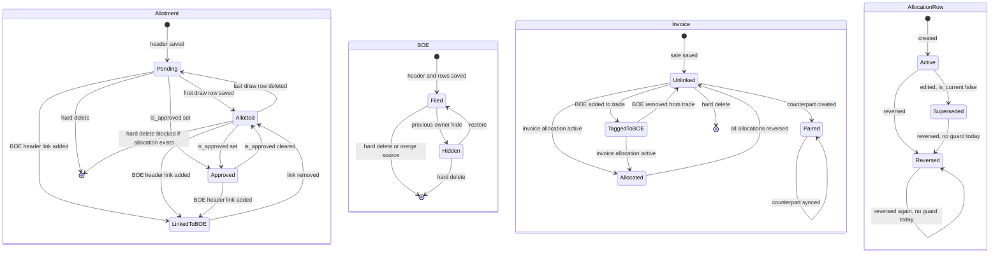

# DFIA Transaction Lifecycle

| Field | Value |
|---|---|
| Document | DFIA transaction lifecycle: licence, allotment, BOE, allocation, invoice |
| Version | 0.1 (draft) |
| Status | **Draft / Under Review. Not Approved. Not Frozen.** |
| Date | 2026-11-01 |
| Parent | `DFIA_BALANCE_MANAGEMENT_MASTER_SPECIFICATION.md` (§§3, 5, 6, 8) |
| Decisions | `DFIA_BUSINESS_DECISION_REGISTER.md`. This file covers BD-07, BD-09, BD-11 and BD-12. |
| Companion | `DFIA_ALLOCATION_RULES.md` (BD-01 to BD-06, BD-08, BD-10) |
| Evidence basis | Static reading of `backend/` on branch `version-v1`, working tree as of 2026-11-01. No test was run, no database was queried, no migration or write command was executed. |

**Legend**

- **VERIFIED**: what the code does today. Each statement cites `file:line`. Paths are relative to `backend/` unless shown otherwise.
- **PROPOSED**: a rule suggested by this draft. It is not approved and it is not existing behaviour.
- **OPEN (BD-xx)**: an owner decision that is still pending. Options are listed with their trade-offs. No option is adopted here.
- **Recommendation**: a suggestion only. The owner decides.

---

## 1. Scope and names

### 1.1 Specification entity to code model

| Spec entity (§11) | Code model | Evidence | Note |
|---|---|---|---|
| DFIA licence | `LicenseDetailsModel` | `apps/license/models/core.py:91`; `license_number` unique at `:125` | No status enum. State is held in `LicenseFlags` (`:2384`). |
| Licence item (credit) | `LicenseImportItemsModel` | `core.py:902`; `unique_together (license, serial_number)` at `:942` | Holds `quantity` (`:912`), `cif_fc` (`:916`), `cif_inr` (`:917`), `unit` (`:914`). |
| Entitlement CIF (export side) | `LicenseExportItemModel` | `core.py:860`; summed as Credit in `apps/license/services/balance_calculator.py:92-110` | |
| DFIA allotment | `AllotmentModel` | `apps/allotment/models/core.py:46` | No status column. See §3.2. |
| Allotment item | `AllotmentItems` | `apps/allotment/models/core.py:212` | This row is the reservation. |
| BOE | `BillOfEntryModel` | `apps/bill_of_entry/models.py:185` | No status column. Header link to allotments is an M2M at `:212`. |
| BOE item | `RowDetails` | `apps/bill_of_entry/models.py:380` | One debit row per (BOE, licence item, transaction type), `unique_together` at `:429`. |
| BOE to allotment allocation | `BOEAllotmentAllocation` | `apps/reconciliation/models.py:331` | No production writer (see §3.4). |
| BOE to invoice allocation | `InvoiceBOEAllocation` | `apps/reconciliation/models.py:226` | Written only by the backfill command (see §3.4). |
| External invoice mark | `ExternalInvoiceLink` | `apps/reconciliation/models.py:434` | Not read by the balance engine's debit path. |
| Invoice | `LicenseTrade` with `direction = SALE` | `apps/trade/models.py:138` | See the note below. |
| Invoice item | `LicenseTradeLine` | `apps/trade/models.py:495` | `qty_kg` (`:536`), `cif_fc` (`:540`). |

**Note on "invoice".** Spec §11 maps DFIAInvoice to `apps/license/models/invoice.py` `Invoice` (`:53`). In this review that model had no reader and no writer outside its own module. It is re-exported at `apps/license/models/__init__.py:8` and has a migration (`apps/license/migrations/0001_initial.py:52`). The balance engine reads `LicenseTrade` and `LicenseTradeLine`. The invoice used by every calculation in this draft is therefore the trade model. PROPOSED: correct the §11 mapping once this draft is accepted.

### 1.2 Naming collision

The word "allocation" has two meanings in the code.

- **Allotment draw** (PROPOSED term): `allocate-items` at `apps/allotment/views_actions.py:1050-1072` and the legacy `AllocationService.allocate_item` at `apps/allotment/services/allocation_service.py:153-202` create `AllotmentItems`. These reserve a licence item's quantity and CIF for an allotment.
- **BOE allocation** (PROPOSED term): `apps/reconciliation/services/allocation_service.py` creates `BOEAllotmentAllocation` and `InvoiceBOEAllocation` rows. These record how much of a BOE row is matched to an allotment item or to a sale line.

---

## 2. Draft versus posted (Part F item 8)

**Finding (VERIFIED):** no DFIA financial object has a persisted draft state. "Posted" is implied by the existence of a row. For allocation rows it is `status = ACTIVE` and `is_current = True`, which are the only lifecycle fields that change balances.

| Candidate | Where | What it actually does | Affects balance? |
|---|---|---|---|
| Allotment `is_approved` | `allotment/models/core.py:114` | Manual flag. Editable inline (`apps/allotment/views.py:101`). Used only for the synthesized overview status. | No. Not referenced by `balance_calculator.py`. |
| Allotment `is_allotted` | `core.py:113`; set by `apps/allotment/signals.py:9-21`; cleared when the last item is removed at `signals.py:24-37` | Derived cache. | No, except through the overview status. |
| Allotment status | `apps/license/services/license_overview_allotments.py` (status function, about lines 86-108) | Synthesized on read. Priority: Linked to BOE, then Approved, then Allotted, then Pending. The docstring says "no stored status field exists". | No. |
| Allotment item `status` | `core.py:286-296` (CREATED, RELEASED, REACTIVATED, COMPLETED) | Only the default is ever set. No writer was found. | No. Dormant. |
| `AllocationVersion` | `apps/allotment/models/allocation_version.py` | Model and migration exist. No writer was found. | No. Dormant. |
| BOE `is_frozen` on row | `bill_of_entry/models.py:413-416` | Read in `save()` (`:434-441`) and in the serializer (`bill_of_entry/serializers.py:385`, `:413`). No code sets it to True. The help text says it is set by a ledger upload, and no such upload was found. | Blocks row edits when True. Dormant. |
| BOE `is_dispute` on row | `bill_of_entry/models.py:417-420` | Only cleared (`apps/bill_of_entry/services/boe_service.py:191`). No writer found. | No. Dormant. |
| BOE "hidden" | `invoice_no = "OTH"` (`boe_service.py:403`) plus the latest `HIDE_BOE` or `RESTORE_BOE` log row (`bill_of_entry/models.py:155-182`) | Previous-owner exclusion. | Yes. Excluded from the balance engine. |
| Allocation `status` and `is_current` | `reconciliation/models.py:293-297` and `:396-400` | ACTIVE and current rows count. Superseded and REVERSED rows do not. | Yes. |
| Sale `final_party_status` | `trade/models.py` (choices around `:268-290`) | Classification (UNKNOWN, FINAL_PARTY, INTERLINKED, NOT_APPLICABLE). Not a lifecycle state. | No. |
| Client allocation draft | `apps/allotment/views_actions.py:960-975` (comment) | A UI key held in the browser. Not persisted. | No. |
| Ledger "draft" PDF | `apps/license/services/license_ledger_package.py:339-360`; `apps/license/views/ledger.py:101-112` | Output artefact. The view says it "never changes verified item state". | No. |

**Consequence.** Part F item 8 ("keep drafts visibly separate from posted transactions") is not implemented for any financial object. Every saved allotment draw, BOE row and sale line is immediately live in the balance engine. The timeline builder treats any real row as an event (`apps/license/services/license_balance_ledger_builder.py:1296-1312`).

**OPEN (not in the register): draft state.** Options:
- **A. Save means post (current).** Simple. No draft can be reviewed before it reduces the balance.
- **B. Explicit DRAFT status excluded from the balance until POSTED.** Needs a status column on the five object types and a filter in every aggregate. Matches Part F item 8 directly.
- **C. Drafts only in the UI.** The client holds unsaved input, and the server stores only posted rows. No schema change.

Recommendation: C for the allotment draw screen, which already holds drafts client-side (`views_actions.py:960-975`), and B only if the owner wants reviewable BOE entries. This is a recommendation only. The owner should add a BD item for it.

---

## 3. Lifecycle by object

Each subsection gives states, creation, edit, cancellation, reversal, what is permitted after downstream rows exist (Part D6), and the balance effect of each operation. The balance effects are the effects on the three engines described in `DFIA_ALLOCATION_RULES.md` §2. Where the effect differs by engine, both are shown.

### 3.1 Licence and licence item

**States (VERIFIED).** The licence has no status enum. Its condition is held in boolean flags (`LicenseFlags`, `core.py:2384`: `is_active`, `is_expired`, `is_null`, `is_au`, `is_individual`) and in `purchase_status`. The licence item's `condition_type` (`%` pool, AU, or open) decides which CIF pool it draws on (`core.py:1034-1110`).

**Creation.** Licence and licence-item import pipelines were not traced in this pass. The balance engine reads the rows they create: `LicenseExportItemModel.cif_fc` for Credit (`balance_calculator.py:92-110`) and `LicenseImportItemsModel.quantity` and `cif_fc` for item-level values.

**Edit (VERIFIED).** The engine uses the current `quantity`, not `old_quantity` (`apps/core/scripts/calculate_balance.py`, docstring of `calculate_available_quantity`, lines 72-96). A licence amendment therefore takes effect at once.

**Cancellation (VERIFIED).** A licence is deleted through its model. The FKs decide what happens:
- Licence items cascade (`core.py:904` is `on_delete=CASCADE`).
- `RowDetails.sr_number` cascades (`bill_of_entry/models.py:389-393`). Any row that is still referenced by an allocation is protected, because the allocation FKs are `PROTECT` (`reconciliation/models.py:268-272`, `:369-373`). So a licence with allocated BOE rows cannot be deleted.
- `LicenseTradeLine.sr_number` is `PROTECT` (`trade/models.py:525-530`).
- A management command `delete_licenses_by_exporter` also exists (`apps/license/management/commands/delete_licenses_by_exporter.py`). Its behaviour was not reviewed.

**Reversal.** None.

**Balance effect.** Removing a licence item removes its credit and its debits. Editing `cif_fc` changes the item's available CIF. A zero-CIF item uses the licence-wide figure (see §3.3 and `DFIA_ALLOCATION_RULES.md` §8, L3). This is a B1 concern.

### 3.2 Allotment (`AllotmentModel`) and allotment item (`AllotmentItems`)

**States.**

- Stored: `is_allotted`, `is_approved`, and the header M2M to BOEs (`BillOfEntryModel.allotment`, `bill_of_entry/models.py:212`).
- Derived on read: Pending, Allotted, Approved, Linked to BOE. The precedence is Linked to BOE, then Approved, then Allotted, then Pending (`license_overview_allotments.py`, about lines 86-108).
- Allotment item: no effective state. A row exists or it does not. The dormant `status` column is listed in §2.

The state diagram in §6 shows these.

**Creation (VERIFIED).**

- **Allotment header.** `AllotmentSerializer.create` (`apps/allotment/serializers.py:317-338`). If no rate is given, the latest `ExchangeRateModel.usd` is used (`serializers.py:327-334`).
- **Allotment item (the draw).** `POST /api/allotments/{id}/allocate-items/` (`views_actions.py:1050-1072`), implemented in `_allocate_items_atomic` (`:1072-1568`). The order of checks:
  1. Lock the allotment with `select_for_update` (`:1098`).
  2. Check the remaining requirement, with a `$20` settlement allowance (`:1158-1182`, allowance at `:1171`).
  3. Lock the licence item (`:1192`).
  4. For PLAN basis, lock and check the plan line (`:1222-1296`).
  5. Check the unit-price pair (`:1296-1330`, allowance at `:1318-1320`).
  6. Check the stored `available_quantity` (`:1341-1349`).
  7. Check the live available CIF (`:1374-1384`, via `effective_source_row_cif_available`).
  8. Check the allotment quantity and CIF (`:1400-1419`).
  9. Merge into an existing row (`:1422-1455`), or create a row (`:1459-1474`).
- **Legacy service.** `AllocationService.allocate_item` (`apps/allotment/services/allocation_service.py:153-202`) calls `LicenseValidationService.validate_allocation`. No production caller was found.

**Edit (VERIFIED).**

- **Allotment header.** `AllotmentSerializer.update` (`serializers.py:340-365`) writes the header fields. It rejects only mappings to foreign item rows. It has no check against committed allocations. `AllotmentModel.save` then recalculates `cif_fc = unit_value_per_unit × required_quantity` (`apps/allotment/models/core.py:147-149`) and `cif_inr = cif_fc × exchange_rate` (`:155-158`). So editing the required quantity or the unit price rewrites the allotment's CIF. The allocate-items cap (`views_actions.py:1158-1182`) changes at once. Existing rows are not re-checked.
- **Allotment item.** There is no API path that edits a row's `qty` or `cif_fc`. The serializer comment says "allocation economics" are never mutated from this screen (`serializers.py:345-360`). Adding to a draw merges into the existing row in place: `existing.qty += qty` (`views_actions.py:1439-1455`). The legacy `AllocationService.update_allocation` (`apps/allotment/services/allocation_service.py:227-274`) has no caller.
- **Approval flag.** `is_approved` is editable inline (`apps/allotment/views.py:101`). No balance effect.

**Cancellation (VERIFIED).**

- **Allotment.** `destroy_allotment` (`apps/allotment/views.py:374-395`) calls `AllotmentModel.delete()`. It does not check for a BOE header link or for allocation rows.
  - `AllotmentItems.allotment` cascades (`core.py:221-226`).
  - `BOEAllotmentAllocation.allotment_item` is `PROTECT` (`reconciliation/models.py:374-378`). If any allocation row exists, the delete raises `ProtectedError`. The generic `except Exception` at `views.py:388-395` turns that into HTTP 500 with the error text.
  - The M2M rows to BOEs are removed by Django without any check.
- **Allotment item.** `delete_allotment_item` (`views_actions.py:1570-1640`) locks the licence item (`:1603`) and hard-deletes the row (`:1609`).
  - It does not check the header BOE link.
  - It does not check the `is_boe` flag. The legacy `deallocate_item` does check it (`allotment/services/allocation_service.py:217`), but it has no caller.
  - A `PROTECT` from allocation rows makes the delete fail. The generic handler returns HTTP 400 "Failed to delete allotment item" (`views_actions.py:1632-1637`).
  - The `post_delete` signal clears `is_allotted` when the last row is removed (`apps/allotment/signals.py:24-37`).
- **Copy.** `copy_allotment` (`views.py:321-370`) creates a new header with no items. It is not a cancellation.

**Reversal (VERIFIED).** None for allotments or items. `released_quantity`, `released_date`, `release_reason`, `reactivated_*` and `previous_version` exist (`core.py:298-330`), but no code writes them.

**Downstream rows (Part D6, VERIFIED).**

| Downstream row exists | Edit header | Delete item | Delete allotment |
|---|---|---|---|
| None | Allowed | Allowed (hard delete) | Allowed (hard delete, items cascade) |
| BOE allocation row (`BOEAllotmentAllocation`) | Allowed. Required quantity and price can drop below committed amounts with no check. | Blocked by `PROTECT`. HTTP 400. | Blocked by `PROTECT`. HTTP 500. |
| BOE header M2M link only | Allowed | Allowed. No check. | Allowed. Links are removed silently. |

**Balance effect (VERIFIED, all three engines differ only where stated).**

| Operation | Financial (`get_balance_cif`) | Customs (`calculate_balance`) | Item quantity |
|---|---|---|---|
| Add a draw of `c` CIF, no header BOE link | Reservation rises by `c` (`calculate_allotment`, `balance_calculator.py:970-1006`) | Same | Available quantity falls by `q` (`ItemBalanceCalculator.calculate_available_quantity`, `:1958-1999`) |
| Link a BOE to the allotment (header M2M) | The allotment's contribution becomes 0 (`_annotate_allotment_contribution`, `:826` and `:835`). Balance rises by the unconsumed remainder. | Same | Available quantity rises by the remainder |
| Delete a draw with no header link | Reservation released by `c` | Same | Available quantity rises by `q` |
| Edit required quantity or unit price | No direct effect. Engines read `AllotmentItems`, not `AllotmentModel.cif_fc` (`balance_calculator.py:855-858`). Affects only the allocate-items cap. | Same | None |

The header-link row is the most important one. Linking a BOE to an allotment with 40 unconsumed moves the balance from 60 to 75 when the BOE is 25 (worked in `DFIA_ALLOCATION_RULES.md` §3, S2). That 15 is the unconsumed reservation, released by a header edit, with no audit record (§3.3).

**PROPOSED rule (BD-07).** Changes to a committed allotment create a new version. Deletion is blocked while any downstream row exists. The fields that drive the cap are re-validated against committed draws before they are saved. Details are in the options under BD-07 (§4).

### 3.3 BOE (`BillOfEntryModel`) and BOE item (`RowDetails`)

**States.**

- Filed: the BOE exists and is not hidden. There is no status column.
- Hidden (previous owner): `invoice_no = "OTH"` and the latest hide or restore log row is a hide (`bill_of_entry/models.py:155-182`).
- Deleted: hard delete, or source of a merge.
- Frozen row and disputed row: fields exist, no writer found (§2). Dormant.

**Creation (VERIFIED).**

- **Header and items.** `BillOfEntrySerializer.create` (`apps/bill_of_entry/serializers.py:267-297`).
  - The header is found with `update_or_create` on `(number, date, port)` (`:277-281`).
  - The DB uniqueness is `(number, date)` only (`bill_of_entry/models.py:235`, migration `0003`). The lookup key includes `port`, the constraint does not. So the same number and date with a different or null port is not matched, and the insert fails on the constraint. This follows from reading the code and was not executed. PROPOSED: align the lookup with the constraint (BD-09).
  - Each allotment in the payload gets `is_boe = True` (`:288-291`).
  - Each item is created with `RowDetails.objects.create` (`:294-296`). The row is unique on `(BOE, licence item, transaction type)` (`models.py:429`). Re-posting an identical BOE therefore fails on the rows (reading, not executed).
- **Parsed PDF.** `apps/bill_of_entry/views/parse_pdf.py` derives `cif_fc = cif_inr ÷ usd_rate` (`:172`). The rate is the BOE's own date rate, or the latest available rate (`:74-95`). That is a current-rate fallback at import (see `DFIA_ALLOCATION_RULES.md` §7).
- **Row validation.** `RowDetailsSerializer.validate` (`serializers.py:82-111`) checks CIF against the live ceiling only for licences in INDIVIDUAL_ITEM mode (`effective_cif_mode`). For every other licence no check runs, so a debit can exceed the balance. Quantity is not checked at all. CIF is rounded to 2 decimal places (`serializers.py:64-74`), though the model holds 3 (`models.py:395-405`).

**Edit (VERIFIED).**

- **Header.** `BillOfEntrySerializer.update` (`serializers.py:299-`) writes the fields and saves. Changes to the `allotment` M2M are applied at `:322-345`. `is_boe` is set on new links (`:329`) and cleared on removed links when no other BOE uses them (`:340`). Nothing checks `BOEAllotmentAllocation`. No `ReconciliationLog` row is written. A header-link change alters the allotment's contribution to the balance at once (§3.2).
- **Row with an id.** `setattr` and `save()` (`serializers.py:382-392`). No check against allocation rows. If the row is frozen, the serializer returns the id as if it had been updated (`:385-387`). `RowDetails.save()` also returns silently for a frozen row (`models.py:434-441`). Both are silent no-ops. This is ISS-048 in the register.
- **Row without an id.** `update_or_create` on `(BOE, licence item, transaction type)` (`serializers.py:398-420`).
- **Row omitted from the payload.** Every row of the BOE that is not in the payload is deleted (`serializers.py:425-431`). A partial payload therefore deletes debit rows. A row with an allocation is protected, so the delete fails with `ProtectedError`. An unallocated row is deleted with no audit record.
- **Trade-driven header stamps.** `stamp_boe_invoice_from_trade` writes `invoice_no` and `invoice_date` onto the BOE (`apps/trade/services/trade_service.py:390-`). Removing a BOE from a trade clears its `invoice_no` if it matches (`apps/trade/serializers.py:596-604`).

**Cancellation (VERIFIED).**

- **Delete.** Through the generic viewset `perform_destroy` (`apps/core/views/master_view.py:169-195`). `ProtectedError` is turned into HTTP 400 with the referencing model names. Without allocations, `RowDetails` cascades (`bill_of_entry/models.py:381-387`), and the `post_delete` receivers refresh stock (`models.py:483-497`) and the replan queue (`apps/license/signals.py:189`). No receiver on the BOE clears `AllotmentModel.is_boe`. Stale flags are therefore possible (absence verified by search).
- **Hide (previous owner).** `_apply_hide` (`apps/bill_of_entry/services/boe_service.py:377-420`) sets `invoice_no = "OTH"` (`:403`) and writes a `HIDE_BOE` row with the previous value in `before` (`:407-414`). The debit is excluded from Balance CIF (`balance_calculator.py:44-63`) and kept in the Customs balance (`:1406-1432`). Restore reads the previous value back from the log. No check is made against allocations or links. The combined effect of hiding a BOE that has a formal allocation (the row leaves the debit, but its sale line stays counted) was not traced to a number.
- **Merge.** `merge_boe` (`boe_service.py:203-300`) moves non-duplicate rows to the target. Duplicate rows are deleted with the source, unless a reconciliation record protects them (`:245-262`). The source BOE is then deleted (`:297`). The duplicate debit rows leave the balance with no row-level audit. The view logs only a message with counts (`apps/reconciliation/views.py:179-210`). This is ISS-039 in the register. Deleting the source BOE also cascades any generated `license.Invoice` rows (`apps/license/models/invoice.py:54-60`). That model is dormant.

**Reversal (VERIFIED).** No reversal event for amounts. Hide and restore reverse the previous-owner status only.

**Downstream rows (Part D6, VERIFIED).**

| Downstream row exists | Edit row CIF or qty | Remove row | Delete BOE |
|---|---|---|---|
| None | Allowed | Allowed, no audit | Allowed, cascades rows |
| `InvoiceBOEAllocation` or `BOEAllotmentAllocation` on the row | Allowed. Allocation not re-checked. Remaining floors at zero silently (`apps/reconciliation/services/allocation_service.py:88-94`, `:141-143`). | Blocked by `PROTECT` (`reconciliation/models.py:268-272`, `:369-373`) | Blocked by `PROTECT` through the cascade. HTTP 400. |
| Frozen row | Silent no-op (`models.py:434-441`) | Allowed by the "omitted" rule, since a delete ignores `save()` | Cascades |
| Trade tag (`LicenseTrade.boes`) only | Allowed | Allowed | Allowed. The M2M rows are removed. The `pre_delete` signal on the trade does not run for a BOE delete. |

**Balance effect (VERIFIED).**

| Operation | Financial | Customs | Item quantity |
|---|---|---|---|
| Add a row of CIF `c` and qty `q`, no tag or allocation | Debit rises by `c` (`calculate_debit`, `balance_calculator.py:459-510`) | Debit rises by `c` (`calculate_boe_debit_total`, `:512-527`) | Available quantity falls by `q`. Quantity is always debited in full (`:1958-1999`). |
| Add a row when the licence item has zero CIF | Licence-wide debit, not item-level (`balance_calculator.py:1798-1820`) | Same | Same |
| Edit row CIF by `delta` | Debit moves by `delta` (unmatched part) | Same | None |
| Delete unallocated row | Debit falls by `c` | Same | Quantity returns |
| Hide | Excluded from Balance CIF | Included | Excluded (`exclude_hidden`) |
| Merge | Duplicates removed | Duplicates removed | Duplicates removed |
| Change header M2M link | Allotment contribution changes (§3.2) | Same | Same |

### 3.4 Allocation (BOE to allotment, BOE to invoice, external mark)

**States (VERIFIED).** Each allocation row has three states, expressed by two fields:

- **Active, current**: `status = ACTIVE`, `is_current = True`. Counts in every balance.
- **Superseded**: `status = ACTIVE`, `is_current = False`, `superseded_by` set to the replacement. Does not count.
- **Reversed**: `status = REVERSED`, `is_current = False`. Does not count.

The two BOE allocation tables use the same pattern. `ExternalInvoiceLink` uses `status` and `is_current` only. See §4.

**Creation (VERIFIED).**

- `create_invoice_boe_allocation` (`apps/reconciliation/services/allocation_service.py:224-308`) and `create_boe_allotment_allocation` (`:437-519`). Both lock the parent rows, check for an existing active pair, check the fit in every dimension, and write a `ReconciliationLog` row in the same transaction.
- Production writers:
  - `InvoiceBOEAllocation` is written only by `boe_link_reconciler.py:175` via `reconcile_trade_boe_links(..., dry_run=False)`. Its only production caller is `backfill_boe_allocations --apply` (`apps/reconciliation/management/commands/backfill_boe_allocations.py:77`). The balance ledger and `check_allocation_health` call it with `dry_run=True`.
  - `BOEAllotmentAllocation` has **no production writer**. Its only callers are tests.
  - `mark_boe_as_external_invoice` (`allocation_service.py:656-712`) has no production caller.
- The reconciliation views expose link, merge, note and recalculate actions only (`apps/reconciliation/views.py:90-273`). **No HTTP endpoint creates, edits or reverses an allocation.**

**Edit (VERIFIED).** `edit_invoice_boe_allocation` (`allocation_service.py:311-384`) and `edit_boe_allotment_allocation` (`:522-585`). They lock the row, require `ACTIVE` and current, re-check the fit excluding the row itself, create a new row with `version + 1`, mark the old row superseded, and log `EDIT_ALLOCATION`. A no-change edit still creates a new version.

**Reversal (VERIFIED, with gaps).** `reverse_invoice_boe_allocation` (`allocation_service.py:387-415`) and `reverse_boe_allotment_allocation` (`:588-610`). They set `status = REVERSED` and `is_current = False` and log `REVERSE_ALLOCATION`. Gaps:
- The function does not check `is_current` or the prior status (`:397-404`, `:592-600`). A **superseded** row can therefore be reversed. Its status then reads REVERSED, while the current row in the chain is untouched.
- A **reversed** row can be reversed again, and a second log row is written.
- Only the allocation row is locked. Its parent rows are not.

**Cancellation.** There is no delete path for allocation rows. The FKs are `PROTECT`, and the ledger pattern forbids deletion.

**Downstream rows (Part D6, VERIFIED).** An allocation makes both parents `PROTECT`. A trade line with an allocation cannot be deleted (`reconciliation/models.py:263-267`). A BOE row with an allocation cannot be deleted (`:268-272`). Editing a parent is **not** re-checked against its allocations. This is the silent over-allocation case in §3.5 and §3.3.

**Balance effect (VERIFIED).**

| Operation | Financial engine | Customs engine |
|---|---|---|
| Create invoice-side allocation of `c` | Row's unmatched debit falls by `c` (`get_debit_rows`, `balance_calculator.py:369-457`). The sale line stays fully counted in `calculate_trade`. Net effect: the sale CIF replaces `c` of BOE debit. | No effect. Customs ignores invoices (`:1406-1432`). |
| Create allotment-side allocation of `c` | The allotment's reservation falls by `c` (`_annotate_allotment_contribution`, `:711-845`). BOE debit is unchanged. | Same for the reservation. |
| Edit allocation | Delta applied | Delta applied (allotment side) |
| Reverse allocation | Capacity returns. Balance effect is the inverse of creation. | Same |
| External mark | No effect on balance. `get_debit_rows` reads `InvoiceBOEAllocation` only (`:415-426`). The mark uses up the invoice-side capacity of the row (`allocation_service.py:127-144`). | No effect |

### 3.5 Invoice (`LicenseTrade`, SALE) and invoice item (`LicenseTradeLine`)

**States.** `LicenseTrade` has no status column (`apps/trade/models.py:138-`). The following relations describe its condition. They can overlap.

- **Unlinked.** No BOE tag and no allocation.
- **Tagged to BOE (legacy).** BOEs in `LicenseTrade.boes` (`trade/models.py:183-188`).
- **Allocated.** One or more active `InvoiceBOEAllocation` rows on its lines.
- **Paired.** Has a `counterpart` (`trade/models.py:246`), created by the copy services (`apps/trade/services/trade_service.py:202-389`).
- **Final-party classification.** `final_party_status` (`trade/models.py`, about `:268-290`). This classifies the sale. It is not a lifecycle state.

**Creation (VERIFIED).** `LicenseTradeSerializer.create` (`apps/trade/serializers.py:401-`, transaction at `:400`). It creates lines and, if `auto_create_paired` is set, the counterpart. Standalone lines are checked against the item's live available CIF (`serializers.py:125-160`, ceiling at `:155`). That check is skipped when `_force_save` is set or a counterpart exists (`:129-137`).

**Edit (VERIFIED).** `LicenseTradeSerializer.update` (`serializers.py:502-`, transaction at `:501`).
- Header fields and lines are written. Lines are synced with `_sync_nested` (`apps/core/helpers.py:6-`), which deletes lines whose ids are missing from the payload.
- With `_force_save`, or on any counterpart trade (`serializers.py:542-544`), an exception raised while syncing lines, incentive lines or payments is **swallowed** (`:552-557`, `:566-571`, `:580-585`). The header still saves.
- Removing a BOE from `boes` clears its stamp when it matches (`:596-604`).
- No check compares the edited quantity or CIF with `InvoiceBOEAllocation` rows. The allocation stays active. Its remaining floors at zero.

**Cancellation (VERIFIED).**
- Delete goes through `perform_destroy` (`apps/core/views/master_view.py:169-195`).
- A trade with an allocated line is blocked by `PROTECT` (`reconciliation/models.py:263-267`). HTTP 400.
- A paired trade raises a Django `ValidationError` in a `pre_delete` receiver (`apps/trade/models.py:781-787`). `perform_destroy` catches only `ProtectedError`, so the request is expected to fail with HTTP 500. Not executed.
- A plain trade without allocation or pair is deleted. Its M2M rows are removed. The `pre_delete` receiver clears the BOE's `invoice_no` when it matches the trade's `invoice_number` (`trade/models.py:766-778`).

**Reversal.** None for the trade. Allocation reversal is in §3.4.

**Downstream rows (Part D6, VERIFIED).**

| Downstream row exists | Edit line qty or CIF | Remove line | Delete trade |
|---|---|---|---|
| None | Allowed | Allowed | Allowed |
| `InvoiceBOEAllocation` on the line | Allowed. Allocation not re-checked. | Blocked by `PROTECT`. With `_force_save`, the error is swallowed and the line stays. | Blocked by `PROTECT` |
| Counterpart | Allowed. Force-save is forced, so the CIF check is skipped (`serializers.py:129-137`). Sync failures are swallowed. | Same | Blocked by the `pre_delete` receiver |

**Balance effect (VERIFIED).**

| Operation | Financial | Customs | Item quantity |
|---|---|---|---|
| Add SALE line of CIF `c`, no BOE | Sale debit rises by `c` (`calculate_trade`, `balance_calculator.py:1063-1090`, which counts all SALE lines) | No effect (`calculate_balance` has no trade term) | Direct-sale quantity falls by `q` (`_direct_sale_quantity_rows`, `:1861-1927`) |
| Tag a BOE to the trade (`LicenseTrade.boes`) | The whole BOE row is excluded from the debit where it has no allocation of its own (`_linked_boe_debit_exclusion_case`, `:294-367`). The unmatched rest of a partly billed BOE is dropped (ISS-020). The `m2m_changed` receiver refreshes stock (`apps/license/signals.py:572-583`). | No effect | Line quantity is excluded when the BOE debits the same item (`:1887`) |
| Add `InvoiceBOEAllocation` of `c` | Debit falls by `c`, partial (`get_debit_rows`). The stock receiver refreshes the item (`apps/license/signals.py:586-594`). | No effect | Allocated quantity is netted (`:1861-1927`) |
| Edit line CIF by `delta` | Sale debit moves by `delta` | No effect | Direct-sale quantity moves |

The legacy tag row is the one the register calls the "KNOWN, ACCEPTED TRADE-OFF" (ISS-021). The code comment is at `balance_calculator.py:231-241`. The spec does not describe this behaviour. See §7.

### 3.6 Invoice allocation (`InvoiceBOEAllocation`)

This is §3.4 applied to the sale side. The allocation is per (trade line, BOE row) pair. Its amounts are `allocated_qty`, `allocated_cif_fc` and `allocated_cif_inr`.

- It is the only partial mechanism that reaches the balance engine. The legacy tag is whole-BOE.
- Quantity-only allocations are possible. Nothing ties `allocated_qty` to `allocated_cif_fc` through a unit price (see `DFIA_ALLOCATION_RULES.md` §6).

---

## 4. Ledger semantics (append-style pattern)

### 4.1 The pattern (VERIFIED)

`InvoiceBOEAllocation` (`reconciliation/models.py:226`) and `BOEAllotmentAllocation` (`:331`) use the same fields:

| Field | `InvoiceBOEAllocation` | `BOEAllotmentAllocation` | Meaning |
|---|---|---|---|
| `status` | `:293` (ACTIVE, REVERSED) | `:396` | Lifecycle value |
| `is_current` | `:296` (default True) | `:399` | Whether this row is the live version |
| `superseded_by` | `:297` (self FK, `SET_NULL`) | `:400` | Points to the replacement |
| `version` | `:304` (default 1) | `:407` | Increments on each edit |
| `notes` | `:305` | `:408` | Free text |
| Non-negative check | `:314-320` | `:417-423` | `CHECK` on the three amounts |
| Indexes | `status`, `is_current` | `status`, `is_current` | |

`ExternalInvoiceLink` (`:434`) has `status` (`:487`), `is_current` (`:490`) and a non-negative check (`:501-507`), but no `superseded_by` and no `version`.

Every write creates a new row and never deletes one. The docstrings state this (`reconciliation/models.py:226-258`, `:331-355`).

`ReconciliationLog` (`reconciliation/models.py:95-`) is append-only. Its docstring says so (`:95-105`). Each action writes `before` and `after` JSON snapshots (`allocation_service.py:418-430`, `:613-625`), plus `reason`, `user` and `created_on`. Its `bill_of_entry` foreign key is `SET_NULL` (`reconciliation/models.py:146`). So the log loses its BOE link when the BOE is deleted.

### 4.2 Coverage

| Object | Append-style? | How it is actually changed |
|---|---|---|
| `InvoiceBOEAllocation` | Yes | Create, supersede, reverse (§3.4) |
| `BOEAllotmentAllocation` | Yes | Create, supersede, reverse. No production writer. |
| `ExternalInvoiceLink` | Yes | Create and reverse. Not read by the balance engine. |
| `AllotmentModel` | No | Edited in place (`serializers.py:340-365`). Deleted (`views.py:374-395`). |
| `AllotmentItems` | No | Merged in place (`views_actions.py:1439-1455`). Deleted (`:1609`). `previous_version` exists but is unused (`core.py:327`). |
| `BillOfEntryModel` | No | Edited in place (`serializers.py:299-`). Deleted (cascade). Merged and deleted (`boe_service.py:297`). |
| `RowDetails` | No | Edited in place (`serializers.py:382-398`). Deleted when omitted (`:425-431`) or by merge. |
| `LicenseTrade` and `LicenseTradeLine` | No | Edited in place (`trade/serializers.py:502-`). Deleted (`perform_destroy`). |

**Consequence.** The spec's rule that financial history is never permanently erased (§6 item 5, §8, BD-07 proposed rule) holds only for the three allocation tables and the log. It does not hold for the six objects above. `AllocationVersion` (`apps/allotment/models/allocation_version.py`) was designed to record allotment-item history and has no writer. It is the scaffolding that BD-07 option C would use (§5).

### 4.3 Weaknesses in the ledger pattern (VERIFIED)

1. Reversal does not check `is_current` or the prior status (`allocation_service.py:397-404`, `:592-600`). A superseded row can be reversed. A reversed row can be reversed again.
2. Create and edit check for an active pair with `exists()` (`:263-273`, `:474-484`). No database constraint prevents a second active pair. The check is safe only because the callers lock both parents first (`:260-261`, `:471-472`, `:331-340`, `:531-541`). A caller that skips the lock can create duplicates.
3. The reason for a reversal is stored only in `ReconciliationLog.reason`, not on the allocation row.
4. Nothing links an allocation row to the log row that created it.
5. No check runs on the parent when the parent is later edited (§3.3, §3.5).
6. `ReconciliationPermission` gates the endpoints (`apps/accounts/permissions.py:72-`), but no endpoint exists for allocation create, edit or reverse. Authorisation for these operations is therefore not enforced by any route.

---

## 5. Operation matrix

Columns: the current behaviour (VERIFIED, with citations), the balance effect today, and the proposed rule (PROPOSED). The BD tag shows where the owner decides.

| # | Operation | Current behaviour (VERIFIED) | Balance effect today | Proposed rule (PROPOSED) | Open point |
|---|---|---|---|---|---|
| 1 | Edit an allotment (required quantity, unit price, CIF) | Saved in place. `cif_fc` recalculated (`core.py:147-149`). No check against committed draws. | Affects the cap only. No direct balance effect (§3.2). | Re-validate against committed draws. Once any draw exists, edits create a new version (`previous_version`, `core.py:327`). | BD-07 |
| 2 | Edit an allotment item (qty, CIF) | No API. Adding to a draw merges in place (`views_actions.py:1439-1455`). | Draw changes at once | Draws are not edited. Corrections are a reversal plus a new draw. | BD-07 |
| 3 | Edit a BOE header | Saved in place (`serializers.py:299-`). No audit row. | None unless the M2M changes | Header changes that affect amounts create an audit row. | BD-07 |
| 4 | Edit a BOE row (CIF, qty) | Saved in place. Not checked against allocations (`:382-392`). Frozen rows are silent no-ops (`models.py:434-441`). | Debit moves at once | Blocked when an allocation exists, or re-validated and audited. | BD-07, BD-08 |
| 5 | Reassign a BOE to another allotment (header M2M) | Accepted by `BillOfEntrySerializer.update` (`serializers.py:322-345`). No check. No audit row. | Previous allotment's reservation is released or a new one is zeroed (§3.2). Immediate. | Audited event. Subject to the BD-11 options. | BD-11 |
| 6 | Move an allocation to a different allotment item | No such operation. Only supersede or reverse. Changing the target means a reversal and a new allocation. | Two steps | A single audited move, or the same two steps shown in the log. | BD-12 |
| 7 | Edit an invoice (sale header or line) | Saved in place. Allocation not re-checked (`trade/serializers.py:502-`). Sync failures swallowed under force-save (`:552-585`). | Sale debit moves. Quantity moves for direct sales. | Block when an allocation exists, or re-validate and version the line. | BD-07, BD-04 |
| 8 | Cancel (delete) an allotment | Hard delete. Blocked by `PROTECT` if an allocation exists (HTTP 500). Not blocked by a header link. | Reservation released | Blocked when any downstream row exists. Status change instead of delete. | BD-07 |
| 9 | Cancel (delete) an allotment item | Hard delete. Blocked by `PROTECT` if an allocation exists (HTTP 400). Not blocked by a header link (`views_actions.py:1570-1640`). | Reservation released | Same as 8 | BD-07 |
| 10 | Cancel (delete) a BOE | Hard delete, cascading unallocated rows. Blocked by `PROTECT` if an allocation exists (HTTP 400). | Debit removed | Blocked when any downstream row exists. Hide is the only reversal today. | BD-07 |
| 11 | Remove a BOE row (omitted from payload) | Hard delete, no audit (`serializers.py:425-431`). | Debit removed | Blocked, or an audited reversal | BD-07 |
| 12 | Cancel (delete) an invoice | Hard delete. Blocked by `PROTECT` if allocated or paired. A `pre_delete` receiver clears the BOE stamp (`trade/models.py:766-778`). | Sale debit removed. Tagged BOE debit returns. | Blocked when allocated. Otherwise reversal with audit. | BD-07, BD-12 |
| 13 | Reverse an invoice-side allocation | Status set to REVERSED. Superseded rows can be reversed (`allocation_service.py:397-404`). No endpoint. | Capacity returns | Only the current ACTIVE row may be reversed. Reason required. | BD-12 |
| 14 | Reverse an allotment-side allocation | As 13. No writer exists (`:592-600`). | Reservation returns | As 13 | BD-12 |
| 15 | Edit an allocation (amount change) | New version row, old row superseded (`:311-384`, `:522-585`). | Delta | Keep. Add the same downstream check as 4. | BD-12 |
| 16 | Hide a BOE (previous owner) | `invoice_no = "OTH"` and a log row. No check (`boe_service.py:377-420`). | Excluded from Balance CIF | Reversible by restore (current). Require a reason. | BD-12 (reason) |
| 17 | Merge two BOEs | Duplicate rows deleted with the source (`boe_service.py:203-300`). View logs a count only. | Duplicate debit removed | Log each removed row (before values) | BD-07, BD-09 |

---

## 6. State diagram

One diagram covers the allotment, BOE, invoice and allocation-row states. Composite states keep the three objects on one diagram. The allotment state is derived on read, and the states can overlap for the invoice (a sale can be tagged and allocated at once). The notes below the diagram say where the diagram simplifies.

**Notes on the diagram.**

- Allotment states are derived from `is_allotted`, `is_approved` and the header M2M. Precedence is LinkedToBOE, then Approved, then Allotted, then Pending (`license_overview_allotments.py`). The diagram shows the transitions, not the precedence.
- BOE "Hidden" is an encoding in `invoice_no` plus the log (§2), not a field.
- For the invoice, Allocated and TaggedToBOE can hold at once. A row can move from one to the other without passing through Unlinked. The diagram shows one path only.
- Frozen rows and disputed rows are dormant (§2) and are not shown.
- The `Superseded` and `Reversed` loops are VERIFIED gaps (§3.4), not intended behaviour.

---

## 7. Where the code does something the master spec does not describe

Each item was verified by reading the code. None was executed.

| # | Code behaviour | Evidence | Spec reference |
|---|---|---|---|
| L-1 | Hard deletes for allotments, draws, BOEs, BOE rows and trades. | `views.py:374-395`; `views_actions.py:1609`; `serializers.py:425-431`; `perform_destroy` | Spec §6.5 and §8 say history is not erased. |
| L-2 | A BOE header link to an allotment zeroes that allotment's whole contribution, not only the consumed part. | `balance_calculator.py:826`, `:835` | Spec §10 says `calculate_allotment` subtracts "only the BOE-consumed portion". That is true for unlinked allotments only. |
| L-3 | Hidden (previous-owner) BOEs: `invoice_no = "OTH"` as a state marker, exclusion from Balance CIF but not from Customs. | `boe_service.py:377-420`; `bill_of_entry/models.py:55-182`; `balance_calculator.py:44-63` | Not in the spec. |
| L-4 | Legacy whole-BOE invoice tag (`LicenseTrade.boes`) excludes whole rows from the debit. | `balance_calculator.py:294-367`, `:231-241` | Spec §3.4 says the uninvoiced part keeps counting at BOE value. |
| L-5 | The financial figure is Opening Balance + Purchase − Sale − allocation-netted BOE debit − allotment. Customs is Credit − raw debit − allotment. Two more variants exist. | `balance_calculator.py:1486-1534`, `:1582-1652`, `:1349-1404`, `:1406-1432` | Spec §4.2 has one formula with no Purchase, Sale or Opening term. |
| L-6 | A header BOE link is an allotment-level exclusion. Only allocation rows are item-level. | `balance_calculator.py:711-845` | Not in the spec. |
| L-7 | Sales without a BOE reduce available quantity but not available CIF. | `_direct_sale_quantity_rows` (`:1861`); `calculate_item_balance` (`:1846-1859`) | Not in the spec. |
| L-8 | ARO allotment type is treated as debit in the stored quantity, and ignored by the live quantity. | `apps/core/scripts/calculate_balance.py:54-65` and `:90` (`aro_qty` added to debit); `balance_calculator.py:1958-1999` (no ARO term) | Not in the spec. |
| L-9 | Plan basis allocations, with a plan line and a planning target item. | `views_actions.py:1222-1330`; `core.py:251-285` | Not in the spec. |
| L-10 | `%` condition pools shared across items. | `apps/license/models/core.py:1085-1091`; `apps/license/services/validation_service.py:197-226` | Not in the spec. |
| L-11 | A `$20` settlement allowance on the allotment CIF cap. | `views_actions.py:1171`, `:1318-1320`; `apps/allotment/services/paired_allocation_max.py:7`, `:50-63` | Not in the spec. |
| L-12 | `is_frozen` and `is_dispute` on BOE rows, with no writer. | `bill_of_entry/models.py:413-420` | Not in the spec. |
| L-13 | The BOE header lookup uses `(number, date, port)`, but the constraint is `(number, date)`. | `bill_of_entry/serializers.py:277-281`; `bill_of_entry/models.py:235` | Spec BD-09 |
| L-14 | Replan requests are queued on every allotment-row and BOE-row save or delete. | `apps/license/signals.py:177` and `:189` | Not in the spec. |
| L-15 | Allotment and BOE row changes are audited only by the generic request log, which stores no before or after values. | `apps/core/middleware.py:138-153` (request-level, asynchronous); the log is off under tests (`:91-96`) | Spec §6 item 5 expects an audit trail of changes. |

---

## 8. Open points

Each point lists options with trade-offs. The owner decides. Nothing here is adopted.

### 8.1 BD-07: balance effect of edits and cancellations; what is allowed after downstream rows exist

**Options.**

- **A. Append-only for every object.** Each edit or cancellation creates a superseding or reversing row for allotments, draws, BOE rows and trade lines. Balances are computed from current rows only.
  - For: complete history. Matches spec §6 item 5 and §8. Same pattern as the allocation tables.
  - Against: schema change on six objects. Every aggregate and query must filter for current rows. Existing history needs migration. Interacts with BD-02 and BD-03.
- **B. Edit in place with a field-level audit row. Hard delete only when no downstream row exists.**
  - For: smallest change. Reuses the `ReconciliationLog` before-and-after pattern. Reads stay the same.
  - Against: prior values exist only as JSON in the log, and the log loses its BOE link when the BOE is deleted (`reconciliation/models.py:146`). Deletion still erases the row. Weaker against spec §6 item 5.
- **C. Status-based cancellation with versions for amendments.** Use the scaffolding already in the code: `AllotmentItems.status` (`core.py:286-296`), `released_*` fields (`:298-322`), `previous_version` (`:327`) and `AllocationVersion` (`allocation_version.py`). Block edits and deletes once any downstream row exists.
  - For: uses existing unused design. Blocks the orphaning cases in §5. Keeps history without new tables.
  - Against: the scaffolding has never been exercised, so it needs design and tests. Every aggregate must filter on status.

**Recommendation (not a decision).** Option C. It matches the register's proposed rule ("block edits that would orphan downstream records; preserve history for every operation") and uses scaffolding that is already in the schema. Option B could follow for objects that never reach downstream rows.

**Required before implementation.** Owner approval of the choice, plus the balance effect of each cell in §5.

### 8.2 BD-11: reassignment of a direct BOE to an allotment

Current behaviour (VERIFIED): a header M2M change is accepted with no check and no audit row (`serializers.py:322-345`). The balance changes at once (§3.2, row "Link a BOE to the allotment").

**Options.**

- **A. Not allowed.** A direct BOE stays direct. A mistake is corrected by deleting and re-entering the BOE, which is possible only when it has no allocation.
  - For: no rewrite of history. Simple.
  - Against: operational burden. Corrections depend on delete, which is blocked once allocations exist.
- **B. Allowed as an audited event.** Linking creates a reassignment row (from: direct, to: allotment), the reservation is recalculated, and the earlier debit stays in history without being re-debited.
  - For: flexible. Explicit.
  - Against: changes the balance, so it needs the same approval rules as BD-07. Needs a new event type.
- **C. Allowed under conditions.** Only before any invoice or allocation exists, and only by a user with a stated reason. The role does not exist yet (PROPOSED).
  - For: balances flexibility and control.
  - Against: needs a new role or permission.

**Recommendation (not a decision).** Option C, which is option B with preconditions.

### 8.3 BD-12: reversal versus amendment as separate ledger events

Current behaviour (VERIFIED): the allocation tables already separate the two. Edit creates a superseding row (`allocation_service.py:311-384`). Reverse sets REVERSED (`:387-415`). The guard against reversing a superseded or reversed row is missing (§3.4).

**Options.**

- **A. Distinct events.** Reversal restores capacity and keeps the record. Amendment creates a superseding version. Both are logged. The reversal guard is added.
  - For: already built for allocations. Clear for reporting.
  - Against: the guard is missing today.
- **B. One correction event with before and after.**
  - For: simpler.
  - Against: a cancelled link cannot be told apart from a value change in reporting.
- **C. Distinct events, and reversal needs a reason and an authorised role.**
  - For: strongest audit.
  - Against: needs a role definition.

**Recommendation (not a decision).** Option A with the guard, plus the reason requirement from C.

### 8.4 BD-09: scope of uniqueness for licence, BOE and invoice numbers

Current behaviour (VERIFIED):
- Licence number: unique across the system (`core.py:125`).
- BOE: `(bill_of_entry_number, bill_of_entry_date)` unique, system-wide (`bill_of_entry/models.py:235`). The serializer lookup also uses port (§3.3).
- Trade invoice number: not unique (`trade/models.py:217`, index only).
- Generated `license.Invoice` number: unique system-wide (`apps/license/models/invoice.py:67`). Dormant.
- Allotment invoice text: no constraint (`allotment/models/core.py`, field `invoice`).

**Options for BOE numbers.**

- **A. System-wide on (number, date).** Current constraint.
  - For: matches the national numbering the importer deals with.
  - Against: a number is unique only within a day in this scheme. Two real BOEs from different ports on the same day with the same number would collide. The serializer port lookup (`serializers.py:277-281`) is then wrong.
- **B. Per company on (company, number, date).** Needs a non-null company on the BOE (`bill_of_entry/models.py` company FK).
  - For: safer for multi-company data.
  - Against: migration needed. Duplicates across companies are then possible.
- **C. Per port on (port, number, date).** Matches the serializer lookup.
  - For: matches today's serializer intent.
  - Against: migration needed. Port is nullable today, so existing rows need cleaning.

**Recommendation (not a decision).** Whichever option the owner chooses, the serializer lookup and the constraint must use the same key (PROPOSED). The register says "do not assume global uniqueness", which this draft agrees with.

**Invoice numbers.** Options are: globally unique (not today), unique per seller, or unique per company and financial year. The owner decides. No recommendation is made.

---

## 9. Limits of this review

- Static reading only. No test was run and no database was queried. Statements about "raises", "returns HTTP 400" or "500" are reasoned from the code and were not executed.
- Licence and item import pipelines, the generated invoice document path, and the frontend were not traced.
- The register's summary table says BD-01 is "ANSWERED, PROVISIONAL (UD-005)", while its detailed section says "QUEUED". This draft treats BD-01 as open, as the master specification does. The owner should reconcile the two entries.
- The brief is not in the repository. Its Part letters are taken from the master specification and the register.
- Line numbers refer to the working tree on 2026-11-01 and will drift.
