# 06. API audit (Agent A, 2026-11-01)

Status: static audit, read-only. No request was made, no server, migration or package was run, and no source or configuration was edited. Companion inventory: `docs/v1/system-audit/inventories/api-endpoint-inventory.md` (one row per endpoint).

ID note: new findings use **ISS-028 to ISS-089**, as set by the coordinator (ISS-019 to ISS-026 belong to another session). ISS-017 and ISS-018 are confirmed below.

Evidence labels: **VERIFIED** = read or grepped in this session. **SUSPECTED** = inference, or depends on framework or runtime behaviour not checked here.

## 1. Summary in plain English

- The API is one Django/DRF surface under `/api/`, with about 354 catalogued operations plus four surfaces the register does not list (schema, api-root, catch-all 404, Django admin). It has no version segment.
- Most reads are role-gated. Writes are gated by role classes. Two families of role check are weaker than they look: the ledger permission lets read-only trade roles call write actions (ISS-028), and the report permission gives write to superusers only, while the UI shows an action to all report users (ISS-081).
- Several user journeys break at the API boundary. The password-reset link has no page and no caller (ISS-082). The licence "Ledger" button calls a route that does not exist (ISS-081). The readiness reject action gets a 405 (ISS-081). Two report exports use a wrong prefix (ISS-017, confirmed at runtime).
- Heavy outputs (XLSX, PDF, ZIP) have no effective rate limit and master exports have no row cap (ISS-029). The activity-log list is unpaginated and grows with every authenticated API call (ISS-080).
- Error bodies are inconsistent. One path returns a Python traceback to the client (ISS-088).
- Filter and pagination declarations do not always match behaviour: several `filterset_class` declarations are never applied (ISS-089).
- The frontend's 293 direct HTTP call sites are mostly well matched to the backend. 293 of 354 register rows have at least one frontend caller; 61 have none. Many of the 61 are reports duplicated under `/api/reports/`, peer-sync routes, operations routes, or actions with no visible caller.

## 2. Headline numbers (VERIFIED)

| Measure | Value | Source |
|---|---|---|
| Register operations | 354 | `docs/v1/09-traceability/api-operation-register.tsv` (wc) |
| Uncatalogued surfaces added | 4 (schema/docs/redoc, api-root, `^api/` catch-all, admin) | `lmanagement/urls.py` |
| Operations with `AllowAny` | 5 (login, password-reset request, password-reset confirm, health, invoice-document view) | register, column 18 |
| Operations with `IsAdminUser` | 3 (throttle health, stats, reset) | register |
| APIView (non-ViewSet) operations | 39 | register, `drf_action = N/A` |
| Master-data operations under `/api/masters/` | 105 | register path grep |
| Operations whose serializer is "dynamic or none declared" | 104 | register, column 19 |
| Frontend direct HTTP call sites (axios-style) | 293 in 82 files | grep over `frontend/src`, excluding tests |
| Register rows with at least one frontend caller | 293 of 354 | inventory, column 9 |
| Register rows with no frontend caller | 61 | inventory |
| `has_object_permission` implementations | 0 | grep over `backend/apps` |
| DefaultRouters | 8: six mounted at `api/`, plus accounts (`api/auth/`) and core (`api/masters/`) | `*/urls.py` |

## 3. URL registration

Root include order (`backend/lmanagement/urls.py`, explicit patterns at lines 32-56, VERIFIED):

```mermaid
flowchart TD
  ROOT[lmanagement/urls.py] --> ADM[admin/]
  ROOT --> HEALTH[api/health/ AllowAny]
  ROOT --> MDS[api/mds/status/]
  ROOT --> SCH[api/schema/ api/docs/ api/redoc/]
  ROOT --> MEDIA[re api/media/ protected]
  ROOT --> AUTH[api/auth/ accounts router + auth views]
  ROOT --> LIC[api/ license router + 7 report paths]
  ROOT --> ALLOT[api/ allotment router]
  ROOT --> BOE[api/ BOE router + parse-pdf]
  ROOT --> TRADE[api/ trade router + invoice view]
  ROOT --> RECON[api/ reconciliation router]
  ROOT --> TASK[api/ tasks router]
  ROOT --> MASTERS[api/masters/ core router + throttle views]
  ROOT --> SYNC[api/sync/ peer sync views]
  ROOT --> CATCH[re ^api/ JSON 404 catch-all]
  ROOT --> SPA[re ^.*$ SPA index.html]
```

Findings:

- **Shadowing between routers: none found (VERIFIED).** Router prefixes under `api/` are disjoint: license (13 prefixes), allotment (`allotments`, `allotment-actions`), BOE (`bill-of-entries`), trade (`trades`, `lines`, `payments`), reconciliation (`reconciliation`), tasks (`tasks`). Explicit paths sit before router includes where they must (`apps/license/urls.py:43-61` before `:63`; `apps/bill_of_entry/urls.py:13` before `:14`; `apps/trade/urls.py:16` before `:17`).
- **Shared root view (VERIFIED, by reading the router construction).** Six routers under `api/` each expose an `api-root` at `^$`. Only the first, license (`apps/license/urls.py:63`), is reachable. This matches BE-INV-12. It is cosmetic, because no data endpoint is shadowed.
- **Catch-all (VERIFIED).** `re_path(r"^api/", _api_404)` (`lmanagement/urls.py:56`) returns JSON 404 for every unmatched `/api/` path, before the SPA catch-all. Consequence (SUSPECTED, framework behaviour not checked locally): Django's slash redirect can never fire for `/api/...` paths because they always resolve. Every current frontend call ends in `/`, so no live caller is affected.
- **No API versioning (VERIFIED).** No `v1/` or `v2/` segment in any `urls.py`. Versioning is absent, not merely unused.
- **Schema gate (VERIFIED).** `_schema_permission` is `[]` when DEBUG, otherwise `IsAuthenticated` (`lmanagement/urls.py:21`). The schema is generated and the register cites it, but many operations show "Dynamic/none declared" (see section 8).

## 4. Permissions coverage

- **Defaults (VERIFIED, per the lead-checked permissions inventory and settings):** `DEFAULT_PERMISSION_CLASSES = IsAuthenticated`. Throttling: Burst and User only (`lmanagement/settings.py:295-298`).
- **Object-level checks: none (VERIFIED).** Zero `has_object_permission` implementations. Every role class is list-level, so any role that can read a licence can read any licence. This is consistent with D1 (role-based company access) and is not a finding in its own right.
- **Role classes (VERIFIED):** `apps/accounts/permissions.py`. `BaseRolePermission` gives superusers everything; for other users, read uses `required_roles_for_read` (empty means any authenticated user) and write uses `required_roles_for_write` (empty means deny).
- **Broken or weaker than expected (VERIFIED):**
  - `LicenseLedgerViewPermission` (`apps/accounts/permissions.py:132-149`) accepts any method for TRADE_VIEWER, TRADE_MANAGER, LICENSE_MANAGER and LEDGER_MANAGER. Write actions inside `apps/license/views/ledger.py` have no further role check. See ISS-028.
  - `ReportPermission` (`permissions.py:115-119`) has no write roles, so every non-superuser write is denied. The Item Pivot "Update Balance" button is shown to every report user (`ItemPivotReport.tsx:727`). See ISS-081.
  - `LicenseReadOnlyPermission` treats POST as read, for `bulk-balance-excel` (`permissions.py:38-52`). This is intentional (payload size) and is recorded as a naming note in section 10.
  - `MasterDataPermission` (`apps/core/views/master_view.py:43-52`) lets any authenticated user, including a user with no role, read all master data (ports, HS codes, companies, exchange rates). This is a policy choice; it is not raised as an ISS.
- **Public surfaces (VERIFIED):** login (`LoginRateThrottle`, `apps/accounts/views/auth.py:16-18`), password-reset request and confirm (`ScopedRateThrottle` scope `password_reset`, `apps/accounts/views/password.py:31-34, 79-82`), health (no auth classes, returns status only), invoice-document view (256-bit capability token, `apps/trade/views_invoice_documents.py:41`). The invoice and reset-confirm endpoints are token-protected; health discloses nothing beyond `ok` or `degraded`.

## 5. Filtering and pagination

- **Global (VERIFIED):** `DEFAULT_FILTER_BACKENDS = [DjangoFilterBackend]`, `DEFAULT_PAGINATION_CLASS = apps.core.pagination.StandardPagination` (page 25, max 200, envelope adds `page_size`, `total_pages`, `current_page`) (`lmanagement/settings.py:278-284`).
- **Master family, 105 rows (VERIFIED):** `MasterViewSet.filter_backends = [CaseInsensitiveSearchFilter, OrderingFilter]` (`master_view.py:99`). The factory's `filterset_fields` are advertised in list and OPTIONS metadata (`master_view.py:621, 659`), but DjangoFilterBackend is not in the list, so they are not applied. Real filtering is the hand-written `apply_advanced_filters` (`master_view.py:316-548`), which is called from `get_queryset` (`master_view.py:308`). See ISS-089.
- **Licence list (VERIFIED):** `LicenseDetailsViewSet.filter_backends = [CombinedFilterBackend, EnhancedSearchFilter, AdvancedOrderingFilter]` (`apps/license/views/license.py:252`). `filterset_class = LicenseFilterSet` (`license.py:251`) is inert. The live filter is `apply_advanced_filters` (`license.py:622`), which calls the master version at `license.py:749`. It applies defaults when parameters are absent: `is_expired` and `is_null` (`license.py:622-660`). Callers that omit these parameters get a filtered list without knowing it.
- **Allotment list (VERIFIED):** `AllotmentViewSet` includes `DjangoFilterBackend` (`apps/allotment/views.py:164`). Its `get_queryset` adds defaults when parameters are absent: `type=AT`, `is_allotted=True`, and `is_boe=False` (`views.py:172-296`). The `is_boe` values `all` and `false_or_current` are removed from the generic layer first (`views.py:184-188`), so they do not reach the master `exact` branch as truthy strings. I checked this because the BOE allocation picker depends on `false_or_current`, and it is handled correctly.
- **BOE list (VERIFIED):** `BillOfEntryViewSet` declares `BOEFilterSet` (`apps/bill_of_entry/views/boe.py:115`) but lists `CombinedFilterBackend`, `EnhancedSearchFilter`, `AdvancedOrderingFilter` (`boe.py:116`). The `FilterSet` is inert. The live filter is `apply_advanced_filters` (`boe.py:178`).
- **Reports (VERIFIED):** report ViewSets and APIViews are not model-backed and do not call DRF pagination (`grep paginate` over the report view files returns nothing). They return a report envelope (`apps/core/reports/envelope.py`), and filters are query-string parameters.
- **Reconciliation (VERIFIED):** `ReconciliationResultsPagination` page 50, max 500 (`apps/reconciliation/views.py:36-40`), applied to the list actions that paginate (`views.py:77-83, 134-137`). Other actions return unpaginated payloads (per action, not traced one by one).
- **Activity log (VERIFIED):** `ActivityLogViewSet.pagination_class = None` (`apps/core/views/activity_log.py:27`). The comment says "use DRF default", but `None` disables pagination in DRF (SUSPECTED framework semantics; not confirmed against local DRF source). See ISS-080.
- **Page-size clamp (VERIFIED):** `max_page_size = 200` on the master pagination (`master_view.py:40`) and on the global one (`apps/core/pagination.py:41`). A client asking for more is silently clamped. See ISS-087.
- **Two pagination classes with different envelopes (VERIFIED):** the global class (`apps/core/pagination.py:22`) and the master class (`master_view.py:36`) differ in the keys they add. See ISS-089.

## 6. Export, upload and download

| Kind | Examples (inventory IDs) | Mechanism | Controls found |
|---|---|---|---|
| Master export | `/api/masters/*/export/`, `/api/lines/export/`, `/api/payments/export/` (API-062, 171, 178 and similar) | `export_data` action (`master_view.py:674-707`), `?export=xlsx|pdf` (or `_export`), whole filtered queryset | Permission only; no cap; no throttle |
| Licence exports | balance PDF and XLSX, bulk balance XLSX (API-128, 129, 131, 152) | Blob responses | `LicensePermission`; no throttle |
| Report exports | `/api/reports/*` with `format=excel`, `/api/*/export/` (API-002, 052, 065) | XLSX, PDF; item pivot streams | `ReportPermission`; no throttle |
| Ledger documents | custom and financial ledger PDF, ledger XLSX, package ZIP and PDF (API-094, 095, 097, 098, 116) | Blob; ZIP | `LicenseLedgerViewPermission`; no throttle |
| Transfer letters and PDFs | allotment, BOE, trade (API-007, 008, 041, 342-344) | Blob | Per-app permission; no throttle |
| Uploads | ledger upload (API-354), licence and BOE parse-PDF (API-049, 155), licence documents (API-133), purchase document (ISS-028) | Multipart | `UploadRateThrottle` on ledger upload only (`apps/license/views/ledger_upload.py:35`); others unthrottled |
| Protected media | `/api/media/{path}` (API-269) | `ProtectedMediaView` with prefix role gate (permissions inventory) | `IsAuthenticated` + role gate |
| Download links | blobs fetched with the bearer header (`frontend/src/utils/documentDownload.ts:67-80`) | Axios blob, then `window.open` on a blob URL | Header auth |

- **Query-string tokens (VERIFIED):** `JWTAuthenticationFromQueryParam` accepts `?access_token=` on GET or HEAD requests whose lower-cased path contains any of 11 keywords such as `download`, `pdf`, `excel`, `export` (`apps/core/authentication.py:12-24, 37-65`). The current frontend does not build such URLs (its comments say it avoids them). See ISS-083, which overlaps decision D4.
- **Exports are not rate limited (VERIFIED):** see ISS-029.
- **Accepted-but-unchecked:** request size limits for uploads and bulk requests were not checked.

## 7. Frontend to backend mismatches

Method: a static scan of `frontend/src` matched each literal and template path to the register path, with `${...}` treated as a path parameter. Helper, ternary and dynamic consumers were resolved by reading the cited lines, and are marked as manual in the inventory.

**Confirmed: ISS-017 (licence report export prefix). CONFIRMED static and runtime.**
- Frontend: `frontend/src/pages/reports/ExpiringLicenses.tsx:12` and `frontend/src/pages/reports/ActiveLicenses.tsx:12` build `license/reports/<name>/?format=excel&days=`. `LicenseExportPanel.tsx:51` passes it to `openAuthedFile`, which calls `api.get(safePath)` (`frontend/src/utils/documentDownload.ts:69`), with base `/api/` (`frontend/src/api/axios.js:9`).
- Backend: the license router is mounted at `api/` (`backend/lmanagement/urls.py:45`), and the report routes are `reports/expiring-licenses/` and `reports/active-licenses/` (`backend/apps/license/urls.py:56-57`). There is no `license/` prefix.
- Working equivalent in the same product: `frontend/src/pages/reports/DownloadLicense.tsx:86-87` calls `reports/expiring-licenses/?days=` and `reports/active-licenses/?days=`.
- Runtime: `docs/v1/system-audit/evidence/runtime-verification-2026-11-01.md:37` records `/api/license/reports/expiring-licenses/` as 404 (JSON) and `/api/reports/expiring-licenses/` as 200 with a valid XLSX. The same pattern holds for active licences.
- Tests codify the wrong path: `ExpiringLicenses.test.tsx:32`, `ActiveLicenses.test.tsx:35`, `LicenseExportPanel.test.tsx:22,51`.

**Confirmed: ISS-018 (readiness link identifier). CONFIRMED static and runtime.**
- Frontend: `frontend/src/pages/LicenseDownloadRequestDetail.tsx:7` builds the SPA link `/license-ledger/package-readiness/${r.request_key}`. The route is `frontend/src/routes/AppRoutes.tsx:251`.
- Readiness page: `LicenseLedgerPackageReadiness.tsx:55` calls `getPackageReadiness(jobId)` (`frontend/src/services/licenseLedgerReadiness.ts:15,18`), which GETs `license-ledger/download-package/{jobId}/readiness/`.
- The correct identifier is the job key. `LicenseLedger.tsx:618` navigates with `packageJob.job_id`.
- Backend: `request_key` is the first UUID segment, 8 hex characters (`apps/license/views/ledger.py:181`). Job keys are `YYYYMMDD-HHMMSS_<8 hex>` (`ledger.py:61, 225`). Readiness looks up `key=` (`ledger.py:365-367` in `_owned_package_job`), so a request key never matches.
- Runtime: `runtime-verification-2026-11-01.md:38` records readiness with the job key as 200, with `request_key` as 404, and with the public UUID as 404. The same file reports a detail-page 500 with `request_key` as a new item (NEW-1). That item was not re-run here.

**New mismatches (VERIFIED unless marked):**

| Where | Call | Result | Finding |
|---|---|---|---|
| `frontend/src/pages/masters/MasterList.tsx:1399` (licence action list, "Ledger" button) | GET `license-actions/{id}/download-ledger/` | No route in any `urls.py` or viewset; expected 404 | ISS-081 |
| `frontend/src/services/licenseLedgerReadiness.ts:22-23`, used by `LicenseLedgerPackageReadiness.tsx:36` ("reject-orphan") | POST `license-ledger/download-package/{job}/readiness/{action}/` | The only route on that path is GET-only (`ledger.py:291-292`); expected 405 | ISS-081 |
| `frontend/src/pages/reports/ItemPivotReport.tsx:727` ("Update Balance") | POST `item-pivot/update-balance/` | Write requires superuser (`accounts/permissions.py:115-119`); 403 for other roles | ISS-081 |
| `frontend/src/pages/auth/PasswordReset.tsx` (request only) | POST `auth/password-reset-confirm/` has no caller; the emailed link `/reset-password/{uid}/{token}/` (`apps/accounts/views/password.py:53`) matches no SPA route and hits the catch-all (`frontend/src/routes/AppRoutes.tsx:335`) | Flow cannot complete | ISS-082 |
| `frontend/src/services/api/licenseApi.js:53,61,69,77,87,98,146` and `allotmentApi.js:86,96` and `masterApi.js:69,80,91` | import-items, export-items, balance, ledger-pdf, item-report, GET documents (route is POST only), update-flags, export-pdf, export-excel, export/pdf, export/excel, bulk_delete | No route for most; no page calls these modules | ISS-085 |

**Verified non-issues in the scan:**
- Leading slashes (`api.post("/auth/login/")`, `/auth/change-password/`, `/masters/...`) resolve. Axios `combineURLs` strips the duplicate slash (`frontend/node_modules/axios/lib/helpers/combineURLs.js`, read).
- Every literal call ends in a trailing slash. The only two without one are in comments. `licenseLedgerReadiness.ts:23` adds the slash itself.
- Dynamic trade actions `trades/{id}/${action}/` resolve to `copy-to-purchase` and `copy-to-sale` (`TradeForm.tsx:67`, `MasterList.tsx:622`). Both are registered (API-339, 340).
- `allotments/${savedId}/allocate` (`useMasterFormSubmit.ts:470`) is an SPA redirect, not an API call.
- `frontend/src/services/api/boeApi.js` is live (`fetchBOEList`, `mergeBOE`, `deleteBOE`, `exportBOEListExcel`, `exportBOEPortExcel`). `planningRuleApi.ts` is live.
- No `window.open` or anchor `href` points at an `/api/` path. The download paths use authenticated blob requests.

## 8. Duplicates and dead endpoints

**Duplicate report surfaces (ISS-084).** Five report families are exposed twice: as a ViewSet under `/api/<name>/` and as an APIView under `/api/reports/<name>/`. The ViewSet variants for active licences, expiring licences, inventory balance and item-pivot list (10 register rows) have no frontend caller. The frontend uses the `/api/reports/` variants only (`DownloadLicense.tsx:86-87`; `itemPivotReportUtils.ts:19`).

**Other duplicates (observations, no ISS):**
- Two ways to merge BOEs: `reconciliation/merge-boe/` (API-283, used by `DuplicateBoesTab.tsx:46`) and `bill-of-entries/{id}/merge/` (API-042, used through `boeApi.mergeBOE`, `MasterList.tsx:271`). Both are live.
- Two export mechanisms for allotments: `allotments/download/` (grouped, used by `MasterList.tsx:721`) and `allotments/export/` (master export, API-017, no caller).
- Two package-job systems: `license-ledger/download-requests/` and `license-ledger/download-package/`. The code comment says the first deliberately uses "the original durable job tables". Both are live.
- Overlapping ledger PDFs: `licenses/{id}/balance-pdf/`, `license-ledger/{id}/custom-ledger-pdf/` and `.../financial-ledger-pdf/` (the last has no caller).

**Unrouted viewsets and dead backend code (ISS-085).**
- `SIONExportViewSet`, `SIONImportViewSet`, `ItemHeadViewSet` are built by the factory (`apps/core/views/views.py:349, 363, 414`) but not imported by `apps/core/urls.py:7-11`, so they have no route. This matches BE-INV-06.
- `CachedModelViewSet` and `CachedReadOnlyModelViewSet` (`apps/core/cached_views.py:107, 120`) have no subclass or import.
- `ExportRateThrottle` and `StrictRateThrottle` are defined (`apps/core/throttling.py:175-183, 218-226`) but applied nowhere (see ISS-029).
- `fetch-ledger` (`apps/license/views_actions.py:27-36`) is an explicit unsupported stub, documented as such. It is not a defect, but it is a route with no caller.

**Backend routes with no frontend caller (61 rows).** The inventory lists them. They group into: reports duplicated under `/api/reports/` (10 rows), export variants (for example `license-ledger/export/` has callers, but `licenses/export/` does not), peer-sync routes (6 rows, by design), operations routes (throttle, health, schema), the public invoice capability URL (by design), and actions with no visible caller (for example `license-actions/update-license-transfer/`, `licenses/{id}/ignore-warning/`, `restore-warning/`, `plan-utilization/`, `trades/{id}/counterpart/`, `trades/{id}/resolve-final-party/`, `trades/sales-classification-review/` list, export and import). These are product questions (retire or keep), not defects by themselves.

## 9. Error response shapes

- **Shapes in use (VERIFIED):** DRF default `{"detail": "..."}` (for example the unmatched `/api/` path, `lmanagement/urls.py:24-29`); field-keyed dicts from `ValidationError` (for example `ledger.py:355`); `{"error": "..."}` (52 sites); and plain-text or HTML from `HttpResponse` (for example `master_view.py:707`, `license.py:981, 985, 995, 1125, 1143`).
- **No custom `EXCEPTION_HANDLER` (VERIFIED):** the DRF default applies, so each view chooses its own shape.
- **Policy versus practice (VERIFIED):** `apps/core/utils/exceptions.py:5-7` says internal detail "is never returned to the API caller". `api_error()` (`exceptions.py:12-21`) is used in 5 files. Eleven views return `str(e)` to the client: `planned_report.py:74, 81`; `item_report.py:160, 167`; `license_purchase_profit_report.py:181, 191, 201`; `item_pivot_report.py:2318`; `trade/views.py:541, 570, 572`. `merged_documents` returns the full traceback (see ISS-088).
- **Frontend reads two shapes (VERIFIED):** `e?.response?.data?.error` (planning workspace, `LicensePlanningWorkspace.tsx:129`) and `detail` elsewhere.

## 10. Naming and versioning (observations, no ISS)

- **Mixed resource naming:** `masters/<entity>` for most master data, but top-level `licenses`, `allotments`, `trades`, `bill-of-entries`, `incentive-licenses`. The singular `trade/` appears in the non-router trade metadata (`/trade/trades/`, see ISS-086).
- **Generic names:** `lines` and `payments` are top-level, not under `trades/{id}/`. Their parent is only expressed as a filter.
- **Naming styles:** kebab-case for most paths, but snake_case in `ledger_detail`, `nested_items`, `bulk_balance_excel`, `bulk_update_product_names`, and `bulk_delete` (frontend only).
- **Lookup parameter names:** `{id}` for most; `{code}` for `scheme-codes` and `notification-numbers`; `{license_id}` for replan-status; `{job_id}`, `{request_id}`, `{token}`, `{path}`, `{report}`, `{scope}`.
- **Export and format parameters:** `?export=xlsx|pdf` and `?_export=` on master exports (`master_view.py:682-686`), `?format=excel|json` on reports, and `?format=pdf` elsewhere. There is no single convention.
- **Reads on POST:** `licenses/bulk-balance-excel/` takes a POST body but is read-only by intent (`LicenseReadOnlyPermission`). This is documented in code but surprising to integrators.
- **Same action, two methods:** `sion-planning-rules/{id}/allocation-strategy/` (GET and PATCH) and `tasks/{id}/remarks/` (GET and POST). Both are legitimate; the convention is not written down.
- **Versioning:** none. No `/api/v1/`, no `Accept` version header, no deprecation policy. Any future breaking change would hit the frontend and any integrator directly.

## 11. Findings

| ID | Severity | Confidence | Title |
|---|---|---|---|
| ISS-028 | HIGH | VERIFIED (static) | Read-only trade roles can call ledger write actions |
| ISS-029 | MEDIUM | VERIFIED code; impact SUSPECTED | Export and heavy-report endpoints have no effective throttle; master exports have no row cap |
| ISS-080 | MEDIUM | VERIFIED code; framework SUSPECTED | Activity-log list is unpaginated and grows with every authenticated API call |
| ISS-081 | HIGH | VERIFIED (static) | Live frontend actions that cannot succeed: unrouted "Ledger" action, readiness reject returns 405, Update Balance denied to non-superusers |
| ISS-082 | HIGH | VERIFIED (static) | Password-reset link has no page; the confirm endpoint has no caller |
| ISS-083 | MEDIUM | VERIFIED code | JWT accepted in the `access_token` query string on download-style GET paths |
| ISS-084 | LOW | VERIFIED | Five report families are exposed twice; the ViewSet variants have no caller |
| ISS-085 | LOW | VERIFIED | Unrouted viewsets, cached viewsets never subclassed, and dead frontend clients |
| ISS-086 | LOW | VERIFIED | Metadata endpoints with wrong or inconsistent prefixes |
| ISS-087 | MEDIUM | VERIFIED code; impact SUSPECTED | Planning list requests `page_size=500`; the server silently caps at 200 |
| ISS-088 | MEDIUM | VERIFIED | Error bodies expose tracebacks and exception text; shapes differ by view |
| ISS-089 | LOW | VERIFIED | Declared `filterset_class` and filter metadata are not applied; two pagination envelopes |

### ISS-028. Read-only trade roles can call ledger write actions (HIGH, VERIFIED static)

- **Evidence:** `backend/apps/accounts/permissions.py:132-149` (`LicenseLedgerViewPermission` returns true for any method for TRADE_VIEWER, TRADE_MANAGER, LICENSE_MANAGER and LEDGER_MANAGER); `backend/apps/license/views/ledger.py:35` (the viewset uses it). Write actions with no role check: `ledger.py:40-75` (POST `download-requests` creates a job), `:119` (retry), `:140` (reconcile), `:186` (POST `download-package`), `:263` (package retry), `:323-341` (purchase-document upload into a trade), `:343-364` (recover-orphan, which calls `link_unique_orphan`), `:415` (package PDF). A grep for `has_any_role`, `is_superuser` and `PermissionDenied` in `ledger.py` and `apps/license/services/ledger_package_recovery.py` returns nothing.
- **Business impact:** a user whose role is read-only for trades can attach purchase documents to trades and link orphan storage objects as evidence. That is an audit-integrity risk. It also lets read roles create and retry server-side jobs.
- **Remediation:** split by method. Safe methods stay with the four roles. Upload and recover-orphan go to LEDGER_MANAGER (and LICENSE_MANAGER if that is intended). Job creation and retry need an explicit role decision. Add 403 tests for TRADE_VIEWER on every write action.

### ISS-029. Export and heavy-report endpoints have no effective throttle; master exports have no row cap (MEDIUM, VERIFIED code; impact SUSPECTED)

- **Evidence:** `ExportRateThrottle` (`backend/apps/core/throttling.py:175-183`) and `StrictRateThrottle` (`:218-226`) are defined and mapped only in the status view (`apps/core/views/throttle_status.py:93`). Settings define `export: 100/hour` and `strict: 30/hour` (`lmanagement/settings.py:317, 321`), but `DEFAULT_THROTTLE_CLASSES` is Burst and User only (`settings.py:295-298`). The only view-level throttle is `UploadRateThrottle` on ledger upload (`apps/license/views/ledger_upload.py:35`). Master export builds XLSX or PDF from the whole filtered queryset with no slice or iterator (`apps/core/views/master_view.py:674-707`; no cap found in that file).
- **Business impact:** any authenticated role can start repeated large XLSX or PDF generation. The effect is CPU and memory pressure on the application server, which is an availability risk. Whether it causes an outage depends on data volume, which was not measured.
- **Remediation:** apply `ExportRateThrottle` to export, report and generate actions, and `StrictRateThrottle` to bulk actions. Add a row cap or streaming for master export. Reconcile the rate table with what is enforced.

### ISS-080. Activity-log list is unpaginated and grows with every authenticated API call (MEDIUM, VERIFIED code; framework SUSPECTED)

- **Evidence:** `backend/apps/core/views/activity_log.py:27` (`pagination_class = None`, with a comment that says "use DRF default"). `backend/apps/core/middleware.py:138-152` writes a log row for every authenticated, non-OPTIONS request under `/api/`, GETs included. Route: `backend/apps/core/urls.py:35`, `/api/masters/activity-logs/` (API-163, 164).
- **Business impact:** a single list call returns the whole table. Response size and server memory grow with traffic. Access is limited to USER_MANAGER, so the risk is availability, not disclosure. Table size was not measured. The retention question sits next to decision D6 (durability), which is a different question.
- **Remediation:** restore a pagination class with a page cap, or use cursor pagination ordered by `-id`. Add an index on the timestamp column if it is not present. Add a retention rule once the owner sets one.

### ISS-081. Live frontend actions that cannot succeed (HIGH, VERIFIED static)

- **Evidence:**
  - (a) `frontend/src/pages/masters/MasterList.tsx:1399`, "Ledger" in the licence action list, calls GET `license-actions/{id}/download-ledger/`. No route exists in any `urls.py` or viewset (grep over `backend/apps` and `backend/lmanagement` returns nothing). The branch boundary (licence list) was read, not executed.
  - (b) `frontend/src/services/licenseLedgerReadiness.ts:22-23`, called from `LicenseLedgerPackageReadiness.tsx:36` with "reject-orphan", POSTs to `readiness/{action}/`. The only route on that path is `backend/apps/license/views/ledger.py:291-292`, which allows GET only, so DRF returns 405.
  - (c) `frontend/src/pages/reports/ItemPivotReport.tsx:727` shows "Update Balance" without a role gate. `ItemPivotViewSet.update_balance` (`backend/apps/license/views/item_pivot_report.py:2369-2370`) uses `ReportPermission`, and that class has no write roles (`backend/apps/accounts/permissions.py:115-119`). `BaseRolePermission` denies any write when write roles are empty, except for superusers (`permissions.py:4-30`).
- **Business impact:** the licence "Ledger" button fails. Reviewers cannot record orphan rejections in package readiness. Managers who see "Update Balance" get a 403 with no explanation.
- **Remediation:** decide whether `download-ledger` exists (implement it, or remove the button). Add a POST route for readiness actions with audit, or change the client to a supported endpoint. Decide who may trigger the balance refresh, then align the permission and the button.

### ISS-082. Password-reset link has no page; the confirm endpoint has no caller (HIGH, VERIFIED static)

- **Evidence:** `backend/apps/accounts/views/password.py:53` builds `{FRONTEND_URL}/reset-password/{uid}/{token}/`. The confirm endpoint is `backend/apps/accounts/urls.py:28` (API-025, `AllowAny`). In `frontend/src`, no route contains `reset-password` (`frontend/src/routes/AppRoutes.tsx`) and no caller uses `password-reset-confirm` (grep: zero). The only reset page, `frontend/src/pages/auth/PasswordReset.tsx:23`, posts to `password-reset/` (request). The catch-all renders NotFound (`AppRoutes.tsx:335`).
- **Business impact:** a user who clicks the reset email lands on a NotFound page. The only way to recover is an administrator reset (`apps/accounts/views/user_management.py:61-62`). This affects every user who forgets a password.
- **Remediation:** add a `/reset-password/:uid/:token` page that calls the confirm endpoint, or change the email link to a page that exists. Add an end-to-end test for the link. This depends on whether self-service reset is in V1 scope (see candidate questions).

### ISS-083. JWT accepted in the `access_token` query string on download-style GET paths (MEDIUM, VERIFIED code)

- **Evidence:** `backend/apps/core/authentication.py:12-24` (11 keywords), `:37-65` (query-string token). `backend/apps/core/middleware.py:44-49` (`_uses_token_auth`) and `:17` skip CSRF for such requests. Tests enshrine it: `backend/tests/test_authentication_query_param.py`. The frontend does not construct such URLs (`frontend/src/utils/documentDownload.ts:5-11` and `LicenseBalanceModal.tsx:353` are comments that say so).
- **Business impact:** a bearer token in a URL can be written to reverse-proxy and application access logs, and to browser history. The keyword match is a substring test, so a token is accepted on any GET whose path contains "export" or "pdf". No current code uses it, so exposure is latent.
- **Remediation:** remove the query-string path, since the frontend already uses headers. If a link-based download is needed, use a signed, short-lived download token. This is the subject of decision D4 (download-token compatibility), so the owner's D4 approval should close this finding.

### ISS-084. Five report families are exposed twice (LOW, VERIFIED)

- **Evidence:** ViewSets `/api/active-licenses/` (API-001, 002; `apps/license/views/active_licenses_report.py:639, 651`), `/api/expiring-licenses/` (API-051-053; `expiring_licenses_report.py:630, 655, 680`), `/api/inventory-balance/` (API-063-066; `inventory_balance_viewset.py:32-135`), `/api/item-pivot/` list (API-068; `item_pivot_report.py:2283`). APIViews under `/api/reports/` (`apps/license/urls.py:55-61`). The frontend uses only the APIView variants (`DownloadLicense.tsx:86-87`, `itemPivotReportUtils.ts:19`).
- **Business impact:** two response contracts for one report can drift. The ViewSet variants are an export surface that nobody reviews, under the same permission.
- **Remediation:** keep one surface per report. Delete the unused variants, or document them as an integration contract and add a contract test that compares both.

### ISS-085. Unrouted viewsets, unsubclassed cached viewsets and dead frontend clients (LOW, VERIFIED)

- **Evidence:** `apps/core/views/views.py:349, 363, 414` (three viewsets, not routed; `apps/core/urls.py:7-11` imports omit them); `apps/core/cached_views.py:107, 120` (no subclass); `frontend/src/services/api/index.js:5-6` re-exports `masterApi` and `allotmentApi`, which no page imports; `licenseApi.js` (14 functions with no caller; see the inventory's dead-client table, and the unrouted or method-mismatched paths at lines 53, 61, 69, 77, 87, 98, 146); `allotmentApi.js:86, 96`; `masterApi.js:69, 80, 91`; `frontend/src/utils/navigationUtils.js:35-37` (maps `items` and `currencies` to `/masters/...`; no such backend entity).
- **Business impact:** misleading contracts and maintenance risk. A future developer could wire a dead client to a route that does not behave as the client assumes.
- **Remediation:** delete dead viewsets and clients, or wire them to supported routes. Generate the OpenAPI contract in CI and fail on any frontend path that is not in it.

### ISS-086. Metadata endpoints with wrong or inconsistent prefixes (LOW, VERIFIED)

- **Evidence:** `apps/trade/views.py:650, 679` (`fk_endpoint: "/trade/trades/"`; the trade router is `api/trades/`, `apps/trade/urls.py:11`). `apps/trade/views.py:583` and `apps/trade/serializers.py:227` return a counterpart `url` of `/api/trade/trades/{id}/`. `apps/license/views_incentive.py:135, 161-162` use `/api/masters/...`. The frontend strips `/api/` in `frontend/src/components/AsyncSelectField.tsx:92`, `DebouncedAsyncSelect.tsx:51` and `frontend/src/components/fkDetailCache.js:14`, so the incentive values work. No frontend call to `/api/lines/` or `/api/payments/` exists, so the trade metadata has no live consumer.
- **Business impact:** a new component that does not strip the prefix would call `/api/api/...`. A consumer that follows the counterpart `url` would get a 404.
- **Remediation:** normalise `fk_endpoint` values to the prefix-less form the rest of the metadata uses. Change `/trade/trades/` to `/trades/`. Fix or remove the counterpart `url` field.

### ISS-087. Planning list requests `page_size=500`; the server silently caps at 200 (MEDIUM, VERIFIED code; impact SUSPECTED)

- **Evidence:** `frontend/src/pages/planning/LicensePlanningWorkspace.tsx:128` calls `masters/sion-classes/` with `page_size: 500` and reads `data.results`. The master pagination has `max_page_size = 200` (`backend/apps/core/views/master_view.py:40`), and `SionNormClassViewSet` is a master factory product (`apps/core/views/views.py:320`). DRF clamps `page_size` to the maximum without any error.
- **Business impact:** if more than 200 SION classes are active, the planning workspace silently shows the first 200 (ordered by `norm_class`). A user could plan against an incomplete list. The count was not checked (no database).
- **Remediation:** page through the endpoint, or raise the cap for this list, and show the total count in the UI.

### ISS-088. Error bodies expose tracebacks and exception text; shapes differ by view (MEDIUM, VERIFIED)

- **Evidence:** `backend/apps/license/views/license.py:1138-1143` (`merged_documents` returns the traceback as `text/plain` with status 500, contrary to `apps/core/utils/exceptions.py:5-7`). Eleven JSON responses carry `str(e)` (listed in section 9). Several plain-text error bodies (section 9).
- **Business impact:** stack traces, file paths and library details reach any user with the relevant role. Clients cannot rely on one error shape, so error handling in the frontend is ad hoc (`e?.response?.data?.error` in some places, `detail` in others).
- **Remediation:** add a custom `EXCEPTION_HANDLER` that returns a single shape (for example `code`, `detail`, `errors`). Replace `str(e)` and traceback responses with `api_error()`, and keep tracebacks in logs only.

### ISS-089. Declared filters and filter metadata are not applied; two pagination envelopes (LOW, VERIFIED)

- **Evidence:** `LicenseFilterSet` is inert (`backend/apps/license/views/license.py:251-252`). `BOEFilterSet` is inert (`apps/bill_of_entry/views/boe.py:115-116`). `IncentiveLicenseFilter` is inert (`apps/license/views_incentive.py:31`; the master base has no DjangoFilterBackend at `apps/core/views/master_view.py:99`). Master list and OPTIONS metadata advertise `filter_fields` that are not applied (`master_view.py:621, 659`). Two pagination classes with different envelopes: `apps/core/pagination.py:22` (adds `page_size`, `total_pages`, `current_page`) and `apps/core/views/master_view.py:36` (`count`, `next`, `previous`, `results`, plus metadata added by `list()`).
- **Business impact:** API metadata tells the frontend and integrators that filters exist when they do not. Envelope shape depends on which class serves a route.
- **Remediation:** delete the inert `filterset_class` declarations, or add DjangoFilterBackend deliberately and test it. Publish one envelope. Generate filter documentation from the backends that are actually applied.

## 12. Limits

- No Django, DRF, Celery, PostgreSQL or server was started. Every behaviour claim is static, except the ISS-017 and ISS-018 runtime results, which are taken from `docs/v1/system-audit/evidence/runtime-verification-2026-11-01.md` and were not re-run here.
- The register is generated from the OpenAPI schema and is source-contract only. Its "Dynamic/none declared" entries (104 serializers, many permissions) were not resolved one by one. Permission and view facts were checked for the routes read, not for all 354.
- The frontend scan is a static, quote-aware pattern match over `frontend/src`. About 20 helper, ternary and dynamic consumers were resolved by reading the cited lines. Server-supplied URLs (download-request item and ZIP sub-routes, package `download_url`) were not fully traced, so "none found" for those rows is provisional.
- Filter and pagination family codes come from class attributes and base classes. Per-action overrides were not traced for every action (for example, reconciliation actions beyond the paginated ones).
- Django's APPEND_SLASH behaviour and DRF's `pagination_class = None` semantics are SUSPECTED. The framework source is not in this checkout (no site-packages found under the repository or the standard Homebrew and framework paths).
- Activity-log row count, SION class count and export volumes were not measured (no database).
- Upload size limits and reverse-proxy access-log formats were not checked (relevant to ISS-083).
- Per the rules, no `.env*`, `auth.json`, `config.toml`, `~/.claude.json` or credential settings were read. `backend/lmanagement/settings.py` was read for DRF and throttle configuration only.
- Response bodies were not sampled beyond the envelope and error code paths read in source.
