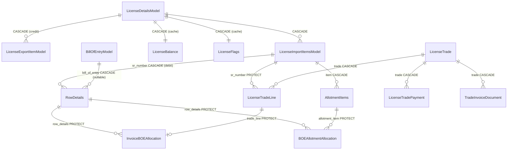

# 07 Database audit: financial and licence tables

Owner: Agent B (database and financial integrity audit). Date: 2026-11-01. Branch: `version-v1`.

Labels: **VERIFIED** = read in source or migration at the cited file:line. **SUSPECTED** = inference, not run. Finding IDs are ISS-030 to ISS-049 only. ISS-001 to ISS-003 and ISS-019 to ISS-027 are referenced, not restated.

Method and limits: static read of models, migrations, signals, services and calculators. No migration was run, no database was written, no seed or write command was run, and no secret file was read. One read-only test run was made in a disposable test database (see section 8). No live schema was inspected, so physical constraints, index definitions and row counts are unverified.

## 1. Plain-English summary

The licence balance is not stored as one authoritative number. It is recomputed from raw rows (export CIF, import items, BOE debit rows, allotments, trade lines, purchase and sale), and the result is copied into a few denormalised fields: `LicenseBalance.balance_cif`, `LicenseFlags.is_null` and `is_expired`, and per-item `available_*`, `debited_*` and `allotted_*` columns on `LicenseImportItemsModel`. Those copies are refreshed by Django signals and by ad hoc writers (ledger upload, sync command, seed command).

Five things matter most for the database:

1. **The copies disagree with the live calculation.** Three different writers set the stored Null DFIA flag using three different thresholds (100, 500 and, in the list filter, 200). The stored item quantity uses a different formula from the live one. The stored `balance_cif` is not refreshed by the ledger upload path. Several API filters read the stored columns. See ISS-033 to ISS-036 in document 18.
2. **Money rows are protected inconsistently.** Reconciliation allocation rows use `PROTECT`, so they block deletion of the debit row they depend on. Trade payments, invoice-document records and the paired counterpart line use `CASCADE`, so deleting a parent removes money history without an audit row (ISS-040).
3. **Concurrency control is partial.** Allocation and reconciliation writes lock the row they touch (`select_for_update`). Balance and flag recalculation takes no licence-level lock, and the allocation path locks only the import item, not the licence whose balance it checks (ISS-037).
4. **Database-level checks are sparse for money.** Non-negative checks exist on reconciliation allocations, ledger rows and the licence invoice, but not on `RowDetails`, licence item rows, trade lines, trade payments or `LicenseBalance`. Those rely on Django validators, which run only through forms and serializers (ISS-043).
5. **Migrations were checked by count, not value.** Migration `license/0005` splits licence fields into sub-tables and drops the originals. Its verification compares row counts only (ISS-044).

## 2. Model inventory: financial and licence tables

Precision is `max_digits,decimal_places` as declared. "Validator only" means a `MinValueValidator` with no database `CheckConstraint`.

| Model (file:line) | Money and quantity fields (precision) | Key relations and `on_delete` | Database constraints and indexes | Delete style | Notes |
|---|---|---|---|---|---|
| `LicenseDetailsModel` (`license/models/core.py:91`) | none (money moved to sub-tables) | `exporter` SET_NULL (`:136`, archived name snapshot via `signals.py:596`); `port` PROTECT; `purchase_status` PROTECT; `scheme_code`/`notification_number` PROTECT | `license_number` unique (`:125`); indexes on number, file number, exporter+date, port+date, date, expiry (`:157-168`) | Hard (cascades to all child rows) | Pre-delete marks the licence so child hooks know it is going away (`signals.py:102-110`). |
| `LicenseExportItemModel` (`:860`) | net_quantity, old_quantity, fob_fc, fob_inr, value_addition, cif_fc, cif_inr 15,2 (`:870-884`); fob_exchange_rate 15,6 | `license` CASCADE; `item` CASCADE; `norm_class` CASCADE | none beyond FK indexes; validator-only non-negative | Hard | Export CIF is the only "credit" source for the balance (`balance_calculator.py:92`). |
| `LicenseImportItemsModel` (`:902`) | quantity, old_quantity, available_quantity, debited_quantity, allotted_quantity 15,3; cif_fc, cif_inr, available_value, debited_value, allotted_value 15,2 (`:912-926`) | `license` CASCADE (`:907`, db_index); `hs_code` CASCADE; `items` M2M | `unique_together (license, serial_number)` (`:941-942`); indexes on license, hs_code, available_quantity, available_value (`:945-950`); validator-only non-negative | Hard | Stored caches of the live calculation; written by `calculate_balance.py:164` and `signals.py:237-261`. |
| `LicenseBalance` (`:2360`) | balance_cif 15,2, default 0, validator-only min 0 (`:2370`) | `license` OneToOne CASCADE, PK | index on balance_cif (`:2380`); no check | Hard | Written only by `update_license_flags` (`signals.py:328`) and sync/seed/update commands. Not refreshed by the ledger upload path (ISS-035). |
| `LicenseFlags` (`:2384`) | none; booleans incl. `is_null` (default False, `:2398`), `is_expired` | `license` OneToOne CASCADE, PK | index (`is_active`, `is_expired`) (`:2406`); no index on `is_null` | Hard | Dashboard counts read these (`dashboard.py:110-112`). |
| `LicenseOwnership` (`:2410`) | none | `current_owner` PROTECT (`:2421`) | index on current_owner | Hard | Owner pointer only. |
| `LicensePurchase` (`:2215`) | fob_inr, cif_inr, cif_usd, amount_inr 15,2; exchange_rate, markup_pct 15,6; quantity_kg 15,3; rate_inr 15,2 (`:2250-2264`) | Parent FK not read in this audit | validator-only | Hard | Purchase credit on the licence side of the Financial ledger (`balance_calculator.py:1290`). |
| `Invoice` / `InvoiceItem` (`license/models/invoice.py:53`, `:168`) | total_* and item amounts (`:71-99`, `:177-207`) | `Invoice.bills_of_entry` CASCADE (`:54-59`); `InvoiceItem.invoice` CASCADE; `sr_number` CASCADE (`:170-172`) | `invoice_number` unique (`:67`); check constraints non-negative (`:155-163`, `:242-256`) | Hard | **No writer exists in the codebase** (grep for `Invoice.objects` and `Invoice(` in `apps/` returned no creation site). See ISS-046. |
| `AllotmentModel` (`allotment/models/core.py:46`) | required_quantity, unit_value_per_unit, cif_fc, cif_inr, exchange_rate (`:56-84`) | `company` PROTECT (`:53`); `port` PROTECT; `related_company` PROTECT; `planning_target_item` PROTECT | none read | Hard (`views.py:374-381`) | Allotment is the "entitlement" side of the item balance. |
| `AllotmentItems` (`:212`) | cif_inr, cif_fc, qty (`:229-241`); effective_unit_price (`:279`); released_quantity, reactivated_quantity (`:298-310`) | `item` CASCADE (`:213-216`); `allotment` CASCADE (`:221-224`); `plan_line` SET_NULL (`:270-272`); `previous_version` SET_NULL (`:327-330`) | unique `(item, allotment, allocation_basis[, planning_target_item])` (`:336-346`) | Hard | Deleting an allotment releases its quantity silently unless a `BOEAllotmentAllocation` PROTECTs the item. |
| `AllocationVersion` (`allotment/models/allocation_version.py:5`) | quantity 15,3; cif_fc 15,2 (`:30-31`) | `allocation_item` PROTECT (`:13-15`); `company` SET_NULL | none read | Hard | Version history. |
| `AuditEvent` (`allotment/models/audit_event.py:8`) | quantity_before/after 15,3; cif_before/after 15,2, nullable (`:46-50`) | `allocation_item` PROTECT (`:34-36`); `actor` SET_NULL | none read | Hard | Allotment audit trail. |
| `Shortfall` (`allotment/models/shortfall.py:6`) | required_quantity 15,3; required_cif 15,2 (`:33-34`); allocated_* (`:36-41`) | `license` CASCADE (`:26-28`) | none read | Hard | Shortfall is derived. |
| `BillOfEntryModel` (`bill_of_entry/models.py:185`) | exchange_rate (`:205`); `failed` integer (`:226`) | `allotment` M2M; `port`; `company` | `unique_together (bill_of_entry_number, bill_of_entry_date)` (`:235`) | Hard; hide is a soft marker (see section 4.4) | Hide overwrites `invoice_no` with the OTH marker (`boe_service.py:403`). |
| `RowDetails` (`bill_of_entry/models.py:380`) | cif_inr, cif_fc, qty 15,3 (`:395-411`) | `bill_of_entry` CASCADE, **null=True** (`:381-388`); `sr_number` CASCADE (`:389-393`) | `unique_together (bill_of_entry, sr_number, transaction_type)` (`:429`); **no check constraint**; frozen guard in `save()` (`:436-441`) | Hard | The debit side of every balance. Deleting an import item cascades here (ISS-040). |
| `LicenseTrade` (`trade/models.py:138`) | subtotal_amount, roundoff, total_amount 20,2 (`:222-224`) | `from_company`/`to_company` SET_NULL; `linked_trade` SET_NULL (`:234-238`); `counterpart` OneToOne PROTECT (`:246-249`); `copied_from` PROTECT | Partial unique on non-blank purchase and sale invoice numbers per company (`:302-318`); from≠to check (`:300-304`); final-party check (`:320-`). `invoice_number` is **not** globally unique. | Hard | Totals recomputed by `recompute_totals` (`:365-391`), which uses queryset update. |
| `LicenseTradeLine` (`trade/models.py:495`) | qty_kg 20,4; rate_inr_per_kg 20,3; cif_fc 20,2; exc_rate 12,4; cif_inr 20,2; fob_inr 20,2; pct 9,3; amount_inr 20,2 (`:536-547`) | `trade` CASCADE (`:513-515`); `counterpart_line` OneToOne CASCADE (`:516-521`); `sr_number` PROTECT (`:525-528`) | **No constraint.** Validator-only. | Hard | `cif_fc` is the field the Financial balance sums for SALE debit (`balance_calculator.py:1063`). |
| `IncentiveTradeLine` (`trade/models.py:581`) | license_value, rate_pct, amount_inr (`:601-617`) | `trade` CASCADE (`:586-589`); `incentive_license` PROTECT (`:593-596`) | none | Hard | Incentive licences are a parallel line type. |
| `LicenseTradePayment` (`trade/models.py:650`) | amount 20,2 (`:658`) | `trade` CASCADE (`:656`) | **No constraint, no validator** | Hard | Settlement history. See ISS-041 and ISS-040. |
| `TradeInvoiceDocument` (`trade/models.py:681`) | sale_bill_inr 20,2 (`:696`) | `trade` CASCADE (`:690-691`) | unique `(trade, version_hash)` (`:702-705`) | Hard | Generated invoice versions. Cascade removes issued-document records with the trade (ISS-040). |
| `InvoiceDocumentAccessToken` (`trade/models.py:711`) | none | `trade` CASCADE (`:722`); `issued_to` SET_NULL | `token_hash` unique (`:721`) | Hard | Public document links. |
| `InvoiceBOEAllocation` (`reconciliation/models.py:226`) | allocated_qty, allocated_cif_fc, allocated_cif_inr (`:280-288`) | `trade_line` PROTECT (`:263-266`); `row_details` PROTECT (`:268-271`); `superseded_by` SET_NULL (`:297-301`) | check: all three allocated values ≥ 0 (`:314-320`) | Soft: `status` and `is_current` (version chain) | Invoice-to-BOE allocation with version chain. Writes use `select_for_update` (`allocation_service.py:257-261`, `:330-340`). |
| `BOEAllotmentAllocation` (`reconciliation/models.py:331`) | allocated_qty, allocated_cif_fc, allocated_cif_inr (`:383-391`) | `row_details` PROTECT (`:369-372`); `allotment_item` PROTECT (`:374-377`); `superseded_by` SET_NULL (`:400-404`) | check: all three ≥ 0 (`:417-421`) | Soft (version chain) | Allotment-to-BOE allocation. |
| `ExternalInvoiceLink` (`reconciliation/models.py:434`) | qty, cif_fc, cif_inr (`:474-482`) | `row_details` PROTECT (`:468-471`) | check ≥ 0 (`:501-507`) | Soft | |
| `ReconciliationLog` (`reconciliation/models.py:95`) | none (JSON before/after) | `trade`, `bill_of_entry`, `license_item` SET_NULL (`:139-157`); `user` SET_NULL (`:165-169`) | none read | Append-only by convention | **Audit rows lose their BOE link when the BOE is deleted** (SET_NULL). Relevant to ISS-039. |
| `IgnoredWarning` (`reconciliation/models.py:518`) | none | `license` CASCADE (`:543-546`); `ignored_by`/`restored_by` SET_NULL | unique `(license, warning_type, entity_type, entity_id)` (`:565-569`) | Soft (`ignored` flag) | |

Soft versus hard delete summary: the licence, licence item, export row, BOE, RowDetails, allotment, trade, trade line and trade payment are all **hard-deleted**. The only soft mechanisms are the BOE hide marker (`invoice_no = OTH`, reversible only through the audit log, see ISS-030), the reconciliation `status`/`is_current` version chain, and `LicenseItemPlan.is_deleted` (`license/models/core.py:1367`, planning only).

### 2.1 Relationship sketch (money-bearing rows)

## 3. Constraint and relationship review

### 3.1 Foreign keys and delete behaviour

- **Protected correctly (PROTECT):** reconciliation allocations on `RowDetails`, `AllotmentItems` and `LicenseTradeLine`; `LicenseTradeLine.sr_number` (a sold licence item cannot be deleted); allocation versions and audit events on `AllotmentItems`; `LicenseOwnership.current_owner`. The generic master-data destroy turns `ProtectedError` into a validation error (`apps/core/views/master_view.py:169-195`).
- **Cascade that removes money history (ISS-040):** `RowDetails.sr_number`, `LicenseTradePayment.trade`, `TradeInvoiceDocument.trade`, `LicenseTradeLine.counterpart_line` (deleting one half of a paired sale and purchase deletes the other half).
- **SET_NULL that orphans audit rows:** `ReconciliationLog.bill_of_entry` and `.license_item`. A deleted BOE leaves its log entries with no BOE link (merge path, ISS-039).

### 3.2 Unique constraints

Present and useful: `LicenseDetailsModel.license_number`; `(license, serial_number)` on import items; `(bill_of_entry_number, bill_of_entry_date)` on BOEs; `(bill_of_entry, sr_number, transaction_type)` on RowDetails; allotment item identity; purchase and sale invoice numbers per company; `(trade, version_hash)` on invoice documents; ignored warning identity.

Gaps: `COMMISSION_PURCHASE` and `COMMISSION_SALE` are excluded from the invoice-number constraint (`trade/models.py:302-318`), so duplicates are possible for commission trades (SUSPECTED impact; no duplicate data was queried).

### 3.3 Check constraints (money and quantity)

| Table | DB check | Source |
|---|---|---|
| InvoiceBOEAllocation, BOEAllotmentAllocation | ≥ 0 on all allocated values | `reconciliation/models.py:314-320`, `:417-421` |
| ExternalInvoiceLink | ≥ 0 on qty and CIF | `:501-507` |
| LicenseInvoice / InvoiceItem | ≥ 0 on totals, amount, rate | `license/models/invoice.py:155-163`, `:242-256` |
| LicenseTrade | from ≠ to company; final-party consistency | `trade/models.py:300-304`, `:320-` |
| **None** | RowDetails, LicenseExportItemModel, LicenseImportItemsModel, LicenseBalance, LicenseTradeLine, LicenseTradePayment, IncentiveTradeLine, AllotmentItems | validator-only (ISS-043) |

### 3.4 Indexes on filter fields

The licence list and dashboard filter on `flags__is_null`, `flags__is_expired`, `flags__is_active` and `balance_cif`. `LicenseFlags` indexes `(is_active, is_expired)` only (`:2406`), so `is_null` filters are not indexed (SUSPECTED performance, no plan read). `LicenseBalance.balance_cif` is indexed (`:2380`), but the list no longer filters on it, and the API stored-balance filters do (ISS-034). `LicenseImportItemsModel` indexes `available_quantity` and `available_value` (`:947-950`), which are stored caches that can drift (ISS-036).

### 3.5 Nullable fields that business logic assumes non-null

| Field | Null allowed | Assumption that breaks |
|---|---|---|
| `RowDetails.bill_of_entry` (`:381-388`) | yes | The single-licence debit query requires `bill_of_entry__isnull=False` (`balance_calculator.py:369-400` `get_debit_rows`), but the batched debit queries do not (`calculate_boe_debit_total_for_licenses` `:542`, `calculate_debit_for_licenses` `:645`). A debit row with a null BOE is counted in list and report totals and skipped by the model property (SUSPECTED; no such row was queried). |
| `LicenseTrade.from_company` / `to_company` | yes (SET_NULL) | Reports and the counterpart rules assume the party is known. Null is possible after a company delete. |
| `LicenseImportItemsModel.hs_code` | yes | Item matching and HS-based reports. |
| `LicenseDetailsModel.exporter` | yes (SET_NULL) | Mitigated by `archived_exporter_name` (`signals.py:596-600`). |
| `LicenseTradeLine.sr_number` | no (PROTECT) | Good. |
| `LicenseBalance` / `LicenseFlags` row | no OneToOne, but may be missing | Readers use `_sub()` defaults (`license/models/core.py:199-204`), which silently return 0 or False for a missing row. `sync_licenses` uses `get_or_create` (`sync_licenses.py:168-170`). |

### 3.6 Default values

- `LicenseFlags.is_null` defaults to False (`:2398`). A new licence therefore starts as "not null" until a signal recalculates it. ISS-002 notes the declared server-side default `flags__is_null=False` is never applied in `apply_advanced_filters`; that is a filter default, not a column default.
- `LicenseBalance.balance_cif` defaults to 0 (`:2370`). A missing or stale balance row reads as zero, which the list then treats as Null DFIA.
- Money columns default to 0 throughout. Zero is therefore indistinguishable from "not yet computed" for the stored caches.

### 3.7 Audit fields

`AuditModel` supplies `created_on`, `modified_on`, `created_by`, `modified_by` to `LicenseDetailsModel`, `BillOfEntryModel`, `RowDetails`, `LicenseTrade`, allotment and reconciliation rows. `LicenseTradeLine` and `LicenseTradePayment` have their own timestamps but no `created_by`/`modified_by`. `LicenseTradePayment` has no audit user at all. Activity logging is asynchronous (D6), so it is not treated as authoritative here.

## 4. Migration review

| Migration | What it does | Balance or flag impact | Verification | Result |
|---|---|---|---|---|
| `license/0005_licensebalance_licenseflags_licensenotes_and_more.py` | Creates `LicenseNotes`, `LicenseBalance`, `LicenseFlags`, `LicenseOwnership`; copies values with raw SQL (`copy_and_verify`, `:38-104`); drops the old `LicenseDetailsModel` columns (`:225-238`) and drops materialised views `license_balance_mv` and `item_balance_mv` CASCADE (`:193-194`). | Copies `balance_cif` (COALESCE to 0) and every `is_*` flag, including the stored `is_null`. The stored value at migration time is carried forward unchanged. | Row counts only (`:93-103`). **No value equality check** between old and new columns. | ISS-044 |
| `bill_of_entry/0012_repair_boe_number_date_unique_constraint.py`, `0013_...columns.py` | Alter the BOE unique constraint to match migration 0003. | None. Comment says "without touching data" (`0012:16-23`). | Body read. | Non-destructive. VERIFIED. |
| `bill_of_entry/0003` (`trade`): `trade/0003_licensetrade_boe_to_boes_m2m.py` | Copies `boe` FK to `boes` M2M and back (`copy_boe_fk_to_boes_m2m`, `copy_boes_m2m_to_boe_fk`). | No balance write. Reverse path exists. | Function names and filter read; body partly read. | Reversible, data-copy only. |
| `license/0002_scheme_and_notification_to_fk.py`, `0009_*`, `0015_*` | Schema and identity conversions. | Not read in depth. | Not read. | NOT READ |
| `license/0014_backfill_licenseitemplan_baseline_used.py`, `0016_backfill_licenseitemplan_remaining_balance.py` | RunPython backfill of plan balance fields. | Planning balance fields (`LicenseItemPlan` `baseline_used_*`, `remaining_*`, `:1327-1351`). Potentially balance-changing for planning, not for Balance CIF. | Not read. | NOT READ. Must be read before any V1 migration run. |
| `license/0041_map_parent_actuals_from_approved_aliases.py`, `0042_map_rutile_parent_actuals.py`, `0037_backfill_actual_usage_planning_targets.py`, `0038_*`, `0033_backfill_strategy_field.py` | Planning-target and actual-usage backfills. | Changes which actual usage maps to which planning target, so it changes planning remaining quantities. | Not read. | NOT READ |
| `license/0046_replan_request_revisions.py`, `0047_durable_replan_request_state_machine.py`, `0049_replan_request_scope.py`, `0054_persistent_license_download_requests.py` | Replan request state machine and download request tables. | No Balance CIF write. | Not read. | NOT READ |

Other checks:

- `makemigrations --check` passed at the V1 baseline (`docs/v1/06-data-and-migrations/current-schema.md`). Not re-run here.
- No migration was found that recalculates `is_null` with a threshold. The 0005 copy is the only migration that touches the stored flags.

## 5. Transaction boundaries and locks

| Write path | Transaction | Lock | Recalculation | Gap |
|---|---|---|---|---|
| Licence create (`apps/license/serializers/_license_write.py:188-260`) | `transaction.atomic()` with `suspend_license_flag_recalc()` | none on licence | `update_license_flags` once at end (`:300`) | Fine for a new row. |
| Licence update (`_license_write.py:305-894`) | atomic | none | `update_license_flags` (`:894`) | Writable `is_null` in the payload is accepted (`serializers/license.py:521`) and then recomputed (ISS-033 context). |
| Import item / export item / RowDetails / allotment / trade-line save | Django autocommit unless the caller wraps it; signals run synchronously in the same transaction | none | `update_license_flags` and `update_balance_values` in signal | No licence-level lock; concurrent writers can write stale aggregates (lost update). ISS-037. |
| BOE save | `on_commit` callbacks (`bill_of_entry/models.py:477-558`) | none | balance refresh deferred to commit | Deferred refresh means a read in the same request can see stale stored values. |
| Reconciliation allocation create, edit, reverse (`reconciliation/services/allocation_service.py:257-261`, `:330-340`, `:397`, `:470-472`, `:531-541`, `:592`, `:682`, `:725`) | `transaction.atomic()` | `select_for_update` on the trade line and the RowDetails (or allotment item) | Stored caches refreshed by signals (`signals.py:584-593`) | Good for the pair. Licence-level balance is not locked. |
| Allotment allocation from the UI (`apps/allotment/views_actions.py:1071`, `:1098`, `:1188-1192`) | `@transaction.atomic` | `select_for_update` on the allotment and on the import item | signals | Locks the item only. The licence balance check (`validation_service.py:119-166`) reads the licence total without lock. ISS-037. |
| `allocation_service.allocate_item` (`apps/allotment/services/allocation_service.py:152-204`) | `@transaction.atomic` | none | signal | **No production caller** found (grep). Dead code path that has no lock. |
| Trade paired create and edit (`apps/trade/services/trade_service.py:219-380`, `:321-322`) | atomic | `select_for_update(of=('self',))` on the source trade | `recompute_totals` | Good. |
| Trade serializer create and update (`apps/trade/serializers.py:400`, `:501`) | atomic | none | `recompute_totals` (`:472`, `:588`) | Nested-write errors are swallowed when `_force_save` is set (ISS-031). |
| BOE merge (`apps/bill_of_entry/services/boe_service.py:203-318`) | atomic | none on the source BOE | none; queryset `.update()` bypasses signals | ISS-039. |
| Ledger upload (`scripts/parse_ledger.py:392-415`, `apps/core/scripts/ledger.py:262-322`) | atomic around `bulk_create` | none | per-item `update_balance_values` after bulk (`parse_ledger.py:550-553`, `ledger.py:281`) | `bulk_create` and `bulk_update` skip `post_save`. ISS-035. |
| Replan worker (`apps/license/tasks.py:135-530`) | atomic | `select_for_update` on the request, the licence and the job | durable state machine | Strongest licence-level locking in the codebase. |

## 6. Findings (database)

Full entries for ISS-037, ISS-040, ISS-043, ISS-044, ISS-046 and ISS-048. Other ISS entries in this audit appear in documents 08 and 18.

### ISS-037: Licence balance and flags are recalculated without a licence-level lock; allocation checks licence balance without one

- **Severity:** HIGH. **Confidence:** VERIFIED (absence of lock, by grep and read); race outcome SUSPECTED (runtime not run).
- **Evidence:**
  - Recalculation reads aggregates then writes: `signals.py:280-335` (`update_license_flags`), `apps/core/scripts/calculate_balance.py:164-215` (`update_balance_values`). No `select_for_update` on `LicenseDetailsModel` in the signal or calculator path. The only licence-row locks are in the replan worker (`apps/license/tasks.py:169`, `:238`).
  - The allocation view locks the import item only (`apps/allotment/views_actions.py:1188-1192`). Its licence balance check reads the financial total (`apps/license/services/validation_service.py:119-166`, `:150`, `get_balance_cif`).
  - `allocate_item` (`apps/allotment/services/allocation_service.py:152-204`) has no production caller.
- **Business impact:** two users allocating against two different items of the same licence at the same time can each see the full licence balance and together allocate more than the licence holds. Stored `balance_cif` and flags can also keep a stale value after an interleaved write.
- **Technical impact:** lost-update risk on `LicenseBalance`, `LicenseFlags` and `LicenseImportItemsModel` caches. Reads inside the allocation transaction are not repeatable against a concurrent writer under the default READ COMMITTED isolation.
- **Suggested remediation:** lock the `LicenseDetailsModel` row (`select_for_update`) in every balance-affecting write path and in the allocation check. Lock order: licence, then import item. Add a test that two allocations on sibling items cannot together exceed the licence balance. Retire or lock `allocate_item`.
- **Acceptance criteria:** (a) concurrency test with two threads or processes allocates sibling items whose sum exceeds the balance; exactly one succeeds and the other receives a validation error; (b) `update_license_flags` runs under the licence lock; (c) no production code path calls `allocate_item` without the lock.

### ISS-040: Parent deletes cascade through money-bearing children without audit rows

- **Severity:** HIGH. **Confidence:** VERIFIED (on_delete rules); reachability through API permissions SUSPECTED (permissions not traced).
- **Evidence:**
  - Debit rows: `RowDetails.sr_number` CASCADE (`bill_of_entry/models.py:389-393`). Deleting a licence item deletes its BOE debit rows, unless a reconciliation allocation PROTECTs them (`reconciliation/models.py:268-271`, `:369-372`). The BOE survives with its other rows.
  - Trade payments: `LicenseTradePayment.trade` CASCADE (`trade/models.py:656`). Deleting a trade deletes its settlement history.
  - Invoice documents: `TradeInvoiceDocument.trade` CASCADE (`:690-691`), so issued invoice versions disappear with the trade.
  - Paired lines: `LicenseTradeLine.counterpart_line` CASCADE (`:516-521`). Deleting one side deletes the other side in the other trade.
  - Licence delete reaches these through the generic destroy (`apps/core/views/master_view.py:169-195`), which only converts `ProtectedError`.
- **Business impact:** deleting a licence or a trade can silently remove debit, settlement and issued-invoice evidence. Balances change with no reconciliation record.
- **Technical impact:** no soft delete, no tombstone, and `ReconciliationLog` rows only SET_NULL their link (`reconciliation/models.py:139-157`).
- **Suggested remediation:** change `LicenseTradePayment.trade` and `TradeInvoiceDocument.trade` to PROTECT, and change `RowDetails.sr_number` to PROTECT for rows with a `bill_of_entry`. Add an explicit, audited delete service that writes a `ReconciliationLog` entry with the removed row snapshot. Confirm the permission for each destroy action (not traced here).
- **Acceptance criteria:** (a) deleting a trade with payments or issued invoice documents is refused with a clear error; (b) deleting a licence item with BOE debit rows is refused unless an approved, audited delete path is used; (c) a deletion test asserts the row count and the audit entry.

### ISS-043: Money and quantity columns have no database non-negative check

- **Severity:** MEDIUM. **Confidence:** VERIFIED.
- **Evidence:** No `CheckConstraint` on `RowDetails` (`bill_of_entry/models.py:380-430`), `LicenseExportItemModel` (`license/models/core.py:860-890`), `LicenseImportItemsModel` (`:902-950`), `LicenseBalance` (`:2360-2381`), `LicenseTradeLine` (`trade/models.py:495-580`), `LicenseTradePayment` (`:650-666`), `IncentiveTradeLine` (`:581-620`). Non-negative checks exist only on reconciliation allocations, ledger rows and the licence invoice (see section 3.3). Protection is `MinValueValidator`, which runs only through forms and serializers.
- **Business impact:** a negative debit, a negative payment or a negative available value can be written by any path that bypasses serializers (scripts, `bulk_create`, the ledger parser, the sync command). A negative value flips balances and flags silently.
- **Technical impact:** the database cannot enforce the invariant that balances are non-negative inputs.
- **Suggested remediation:** add `CheckConstraint` (≥ 0) to each money and quantity column after a read-only query for existing negative rows (section 2 of document 18 describes the query). Add a `CHECK (amount_inr = ...)` only after the owner confirms the rule (see ISS-042).
- **Acceptance criteria:** (a) migration applies on a copy with no violating rows, and fails loudly with a row list if violating rows exist; (b) a direct `bulk_create` of a negative value raises `IntegrityError`.

### ISS-044: Migration `license/0005` verifies row counts only and drops source columns and materialised views

- **Severity:** MEDIUM. **Confidence:** VERIFIED.
- **Evidence:** `license/migrations/0005_licensebalance_licenseflags_licensenotes_and_more.py:38-104` copies values with raw SQL; the verification at `:93-103` compares `COUNT(*)` only. `RemoveField` drops `balance_cif`, `is_null` and the other moved columns (`:225-238`). Materialised views `license_balance_mv` and `item_balance_mv` are dropped CASCADE (`:193-194`).
- **Business impact:** a failed or partial value copy would pass verification if row counts match. Any report that read the dropped materialised views would break or read nothing.
- **Technical impact:** the migration is irreversible for the dropped columns (reverse is `noop_reverse`, `:120`). Whether the views were recreated later was not verified.
- **Suggested remediation:** for any future column split, add a value-equality check (count of rows where the copied and source values differ, must be 0) and a rehearsal on a restored copy. Record the materialised-view recreation status.
- **Acceptance criteria:** (a) rehearsal on a restored copy shows zero value differences; (b) `pg_matviews` lists the expected views after migration, or their removal is documented as intended.

### ISS-046: The licence-level `Invoice` and `InvoiceItem` tables have no writer

- **Severity:** LOW. **Confidence:** VERIFIED (no creation site found by grep of `apps/`).
- **Evidence:** `license/models/invoice.py:53-` (`Invoice`, `invoice_number` unique at `:67`), `:168-` (`InvoiceItem`). Only the model module imports them (`license/models/__init__.py:5`, `:8`). Trade invoices are a different mechanism (`trade/services/invoice_document_service.py`).
- **Business impact:** none while empty; a future writer could create a second, unreconciled invoice system.
- **Technical impact:** dead schema with active check constraints.
- **Suggested remediation:** either document as reserved, or remove in a later migration after confirming no data exists in the target databases (read-only count).
- **Acceptance criteria:** a read-only count on each target database shows zero rows, and the decision (keep or remove) is recorded in `docs/v1`.

### ISS-048: A save on a frozen `RowDetails` row returns silently and the caller sees success

- **Severity:** MEDIUM. **Confidence:** VERIFIED.
- **Evidence:** `bill_of_entry/models.py:436-441`: `if RowDetails.objects.filter(pk=self.pk, is_frozen=True).exists(): return`. The method returns without raising. Callers that use `update_or_create` (`bill_of_entry/serializers.py:398`, `:417`) get no error and the API returns success.
- **Business impact:** a user edit to a ledger-frozen BOE row appears to save but is not persisted. The UI shows the old figure on the next load, or the new figure only until refresh.
- **Technical impact:** silent data loss on the write path.
- **Suggested remediation:** raise a validation error (409 or 422) when a frozen row is edited through the API. Keep the silent path only for ledger code that deliberately bypasses it.
- **Acceptance criteria:** (a) a PATCH to a frozen row returns a non-2xx response and leaves the row unchanged; (b) ledger upload still updates frozen rows.

## 7. Database-level open questions

- Should licence-item and trade deletes be allowed at all after balances exist (ISS-040)? This is a data-retention policy question under D6.
- Should the stored `is_null` and `balance_cif` be kept at all, or be removed in favour of live reads with a materialised cache refreshed on a schedule? (Owner and architecture decision; DEC-02 covers the classification.)

## 8. Read-only test run

- Command: `TESTING=true TEST_DB_NAME=test_lm_auditB_d2_char /Users/drushahardiksottany/Developer/projects/license-manager/.venv/bin/python -m pytest apps/license/tests/test_balance_semantics_d2_characterization.py -p no:cacheprovider --no-cov -q` (run from `backend/`).
- Exit code: **0**. Result: **6 passed**. Log: `/tmp/lm-verify-auditB-d2.log` (outside the repository).
- Disposable test database name was set by `TEST_DB_NAME` (`backend/lmanagement/settings.py:213-217`). `TESTING=true` is not read by settings and had no effect that was observed. A first run wrote `backend/htmlcov/` (coverage HTML); that directory is git-ignored (`backend/.gitignore:45`).
- No other test was run. No migration was run.

## 9. Missing database tests (summary; full table in document 08)

- No test that a trade delete with payments or invoice documents is refused (ISS-040).
- No test that a negative amount is rejected at the database level (ISS-043).
- No concurrency test for sibling-item allocation (ISS-037).
- No value-equality test for the 0005 copy (ISS-044).
- No test that a frozen row update returns an error (ISS-048).
