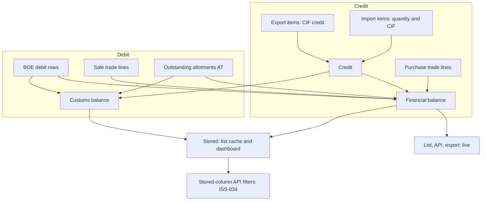
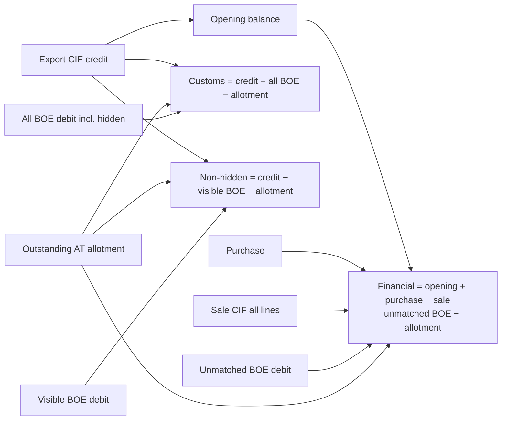

# 08 Financial business logic audit

Owner: Agent B. Date: 2026-11-01. Branch: `version-v1`.

Labels: **VERIFIED** = read in code or migration at file:line. **SUSPECTED** = inference, not run. Finding IDs are ISS-030 to ISS-049. Existing findings are cross-referenced, not restated: ISS-001 to ISS-003 (dashboard, default filter, thresholds), ISS-019 to ISS-025 (D2 engine findings from agent 06), ISS-026 (five Null DFIA cut-offs), ISS-027 (download detail 500). Owner questions Q-005, Q-016 and Q-001 are pending and are not decided here.

Method: static read of the balance engine (`apps/license/services/balance_calculator.py`), the stored writers (`apps/license/signals.py`, `apps/core/scripts/calculate_balance.py`), the list and dashboard views, the validators, BOE, allotment, reconciliation and trade services, and the decision records. One read-only characterization test run (exit 0, 6 passed; see document 07 section 8). No live data was queried.

## 1. Plain-English summary

Three different "balances" are calculated for a licence. Each is a separate, named output, and the codebase keeps them apart on purpose (repository decision D2 in `docs/v1/00-executive-overview/decisions-required.md`).

- **Customs balance** (`calculate_customs_balance`, `:1406`): export CIF minus every BOE debit (including hidden BOEs) minus outstanding allotments. Sales are not part of it.
- **Financial balance** (`_calculate_financial_balance`, `:1582`): opening balance, plus purchases, minus sales, minus the BOE debit that has not yet been matched to a sale invoice, minus outstanding allotments. This is the figure the list, the API, the export and the stored `balance_cif` show.
- **Live calculation of the non-hidden customs-like figure** (`calculate_balance`, `:1349`): export CIF minus visible BOE debit minus allotments. The snapshot's `customs_balance` field uses this (ISS-047).

The owner's available-balance rule (UD-002, recorded in `docs/v1/system-audit/execution/user-decisions.md`) says a BOE's utilisation counts once whether it is unbilled or billed. The code honours that in the normal case where a BOE is fully billed through a formal allocation or a legacy tag. It breaks in several edge cases, documented below and in ISS-019 to ISS-021, plus two new ones (ISS-031 and ISS-032).

## 2. D2 verification result

The brief names two D2 statements, and the repository has two different records. Both were checked.

| Statement | Source | Result |
|---|---|---|
| **Available balance = allotted − unbilled BOE − billed utilisation; billing a BOE must not deduct it twice** (the brief's D2) | UD-002 in `user-decisions.md` | **Partial.** Holds for the owner's worked example (allotted 500,000; unbilled BOE 100,000; available 400,000; then billing the same BOE for 100,000 leaves 400,000). See section 4.6 for the trace on all three engines. Fails in the cases listed below. |
| Customs and Financial are two engines and must not be merged (repository D2) | `decisions-required.md` row D2 | **Holds.** The three figures are distinct functions with distinct formulas, and the characterization test pins them separately. |

Cases where the rule does not hold in code:

| Case | Trigger | Result | ID |
|---|---|---|---|
| Sale with no BOE link, same goods as a BOE | Financial engine counts the BOE as unbilled and the sale as billed | BOE deducted twice (300,000 where UD-002 gives 400,000 in the agent 06 example) | ISS-019 |
| Partial billing by legacy tag (BOE 100,000, billed 60,000) | BOE excluded in full; only the sale is deducted | Unbilled 40,000 disappears (440,000 where UD-002 gives 400,000) | ISS-020 |
| Unbilled sibling rows of a billed BOE | Whole BOE excluded when any row is tagged | Unbilled rows dropped | ISS-021 |
| Allotment with any linked BOE | Whole allotment item zeroed | Remainder of a partly used allotment released | ISS-022 |
| **Legacy-tagged BOE that also has a partial formal allocation** | Exclusion gated on `allocated == 0`, so the remainder is debited again while the sale still counts in full | **Billed BOE deducted twice for the remainder** | **ISS-032 (new)** |
| Client flags skip the CIF ceiling on trade lines | `_force_save` and `auto_create_paired` | Sale CIF can exceed source-row CIF; not a double count but an unchecked debit | **ISS-031 (new)** |
| Sale line with CIF left at zero in quantity mode | `LicenseTradeLine.cif_fc` is not derived from quantity and rate | A billed BOE is excluded but its sale contributes nothing (SUSPECTED) | ISS-042 (new) |

Decision status: UD-002 is recorded as owner-approved. Q-016 asks whether the owner should reconsider UD-002 in light of ISS-019 to ISS-021. This audit does not decide Q-016. It adds ISS-032 as new evidence for that question.

## 3. Null DFIA threshold

**Status: pending (Q-001) under this audit's brief. This audit does not select a value.**

Repository note for the lead: `docs/v1/system-audit/execution/user-decisions.md` UD-003 records an owner answer dated 2026-11-01: "Null DFIA is if license balance_cif is less than $200 everywhere", with the currency still to be confirmed (Q-011). The brief says Q-001 is open. The two records conflict. This audit documents both values and lists where each is used. It does not adopt UD-003, and it does not treat the code as the decision.

| Value | Meaning in code | Where it is used (VERIFIED) |
|---|---|---|
| **200** | Null if live balance < 200 | Live list filter `apply_advanced_filters` (`apps/license/views/license.py:653-678`); docstring for the viewset (`views/license.py:219`); active DFIA report filter (`apps/license/views/active_dfia_report.py:105-125`). Owner answer UD-003 (not adopted here). |
| **500** | Null if balance < 500 | Stored flag in `update_license_flags` (`apps/license/signals.py:315-318`); sync command (`apps/license/management/commands/sync_licenses.py:37`, `:194-195`); allocation gate `validate_license_active` (`apps/license/services/validation_service.py:47-48`, called from `validate_allocation` at `:257`); a dead duplicate `update_license_flags` at `validation_service.py:299-322` with no callers. |
| **100** | Null if balance < 100 | Stored flag rewritten on every `update_balance_values` call (`apps/core/scripts/calculate_balance.py:204-212`). Separately, the active licences report excludes balance < 100 (`apps/license/views/active_licenses_report.py:114`) and the expiring licences report does the same (`expiring_licenses_report.py:106`). The dashboard expiring-soon count uses ≥ 100 (`apps/license/views/dashboard.py:142`). |
| Other values listed in ISS-026 (not re-verified here) | 1,000 and 20,000 | `apps/core/management/commands/report_fetch.py` and `report_service.py:196-255` per ISS-026; dashboard label in `frontend/src/pages/Dashboard.tsx` around lines 415-425. |

Consequences of the current state, which hold whichever value is chosen:

- The stored `is_null` is set by two writers with different thresholds (100 and 500). The result depends on which writer ran last (ISS-033).
- Allocation is blocked below 500 while the list shows a licence with balance 200 to 499 as non-null (ISS-038).
- The dashboard Null DFIA count reads the stored flag, not the live balance (ISS-001).

## 4. Flows

Each flow lists the steps in plain English, the code references, whether D2 holds, and any findings.

### 4.1 Licence creation and entitlement

**Steps.** A licence is created with export items (the credit: CIF per export line) and import items (per-serial quantity and CIF). The create runs in one transaction with the flag recalculation suspended, then runs one `update_license_flags` at the end. Sub-table rows (`LicenseBalance`, `LicenseFlags`, `LicenseNotes`, `LicenseOwnership`) are created by a post-save signal and then written with `.update()`.

**Code.** `apps/license/serializers/_license_write.py:188-300` (create), `:305-894` (update). Export CIF is summed in `calculate_credit` (`balance_calculator.py:92`). Sub-table writes: `_license_write.py:28-70`, `:131-140`.

**D2.** Not applicable directly (credit side). The credit is the same in all three engines except where the opening-balance gate changes it (`calculate_opening_balance`, `:1486`).

**Findings.**
- The API accepts `is_null`, `is_expired` and the other flags in the licence payload (`apps/license/serializers/license.py:515-525`; write mapping `_license_write.py:32-37`). `update_license_flags` recomputes `is_null` and `is_expired` at the end of the save and overwrites the stored value when the computed value differs (`signals.py:315-323`, VERIFIED by read). A manually supplied `is_null` therefore does not persist when it disagrees with the computed value. The run-time order was not exercised. This is folded into ISS-033.

### 4.2 Allotment

**Steps.** A user allocates a licence item to an allotment (the entitlement). The UI action locks the import item row (`select_for_update`), checks the licence balance and item quantity, then creates an `AllotmentItems` row. Allotment type `AT` is outstanding; `ARO` is treated as already debited.

**Code.** `apps/allotment/views_actions.py:1071-1192` (lock at `:1192`); `apps/license/services/validation_service.py:119-196` (balance and quantity checks; both use live values, `get_balance_cif` and `calculate_available_quantity`). Outstanding allotment: `balance_calculator.py:711-844` (`_annotate_allotment_contribution`), `:895-927` (`get_outstanding_allotment_totals`). `allocation_service.allocate_item` (`apps/allotment/services/allocation_service.py:152-204`) has no production caller.

**D2.** Partial. An allotment linked to any BOE is zeroed for its whole remainder (`balance_calculator.py:798`, `:826`, `:834-840`), which is ISS-022.

**Findings.** ISS-037 (licence-level race, document 07). ISS-022 (allotment zeroing, cross-reference).

### 4.3 BOE creation and utilisation

**Steps.** A BOE is entered (manually, by PDF parse, or by ledger upload) with one or more `RowDetails` rows of type DEBIT. Each row names an import item and carries CIF (FC and INR) and quantity. A post-save signal refreshes the item's stored caches and the licence flags. Ledger upload writes rows with `bulk_create`, which skips signals, and then refreshes item caches explicitly.

**Code.** `apps/bill_of_entry/models.py:380-441` (RowDetails and frozen guard); `apps/bill_of_entry/serializers.py:295` (create), `:398`, `:417` (update_or_create); `apps/bill_of_entry/models.py:455-460` and `update_stock`; `apps/core/scripts/ledger.py:262-322`; `scripts/parse_ledger.py:392-415`, `:550-553`. The BOE debit used by Customs is `calculate_boe_debit_total` (`balance_calculator.py:512`), which is raw and unconditional. The Financial debit is `calculate_debit` (`:459`), which nets out linked rows.

**D2.** Holds for the unbilled BOE: it counts once in both engines.

**Findings.** ISS-048 (frozen rows silently ignored, document 07). ISS-035 (ledger upload leaves `balance_cif` stale, document 18). ISS-036 (stored quantity differs from live, document 18).

### 4.4 BOE billing and partial billing

**Steps.** A BOE is billed in one of two ways.
1. **Formal allocation.** An `InvoiceBOEAllocation` ties part or all of a debit row to a sale trade line. The allocation records `allocated_cif_fc` and `allocated_qty`. Allocations are versioned (`is_current`, `superseded_by`) and reversible.
2. **Legacy tag.** A sale trade's `boes` M2M lists the BOE. The whole BOE is then treated as represented by an invoice, for every licence that the trade's lines touch.

For the Financial engine, a represented row's CIF is removed from the BOE debit only when the row has no formal allocation of its own (`allocated == 0`). A row with a formal allocation has only the allocated part removed. The sale trade line's full CIF is counted in `calculate_trade` in both cases.

**Code.** Represented BOEs: `balance_calculator.py:210-291` (`resolve_boes_represented_by_invoice[_for_licenses]`), `:128-208` (`_scan_linked_boe_candidates`). Exclusion: `:294-368` (`_linked_boe_debit_exclusion_case`, gate at `:347` and `:359`). Per-row annotations: `:369-458` (`get_debit_rows`). Sale debit: `:1063` (`calculate_trade`, sums `cif_fc` of every SALE line). Formal allocation writes: `apps/reconciliation/services/allocation_service.py:257-261` (locks trade line and row), `:330-340` (edit), `:397` (reverse).

**D2.** Holds for a BOE fully billed by formal allocation or legacy tag, where the sale CIF equals the BOE CIF (the owner's example). **Does not hold** for a BOE with a legacy tag and a partial formal allocation (ISS-032), a partly billed legacy-tagged BOE (ISS-020), or unlinked sales (ISS-019).

**Findings.** ISS-032 (new, HIGH). ISS-019, ISS-020, ISS-021, ISS-023 (cross-reference). ISS-042 (trade line CIF derivation).

#### ISS-032: A legacy-tagged BOE with a partial formal allocation keeps its unallocated remainder as debit, on top of a sale that already covers it

- **Severity:** HIGH. **Confidence:** VERIFIED (code path read end to end; runtime NOT RUN).
- **Evidence:**
  - Exclusion for legacy tags is gated on the row having no formal allocation: `apps/license/services/balance_calculator.py:347` (`Q(bill_of_entry_id__in=represented) & Q(allocated=DEC_0)`) and `:359` (batch form).
  - A legacy-tagged BOE is in `represented` through `_scan_linked_boe_candidates` (`:128-208`), independent of allocations.
  - `calculate_debit` therefore counts the row's remainder `cif_fc − min(cif_fc, allocated)` (`:459-510`, `get_debit_rows` annotations `:369-458`).
  - `calculate_trade` counts the full sale line CIF (`:1063`).
  - Result: for a 1,000 BOE legacy-tagged to a 1,000 sale and formally allocated 300 to that sale, the Financial deduction is 700 (remainder) + 1,000 (sale) = 1,700 for 1,000 of goods.
- **Business impact:** a billed BOE reduces the available balance more than once. Licence balances are understated, and allocation can be refused for licences that still have goods.
- **Technical impact:** the exclusion rule changes shape depending on whether a formal allocation exists, which the docstring (`:298-313`) explicitly protects for the no-legacy-tag case only.
- **Suggested remediation:** the owner must decide (Q-005 / Q-016) whether a legacy-tagged BOE is wholly represented regardless of formal allocations. Once decided, make the exclusion consistent: either exclude the remainder whenever `represented` holds, or count the sale only for its allocated quantity. Add the 1,000/300/1,000 golden case to the characterization tests before changing the formula.
- **Acceptance criteria:** (a) golden test with the numbers above asserts the agreed Financial figure in both the single and batch engines; (b) the Customs figure is unchanged; (c) the owner decision is recorded in `docs/v1`.

### 4.5 BOE hide, restore and merge (supporting flow)

**Steps.** A user hides a BOE to mark it as previous-owner utilisation. Hiding overwrites the BOE's `invoice_no` with the OTH marker and writes a `ReconciliationLog` row whose `before` JSON holds the old `invoice_no`. Restoring reads the most recent HIDE log and puts the value back. Hidden BOEs are excluded from the Financial engine and included in the Customs engine (`calculate_hidden_boe_debit_total`, `balance_calculator.py:562`). Merging moves a source BOE's rows into a target and deletes the source.

**Code.** `apps/bill_of_entry/services/boe_service.py:377-421` (`_apply_hide`), `:423-476` (`_apply_restore`), `:487` (`hide_boe`), `:580` (`hide_boes_bulk`), `:203-318` (`merge_boe`). Endpoints: `apps/license/views/license_balance_ledger.py:186-240` (hide, restore, bulk); `apps/reconciliation/views.py:180-200` and `apps/bill_of_entry/views/boe.py:247-260` (merge). `annotate_and_exclude_hidden` at `apps/bill_of_entry/models.py:58-130`.

**D2.** Not directly. Hidden BOEs follow the opening-balance gate: Customs keeps them, Financial removes them through `calculate_opening_balance` (`:1486`).

**Findings.** ISS-030 (repeat hide loses the original invoice number, document 18). ISS-039 (merge discards duplicate rows, document 18).

### 4.6 Licence balance, CIF balance and customs balance (the three engines)

**Steps (Financial).** Start from the opening balance. The opening balance is export CIF minus hidden BOE debit minus purchase credit, if any hidden BOE exists; or zero if the licence has a purchase; or the full export CIF otherwise (`calculate_opening_balance`, `:1486-1533`). Add purchase credit. Subtract sale CIF (all SALE lines). Subtract the unmatched BOE debit (`calculate_debit`). Subtract outstanding allotments. Round to 2 dp and floor at zero (`:1582-1651`). Batched form: `calculate_financial_balance_for_licenses` (`:1654-1700`).

**Steps (Customs).** Export CIF minus every BOE debit (visible and hidden), minus outstanding allotments, rounded and floored (`calculate_customs_balance`, `:1406-1431`). The Customs Ledger shows the same figure.

**Steps (non-hidden).** Export CIF minus visible BOE debit minus allotments (`calculate_balance`, `:1349-1403`). Used by the snapshot's `customs_balance` field (ISS-047).

**Code.** `apps/license/models/core.py:330-349` (`get_balance_cif` = Financial). Consumers: list `views/license.py:315`, export `:331`, serializer `apps/license/serializers/license.py:955-967`, `signals.py:309` (stored), validation `validation_service.py:150`, dashboard `dashboard.py:135-142`.

**D2.** Holds for the owner's example on all three engines when the BOE is billed in full (checked by hand against the formulas: Financial 500,000 − 100,000 (unmatched BOE) = 400,000; after billing, 500,000 − 100,000 (sale) = 400,000; Customs 500,000 − 100,000 = 400,000 both before and after). Breaks where listed in section 2.

**Findings.** ISS-049 (negative results are floored to zero and hide over-utilisation). ISS-047 (snapshot emits the non-hidden figure as `customs_balance`). ISS-025 (documentation disagreement, cross-reference). ISS-019 to ISS-021 (D2 engine findings, cross-reference).

#### ISS-049: Negative balances are floored to zero in every engine, so over-utilisation is invisible

- **Severity:** MEDIUM. **Confidence:** VERIFIED.
- **Evidence:** `balance_calculator.py:1403` (`calculate_balance`), `:1431` (`calculate_customs_balance`), `:1651` (`_calculate_financial_balance`), `:1760` and `:1858` (item CIF and debit), `:1998` (`calculate_available_quantity` returns `0` for negative). Batched forms apply the same floor (`:1345`). Stored `calculate_available_quantity` also floors through `max(..., 0)` (`apps/core/scripts/calculate_balance.py:96-99`).
- **Business impact:** a licence that has been over-debited (for example by ISS-019 or ISS-032) shows zero, which looks like "exhausted" rather than "over-utilised". Operators cannot see the size of the error.
- **Technical impact:** the floor is applied before any reporting, so no caller can recover the negative value.
- **Suggested remediation:** keep the floor for display if the owner wants it, but expose the unfloored value as a separate named field (for example `over_utilised_by`) and a reconciliation flag. Do not change the floored output without owner approval (D2).
- **Acceptance criteria:** (a) for a synthetic over-debit licence, the engine returns the unfloored value via the new field and the floored value via the existing field; (b) list and export show the flag.

#### ISS-047: The snapshot's `customs_balance` emits the non-hidden figure while the Customs Ledger includes hidden rows

- **Severity:** MEDIUM. **Confidence:** VERIFIED.
- **Evidence:** `apps/license/services/balance_snapshot.py:156` (`balance_map = calculate_balance_for_licenses`), `:229` and `:252` (`customs_balance = balance_map.get(...)`, emitted), `:253` (`balance_difference = financial − customs`). The correct figure is computed at `:179` (`customs_available_map = calculate_customs_balance_for_licenses`) and is not emitted as `customs_balance`. The characterization test pins the divergence (93,000 vs 63,000 on the synthetic fixture). Documented in `docs/v1/04-domain-and-business-rules/financial-rules.md`.
- **Business impact:** any report that reads `customs_balance` or `balance_difference` shows a figure that does not match the Customs Ledger for a licence with hidden BOEs.
- **Technical impact:** two engines are exposed under one name.
- **Suggested remediation:** owner decision (the financial-rules document lists three options). Do not change the emitted field until decided. Rename the current field to match its formula as a minimum.
- **Acceptance criteria:** the emitted field name matches its formula; a golden test covers a hidden-BOE licence; the owner choice is recorded.

### 4.7 Trade creation (lines, totals and pairing)

**Steps.** A trade (purchase, sale, commission purchase or commission sale) has lines. Each line references a licence item (`sr_number`), a mode (QTY, CIF or FOB), quantity, rate, CIF and percentage. `amount_inr` is computed from quantity and rate only when it is zero or blank. The header total is the sum of line amounts, rounded to the nearest rupee, with the difference shown as round-off. A paired sale and purchase is created atomically and the counterpart keeps the same CIF.

**Code.** `apps/trade/models.py:138-260` (header), `:495-580` (line; `compute_amount` and `save` at `:567-576`), `:365-391` (`recompute_totals`). Serializer: `apps/trade/serializers.py:49-170` (line and validation), `:400-501` (create), `:540-590` (update with nested sync). Pairing: `apps/trade/services/trade_service.py:219-380`.

**D2.** Holds for the sale side when `cif_fc` is populated: the sale's CIF is counted in full (`calculate_trade`). Does not hold when `cif_fc` is zero (ISS-042).

**Findings.** ISS-031 (CIF ceiling bypass). ISS-042 (manual amounts and CIF). ISS-041 (payments). ISS-043 (no check constraint, document 07).

#### ISS-031: Client-supplied flags skip the trade-line CIF ceiling and silently swallow nested save errors

- **Severity:** HIGH. **Confidence:** VERIFIED (read in code; no test references the flags; runtime NOT RUN).
- **Evidence:**
  - `apps/trade/serializers.py:129`: `force_save = initial_data.get('_force_save', False)`. When true, `validate` returns before the CIF ceiling check (`:136`).
  - `:147-148`: `auto_create_paired` from the payload disables the ceiling check for INDIVIDUAL_ITEM mode (`:151-165`).
  - `:542-544`: the update path reads `_force_save` again. Each nested sync (`:553-585`) is wrapped in `try/except Exception` and re-raises only when `force_save` is false, so a failed line, payment or incentive write is silently dropped when the flag is set.
  - The frontend never sends these flags (grep of `frontend/src` returned no matches for `_force_save`). No test found (grep).
- **Business impact:** any user with trade-write permission can post a sale whose CIF exceeds the source row's available CIF, and the update can partly succeed without an error. The licence debit then reflects a value the normal workflow forbids.
- **Technical impact:** an undocumented client-controlled bypass of a validation gate; error handling that returns success for partial writes.
- **Suggested remediation:** remove `_force_save` from the request contract or restrict it to a server-side internal path. Restrict `auto_create_paired` to the paired-create action (set server-side), not a payload field. Make nested failures roll back the whole update.
- **Acceptance criteria:** (a) a PATCH with `_force_save: true` or `auto_create_paired: true` on a line over the source CIF returns 400; (b) a forced nested failure rolls back the header and lines; (c) the paired create still works without the client flag.

#### ISS-042: Trade line CIF and amount are not derived from quantity and rate; the licence debit uses the CIF field

- **Severity:** MEDIUM. **Confidence:** VERIFIED for manual `amount_inr`; SUSPECTED for the debit effect (runtime NOT RUN).
- **Evidence:**
  - `amount_inr` is computed only when zero or blank (`apps/trade/models.py:567-576`, comment "allow manual entry from frontend"). A manual value is stored as is and sums into the header total (`:365-391`).
  - The licence debit for SALE lines is `Sum(cif_fc)` (`apps/license/services/balance_calculator.py:1063-1088`). For QTY-mode lines, `compute_amount` does not set `cif_fc` (`trade/models.py:548-565`). `cif_fc` defaults to 0 (`:540`).
  - The frontend creates new lines with `cif_fc: 0` (`frontend/src/pages/TradeForm.tsx:364`) and sends the typed value (`:1352-1353`). Whether a quantity-mode operator also types CIF was not confirmed.
- **Business impact:** a sale entered in quantity mode may debit the licence by zero while the invoice total shows the money. A billed BOE linked to that sale is then excluded from debit (ISS-020 mechanism), so its CIF disappears from the licence.
- **Technical impact:** two money representations (`amount_inr` and `cif_fc`) that the code does not reconcile.
- **Suggested remediation:** owner decision on whether QTY-mode sales debit the licence and at what CIF (quantity × rate, or entered CIF). Add a server-side check that `cif_fc` is populated for SALE lines that link to a BOE, and a report of QTY-mode sale lines with `cif_fc = 0`.
- **Acceptance criteria:** a read-only query on each target database lists QTY-mode SALE lines with zero `cif_fc`; the owner rule is recorded; a test covers a QTY-mode sale against a legacy-tagged BOE.

#### ISS-041: Trade payments have no amount validation; over-settlement and negative amounts are accepted

- **Severity:** MEDIUM. **Confidence:** VERIFIED (no validator at model or serializer; no view check found).
- **Evidence:** `apps/trade/models.py:650-666` (`amount` 20,2, default 0, no validator, no constraint). `apps/trade/serializers.py:49-57` (`fields = ('id', 'date', 'amount', 'note')`, no `validate`). `due_amount` (`trade/models.py:357-363`) is `total − paid` with no floor, so it becomes negative on over-settlement and positive on a negative payment.
- **Business impact:** a settlement can exceed the invoice, and the "due" figure shown to the user goes negative with no warning. Negative payments can reduce settled totals silently.
- **Technical impact:** no database or service invariant on settlement totals.
- **Suggested remediation:** owner decision on whether credit notes and overpayments are allowed. If not, validate `0 < amount ≤ total − paid` in the serializer and add a check constraint. If yes, label them as a distinct type.
- **Acceptance criteria:** overpayment and negative amount tests return 400 (or a typed credit-note path with its own tests); the due figure is never negative without a credit-note record.

### 4.8 Invoice creation and posting

**Steps.** A sale or purchase trade produces an invoice document. The invoice number is typed by the user (trade header `invoice_number`). Each generated document is a versioned PDF keyed by a hash of the canonical payload, so the same content does not produce a second record. Documents are shared through expiring tokens with a view limit. There is no posting step, no ledger journal and no sequence generator.

**Code.** `apps/trade/services/invoice_document_service.py:28-183` (`InvoiceDocumentService`, `version_hash`, `TradeInvoiceDocument.objects.get`); `apps/trade/models.py:681-709` (`TradeInvoiceDocument`, unique `(trade, version_hash)`), `:711-757` (access tokens and audit events). Duplicate invoice numbers: `apps/trade/models.py:302-318` (purchase and sale per company only). Licence-level `Invoice` model: no writer (ISS-046).

**D2.** Not applicable (presentation). The document's amount is the trade total, which inherits ISS-042.

**Findings.** ISS-046 (orphan licence invoice tables, document 07). ISS-040 (document cascade, document 07).

### 4.9 Payments

**Steps.** Payments are entered inside the trade (nested) as settlements with a date, amount and note. `paid_or_received` sums them, and `due_amount` is total minus paid.

**Code.** `apps/trade/models.py:650-666`, `:355-363`; `apps/trade/serializers.py:46-47` (`get_attribute` on due amount), `:248-250`; nested sync `:540-590`.

**D2.** Not applicable (payments do not change the licence balance; they change the commercial due figure).

**Findings.** ISS-041 (no validation). ISS-040 (cascade on trade delete).

### 4.10 Commission

**Steps.** Commission purchase lines (`COMMISSION_PURCHASE`) are counted as purchase credit in the Financial engine, the same as ordinary purchases. Commission sale lines (`COMMISSION_SALE`) are presented as sales in the overview and ledger, but are not counted as a licence debit anywhere in the balance engine.

**Code.** Purchase credit includes `COMMISSION_PURCHASE`: `apps/license/services/balance_calculator.py:1136-1160`. Licence debit is `direction='SALE'` only: `:1008-1027` (`get_trade_rows`, the comment says "SALE only"). `has_trading_activity` also excludes `COMMISSION_SALE` (`:1159-1190` area). Overview invoice list includes it: `apps/license/services/license_overview_invoices.py:22`. Canonical ledger lists it: `apps/license/services/canonical_ledger_service.py:133`, `:1108`. Semantics table: `apps/license/domain/transaction_semantics.py:117-120` (mapping; debit semantics in that file not read in full).

**D2.** Partial by design, unresolved. A commission sale that moves the licence's goods would, under UD-002, be billed utilisation; the engine does not count it.

**Findings.** ISS-045.

#### ISS-045: Commission sales are presented as sales but do not debit the licence

- **Severity:** MEDIUM. **Confidence:** VERIFIED (engine and overview read); the intended business meaning is an owner question.
- **Evidence:** `balance_calculator.py:1008-1027` (licence debit SALE only), `:1159` (trading activity excludes COMMISSION_SALE), `license_overview_invoices.py:22` (includes COMMISSION_SALE as a sale), `canonical_ledger_service.py:133`, `:1108`.
- **Business impact:** if a commission sale is a real sale of licence goods, the available balance is overstated and the overview shows a sale that does not reduce the balance.
- **Technical impact:** the direction sets used by the engine, the overview and the ledger disagree.
- **Suggested remediation:** owner decision (see section 7). Once decided, use one direction set for all three and add a golden test.
- **Acceptance criteria:** one shared constant for sale directions; a golden test shows whether a commission sale debits the licence as the owner decides.

### 4.11 Client ledger

**Steps.** No dedicated client ledger module was found. The closest representations are the canonical ledger (`apps/license/services/canonical_ledger_service.py`) and the licence balance ledger builder (`apps/license/services/license_balance_ledger_builder.py`, which builds the Financial and Customs ledgers from the same rows the engines use).

**Code.** `canonical_ledger_service.py` (1,367 lines), `license_balance_ledger_builder.py` (1,682 lines). Both use `LicenseBalanceCalculator` and the trade direction sets.

**D2.** Holds in structure: the ledger rows use the same `get_debit_rows`, `get_trade_rows` and `get_allotment_rows` as the engines (`license_balance_ledger_builder.py` per its docstrings). Inherits ISS-019 to ISS-032.

**Findings.** None new. The name "client ledger" in the brief is SUSPECTED to refer to one of these two modules. Confirm with the owner.

### 4.12 Company accounting

**Steps.** No accounting application exists. `apps/accounting` contains only cache files and is not in `INSTALLED_APPS` (BE-INV-01 in `backend-app-inventory.md`).

**D2.** Not applicable.

**Findings.** None. D5 limits V1 to commercial evidence.

### 4.13 Reports and exports

**Steps.** Reports read the three engines through batched calls, read stored columns in some places, and filter on live balance in others.

| Report or view | Balance used | Threshold or filter | Evidence |
|---|---|---|---|
| Licence list | Financial, live | Null 200 (live) | `views/license.py:315`, `:653-678` |
| Licence list API filters | Stored `balance_cif`, stored flags | `balance_cif_min/max`, `has_balance`, `status`, `is_active`, `is_expired` | `apps/core/filtersets.py:119-186`, `views/license.py:251` (ISS-034) |
| Licence export | Financial, live | none | `views/license.py:331` |
| Dashboard counts | Stored flags | Null 500 (stored) | `views/dashboard.py:107-113` (ISS-001) |
| Dashboard expiring soon | Financial, live | ≥ 100 | `dashboard.py:135-142` |
| Active DFIA report | Financial, live | Null 200 | `views/active_dfia_report.py:105-125` |
| Active licences report | live | < 100 | `views/active_licenses_report.py:114` |
| Expiring licences report | live | < 100 | `views/expiring_licenses_report.py:106` |
| Item pivot and item report | live batched | none | `views/item_pivot_report.py:674`; `views/item_report.py:433` |
| Balance snapshot | mixed (`customs_balance` non-hidden) | none | `services/balance_snapshot.py:156`, `:252` (ISS-047) |

**D2.** Partial. Reports that mix a live figure with a stored one (dashboard, filters) can show different numbers for the same licence (ISS-001, ISS-034).

**Findings.** ISS-034 (document 18). ISS-047 (above). ISS-001 (cross-reference).

## 5. Edge cases

| Case | Current behaviour | Evidence | Status |
|---|---|---|---|
| Zero balance | Floored to 0; treated as Null DFIA in the list (< 200) and in the stored flag (< 500 or < 100). | `balance_calculator.py:1403`; `views/license.py:673` | ISS-026, ISS-049 |
| Negative balance (over-debit) | Floored to 0; excess invisible. | `balance_calculator.py:1403`, `:1431`, `:1651` | ISS-049 |
| Stored item quantity fractional | Truncated to whole units by `round_down(..., 0)`. | `apps/core/scripts/calculate_balance.py:96`; `apps/core/utils/decimal_utils.py:109` | ISS-036 |
| Stored vs live item quantity | Stored includes hidden rows and ARO; live excludes hidden rows and does not net ARO. | `calculate_balance.py:7-70`; `balance_calculator.py:1958-1998` | ISS-036 |
| Rounding of CIF | Final balances quantized to 2 dp with ROUND_HALF_UP; intermediate sums not rounded. | `balance_calculator.py:39-41` | SUSPECTED minor |
| Precision mixing | BOE CIF and quantity 3 dp; licence and trade CIF 2 dp; allocations 3 dp for quantity and 2 dp for CIF (`allocation_service` fields). | `bill_of_entry/models.py:395-411`; `license/models/core.py:912-926`; `balance_calculator.py:_ALLOCATION_DECIMAL_FIELD` (20,3) | SUSPECTED minor |
| Very large values | Licence and BOE CIF fields are 15 digits (max 999,999,999,999.99, about 1 trillion); trade and payment fields 20 digits. Sums are unbounded aggregates. | `license/models/core.py:912-926`; `trade/models.py:536-547` | VERIFIED; no overflow found |
| Partial billing | Legacy tag drops the unbilled remainder (ISS-020); formal allocation keeps it (correct); both together double-count (ISS-032). | section 4.4 | ISS-020, ISS-032 |
| Reversed allocation | `status` and `is_current` change; only ACTIVE and current rows are summed into balances. | `balance_calculator.py:369-400` (allocated subquery), `:712-745` (BOE-allotment subquery); `reconciliation/models.py:226-307` | VERIFIED by read; reversal tests exist per BR-07 (not re-run) |
| Cancelled BOE | No cancelled state. Only hide, which is reversible. | `bill_of_entry/models.py:185-240` | Gap; no state exists |
| Deleted licence with live BOEs | Debit rows cascade unless PROTECTed by an allocation; the BOE survives with other rows. | `bill_of_entry/models.py:389-393`; `reconciliation/models.py:268-271` | ISS-040 |
| Deleted trade with payments or documents | Payments and invoice documents cascade. | `trade/models.py:656`, `:690-691` | ISS-040 |
| Deleted paired trade | The counterpart line cascades. | `trade/models.py:516-521` | ISS-040 |
| Hidden BOE hidden twice then restored | Original invoice number lost; BOE restored blank. | `boe_service.py:403`, `:416`, `:451-453` | ISS-030 |
| Frozen BOE row edited | Save returns silently. | `bill_of_entry/models.py:436-441` | ISS-048 |
| Negative payment or over-settlement | Accepted; due amount goes negative or positive. | `trade/models.py:650-666` | ISS-041 |
| Sale over source CIF | Rejected unless `_force_save` or `auto_create_paired`. | `trade/serializers.py:127-170` | ISS-031 |
| Sale in quantity mode without CIF | Debit zero (SUSPECTED). | `trade/models.py:540`; `balance_calculator.py:1063` | ISS-042 |
| Commission sale | Not a licence debit. | `balance_calculator.py:1008-1027` | ISS-045 |
| Restricted item with condition pool | Pool-capped; `available_value` may use `0.01` as a marker for "unavailable". | `apps/license/signals.py:205-278`; `calculate_balance.py:125-160` | Not assessed further |
| Two allocations on sibling items | Both can pass the licence balance check. | `validation_service.py:119-166`; `views_actions.py:1192` | ISS-037 |
| Null BOE on a debit row | Counted in batched totals, skipped by the single-licence property. | `balance_calculator.py:369-400` vs `:542`, `:645` | SUSPECTED |
| Licence in the 200 to 499 band | Shown non-null in the list; cannot be allocated. | `views/license.py:677`; `validation_service.py:47-48` | ISS-038 |

## 6. Missing tests

Located by grep of `apps/` and `tests/` for each risky behaviour. The grep is not exhaustive; a test may exist under another name.

| Behaviour | Test present? | Needed |
|---|---|---|
| D2 owner example (allotted 500k, BOE 100k, billed) on all engines | Partial: characterization test pins the three figures on a hidden-BOE fixture (`test_balance_semantics_d2_characterization.py`, 6 passed). The owner example is not a pinned test. | Add golden test (section 4.6). |
| Legacy tag plus partial formal allocation (ISS-032) | No test found | Golden test, both engines. |
| `_force_save` and `auto_create_paired` bypass (ISS-031) | No test with `_force_save` found (grep returned 0); `auto_create_paired` appears in 2 test files | Negative test: over-CIF line is refused. |
| Nested write failure with force flag (ISS-031) | No test found | Rollback test. |
| Repeat hide then restore (ISS-030) | No test found combining two hides and a restore | Round-trip test. |
| Merge with duplicate debit rows (ISS-039) | `merge_boe` appears in one test file | Test that duplicate rows are compared and audited. |
| Trade payment over-settlement and negative (ISS-041) | No test found (grep "overpay" or "negative payment" returned 0) | Validation tests. |
| QTY-mode sale debit (ISS-042) | No test found | Golden test, QTY mode against a BOE. |
| Commission sale debit (ISS-045) | `COMMISSION_SALE` appears in 2 test files; no test asserts a debit | Owner-decided golden test. |
| Stored vs live item quantity parity (ISS-036) | `round_down` or truncation appears in 6 test files; no parity test found | Parity test across the two formulas. |
| Three-threshold consistency (ISS-033, ISS-038) | `test_license_default_active_filter.py` pins the 200 boundary for the list; no test pins the 100 or 500 writers | Matrix test per writer. |
| Concurrency on sibling allocations (ISS-037) | `select_for_update` appears in 0 test files | Two-process test. |
| Ledger upload leaves `balance_cif` fresh (ISS-035) | `parse_ledger` appears in 2 test files; no assertion on `balance_cif` | Assertion after upload. |
| Stored filters match live balance (ISS-034) | `balance_cif_min` or `has_balance` in 1 test file | Parity test for `balance_cif_min`. |
| Licence and trade delete with live rows (ISS-040) | No test found | Refusal test. |
| Frozen row edit (ISS-048) | `frozen` appears in 5 test files; none asserts a non-2xx response | Negative test. |
| Negative balance visibility (ISS-049) | No test found | Over-debit fixture. |
| Snapshot `customs_balance` (ISS-047) | Characterized by the D2 test (pins the divergence) | Update when owner decides. |

## 7. Findings from this document (full entries)

Full entries for ISS-031, ISS-032, ISS-038, ISS-041, ISS-042, ISS-045, ISS-047 and ISS-049 are in sections 4.4, 4.7, 4.1 to 4.13 and the sections above. ISS-038 is below.

#### ISS-038: The allocation gate rejects licences below 500 while the list treats 200 to 499 as active

- **Severity:** MEDIUM. **Confidence:** VERIFIED.
- **Evidence:** `apps/license/services/validation_service.py:47-48` (`if balance < 500: errors.append("License balance is below minimum threshold (500)")`), inside `validate_license_active` (`:23-60`), which `validate_allocation` calls (`:257`). `allocation_service.py:182` and `:259` call `validate_allocation`. The list treats balance ≥ 200 as non-null (`views/license.py:677`).
- **Business impact:** an operator sees a licence in the active list with balance 300 and cannot allocate against it. The error does not match the list.
- **Technical impact:** two thresholds on one business state; the allocation gate is a third-party view of "null".
- **Suggested remediation:** the threshold is an owner decision (Q-001 and UD-003). Once decided, use one named constant for the allocation gate and reference it from every writer.
- **Acceptance criteria:** a licence the list shows as non-null can be allocated, or the list shows the reason; one named constant is used.

## 8. Owner questions raised by this document

These are not answered by D1, D2 or UD-002, and the code does not answer them.

- **Commission sale:** does a commission sale debit the licence? (ISS-045; category: financial rule; impact: balance and overview totals.)
- **QTY-mode sales:** should a quantity-and-rate sale debit the licence at quantity × rate when no CIF is entered? (ISS-042; category: financial rule; impact: debit and BOE exclusion.)
- **Legacy tag with formal allocation:** is a legacy-tagged BOE wholly represented even when part of it is formally allocated? (ISS-032; category: financial rule; impact: double deduction of the remainder.)
- **Overpayment and credit notes:** are settlements above the invoice total, or negative settlements, allowed? (ISS-041; category: commercial rule; impact: due amounts and trade totals.)
- **Override flags:** should a user ever be allowed to skip the source-row CIF ceiling? If yes, under what role and reason? (ISS-031; category: entitlement rule; impact: licence over-sale.)
- **Null DFIA threshold:** does UD-003 ("less than $200 everywhere") close Q-001, and is the currency settled (Q-011)? (ISS-026; category: business definition; impact: list, dashboard, reports, allocation gate.)
- **Negative balance display:** should over-utilisation be shown as a negative figure or as a flag? (ISS-049; category: presentation rule; impact: all three engines.)

## 9. Edge-case and test summary

See sections 5 and 6. The highest-risk gaps are: no golden test for the owner example, no test for the legacy-tag plus formal-allocation combination, no negative test for the override flags, and no concurrency test.
