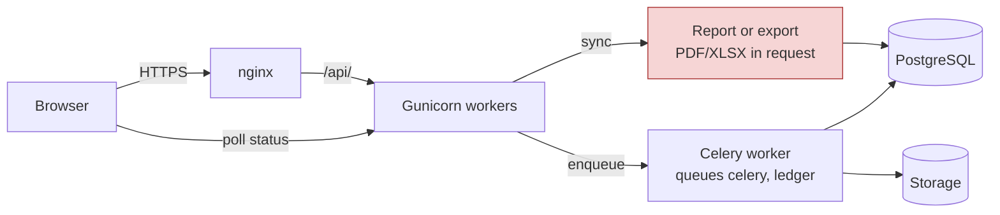

# 12 Performance Audit (Agent E)

Date: 2026-11-01. Branch: `version-v1`. Mode: read-only static and filesystem inspection.

## Scope and method

- No runtime probe, load test, container, server, worker, `npm run build`, package install, or connection to Redis, PostgreSQL, Celery or production was performed.
- No `.env*`, `auth.json`, `config.toml`, `~/.claude.json`, or `.env_dgft` content was read.
- Labels: **MEASURED** means a read-only command was run and its output was observed. **THEORETICAL** means the risk is inferred from code and has not been observed at runtime.
- Existing query-count guards are cited by hotspot ID (PH-xx) from `docs/v1/07-quality-and-operations/performance-hotspot-contracts.md`. Their runtime results are not reproduced here.
- Finding IDs: ISS-060 to ISS-065 only.

## 1. Summary

- The largest measured issue is operational: the local `frontend/dist` build directory has grown to **627 MB across 32,154 `.js` files** because the Vite config never empties it (ISS-060). The production copy is not measured, so its state is THEORETICAL.
- The largest code-level risk is that export and report generation runs synchronously inside the request cycle, with no visible cap on licence count for the ledger export (ISS-062).
- The export-specific throttle scope (`export`, 100/hour) is defined and mapped but attached to no view, so exports fall back to the general burst and user limits (ISS-061, MEASURED wiring).
- Report and activity responses are unpaginated or unbounded (ISS-063).
- The licence list queryset is well optimised (select_related plus three Exists annotations). The hotspot contracts guard the allotment list and plan-candidate list (PH-01, PH-02) but not the licence list itself. Coverage is uneven across other views (ISS-064).
- Frontend defaults are reasonable. Gaps are the lack of an axios request timeout, a polling loop that can re-request in-flight status calls, and an inaccurate Vite comment and build-warning suppression (ISS-065).

Findings table: ISS-060 to ISS-065 (section 7).

## 2. Measured findings

| # | Observation | Command or source | Label |
|---|---|---|---|
| M1 | `frontend/dist` exists and is ignored by git (`frontend/.gitignore:13`); `git ls-files frontend/dist` returns 0 files, so it is untracked, not modified in git. | `git ls-files`, `git status`, `git check-ignore` | MEASURED |
| M2 | `frontend/dist/assets/js` totals **627 MB** (`du -sh`) and contains **32,154** `.js` files. | `du -sh`, `find -name '*.js' \| wc -l` | MEASURED (local checkout only) |
| M3 | 232 `app-shell-*.js` files and 232 `vendor-react-*.js` files are present. Multiple copies of other chunks also remain (for example 464 `AllotmentAction-*` and 464 `BOETransferLetter-*` files). These are accumulated builds. | `ls \| sed \| uniq -c` | MEASURED |
| M4 | The largest `.js` file over 100 KB in the local dist is 583,209 bytes, an older `app-shell` build. | `ls -la \| sort -k5 -n \| tail` | MEASURED |
| M5 | First-load JavaScript referenced by the current `dist/index.html`: `index-C_1YX4ai.js` 68,043 B, `rolldown-runtime` 775 B, `app-shell-BsDwRAQS.js` 354,814 B, `vendor-react-BXsX4oya.js` 179,955 B. Total **603,587 bytes raw** (not gzip). Gzip size was not measured. | `ls -la` on the four files named in `index.html` | MEASURED |
| M6 | `ExportRateThrottle` (scope `export`) is defined at `backend/apps/core/throttling.py:175-183` and mapped in a dictionary at `:357`. No view sets `throttle_classes` to it. The `export` rate, `100/hour`, is at `backend/lmanagement/settings.py:317`. | `grep ExportRateThrottle`, `grep throttle_classes` | MEASURED |
| M7 | Default throttle classes are `BurstRateThrottle` and `UserRateThrottle` (`settings.py:295-298`). Burst is `180/minute` (`settings.py:310`); user is `3000/hour` (`settings.py:304`). | settings read | MEASURED |
| M8 | `StandardPagination`: `page_size = 25`, `max_page_size = 200` (`backend/apps/core/pagination.py:39-41`). | read | MEASURED |
| M9 | `ActivityLogViewSet` sets `pagination_class = None` (`backend/apps/core/views/activity_log.py:27`). Its `limit` parameter defaults to 100 and is capped at 1000 (`:62-68`). The result is bounded but not paginated, and `page` is ignored. | read | MEASURED |
| M10 | The five report view modules (`item_pivot_report.py`, `license_report.py`, `planned_report.py`, `active_licenses_report.py`, `expiring_licenses_report.py`) contain no `pagination`, `page_size` or row-limit terms. Matches were only sheet-name slices. | `grep -n -E "pagination\|page_size\|limit\|max_rows"` | MEASURED |
| M11 | `DATABASES` in settings has no `CONN_MAX_AGE` (`settings.py:201-214`). Django's default of 0 opens a new PostgreSQL connection per request. | `grep CONN_MAX_AGE` returns nothing | MEASURED |
| M12 | `frontend/src/api/axios.*` contains no `timeout` setting. | `grep -E "timeout" frontend/src/api/axios.*` returns nothing | MEASURED |
| M13 | `frontend/src/api/queryClient.ts:6-7`: `staleTime: 30_000`, `retry: 1`. No other global overrides. | read | MEASURED |
| M14 | Polling: `ReplanStatus.tsx:28-31` polls every 2000 ms only while state is `REPLAN_PENDING` or `REPLAN_RUNNING`. `LicenseDownloadRequestDetail.tsx:7` polls every 3000 ms while `processing_count > 0`. `LedgerUpload.tsx:20,164,186` runs a 1000 ms `setInterval` with `POLL_CONCURRENT = 5`, cleared at `:188` on unmount. | grep and read | MEASURED |
| M15 | React Query devtools are loaded lazily only when `import.meta.env.DEV` (`frontend/src/main.tsx:21-22`). | read | MEASURED |
| M16 | Vite config: `emptyOutDir: false` (`frontend/vite.config.js:38`); `chunkSizeWarningLimit: 1000` (`:41`); manual chunks only for `vendor-react` and `app-shell` (`:45-69`). The comment at `:103-107` says the Dashboard trend panel imports Recharts, but `recharts` appears only in `frontend/src/pages/Dashboard.test.tsx` among `frontend/src` files. | grep `recharts`, `exceljs`, `jspdf` in `frontend/src` (non-test) | MEASURED |
| M17 | `package.json` declares `exceljs` (line 39), `jspdf` (41), `jspdf-autotable` (42) and `recharts` (50). No non-test file under `frontend/src` names `exceljs`, `jspdf` or `recharts`. Whether they are used through an alias or indirectly is not confirmed. | `grep -rln` over `frontend/src` (ts, tsx, js, jsx) | MEASURED (usage unconfirmed) |
| M18 | `performance-baseline.md` says a measured frontend chunk baseline is in `docs/v1/01-discovery/test-and-quality-baseline.md`. A grep for chunk, KB, bundle and gzip terms in that file returned no matches. | grep | MEASURED (documentation gap) |
| M19 | nginx timeouts for the HTTPS vhost are 300 s for client body, read and send (`nginx-license-manager.conf:35-40`). Gzip is enabled for `application/json` (`:45-50`). | read | MEASURED |
| M20 | `LicenseViewSet.get_queryset` applies `select_related('exporter','port','purchase_status','balance','flags','ownership','ownership__current_owner','notes')` and three `Exists` annotations (`backend/apps/license/views/license.py:28-42`). List prefetches are scoped to avoid nested fan-out (`:44-48`). | read | MEASURED |

Existing query-count and batching guards (cited, not re-run): PH-01 allotment list (at most 6 queries), PH-02 plan candidates (17 queries for 8 rows), PH-03 active DFIA batched balance, PH-04 bulk item value, PH-05 and PH-06 canonical ledger and PDF budgets, PH-07 and PH-08 overview tabs, PH-09 plan presentation, PH-10 licence report, PH-11 planned report, PH-12 trade list (caps of 10 and 14 queries). PH-13 is a permissive wall-clock smoke bound. PH-14 notes that the browser performance spec exists but its documented run was not green. Source: `performance-hotspot-contracts.md`.

## 3. Theoretical risks

- **T1, Synchronous generation consumes Gunicorn workers.** The Gunicorn configuration for this application is not in the repository. `auto-deploy.sh:380-382` refers to `backend/gunicorn.conf.py`, which does not exist in the tree. The worker count, timeout and worker class are therefore unknown. The deploy script expects at least four processes (`auto-deploy.sh:763-765`). The only effective ceiling on a long export is the nginx 300 s read timeout (M19).
- **T2, Celery limits do not govern web-tier exports.** Task time limits (`settings.py:368-381`: soft 240 to 300 s, hard 300 to 360 s) apply only to Celery tasks. Synchronous exports in the web tier have no equivalent limit in the repository.
- **T3, Per-request connection churn.** Without `CONN_MAX_AGE` (M11), each request pays connection setup. The effect grows with concurrency and is not measured.
- **T4, Duplicated status requests in `LedgerUpload`.** The interval is 1 s and each tick awaits `Promise.allSettled` without an in-flight guard. Tasks in flight are still counted as pending (`doneRef` only records completed tasks), so a tick that starts before the previous one finishes can re-request the same task IDs. Confidence Medium.
- **T5, Hung requests.** Without an axios timeout (M12), a stalled call keeps its spinner until the browser or nginx gives up. Nginx gives up after 300 s.
- **T6, Activity log growth.** `ActivityLog` has no retention job identified in the infrastructure review. This was not searched exhaustively. Unbounded growth is theoretical.

## 4. Query-pattern findings

The table below counts lines per view module, not views. A low prefetch count next to many ORM lines is a candidate for review, not proof of N+1.

| View module | select/prefetch lines | ORM query lines | Note |
|---|---:|---:|---|
| `apps/license/views/ledger.py` | 16 | 8 | Heaviest coverage; contains the synchronous export paths (ISS-062). |
| `apps/license/views/item_pivot_report.py` | 11 | 6 | Single 2400-line view; synchronous Excel (ISS-062, ISS-063). |
| `apps/license/views/sion_planning_rule.py` | 6 | 12 | Candidate for review; no PH guard. |
| `apps/license/views/dashboard.py` | 4 | 8 | Candidate for review; no PH guard. |
| `apps/license/views/license.py` | 5 | 7 | Explicit batching in `get_queryset` (M20). No PH guard names the licence list. |
| `apps/license/views/parse_pdf.py` | 0 | 7 | Candidate for review; no select or prefetch. |
| `apps/license/views/inventory_balance_viewset.py` | 1 | 6 | Candidate for review; no PH guard. |
| `apps/license/views/item_plan.py` | 1 | 4 | Candidate for review. |
| `apps/license/views/active_licenses_report.py` and `expiring_licenses_report.py` | 1 each | 1 each | Expiring report has no PH guard. |

Trade and BOE paths:

- `EnhancedLicenseTradeViewSet` (`backend/apps/trade/views.py:363-378`) uses `select_related` and `Prefetch` for lines, incentive lines and payments. PH-12 guards the list.
- `BillOfEntryViewSet.get_queryset` (`backend/apps/bill_of_entry/views/boe.py:135-157`) uses `select_related('company','port')` and prefetches `item_details` and `allotment`. The export queryset explicitly prefetches item details (`views_export.py:78-95`).
- `_group_boe` (`views_export.py:816-829`) calls `list(boe.item_details.all())` per BOE. It is correct only while the caller keeps the prefetch. THEORETICAL risk if reused.
- `ActivityLog` `get_queryset` uses `select_related('user')` (`activity_log.py:29-30`).

## 5. Pagination and export findings

- **Lists.** The default is 25 items per page with a maximum of 200 (M8). The ledger download-request list uses `page_size` default 44 with a cap of 100 (`ledger.py`, the `download-requests` action). The activity log is unpaginated but capped at 1000 (M9).
- **Reports.** Report views return complete result sets as JSON with no page or row limit (M10). `ItemPivotReportView` caches the result by normalised request (`item_pivot_report.py:574`). The nginx configuration comment says item pivot responses "can return multi-megabyte JSON matrices" (`nginx-license-manager.conf:42-43`), which corroborates the size risk but is not a measurement.
- **Exports (synchronous, in-request).**
  - Ledger: `LicenseLedgerViewSet.export` (`ledger.py:644-690`) builds PDF or XLSX from canonical datasets for the licence IDs supplied. The only guard is an empty check (`:669-670`). No maximum count was found.
  - Ledger PDFs: `FileResponse` built in-request at `ledger.py:430`, `:445`, `:461`. The ledger-only draft PDF is built synchronously at `:112`.
  - Item pivot: `export_to_excel_streaming` uses `write_only` (`item_pivot_report.py:1971`) but saves to a temp file in-request (`:1962`, `:2245`).
  - BOE: grouped PDF (`views_export.py:107-151`), grouped XLSX (`:419-428`), port XLSX (`:734-739`).
  - Reports: Active licences (`active_licenses_report.py:300-348`, `:627`), expiring (`expiring_licenses_report.py:292-340`, `:618`), inventory balance (`inventory_balance_report.py:209-337`), item report (`item_report.py:461-493`). These build full in-memory `openpyxl` workbooks.
- **Pattern to reuse.** The ledger package path already runs as a Celery job with a `LicenseLedgerPackageJob` record, time limits and recovery (`settings.py:354-381`, `license/tasks.py:547-553`). This is the existing precedent for moving exports off the request path.

## 6. Frontend findings

- Defaults are sensible: 30 s stale time, one retry, devtools dev-only (M13, M15).
- The main first-load cost is `app-shell` at 354,814 B raw (M5). The Vite chunking comment is out of date (M16). The warning limit of 1000 KB hides size regressions (M16).
- Declared dependencies that no non-test source imports (M17) add install and audit surface. They may still be needed through an alias. Verify before removal.
- No request timeout (M12). Polling intervals are bounded and cleared (M14).

## 7. Findings (ISS-060 to ISS-065)

Each finding lists severity, confidence, label, evidence, business impact, remediation, acceptance criteria, and the runtime measurement that would confirm it. Runtime measurements must be run by the owner or QA in staging. They were not run here.

### ISS-060: Frontend build output accumulates without cleanup

- **Severity:** Medium. **Confidence:** High for local, Medium for production. **Label:** MEASURED (local checkout). Production state THEORETICAL.
- **Evidence:** `frontend/vite.config.js:35-38` (`emptyOutDir: false`, with the stated reason that open tabs need old chunks). M2 to M4. `scripts/deployment/auto-deploy.sh:393-394` (`git clean` excludes `frontend/dist/`). `auto-deploy.sh:712-713` (recursive `chmod` over dist). nginx serves `dist` as root (`nginx-license-manager.conf:53`).
- **Business impact:** Disk growth on the production host, slower deploy-time recursive operations, and larger backups if `dist` is ever included. Functional behaviour is not broken, so this does not block users today.
- **Remediation:** Keep the stale-tab protection, but prune chunks not referenced by the last N release manifests after each successful deploy. Keep at least two releases. Alternatively build each release to its own directory and switch a symlink.
- **Acceptance criteria:** After five successive builds, the file count and size stay within a fixed budget. Every chunk referenced by the current and previous `index.html` resolves with HTTP 200. A tab loaded on release N-1 can still fetch lazy chunks.
- **Runtime measurement:** On the production host, read-only: `du -sh frontend/dist/assets/js` and `find frontend/dist/assets -type f | wc -l` before and after three deploys.

### ISS-061: Export endpoints are not subject to the export throttle scope

- **Severity:** Medium. **Confidence:** High for wiring, Medium for impact. **Label:** MEASURED (wiring). Impact THEORETICAL.
- **Evidence:** `backend/apps/core/throttling.py:175-183` (class and scope), `:357` (mapping only). `backend/lmanagement/settings.py:295-298` (default classes), `:317` (`export: 100/hour`). `throttle_classes` appears only on `ledger_upload.py:35`, `accounts/views/auth.py:18`, `accounts/views/password.py:33,81`. Export views (`ledger.py` export, `item_pivot_report.py`, `views_export.py`, the report views) do not set it.
- **Business impact:** Intended limits on expensive PDF and XLSX generation do not apply. A user or compromised session can trigger many synchronous exports within the general limits (180/min burst, 3000/hour user), saturating workers (ISS-062).
- **Remediation:** Attach `ExportRateThrottle` (or a `ScopedRateThrottle` with scope `export`) to every export action. Add tests that the 101st export within an hour returns 429 for a non-staff user. Keep the 100/hour value unless the owner decides otherwise.
- **Acceptance criteria:** Each export action returns 429 at the configured boundary. Normal use returns unchanged response bodies. Tests cover all export actions listed in section 5.
- **Runtime measurement:** On staging with a test account, send 101 export requests in one hour and record the first 429. Confirm the boundary matches settings.

### ISS-062: Synchronous PDF and XLSX generation in the request cycle, with no visible cap on the ledger export

- **Severity:** High. **Confidence:** Medium (static evidence; runtime duration unknown). **Label:** MEASURED (synchronous call sites). Latency and worker starvation THEORETICAL.
- **Evidence:** `ledger.py:644-690` (export, no maximum count), `:430`, `:445`, `:461`, `:112`. `item_pivot_report.py:1827`, `:1962`, `:1971`, `:2245`. `views_export.py:107-151`, `:419-428`, `:734-739`. `active_licenses_report.py:300-348`, `:627`. `expiring_licenses_report.py:292-340`, `:618`. `inventory_balance_report.py:209-337`. `item_report.py:461-493`.
- **Business impact:** A large export holds a Gunicorn worker for its full duration. Concurrent exports can starve the API, causing timeouts for other users. The ledger export is the most exposed because its input count is not capped.
- **Remediation:** Move exports above an owner-defined size to Celery, reusing the `LicenseLedgerPackageJob` pattern (poll for status, download on completion). Add a maximum licence count per synchronous ledger export. Use write-only streaming for every XLSX export. Owner decision: the size threshold.
- **Acceptance criteria:** A synchronous export at the cap completes within the agreed budget, or returns an accepted status with a job reference. API latency for `/api/health/` and a licence list stays within budget during five concurrent exports.
- **Runtime measurement:** On staging, time each export endpoint at 1, 10 and the maximum licence count. Record response bytes and worker busy time. Repeat with five concurrent exports while sampling `/api/health/` latency.

### ISS-063: Report and activity responses are unbounded or unpaginated

- **Severity:** Medium. **Confidence:** Medium. **Label:** MEASURED (absence of limits in code). Payload size THEORETICAL.
- **Evidence:** M10 (report modules), `item_pivot_report.py:531` (view) and `:574` (cache keyed by normalised request). `activity_log.py:27` (`pagination_class = None`) and `:62-68` (limit, default 100, max 1000). `pagination.py:41` (max page size 200). `nginx-license-manager.conf:42-43` (repository comment on multi-megabyte matrices).
- **Business impact:** Large JSON payloads slow tab loads, use browser memory and increase gzip CPU. The activity log silently ignores `page`, which may mislead callers that expect pagination.
- **Remediation:** Define a response-size budget per report from measured data. For matrices, paginate by norm or item, or return a truncation flag with a total. For the activity log, restore pagination with a `max_page_size` and keep the `limit` parameter for existing callers (confirm callers first).
- **Acceptance criteria:** The largest realistic report response is within the agreed byte budget. Existing UI behaviour is unchanged for current data. The activity log supports `page` and returns a count.
- **Runtime measurement:** Against a staging copy, record `size_download` for each report at realistic maximum filters. Do not run this against production.

### ISS-064: Query-pattern and connection-setup gaps outside the guarded paths

- **Severity:** Medium. **Confidence:** Low to Medium (static). **Label:** MEASURED (absence of `CONN_MAX_AGE`, coverage table). N+1 presence THEORETICAL.
- **Evidence:** M11 (`settings.py:201-214`). Section 4 table, especially `parse_pdf.py` (7 ORM lines, no prefetch), `sion_planning_rule.py` (12 ORM lines, 6 prefetch lines), `dashboard.py`, `inventory_balance_viewset.py`, `item_plan.py`, `expiring_licenses_report.py`. `views_export.py:829` (`_group_boe` relies on caller prefetch). PH guards do not cover parse, dashboard, SION rules, inventory balance, item plan, expiring report, or the activity log.
- **Business impact:** Latency grows with row count on screens that have no guard. Connection churn under load adds cost and can exhaust PostgreSQL connection slots.
- **Remediation:** Add `CONN_MAX_AGE` with a short lifetime and `CONN_HEALTH_CHECKS = True`, after confirming there is no pooler. Add query-count guards for the uncovered views using the PH pattern. Review the candidate modules with `EXPLAIN` on realistic data.
- **Acceptance criteria:** New query-count tests for each uncovered view pass with a fixed ceiling. Staging p95 latency for the affected endpoints does not regress after the `CONN_MAX_AGE` change.
- **Runtime measurement:** In staging, count queries per request using the Django test client or a staging shell. Measure request p95 with `CONN_MAX_AGE` 0 and a short positive value. Check connection churn in PostgreSQL statistics on staging.

### ISS-065: Frontend request timeouts, polling overlap, and bundle hygiene

- **Severity:** Medium. **Confidence:** Medium. **Label:** MEASURED (M12, M14, M16, M17). Overlap and hang behaviour THEORETICAL.
- **Evidence:** M12 (`frontend/src/api/axios.*`, no timeout). `LedgerUpload.tsx:20,164-188` (1 s interval, concurrency 5, no in-flight guard). `vite.config.js:41` (warning limit 1000). `vite.config.js:103-107` (stale Recharts comment). `package.json:39-42,50` (declared libraries with no non-test import, M17). `TradeForm.tsx:207-208` (`staleTime: Infinity`, `gcTime: 0`).
- **Business impact:** Stalled calls leave users waiting without feedback. Overlapping status calls add server load during ledger uploads. Unused or unverified dependencies add install and audit surface, and the stale comment misleads maintainers about what is in the first-load bundle.
- **Remediation:** Set explicit timeouts: a default for normal calls, and a longer or disabled timeout only for download and export calls. Convert the upload poll to a sequential chain (`setTimeout` after each batch completes) with an in-flight guard. Verify and remove unused declared libraries. Restore the default warning limit or set an explicit first-load budget. Correct the Vite comment.
- **Acceptance criteria:** No request is made without an explicit timeout policy. In a test with a slow mock (over 1 s per status call), each task receives at most one status request in flight. A bundle-size check fails when first-load JavaScript exceeds the agreed budget.
- **Runtime measurement:** In CI or staging, run a throttled-network Playwright trace of an upload and count status requests per task ID. The owner or CI runs the production build and records first-load bytes gzipped.

## 8. Diagram: request path and the asynchronous precedent

The red node is the synchronous generation path (ISS-062). The ledger package flow already uses the Celery branch.

## 9. Limits

- No runtime measurement was taken. All latency and capacity statements are THEORETICAL.
- The local `frontend/dist` is not the production build. The production copy was not inspected.
- The Gunicorn and supervisor configuration for this application is not in the repository and was not observed.
- Counts in section 4 are line counts, not query counts.
- `performance-baseline.md` was read and not modified.
