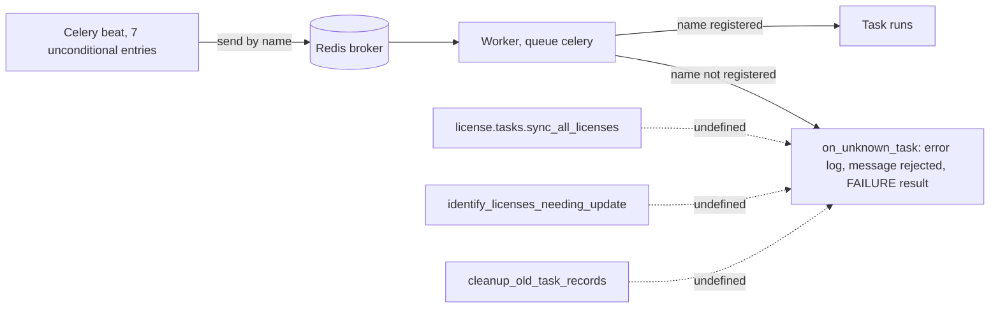
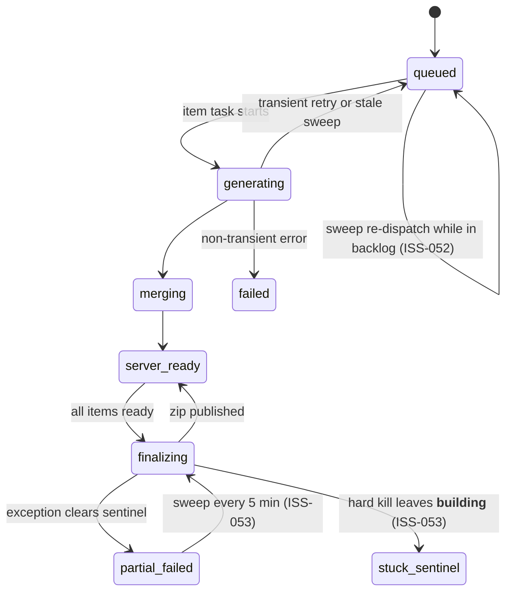

# 15. Integrations and Background Jobs Audit (Agent D)

- Audit date: 2026-11-01
- Branch: `version-v1` (working tree has uncommitted changes; findings describe the tree as read)
- Scope: Celery configuration and beat schedule, task inventory, Redis use, RabbitMQ, scheduled sync jobs, email, file storage, PDF and Excel generation, external HTTP and subprocess integrations, retry and idempotency, failure recovery, task monitoring.
- Mode: read-only. No Celery worker, beat, Redis client, or broker connection was started or used. No Redis data was read or written. No packages were installed. No secret or credential file was opened (`.env*`, `auth.json`, `config.toml`, `~/.claude.json`, `.env_dgft`).
- Evidence labels: **VERIFIED** means the claim rests on static evidence (file:line, grep, and reading the library source in `.venv`) cross-checked in this pass. **SUSPECTED** means the code path exists but the runtime behaviour has not been observed. **UNVERIFIED** means a runtime check is needed; the check is named.
- Library source read (read-only): `.venv/lib/python3.14/site-packages/` for `celery`, `kombu`, `billiard`, `django_redis`, `django`.

## 1. Plain-English summary

- Background work runs on Celery. Redis is the broker, the result backend, and (through Django's cache) the cache, all in one configured URL. There is no RabbitMQ. The only AMQP code is the `amqp` and `kombu` packages pinned in `backend/requirements_python314.txt` as transitive Celery dependencies.
- The best-engineered part is the durable package and replan state machine in the database, with sweeper tasks every 5 minutes. The broker is treated as a delivery mechanism, and recovery is database-driven. Several gaps remain in that machine (ISS-052, ISS-053).
- Scheduled jobs: 7 beat entries are always registered. 4 of them point at 3 task names that do not exist anywhere in the repository (ISS-014), so they never execute. A further 4 entries register only when `SYNC_ENABLED` or `MDS_ENABLED` is true. The sync tasks they point at are not registered in the worker (ISS-056).
- Two user-visible breaks are confirmed statically: the legacy download-request dispatch raises `NameError` (ISS-050), and the reconciliation and item-pivot balance recalculation endpoints import a task that is not defined anywhere (ISS-051).
- Storage is local `FileSystemStorage` under `MEDIA_ROOT`. Licence-package artefacts live there and are reachable through the protected-media route without a role check (ISS-054).
- Production Redis cannot be separated: `REDIS_URL` is required and feeds the broker, the result backend and the cache together. Django-redis `cache.clear()` runs `FLUSHDB`, so cache-clearing commands, tests, and an operator's local `.env` can wipe the broker (ISS-055).
- Email is used only for password reset. The default backend is the console backend, and the production check accepts it (ISS-057).
- Several external DGFT and ICEGATE calls, plus heavy PDF and OCR work, run inside HTTP requests (ISS-059). Most of the scraper code is dormant.

## 2. Integration inventory

| # | Integration | Protocol and location | Sync in request? | Timeout | Status | Notes |
|---|---|---|---|---|---|---|
| I-01 | Redis, Celery broker | `backend/lmanagement/settings.py:346` (`CELERY_BROKER_URL = REDIS_URL`); default `redis://127.0.0.1:6379/0` (`settings.py:111`) | Enqueue happens in request on `.delay` or `.apply_async` (see section 8) | n/a | Active | Required explicitly in production (`settings.py:111-114`). |
| I-02 | Redis, Celery result backend | `settings.py:347` (same URL) | n/a | Result expiry default 1 day (`.venv/.../celery/app/defaults.py:215-217`) | Active | Same DB as broker and cache in production. |
| I-03 | Redis, Django cache and throttles | `settings.py:389-393`; `DEFAULT_THROTTLE_CLASSES` at `settings.py:295-297` | Yes | n/a | Active | Default cache is db 1 when `REDIS_URL` is unset, otherwise the same URL. |
| I-04 | RabbitMQ or AMQP | none. `amqp==5.3.1` and `kombu==5.6.0` pinned in `backend/requirements_python314.txt:1,21`; no `amqp://` or `pyamqp` string anywhere in backend, scripts or deploy | n/a | n/a | Absent | Grep for `amqp|pyamqp|rabbit` returned no code or config hits. |
| I-05 | SMTP or console email | `settings.py:527-539`; only caller `apps/accounts/views/password.py:30-70` | Yes (synchronous `send_mail`) | none set (`EMAIL_TIMEOUT` absent) | Active for password reset only | See ISS-057. |
| I-06 | DGFT exchange-rate page | `apps/core/management/commands/fetch_exchange_rates.py:32,68` (urllib, `timeout=30`) | No | 30 s | Dormant in app | Celery task `core.tasks.fetch_exchange_rates` exists but is not scheduled (`lmanagement/celery.py:75-79`). Runs from a Mac cron via `scripts/imports/fetch-and-push-rates.sh` (exists). |
| I-07 | DGFT licence ownership (live) | `apps/license/services/dgft_ownership.py:17-18,128,139-197` (4 attempts, 30 s timeout, exponential sleeps 5/10/20/40 s); called from `apps/license/views_actions.py:448-500` (`fetch-ownership` action) | Yes | 30 s x 4 plus sleeps | Active | See ISS-059. |
| I-08 | DGFT licence ownership (command) | `apps/license/management/commands/update_license_ownership.py:265,573,592,612` | No (management command) | Not inspected | Manual | |
| I-09 | DGFT DFIA QR verification page | `apps/license/parsers/dfia_pdf.py:36,660-682` (host allow-list `_DGFT_HOSTS`, 30 s timeout); called from `apps/license/views/parse_pdf.py:182-191` (`LicensePdfParseView`) | Yes, during upload parse | 30 s | Active when a QR is present | Outbound fetch from an upload request. See ISS-059. |
| I-10 | DGFT and ICEGATE bill-of-entry scraper | `apps/bill_of_entry/scripts/boe.py:119-234` (timeouts parameterised) | Unknown | Parameter default | Dormant | Only importer found is the dead module `lmanagement/tasks.py:7`. |
| I-11 | ICEGATE company-name lookup | `apps/core/scripts/company_names.py:21,46,74` (`verify=False` at line 21; no timeout) | Unknown | none | Dormant | No importer found by grep. TLS verification disabled. |
| I-12 | DGFT shipping-bill (EBRC) | `scripts/dgft_shipping_bill.py:12,34` (plain `http://`; no timeout) | n/a | none | Dormant | Only importer is dead `lmanagement/tasks.py:9`, which imports the non-existent apps `ebrc` and `shipping_bill`. |
| I-13 | DGFT description updater | `apps/core/management/commands/update_dgft_descriptions.py:94` (requests Session) | No (command) | Not inspected | Manual | |
| I-14 | Master-data peer sync (HTTP) | `apps/core/sync/push.py:64,176,240` and `media.py:201` (urllib, timeouts 10 to 60 s) | Background only if enabled | 10 to 60 s | Disabled by default (`SYNC_ENABLED`, `settings.py:588`) | Tasks not registered (ISS-056). |
| I-15 | Master-Data Service (MDS) | `lmanagement/celery.py:123-131` (beat, `mds_client.sync_masters`); `settings.py:603-620` | Background only if enabled | n/a | Disabled by default; package absent from repo (`../mds-client` does not exist) | UNVERIFIED: external package behaviour not reviewable here. |
| I-16 | LibreOffice, unoconv, osascript | `apps/allotment/scripts/aro.py:74,104,171,229,233` (`subprocess.run`, timeouts 30 to 60 s) | Yes, for transfer letters | 30 to 60 s per call | Active | Called from `apps/bill_of_entry/views/boe.py:229` and transfer-letter utility `apps/core/utils/transfer_letter.py:86`. |
| I-17 | OCR: tesseract, poppler, zbar | `apps/license/parsers/dfia_pdf.py:12-14` (documented fallback), imports pytesseract, pdf2image, pyzbar via `requirements.txt` | Yes, in the parse request | none set | Active when system packages present | Runtime duration UNVERIFIED. |
| I-18 | In-process audit thread | `apps/core/middleware.py:99-111,138-152` (one daemon thread per authenticated `/api/` request) | Asynchronous to request, not Celery | none | Active | See ISS-058. |
| I-19 | Protected media (dev stream or nginx X-Accel) | `apps/core/views/media.py`; `lmanagement/urls.py:43` (`^api/media/`); `settings.py:249-255` | Yes | n/a | Active | See ISS-054. |
| I-20 | Cron (outside Celery) | `scripts/imports/fetch-and-push-rates.sh` (Mac cron, pushes via SSH and Django shell); `scripts/deployment/license-manager-watchdog.sh` (supervisor restart) | n/a | n/a | Operational | Outside the repository's Celery schedule. |

## 3. Background-task inventory

Decorated tasks found by grep for `@shared_task`, `@app.task`, and `@task`: **25**. Registered at worker boot: **12**. Not registered: **13**. Worker boot registers `lmanagement/__init__.py:3` (which imports the app and therefore `debug_task`), `apps.core.tasks` (autodiscovered from `INSTALLED_APPS`, `settings.py:142-149`), and `apps.license.tasks`. Autodiscovery uses only `<app>.tasks` for each installed app (`celery.py:40`; Celery `loaders/base.py:218-239`). It does not import `apps.core.sync.tasks`, `apps.core.tasks_materialized_views`, or `lmanagement.tasks`.

| Registered name | Symbol and location | Registered at worker boot? | Referenced by | Status |
|---|---|---|---|---|
| `debug_task` (no name) | `lmanagement/celery.py:169-173` | Yes | none | Defined, never called (debug helper) |
| `core.tasks.fetch_exchange_rates` | `apps/core/tasks.py:13-27` | Yes | comment only (`celery.py:76`) | Defined, not scheduled, never dispatched in code |
| `planning.dispatch_replan_requests` | `apps/license/tasks.py:130-149` | Yes | `services/replan_requests.py:20`; `tasks.py:303` | Live |
| `planning.replan_sion_batch` | `tasks.py:152-158` | Yes | `apps/license/views/sion_planning_rule.py:605` (on_commit) | Live |
| `planning.replan_license` | `tasks.py:161-291` (bind=True) | Yes | `tasks.py:142,157`; alias `run_license_replan` (`tasks.py:307`) | Live |
| `planning.recover_pending_replan_requests` | `tasks.py:294-303` | Yes | beat `celery.py:92-97` every 5 min | Live, scheduled |
| `license.process_single_license` | `tasks.py:109-127` (symbol `process_single_license_task`) | Yes | `apps/license/views/ledger_upload.py:151` (async upload) | Live |
| `license.enqueue_license_ledger_package` | `tasks.py:314-325` | Yes | `views/ledger.py:153,377`; `services/ledger_package_recovery.py:185`; `apps/trade/services/sale_classification_review.py:59`; `tasks.py:587` | Live |
| `license.build_license_ledger_package_item` | `tasks.py:413-473` (bind=True) | Yes | `tasks.py:323` | Live |
| `license.finalize_license_ledger_package` | `tasks.py:476-544` | Yes | `tasks.py:434,461,472,590` | Live |
| `license.cleanup_expired_ledger_packages` | `tasks.py:547-566` (symbol `cleanup_expired_license_ledger_packages`) | Yes | beat `celery.py:98-103` daily 02:20 UTC | Live, scheduled |
| `license.recover_license_ledger_package_jobs` | `tasks.py:569-591` | Yes | beat `celery.py:104-109` every 5 min | Live, scheduled |
| `add`, `fetch_file`, `dgft_shipping_details`, `fetch_data_to_model`, `delete_license_details_by_numbers` | `lmanagement/tasks.py:15,20,43,68,119` (auto names `lmanagement.tasks.*`) | No (module not imported) | none | Dead module. Imports non-existent apps `ebrc` and `shipping_bill` (absent from repo) |
| `refresh_all_views_task`, `refresh_license_balance_task`, `refresh_item_balance_task`, `refresh_dashboard_stats_task`, `check_materialized_view_health` | `apps/core/tasks_materialized_views.py:20,36,47,58,69` | No (module not autodiscovered) | only `apps/core/signals_materialized_views.py`, which has no importer (ISS-016) | Defined, never called |
| `sync.pull_from_peers`, `sync.process_media_tasks`, `sync.push_changes` | `apps/core/sync/tasks.py:20,29,38` (inside `try: from celery import shared_task`) | No (module not autodiscovered; `apps.core.sync` not in `INSTALLED_APPS`; only test importers) | beat `celery.py:141,147,153` when `SYNC_ENABLED` | Referenced but unregistered (ISS-056) |
| `apps/accounts/tasks.py` | file contains only a comment; no tasks | n/a | n/a | Empty module |

Names referenced but **not defined anywhere** (grep for each name across the backend, excluding `htmlcov`):

| Name | Referenced by | Effect |
|---|---|---|
| `license.tasks.sync_all_licenses` | beat `lmanagement/celery.py:47` (entry `sync-licenses-daily-midnight-ist`) | Never runs (ISS-014) |
| `identify_licenses_needing_update` | beat `celery.py:59` (entry `update-balances-11am-ist`) and `celery.py:67` (entry `update-balances-8pm-ist`) | Never runs (ISS-014) |
| `cleanup_old_task_records` | beat `celery.py:83` (entry `cleanup-old-tasks-hourly`) | Never runs (ISS-014). Would target `CeleryTaskTracker`, which has no writer |
| `update_all_license_balances` | `apps/reconciliation/views.py:295-300` and `apps/license/views/item_pivot_report.py:2384-2390` (`apply_async`) | ImportError on request, HTTP 500 (ISS-051) |

Dynamic task-name construction: none found. `send_task(` has no call sites. No `app.tasks[...]` lookup exists. Nothing in the repository could resolve the undefined names at runtime.

Conditional beat references not in the repository: `mds_client.sync_masters` (`celery.py:125`) when `MDS_ENABLED`. The package is absent, and `settings.py:612-620` disables `MDS_ENABLED` when the import fails, so this entry is not scheduled in this checkout. UNVERIFIED for environments that install the package.

Defined but never called (no dispatch site outside tests and the definition, and no beat entry): `debug_task`, `core.tasks.fetch_exchange_rates`, the five materialized-view tasks, and the five `lmanagement/tasks.py` tasks. That is 12 tasks.

## 4. Beat schedule review

Source: `backend/lmanagement/celery.py:43-158`. `CELERY_TIMEZONE = TIME_ZONE = "UTC"` (`settings.py:233`), so the crontab values are UTC and the IST comments are correct (18:30 UTC = 00:00 IST; 05:30 UTC = 11:00 IST; 14:30 UTC = 20:00 IST).

| Entry | Task | Schedule (UTC) | Gate | Status |
|---|---|---|---|---|
| `sync-licenses-daily-midnight-ist` | `license.tasks.sync_all_licenses` | 18:30 daily | none | Undefined task (ISS-014) |
| `update-balances-11am-ist` | `identify_licenses_needing_update` | 05:30 daily | none | Undefined task (ISS-014) |
| `update-balances-8pm-ist` | `identify_licenses_needing_update` | 14:30 daily | none | Undefined task (ISS-014) |
| `cleanup-old-tasks-hourly` | `cleanup_old_task_records` | hourly at :00 | none | Undefined task (ISS-014) |
| `recover-pending-license-replans-every-5-min` | `planning.recover_pending_replan_requests` | every 5 min, expires 240 s | none | Defined and registered |
| `cleanup-expired-license-ledger-packages-daily` | `license.cleanup_expired_ledger_packages` | 02:20 daily | none | Defined and registered |
| `recover-license-ledger-package-jobs-every-5-min` | `license.recover_license_ledger_package_jobs` | every 5 min, expires 240 s | none | Defined and registered |
| `mds-sync-masters-every-5-min` | `mds_client.sync_masters` | every 5 min | `MDS_ENABLED` | External package absent |
| `sync-pull-peers-every-5-min` | `sync.pull_from_peers` | every 5 min | `SYNC_ENABLED` | Unregistered (ISS-056) |
| `sync-push-durable-events-every-5-min` | `sync.push_changes` | every 5 min | `SYNC_ENABLED` | Unregistered (ISS-056) |
| `sync-process-media-every-5-min` | `sync.process_media_tasks` | every 5 min | `SYNC_ENABLED` | Unregistered (ISS-056) |

Count: 7 unconditional entries (4 undefined, 3 live). Up to 4 conditional entries. Distinct referenced names across all entries: 10 (6 unconditional, 4 conditional). Undefined names: 3 (4 entries).

Operational notes:
- Beat runs inside the worker. The production supervisor program passes `--beat` (`scripts/deployment/license-manager-celery.conf:2`). The example systemd unit (`backend/deploy/celery.service:19`) has no `--beat`. If both units run, there are two schedulers and every recovery task is dispatched twice per tick (SUSPECTED; no multi-beat guard exists).
- Beat state is stored in a local file, `celerybeat-schedule` (default, `celery/app/defaults.py:79`). The files `backend/celerybeat-schedule*` exist in the working tree and are gitignored (`.gitignore:72-74`). They were not opened.
- Dev runner `scripts/development/run-celery-dev.sh:19` runs a worker without beat, so no schedule fires in local development.

## 5. Redis and broker review

| Setting | Default when `REDIS_URL` unset (dev) | Production (`REDIS_URL` required) | Reference |
|---|---|---|---|
| Broker | `redis://127.0.0.1:6379/0` (db 0) | same URL | `settings.py:111,346` |
| Result backend | same as broker | same URL | `settings.py:347` |
| Django cache | `redis://127.0.0.1:6379/1` (db 1) | same URL, so same DB as broker | `settings.py:389-393` |
| Throttling | Django cache | Django cache | `settings.py:295-297`; `apps/core/throttling.py:47-50` |
| Direct redis client | none (`rqworker.py:67` imports `redis.exceptions` only, on a dead path) | none | grep |

Key findings for Redis:
- The production validator requires `REDIS_URL` to differ from the defaults (`settings.py:111-114`). Because one variable feeds broker, result backend and cache, production shares one Redis DB across all three. This is VERIFIED from the settings file.
- Django-redis `clear()` calls `client.flushdb()` (`.venv/.../django_redis/client/default.py:482-491`). Callers: `apps/core/management/commands/clearcache.py:9` (no confirmation), `apps/core/management/commands/cache_stats.py:38-40` (`--clear`), and many test modules (for example `apps/accounts/tests.py:19`, `apps/license/tests/test_item_pivot_response_cache.py:16`, `apps/core/tests/sync_factories.py:289`).
- `lmanagement/settings.py:24-32` loads `.env` before `REDIS_URL` is read. If a developer's environment file sets `REDIS_URL` to the broker DB, a test run flushes the broker. Whether that is the case is UNVERIFIED (the file was not read; a check is noted in ISS-055).
- The developer's shared Redis database 0 is the default broker DB in development (`settings.py:111`). The e2e harness `scripts/test/run_data_bearing_browser_e2e.sh` uses DB 7 by default, refuses DB 0 (`:53`), refuses a non-empty DB 7 (`:55-58`), passes `REDIS_URL` to both the backend and the worker (`:84,90`), and flushes DB 7 only when it created its own database (`:33`). This design is sound. Its index regex accepts 1 to 99, while Redis defaults to 16 databases (SUSPECTED that indices of 16 and above fail at server level; UNVERIFIED).
- CI uses Redis 7 as a service and `REDIS_URL=redis://localhost:6379/0` (`.github/workflows/ci.yml:66-71,85`). Test flushes are safe there because the service is ephemeral.
- Operator documentation recommends `redis-cli FLUSHALL` (`docs/operations/TRACTOR_SERVER_SETUP.md:344`). It is documentation only, but it is a foot-gun on a shared instance.
- Key naming: no `KEY_PREFIX` or `VERSION` is set in `CACHES`, so cache keys use the django-redis default. Celery uses its default keys (queue `celery`, `unacked`, `_kombu.binding.celery`, `celery-task-meta-*`). UNVERIFIED without a live inspection (not run here).
- Transport: no `broker_transport_options` are set (grep). Kombu's Redis transport defaults to `visibility_timeout = 3600` (`.venv/.../kombu/transport/redis.py:644`). A message held by a dead worker therefore reappears after up to one hour, which is longer than the 10- and 15-minute stale windows used by the sweepers (see section 9).
- Serialisation is JSON only (`settings.py:348-350`, `celery.py:33-37`). Good practice.
- Prefetch is 1 (`settings.py:384`). Good for long tasks.
- `acks_late` and `reject_on_worker_lost` are set on 8 tasks through decorators and `CELERY_TASK_ANNOTATIONS` (`settings.py:364-381`). The default is `False` (`defaults.py:265`).
- Routing: every project task goes to the `celery` queue (`settings.py:354-363`). The production supervisor consumes `celery,ledger` (`license-manager-celery.conf:2`). The `ledger` queue is unused, and the code comments say so (`apps/license/tasks.py:26-28`).

## 6. Email, storage, PDF and Excel review

### 6.1 Email

- Only one send path exists: `PasswordResetRequestView.post` (`apps/accounts/views/password.py:30-70`). It is synchronous, wrapped in `except Exception` (logged only), and returns a generic 200 to avoid enumeration. This is correct in intent.
- Default backend is console (`settings.py:529-531`). The production validator (`settings.py:554-555`) requires the environment variable to be non-empty, not that it name SMTP. The console backend would print the reset link, which contains the token, to stdout or logs.
- `EMAIL_TIMEOUT` is not set (grep returned nothing). A blocking SMTP connect therefore runs in the HTTP request with no bound set by the application.
- No retry, no queue, and no failure metric. Failures appear only in logs.
- No notification path exists for package completion or other events.

### 6.2 File storage

- `MEDIA_ROOT = BASE_DIR / "media"` (`settings.py:250`). `STORAGES` is not configured, so Django's default `FileSystemStorage` applies. `_promote_storage_file` relies on `os.replace` for this (`tasks.py:47-50`).
- `STATICFILES_STORAGE` is set at `settings.py:247`. It is absent from Django's `global_settings` in `.venv/.../django/conf/global_settings.py` (grep returned nothing), so Django 6.0 does not read it. Whitenoise's manifest storage is therefore not applied. Runtime effect UNVERIFIED (not run).
- Protected media: `ProtectedMediaView` (`apps/core/views/media.py:102-130`) confines paths to `MEDIA_ROOT`. `_required_read_roles` (`media.py:39-99`) applies role checks only for `licenses/`, `boe_copies/`, `trade/`, `license_purchases/`, and `companies/`. Any other path returns `None` (`media.py:99`), so any authenticated user passes. Licence-package artefacts live under `license-ledger-packages/<job key>/...` (`tasks.py:33-36`), which is not on the list (ISS-054).
- Development also serves `^media/` directly when `DEBUG` is true (`lmanagement/urls.py:63-68`). Production behaviour depends on `DEBUG` and nginx configuration, which were not reviewed.

### 6.3 Package artefacts and cleanup

- Per item: `<prefix>/licences/<licence>/<section>.pdf` (four sections) and `<prefix>/output/<licence>.pdf` (`tasks.py:450-452`).
- Per job: `<prefix>/manifest.json` and `<prefix>/license-ledger-package-<key>.zip` (`tasks.py:526-529`).
- Cleanup (`tasks.py:547-566`) deletes only jobs with `expires_at <= now` and status in `server_ready`, `failed`, or `partial_failed`. It deletes database-known keys and the deterministic component keys, then calls `job.delete()`. Jobs in `queued`, `generating`, `dispatch_failed`, or the `__building__` sentinel are never cleaned, even when expired (ISS-053).
- `job.delete()` cascades to `LicensePackageAuditEvent` and `LicensePackageArtifact` (`apps/license/models/core.py:2556-2557, 2573-2574`, `on_delete=CASCADE`). Audit events are therefore removed at expiry.
- Retention defaults: `LICENSE_LEDGER_PACKAGE_RETENTION_DAYS` defaults to 7 and `LICENSE_LEDGER_PACKAGE_MAX_LICENSES` to 100, both via `getattr` in `ledger.py:50,62,195,229`. Neither is declared in `settings.py` (grep returned nothing).

### 6.4 PDF and Excel generation: synchronous versus queued

| Operation | Path | Where | Blocking risk |
|---|---|---|---|
| Ledger package (multi-licence ZIP) | Queued (Celery item and finalize tasks) | `apps/license/tasks.py:413-544` | Low for the request; worker memory (see ISS-053) |
| Single-licence merged PDF `download-package-pdf` | Synchronous, one licence only | `apps/license/views/ledger.py:414-432` (`build_merged_pdf`) | Medium; full canonical dataset built in request |
| Custom ledger PDF | Synchronous | `ledger.py:434-447` | Medium |
| Financial ledger statement PDF | Synchronous | `ledger.py:449-463` | Medium |
| Allotment letter PDF | Synchronous | `apps/allotment/views_actions.py:1640-1663` | Medium |
| Transfer letters (BOE, trade, allotment) | Synchronous, includes LibreOffice conversions | `apps/bill_of_entry/views/boe.py:229`; `apps/core/utils/transfer_letter.py:86,558`; `apps/allotment/scripts/aro.py:71-233` | High: up to several subprocess calls at 30 to 60 s each |
| Grouped BOE and allotment PDF exports | Synchronous, whole queryset | `apps/bill_of_entry/views_export.py:107`; `apps/allotment/views_export.py:97` | Unbounded by row count (not measured) |
| Item-pivot and other Excel exports | Synchronous, openpyxl | `apps/license/views/item_pivot_report.py`; `apps/core/exporters/excel/` | Unbounded by row count (not measured) |
| BOE PDF parse | Synchronous | `apps/bill_of_entry/views/parse_pdf.py:203-212` | Medium |
| DFIA PDF parse (with DGFT fetch and OCR fallback) | Synchronous | `apps/license/views/parse_pdf.py:182-191`; `dfia_pdf.py:12-14,660-682` | High: outbound DGFT call plus OCR |
| Ledger CSV and HTM upload | Queued per licence (`process_single_license`); synchronous mode also exists | `apps/license/views/ledger_upload.py:123-160` | Low for request |

## 7. Retry and idempotency review

| Operation | Idempotency mechanism | Retry | Duplicate risk | Reference |
|---|---|---|---|---|
| Replan (`planning.replan_license`) | Status check on entry (`PENDING`, `QUEUED`, `RETRY_PENDING` only, otherwise return idempotent); `select_for_update` on the row; revision check before commit | Application-managed: transient errors only (`_transient`), `MAX_RETRIES=3`, `next_retry_at` with backoff `2^n`; sweeper requeues `RETRY_PENDING` | Low: a redelivered message sees `RUNNING` or a terminal state and returns | `tasks.py:161-168, 276-291, 294-303` |
| Replan dispatch | Atomic QUEUED transition under lock | None beyond sweeper | Low | `tasks.py:130-149` |
| Replan publish from request | Durable row created first; publish on commit; failure caught and logged; sweeper recovers `PENDING` after 5 min | Sweeper | Low | `services/replan_requests.py:16-29` |
| Package item build | Early return only when `SERVER_READY` and output exists in storage (`tasks.py:421-423`); no in-flight or lease check | Celery `self.retry`, max 3, countdown `2^n`, only for transient errors; otherwise `FAILED` | **High under backlog**: sweeper and retries re-dispatch items still queued in the broker (ISS-052) | `tasks.py:413-473` |
| Package finalize | DB sentinel `archive_key = "__building__"` under `select_for_update`; early return when archive exists | None; `PARTIAL_FAILED` on exception and sweeper re-dispatch every 5 min | Sentinel can stick after a hard kill (ISS-053); repeated dispatch of a deterministic failure | `tasks.py:476-544, 580-590` |
| Package enqueue (fan-out) | Filters `status=QUEUED` only; no item-level lease | Sweeper | **High** (same as item build) | `tasks.py:314-325, 584-588` |
| Package request create (`download-package`) | `Idempotency-Key` header or body key, scoped to user, excluding `FAILED` jobs; `select_for_update` only locks existing rows | None | Race: concurrent first requests with the same key both insert, because `idempotency_key` is indexed but not unique (`models/core.py:2466,2489`) | `ledger.py:211-236` |
| Legacy download-request create | Same key scope but includes `FAILED` jobs (no exclude); returns an existing failed job | None | Same race; inconsistent with the package endpoint | `ledger.py:57-60` |
| Package retry (`package-retry`) | Reads `FAILED` items, updates them to `queued`, enqueues the ids | Manual (user) | Two concurrent retries can both enqueue the same ids (no row lock on the job) | `ledger.py:262-272` |
| Legacy retry (`download-requests/<id>/retry`) | Requeues ready blockers, then calls `_enqueue_download_request` | Manual (user) | Raises `NameError` when any blocker became ready (ISS-050) | `ledger.py:118-137` |
| Sale-review requeue | Only `failed` items with the classification error; requeued in a transaction | None | Enqueue in on_commit without try/except (failure surfaces as HTTP 500 after commit) | `apps/trade/services/sale_classification_review.py:40-59` |
| Ledger upload per licence | None (new Celery task id per licence); no duplicate check on file | None | A re-upload re-creates or updates licences; idempotency depends on `create_object` (not inspected) | `ledger_upload.py:151` |
| Sync push and pull | Immutable event ledger with `event_id` uniqueness (`service.py:69`) | Sync tasks (unregistered; see ISS-056) | Unknown (sync path not running) | `apps/core/sync/service.py:53-80` |

Broker-level redelivery: tasks with `acks_late=True` are redelivered after `visibility_timeout` (default 3600 s, see section 5). Replan and item tasks are idempotent enough at the row level to survive that, but the package item task is not (ISS-052).

## 8. Failure recovery review

| Scenario | Mechanism | Outcome | Gap |
|---|---|---|---|
| Broker unreachable at replan request time | Row created as `PENDING`; publish failure caught and logged (`services/replan_requests.py:26-29`) | Sweeper publishes within 5 min | None found |
| Broker unreachable at package request time | `_enqueue_package_job` catches all exceptions and logs (`ledger.py:375-382`); job stays `QUEUED` | Sweeper picks up `QUEUED` jobs (`tasks.py:580-590`) | None found |
| Broker unreachable at legacy request time | `_enqueue_download_request` raises `NameError` in its own except branch (`ledger.py:150-157`) | Request returns 500; `dispatch_failed` is never written; job still `QUEUED` so sweeper recovers it | ISS-050 |
| Broker unreachable at sale-review or recovery requeue | `.delay` not wrapped (`sale_classification_review.py:59`; `ledger_package_recovery.py:185`) | HTTP 500 after commit; sweeper recovers `QUEUED` items | ISS-053 class; medium |
| Worker dies mid replan | `acks_late` and `reject_on_worker_lost`; row stuck `RUNNING` until sweeper resets after 10 min to `RETRY_PENDING` | Redelivery after broker visibility timeout (1 h) and sweeper re-dispatch; both are guarded by row status | Duplicate execution is bounded but not zero (SUSPECTED) |
| Worker dies mid item build | Row `GENERATING`; sweeper requeues after 15 min (`tasks.py:574-579`) | Re-dispatch, but any copy still in the broker also runs | ISS-052 |
| Worker dies mid finalize (SIGKILL, OOM, or supervisor stop after `stopwaitsecs=600`) | Sentinel `__building__` remains; no reset path except the except branch, which a kill bypasses | Job stuck in generating forever; sweeper re-dispatches and the task returns `finalizing` | ISS-053 |
| Soft time limit hit during replan or item build | `SoftTimeLimitExceeded` is a plain `Exception` (`.venv/.../billiard/exceptions.py:29`), not in `_transient` | Marked `FAILED` on first attempt; no retry | ISS-053 |
| Finalize fails deterministically | `PARTIAL_FAILED` set, exception re-raised; sweeper re-dispatches every 5 min while all items are ready | Repeated failure every 5 min, no cap | ISS-053 |
| Beat schedule names an undefined task | Beat sends by name; worker `on_unknown_task` logs, rejects, writes `FAILURE` (`.venv/.../celery/worker/consumer/consumer.py:596-618`) | Silent no-op with error log | ISS-014 |
| Sync enabled but tasks unregistered | Same as above (`NotRegistered`) | Sync never runs | ISS-056 |
| Redis flushed | Broker messages lost; DB rows still in `QUEUED`/`PENDING`/`RETRY_PENDING` | Sweeper recovers replans and packages within 5 to 15 min. Throttle counters and cached results are lost | ISS-055 (recovery is good) |

Monitoring: `CeleryTaskTracker` (`apps/core/models.py:775`) has no writer (grep found only the model and migration `0001_initial.py:78`). No task updates it, so it stays empty. Operators have no task-level history beyond logs and the job tables. The UI polls `item-pivot/task-status/<id>/` (`apps/license/views/item_pivot_report.py:2320-2340`, reading `AsyncResult`) and `ledger-task-status/<id>/` (`apps/license/urls.py:53`).

## 9. Inconsistent task identifiers

| Logical job | Identifier forms | Risk |
|---|---|---|
| Replan recovery | `planning.recover_pending_replan_requests` (name), alias `dispatch_pending_license_replans` (`tasks.py:308`) | Low. Aliases exist for older callers. |
| Replan task | `planning.replan_license` (name), symbol `replan_license_task`, alias `run_license_replan` (`tasks.py:307`) | Low |
| Package cleanup | `license.cleanup_expired_ledger_packages` (beat, name), symbol `cleanup_expired_license_ledger_packages` (`tasks.py:548`) | Low: the name and symbol differ, so grep on either misses the other |
| Process single licence | `license.process_single_license` (name), symbol `process_single_license_task` (`tasks.py:116`) | Low: callers use the symbol, so name-based dispatch would break |
| Balance update | Beat `identify_licenses_needing_update` (no namespace); code `update_all_license_balances` (undefined); reconciliation docstring cites `apps.license.tasks.update_all_license_balances` | High, see ISS-014 and ISS-051 |
| Licence sync | Beat `license.tasks.sync_all_licenses` (a module path that does not exist); command `sync_from_ge_server` exists but is not scheduled | Medium, see ISS-014 |
| Exchange rates | Task `core.tasks.fetch_exchange_rates`; command `fetch_exchange_rates`; Mac script `fetch-and-push-rates.sh` (three entry points, only the script is live) | Low-medium: the source of truth for rates is unclear |
| Sync tasks | Names `sync.*`; module `apps.core.sync.tasks`; no autodiscovery | Medium, see ISS-056 |
| Auto-named tasks | `lmanagement.tasks.*` (no `name=`) | Dead, low |
| Task model name | `apps.tasks` app (user to-do `Task` model, `apps/tasks/models.py:8`) versus Celery tasks | Naming collision only |
| Dispatch-failed status | Model constant `STATUS_DISPATCH_FAILED` (`models/core.py:2453`), literal `'dispatch_failed'` used in `ledger.py:156` | Low |

## 10. Findings (ISS-050 to ISS-059)

| ID | Severity | Confidence | Title | Key evidence |
|---|---|---|---|---|
| ISS-050 | HIGH | VERIFIED (static); runtime SUSPECTED | Legacy download-request dispatch raises NameError; retry and reconcile return 500 | `apps/license/views/ledger.py:150-157`; callers `ledger.py:65,136,141`; UI retry `frontend/src/pages/LicenseDownloadRequestDetail.tsx:7` |
| ISS-051 | HIGH | VERIFIED (static) | Balance-recalculation endpoints import an undefined task and return 500 | `apps/reconciliation/views.py:295-300`; `apps/license/views/item_pivot_report.py:2384-2390`; UI `frontend/src/pages/ReconciliationPanel.tsx:108` |
| ISS-052 | MEDIUM | VERIFIED (static); runtime SUSPECTED | Package item tasks are not idempotent under backlog or retry; duplicate renders and inflated attempts | `apps/license/tasks.py:320-325, 421-423, 436-438, 584-588`; `celery.py:104-109`; `kombu/transport/redis.py:644` |
| ISS-053 | MEDIUM | VERIFIED (static); runtime SUSPECTED | Package job lifecycle gaps: stuck `__building__` sentinel, uncapped re-dispatch, soft-limit fail-fast, cleanup skips non-terminal rows and cascades audit events | `apps/license/tasks.py:493-500, 530-540, 547-566, 580-590, 274-291, 463-473`; `apps/license/models/core.py:2453, 2573-2574`; `.venv/.../billiard/exceptions.py:29` |
| ISS-054 | MEDIUM | VERIFIED (static); exploitability SUSPECTED | Protected-media role gate omits `license-ledger-packages/`; any authenticated user can fetch a package file if they know its path | `apps/core/views/media.py:39-99`; `lmanagement/urls.py:43`; `apps/license/tasks.py:33-36` |
| ISS-055 | HIGH | VERIFIED (static); runtime UNVERIFIED | One Redis URL for broker, results and cache; `cache.clear()` runs FLUSHDB in commands and tests | `settings.py:24-32, 111-114, 346-347, 389-393`; `.venv/.../django_redis/client/default.py:482-491`; `clearcache.py:9`; `apps/accounts/tests.py:19` |
| ISS-056 | MEDIUM | VERIFIED (static) | Master-sync outbox writes unconditionally; sync beat tasks are unregistered; no retention | `apps/core/apps.py:9-19`; `apps/core/sync/signals.py:16-60`; `apps/core/sync/service.py:53-80`; `lmanagement/celery.py:138-158`; `apps/core/sync/tasks.py:20-38` |
| ISS-057 | MEDIUM | VERIFIED (static) | Email: console backend accepted in production (token in logs), no `EMAIL_TIMEOUT`, failures swallowed, no retry | `settings.py:529-539, 554-555`; `apps/accounts/views/password.py:30-70` |
| ISS-058 | MEDIUM | VERIFIED (static); load impact SUSPECTED | One unbounded daemon thread and one DB write per authenticated API request, including reads; no retention; lost on restart | `apps/core/middleware.py:99-111, 138-152` |
| ISS-059 | MEDIUM | VERIFIED (static); runtime UNVERIFIED | Outbound DGFT and OCR work and heavy PDF generation run inside HTTP requests; some outbound calls have no timeout or disable TLS verification | `apps/license/views_actions.py:448-500`; `apps/license/services/dgft_ownership.py:17-18,139-197`; `apps/license/parsers/dfia_pdf.py:660-682`; `apps/core/scripts/company_names.py:21,46,74`; `scripts/dgft_shipping_bill.py:12,34`; `apps/license/views/ledger.py:414-432` |

Cross-references (do not renumber): ISS-014 and ISS-015 (section 11). ISS-016 (materialized-view signal module has no importer): confirmed in this pass, and the five materialized-view tasks are also never autodiscovered (section 3). BE-INV-03 (sync tasks have no importer): confirmed, with the nuance that tests import them.

### ISS-050: Legacy download-request dispatch raises NameError

- Severity: HIGH. Confidence: VERIFIED (static); runtime SUSPECTED.
- Evidence: `apps/license/views/ledger.py:149-157`. `_enqueue_download_request` refers to `LicenseLedgerPackageJob` at lines 154 and 156. The module imports only `LicenseDetailsModel, IncentiveLicense` at module level (`ledger.py:19`), and local imports exist only in other methods (`ledger.py:44,144,190`). The name is therefore undefined in this function. Within the `try`, the `delay` call publishes the task, then line 154 raises `NameError`. The `except` branch then evaluates line 156, which raises `NameError` again. The exception escapes. Callers are `download_requests` POST (`ledger.py:65`, inside `on_commit`), `download_request_retry` (`ledger.py:136`), and `download_request_reconcile` (`ledger.py:141`). No test references the `download-requests` routes (grep).
- UI: `frontend/src/pages/LicenseDownloadRequestDetail.tsx` (Retry button) calls `retryDownloadRequest` (`frontend/src/services/licenseDownloadRequests.ts:10`). Retry returns 500 when a blocked item has become ready, and the UI shows "Unable to retry this request" (`LicenseDownloadRequests.tsx:13`), while the enqueue may already have been published. The `createDownloadRequest` helper (`licenseDownloadRequests.ts:11`) has no importing page in this pass.
- Business impact: a live user action reports failure while work proceeds server-side. Users retry, creating confusion over which package is current.
- Technical impact: the `dispatch_failed` status is never persisted, so the UI retry predicate for it (`LicenseDownloadRequests.tsx:14`) can never be true. `reconcile` always returns 500.
- Remediation: import `LicenseLedgerPackageJob` at module level or inside the helper; catch exceptions around the publish only; persist `dispatch_failed` through the constant; route the legacy endpoints through the package-enqueue helper that already exists (`ledger.py:372-382`); add tests for POST, retry and reconcile with a stubbed `delay`.
- Acceptance criteria: (a) `ruff check --select F821 apps/license/views/ledger.py` reports no undefined names; (b) POST `download-requests/` returns 202 with a stubbed broker; (c) retry with a ready blocker returns 202 and enqueues exactly once; (d) a stubbed `delay` that raises leaves the job `QUEUED` and returns 202 without leaking `NameError`.
- Runtime check that settles the runtime claim: a Django test client call to `POST /api/license-ledger/download-requests/reconcile/` with `enqueue_license_ledger_package_job.delay` patched to return a stub. Expect a 500 at present.

### ISS-051: Balance-recalculation endpoints import an undefined task

- Severity: HIGH. Confidence: VERIFIED (static).
- Evidence: `apps/license/tasks.py` (all 591 lines read) defines no `update_all_license_balances`; grep across the backend finds only the two call sites. Call sites: `apps/reconciliation/views.py:295-300` (`recalculate`, inside `transaction.atomic()` from line 299) and `apps/license/views/item_pivot_report.py:2384-2390` (`update_balance`, route `item-pivot/update-balance`, `:2369`). Both import the name inside the handler with no try/except, so the handler raises `ImportError` and returns HTTP 500. `ReconciliationPanel.tsx:108` posts to `reconciliation/recalculate/`.
- Business impact: the reconciliation panel's recalculate action does not work. The only documented way to force a licence-balance recalculation through the application is broken. This is finance-adjacent (licence balances), so the decision belongs to the balance owners and should not be guessed here (D1 to D6 in `docs/v1/00-executive-overview/decisions-required.md` are relevant).
- Technical impact: no task runs, no `ReconciliationLog` row is written (the import precedes the `create`), and the polling endpoint `item-pivot/task-status` (`item_pivot_report.py:2320`) never sees a task id.
- Remediation: either restore the task (a documented, approved implementation, with balance semantics unchanged unless approved) or remove both endpoints and the UI control. Do not reimplement the calculation without the owner's approval.
- Acceptance criteria: a POST to each endpoint returns 202 with a `task_id`, or the endpoint and UI control are removed; a test asserts the chosen behaviour; no balance value changes without the approved decision.
- Runtime check: POST to `reconciliation/recalculate/` and expect `ImportError` (500) in the logs.

### ISS-052: Package item tasks are not idempotent under backlog or retry

- Severity: MEDIUM. Confidence: VERIFIED (static); runtime SUSPECTED.
- Evidence: `apps/license/tasks.py:584-588` (recovery re-dispatches every `QUEUED` item of every `QUEUED` or `GENERATING` job, every 5 min, regardless of age, from `celery.py:104-109`). `tasks.py:320-325` (enqueue dispatches all `QUEUED` items). `tasks.py:421-423` (the only early return is `SERVER_READY` with output present; there is no check for an item already in progress). `tasks.py:436-438` (every copy increments `attempts`). `ledger.py:262-272` (manual retry without a job lock). Broker redelivery of `acks_late` tasks waits for `visibility_timeout` of 3600 s (`kombu/transport/redis.py:644`).
- Business impact: while the queue is backlogged for more than 5 minutes, each sweep adds another copy of every queued licence build. The copies run in full, consume worker time, and inflate `attempts`. This does not directly change a licence balance, but it delays other work and makes "attempts" unreliable for support.
- Technical impact: the same output key is written by multiple tasks. This is safe today because the default filesystem storage uses `os.replace` (`tasks.py:47-50`) but would not be safe for an object store that renames on collision (latent: the non-filesystem branch in `apps/license/tasks.py:52-60` ignores the name returned by `storage.save`). The duplicate tasks also race on the item row.
- Remediation: add a lease (`lease_expires_at` and `lease_token`) or an in-progress status claimed under `select_for_update` at task start; ignore a task whose lease is live; only re-dispatch items whose `celery_task_id` is older than the broker visibility window; cap total dispatches per item.
- Acceptance criteria: with two concurrent `build_license_ledger_package_item` calls for one item, exactly one renders; `attempts` increases by one per real execution; a sweep over a queued item with a live lease dispatches nothing.
- Runtime check: enqueue a package with the worker stopped, wait for two sweeps (10 min), count `attempts` after starting the worker. Expect 2 or more at present.

### ISS-053: Package job lifecycle gaps

- Severity: MEDIUM. Confidence: VERIFIED (static); runtime SUSPECTED.
- Evidence and sub-findings:
  - (a) Stuck sentinel. `tasks.py:493-500` sets `archive_key = "__building__"`. The only reset is the `except` branch at `tasks.py:536-540`. A SIGKILL (OOM, supervisor `killasgroup` after `stopwaitsecs=600`, or the hard `time_limit=360` at `tasks.py:477`) bypasses it. Recovery (`tasks.py:589-590`) re-dispatches finalize, which returns `finalizing idempotent` at `tasks.py:493-494`. No sweeper resets the sentinel.
  - (b) Uncapped re-dispatch. A finalize failure sets `PARTIAL_FAILED` (`tasks.py:538-540`). Recovery includes `PARTIAL_FAILED` jobs (`tasks.py:581`) and re-dispatches finalize when all items are ready (`tasks.py:589-590`). A deterministic failure therefore repeats every 5 min with no attempt counter.
  - (c) Soft time limit is fail-fast. `SoftTimeLimitExceeded` is a plain `Exception` (`billiard/exceptions.py:29`) and is absent from `_transient` (`tasks.py:104-106`). Replan (`tasks.py:286`) and item (`tasks.py:470-473`) move to `FAILED` on the first attempt. The limits come from `settings.py:364-381` (240 s soft for item build and replan, 300 s soft for finalize).
  - (d) Cleanup gaps. Cleanup (`tasks.py:552-553`) selects terminal statuses only. Jobs in `queued`, `generating`, `dispatch_failed`, or with the sentinel are never removed. `job.delete()` cascades to audit events and artefact rows (`models/core.py:2556-2557, 2573-2574`).
  - (e) `dispatch_failed` never persisted (see ISS-050).
- Business impact: a customer's package can show "generating" indefinitely with no way to recover except database work. Long licences can fail permanently, forcing manual retries. Audit events for generated customs packages expire after 7 days by default, which matters if they are retained for audit.
- Technical impact: unbounded 5-minute log-and-retry loop; orphan artefacts and rows for non-terminal jobs; audit loss.
- Remediation: store the finalize lease as a timestamp with an owner, and let the sweeper clear a stale sentinel (`__building__` older than a threshold) back to `PARTIAL_FAILED`; add `finalize_attempts` with a cap; add `SoftTimeLimitExceeded` to the retryable set or give it a distinct status; make cleanup cover all statuses past `expires_at` after a grace period; decide the audit-event retention (question Q-3 in section 12).
- Acceptance criteria: a stubbed hard kill during finalize is recovered to a retryable state by the next sweep; a deterministic finalize failure stops after N attempts with a recorded reason; a soft-limit exception leads to a retry, not `FAILED`; cleanup removes an expired `queued` job after the grace period; audit events survive cleanup for the approved retention period.
- Runtime check: run a worker with `time_limit` lowered in a throwaway environment (no shared broker), kill it mid finalize, then inspect `archive_key` and `status`.

### ISS-054: Protected-media role gate omits ledger packages

- Severity: MEDIUM. Confidence: VERIFIED (static); exploitability SUSPECTED.
- Evidence: `apps/core/views/media.py:62-99` (role gate for five prefixes only; returns `None` otherwise, `media.py:99`). `media.py:113` (`IsAuthenticated` only). `lmanagement/urls.py:43` (`^api/media/(?P<path>.+)$`). Package files are stored under `MEDIA_ROOT/license-ledger-packages/<job key>/...` (`apps/license/tasks.py:33-36`, `settings.py:250`).
- Business impact: licence ledger packages are customs documents and carry licence and trade details. Any authenticated user, including roles the ledger API denies, can download a package if they know its path. The job key is `YYYYMMDD-HHMMSS_` plus 8 hex characters (`ledger.py:61,225`), or a browser-supplied key with the same shape (`ledger.py:222-224`). Entropy is roughly 32 bits plus a timestamp, so guessing is hard but the design is a default-allow.
- Technical impact: the protected-media layer is default-allow for unlisted prefixes. Any other file that lands under `MEDIA_ROOT` outside the five prefixes is exposed to all authenticated users in the same way.
- Remediation: deny by default for unlisted prefixes (return 404 unless the prefix is on an explicit public list); add a `license-ledger-packages/` branch that checks job ownership (`requested_by`) or the ledger view role; or move artefacts outside `MEDIA_ROOT` and serve only through the owner-scoped API.
- Acceptance criteria: user B receives 404 for user A's job file via `/api/media/license-ledger-packages/...`; an unlisted prefix returns 404; the owner still downloads through `download-package/.../download/`; a test covers both.
- Runtime check: as a second authenticated user, request `GET /api/media/license-ledger-packages/<A job key>/output/<licence>.pdf`. Expect 200 at present (dev stream) and the X-Accel header in production.

### ISS-055: One Redis URL for broker, results and cache; cache clear flushes the broker

- Severity: HIGH. Confidence: VERIFIED (static); runtime UNVERIFIED.
- Evidence: `settings.py:111-114` (production requires an explicit `REDIS_URL`), `settings.py:346-347` (broker and result backend), `settings.py:389-393` (cache), `.venv/.../django_redis/client/default.py:482-491` (`clear()` calls `flushdb()`), `apps/core/management/commands/clearcache.py:8-10` (no confirmation), `apps/core/management/commands/cache_stats.py:38-40`, and test modules that call `cache.clear()` (`apps/accounts/tests.py:19`, `apps/license/tests/test_item_pivot_response_cache.py:16`, `apps/core/tests/sync_factories.py:289`, `apps/license/tests/test_e126_classification_sequence.py:202`). `settings.py:24-32` loads `.env` before the Redis URL is read; no test settings override `CACHES` (`pytest.ini` sets only the settings module). `docs/operations/TRACTOR_SERVER_SETUP.md:344` recommends `FLUSHALL`.
- Business impact: an operator running `clearcache` in production, or a developer running tests with `REDIS_URL` pointing at the broker DB, deletes queued package and replan work and in-flight results. The sweepers recover queued database rows within 5 to 15 min, so the damage is delay and rework, not loss of durable data. Throttle state resets, which weakens rate-limit protection for the period.
- Technical impact: the queue, results and cache cannot be cleared independently, and a shared Redis instance (the developer's DB 0) can be wiped by unrelated tooling.
- Remediation: separate `CELERY_BROKER_URL` (and result backend) from `CACHES` with distinct variables and DB indices; set `KEY_PREFIX` and `VERSION` for the cache; replace `cache.clear()` in tests with a local-memory cache override; change `clearcache` to delete by prefix or require `--yes-flush` and refuse when the URL equals the broker URL; remove `FLUSHALL` from operator docs.
- Acceptance criteria: test settings use `LocMemCache` (no Redis calls); `clearcache` refuses to run against the broker database without an explicit flag; a cache clear leaves a seeded Celery queue key intact; production settings reject a cache URL equal to the broker URL.
- Runtime check (UNVERIFIED; do not run against a shared instance): in a disposable Redis database, seed a list key `celery` and a cache key, run `clearcache` with the same URL, and confirm whether `celery` is removed. Separately, check the developer's `.env` for `REDIS_URL` without opening the file in the audit (check the variable name only, through the process environment).

### ISS-056: Master-sync outbox writes unconditionally; sync beat tasks are unregistered; no retention

- Severity: MEDIUM. Confidence: VERIFIED (static).
- Evidence: `apps/core/apps.py:9-19` calls `connect_master_outbox_signals()` in `CoreConfig.ready()` with no `SYNC_ENABLED` check (only `ImportError` is caught). `apps/core/sync/signals.py:16-60` connects save and delete handlers for every registry entry (`registry.py:34,170-172`, a static tuple). `apps/core/sync/service.py:53-80` writes `SyncEvent` and creates `SyncPeerDelivery` rows for each active peer, with no gate. No deletion or pruning of `SyncEvent` or `SyncPeerDelivery` was found (grep). Sync beat entries are gated by `SYNC_ENABLED` (`lmanagement/celery.py:138-158`), but the tasks live in `apps/core/sync/tasks.py`, which is not autodiscovered (`settings.py:122-149` omits `apps.core.sync`; the loader imports `<app>.tasks` only). Non-test importers: none (`apps/core/tests/test_sync_transport.py:598-704` imports them). Under `SYNC_ENABLED=true`, the worker rejects these names as unregistered, the same path as ISS-014.
- Business impact: a deployment that enables sync gets no synchronisation and no error other than a log line every 5 minutes. The app writes an unbounded event log on every master-data save even when sync is off, which adds database writes and table growth to every master save.
- Technical impact: write amplification on master saves; `SyncEvent` growth without bound; the "durable ledger must be driven" intent (`celery.py:134-137`) is defeated by the missing registration.
- Remediation: import `apps.core.sync.tasks` from `apps/core/apps.py` (or add `apps.core.sync` to `INSTALLED_APPS` with a `tasks` module), and gate the outbox connection on `SYNC_ENABLED` or on a configured peer list; add a retention job for delivered `SyncEvent` rows with the approved retention; decide whether sync is in V1 scope (question Q-8).
- Acceptance criteria: with `SYNC_ENABLED=false`, a master save creates no `SyncEvent`; with `SYNC_ENABLED=true`, `sync.pull_from_peers`, `sync.push_changes` and `sync.process_media_tasks` appear in the worker's registered task list; a retention test deletes only delivered events older than the threshold.
- Runtime check (non-broker): with `DJANGO_SETTINGS_MODULE=lmanagement.settings` and `SYNC_ENABLED=true` in a disposable environment, run `python -c "import django; django.setup(); from lmanagement.celery import app; app.loader.import_default_modules(); print(sorted(t for t in app.tasks if t.startswith('sync.')))"` and expect an empty list. This imports the app without connecting to a broker.

### ISS-057: Email configuration and send behaviour

- Severity: MEDIUM. Confidence: VERIFIED (static).
- Evidence: `lmanagement/settings.py:529-531` (default console backend), `settings.py:554-555` (production check requires only a non-empty env var), `settings.py` (no `EMAIL_TIMEOUT`; grep), `apps/accounts/views/password.py:51-53` (reset link containing the token), `password.py:59-66` (synchronous `send_mail`), `password.py:67-70` (exception swallowed and logged).
- Business impact: a misconfigured production deployment can silently drop password resets while returning success to the user, and can print reset tokens into logs. Users are then locked out with no visible error.
- Technical impact: the request thread can block on SMTP connect with no application-level bound; no retry; no alert beyond a log line; the console backend leaks bearer-equivalent tokens to logs.
- Remediation: require the production `EMAIL_BACKEND` to be SMTP (or the approved provider backend) and refuse console or locmem values; set `EMAIL_TIMEOUT`; send through a queued task with retry, or keep synchronous with a short timeout and surface a visible error to operators; never log the reset link.
- Acceptance criteria: production settings raise when `EMAIL_BACKEND` ends in `console.EmailBackend` or `locmem.EmailBackend`; `EMAIL_TIMEOUT` is set; a reset request with an unreachable SMTP host returns within the timeout and logs a single error without the token; a test asserts the token is absent from logs.
- Runtime check: in a disposable environment with the console backend, trigger one reset and check the process output for the reset link (expected at present).

### ISS-058: Per-request audit threads

- Severity: MEDIUM. Confidence: VERIFIED (static); load impact SUSPECTED.
- Evidence: `apps/core/middleware.py:99-111` (`_start_log_thread` starts a new daemon thread per call and closes the DB connection in `finally`). `middleware.py:138-152` (`ActivityLogMiddleware` calls it for every `/api/` request that is not `OPTIONS` and has an authenticated user, including `GET`). `middleware.py:114-130` (the write is `ActivityLog.objects.create`). No retention or cleanup for `ActivityLog` was found.
- Business impact: an audit trail that is not guaranteed. Writes are lost when the process restarts, and under load the number of concurrent threads and DB connections is not bounded by the application. Retention is undefined, so the table grows without limit.
- Technical impact: one DB write per read request; unbounded thread creation; connection pressure on Postgres; no back-pressure.
- Remediation: write audit rows synchronously inside the request transaction for mutating requests only, or route them through a bounded queue (or a Celery task with acks); add retention; log read access only where the business requires it (a product decision).
- Acceptance criteria: a load test of 500 concurrent reads creates at most a fixed number of threads or queue entries; a restart does not lose acknowledged audit rows; retention deletes rows older than the approved period.
- Runtime check: count threads and DB connections under a read load test in a non-production environment.

### ISS-059: Outbound DGFT and OCR work and heavy PDF generation run in HTTP requests; some outbound calls lack timeouts or verify TLS

- Severity: MEDIUM. Confidence: VERIFIED (static); runtime UNVERIFIED.
- Evidence:
  - `apps/license/views_actions.py:448-500` runs `fetch_and_update_ownership` synchronously. `apps/license/services/dgft_ownership.py:17-18` sets a 30 s timeout and 4 attempts. `dgft_ownership.py:139-197` sleeps 5, 10, 20 and 40 s between failures. The worst case is about 3 minutes per request (derived from the constants, not measured).
  - `apps/license/parsers/dfia_pdf.py:660-682` fetches DGFT pages during an upload parse (`views/parse_pdf.py:182-191`), with OCR fallback (`dfia_pdf.py:12-14`).
  - `apps/core/scripts/company_names.py:21` disables TLS verification (`verify=False`), and `:21,46,74` set no timeout. The module has no importer found by grep (dormant), so the risk is latent.
  - `scripts/dgft_shipping_bill.py:12,34` use plain HTTP and no timeout. Only the dead `lmanagement/tasks.py` imports it (dormant).
  - Heavy synchronous generation (section 6.4): `ledger.py:434-463, 414-432`, `apps/allotment/views_actions.py:1640-1663`, transfer letters with LibreOffice (`aro.py:71-233`), grouped exports (`views_export.py` files).
- Business impact: a DGFT outage or slowdown can tie up web workers and make the parse and ownership screens unusable. Large exports and transfer letters can time out at the proxy, and users retry, causing duplicate work.
- Technical impact: gunicorn worker starvation; no circuit breaker; no backpressure; TLS verification disabled in dormant code that could be wired in later.
- Remediation: move DGFT fetches and OCR into queued tasks with a status endpoint (the pattern already exists for licence uploads); add an explicit circuit breaker or fail-fast for DGFT outages; set `verify=True` and a timeout in `company_names.py` before any use; move large PDF and Excel exports to the package pattern (job, status, file); bound the number of licences or rows per synchronous export.
- Acceptance criteria: `fetch-ownership` returns 202 with a task id and completes asynchronously; a DGFT timeout leaves the licence unchanged and reports a retryable status; no `verify=False` remains in code; a synchronous export over the agreed row limit is rejected with a message.
- Runtime check: time `POST /api/license/<pk>/fetch-ownership/` against a stub that never responds, in a non-production environment. Also time a single-licence `download-package-pdf` on the largest licence.

## 11. ISS-014 and ISS-015 (verified cross-references)

### ISS-014: Backend beat schedule names undefined tasks (MEDIUM, VERIFIED)

- Status: **verified and refined**. The earlier inventory describes "three beat entries". The evidence shows four beat entries that reference three undefined names: `license.tasks.sync_all_licenses` (`lmanagement/celery.py:47`), `identify_licenses_needing_update` (`celery.py:59` and `celery.py:67`), and `cleanup_old_task_records` (`celery.py:83`). A grep for each name across the backend returns only these beat entries (plus the `license.tasks` module path, which does not exist: `apps/license/tasks.py` has no such function).
- Dynamic construction: none. No `send_task` call sites, no `app.tasks[...]` lookup, and no string formatting produces these names.
- Runtime effect (from installed Celery source, not run): beat sends the message by name without checking the registry (`.venv/.../celery/beat.py:393-421`; `send_task` at `.venv/.../celery/app/base.py:842`, no registry check). The worker receives the message and calls `on_unknown_task` (`.venv/.../celery/worker/consumer/consumer.py:596-618`). That logs `Received unregistered task of type ...`, rejects the message without requeue (`message.reject_log_error`), and writes a `FAILURE` result with `NotRegistered`. No retry occurs. Each run is a silent no-op with an error log.
- Business impact: the 11:00 and 20:00 IST balance refreshes and the daily licence sync never run from the scheduler. Whether balances are live-computed on save is not decided in this audit; a test comment states that balances recalculate on relevant saves (`apps/license/tests/test_balance_cif_single_source.py:19`), which other agents should confirm.
- `CeleryTaskTracker` has no writer, so the `cleanup_old_task_records` job, which would have pruned it, has nothing to prune (`apps/core/models.py:775`).
- Runtime check that settles it (non-broker): `python -c "import django; django.setup(); from lmanagement.celery import app; app.loader.import_default_modules(); print([n for n in ('license.tasks.sync_all_licenses','identify_licenses_needing_update','cleanup_old_task_records') if n not in app.tasks])"`. Expect all three names listed.
- Decision needed: Q-012 (pending, `docs/v1/system-audit/execution/user-questions-register.md:23`).

### ISS-015: `rqworker` command depends on packages not in requirements (LOW, VERIFIED imports, runtime SUSPECTED)

- Status: **verified**. `apps/core/management/commands/rqworker.py:65-71` imports `django_rq`, `redis.exceptions`, `rq` and `rq.logutils` inside `handle()` in a `try` block. An `ImportError` is converted to `CommandError("RQ worker dependencies are not installed; ...")`. Failure therefore occurs at run time when the command is invoked, not at import time. The module has no top-level RQ import, so Django's command discovery and `manage.py help` are unaffected.
- Other RQ usage: `rqworker.py:94` (`rq.contrib.sentry`) is in the same command. The grep across the backend found no other `rq` or `django_rq` import, no `RQ_QUEUES` setting, and no `django_rq` in `INSTALLED_APPS` (`settings.py:122-149`). Nothing enqueues RQ jobs.
- Requirements: neither `rq` nor `django-rq` appears in `requirements.txt`, `requirements_python314.txt` or `requirements-test.txt`. `redis==7.4.0` is present (`requirements.txt:12`), so the failure is on the RQ packages only.
- Runtime effect: `python manage.py rqworker` prints `CommandError` and exits non-zero. Runtime is UNVERIFIED (not run). If someone installs `rq` alone, the `use_connection` call at `rqworker.py:88` may not exist in current RQ; that is UNVERIFIED.
- Recommendation: delete the command and the `rqworker.py` file, since Celery is the only queue (decision is a code-deletion task, and it is consistent with the existing Q-012 cleanup scope, not a product question).

## 12. Candidate questions for the product owner

These are questions the code cannot answer. Each has a category, impact and one-sentence question.

- Q-A (scope, high): Are the licence sync and balance-refresh schedules (beat 11:00 and 20:00 IST, daily sync) required for V1, or should they be removed? This is Q-012 and is blocked on ISS-014.
- Q-B (compliance, high): How long must generated ledger packages and their audit events be kept? Today they expire after 7 days and the audit events are deleted with them (ISS-053).
- Q-C (scope, medium): Is master-data peer sync (`SYNC_ENABLED`) in V1 scope? If not, should the sync outbox be switched off (ISS-056)?
- Q-D (security, high): Should a ledger package be visible only to its requester, or to any user with the ledger role? (ISS-054.)
- Q-E (integration, medium): Is password reset the only email requirement for V1, or are package-ready or other notifications required (ISS-057)? If password reset is required, which SMTP provider will be used?
- Q-F (availability, medium): Must DGFT and ICEGATE calls (ownership fetch, DFIA QR fetch, exchange rates) stay inside the user's request, or may they be queued with a status screen (ISS-059)?
- Q-G (infrastructure, high): Is a shared Redis instance for broker, results and cache acceptable for V1 production, or must they be separated (ISS-055)?
- Q-H (compliance, medium): Is per-request activity logging (every API read) a V1 requirement, and what retention applies (ISS-058)?
- Q-I (scope, low): Are the dormant ICEGATE company lookup, the DGFT shipping-bill client, and the bill-of-entry scraper in V1 scope, or should they be removed (I-10, I-11, I-12)?
- Q-J (ops, medium): Should the daily DGFT exchange-rate fetch run from the server through the scheduler, from the Mac cron that exists today, or be removed (I-06)?

## 13. Runtime checks not performed

All checks below are non-broker unless stated. None were run in this pass.

1. Undefined-name scan for ISS-050: `ruff check --select F821 apps/license/views/ledger.py` (static).
2. Endpoint checks for ISS-050 and ISS-051 with stubbed `delay` (test client, no broker).
3. Task registry check for ISS-014 and ISS-056: `app.loader.import_default_modules()` followed by listing `app.tasks` (imports only, no broker).
4. Cross-user media check for ISS-054 (dev server with a disposable database).
5. Lease and duplicate-execution check for ISS-052 with the worker stopped, using a disposable database and a dedicated Redis index. Not against a shared instance.
6. Hard-kill finalize check for ISS-053 with a lowered `time_limit` in a disposable environment.
7. Redis flush behaviour for ISS-055 in a disposable Redis DB seeded with a `celery` list key. Do not run against the developer's DB 0.
8. Email console-output check for ISS-057.
9. Thread and connection count under load for ISS-058.
10. Timing of `fetch-ownership` against a stub that never answers, for ISS-059.
11. Confirmation that the developer's environment file does not set `REDIS_URL` to the broker DB. Check the process environment for the variable name only; do not open `.env*`.
12. Behaviour of Django's whitenoise and `STATICFILES_STORAGE` absence (section 6.2) in a built image.

## 14. Limits

- Static analysis only. Runtime claims are marked and do not rest on observed behaviour.
- The `mds_client` package is not in the repository and was not reviewed.
- External services (DGFT, ICEGATE, SMTP providers, the production nginx and supervisor configuration as deployed) were not contacted or inspected beyond the repository files.
- Environment files and secrets were not opened, by rule. Any statement about a developer's environment is UNVERIFIED.
- Large-export row counts, the duration of PDF builds, and the exact worst-case DGFT latency were not measured.
- Index-based grep was used alongside direct reading. Grep can miss dynamically named references; the dynamic-name search in section 3 found none, but it was not exhaustive over third-party code.
- The worker concurrency and memory profile of the package zip path (the whole source PDF is read into memory per item, `tasks.py:508-509`, and `apps/license/views/ledger.py:97`) is noted but not measured.
- The working tree had uncommitted changes at audit time. Findings describe the files as read.
