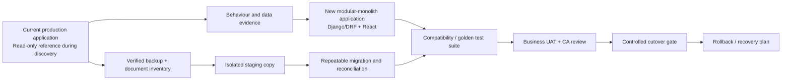

# License Manager - full parallel rebuild implementation plan

**Status:** Planning blueprint only. No rebuild, migration, data change or production change is authorised by this document.

## 1. Decision and design principle

Build a new application alongside the existing License Manager, retain the current application and its database as the behavioural and data reference, and cut over only after defined compatibility, reconciliation, recovery and business-acceptance gates pass.

This plan includes an integrated accounting module, but it does **not** assume the current system already contains a complete general ledger. Existing evidence shows operational invoice/trade-payment concepts but did not discover a complete chart-of-accounts, journal, trial-balance or bank-statement domain. Those are therefore new Option B capabilities that need CA-approved policy and migration design.

The programme must preserve valid current behaviour, but it must not preserve a verified defect merely for compatibility. A compatibility exception requires a finding ID, owner decision, migration treatment, user communication and regression test.

## 2. Target operating model

The product is designed for one or two operators and an owner/reviewer:

| Role | Day-to-day responsibility | System control |
|---|---|---|
| Operator | Enters licences, BOEs, invoices, documents and planning inputs | Guided forms; validation; drafts; no silent override |
| Reviewer / owner | Approves high-risk corrections, restriction overrides and significant postings | Work queue, exception dashboard, reason and evidence mandatory |
| Administrator | Manages company memberships, approved masters and configuration | Server-side scope; audited changes; no implicit global access |
| Accountant / CA | Approves accounting policy, openings, period rules and statements | Posting/reversal/close controls; reconciliation evidence |

Every material record has a legal entity (company), status, source/evidence references, creator/updater and auditable state history. An active-company selector improves usability but never substitutes for server-side company authorization.

## 3. Parallel rebuild topology



The current production system remains operational until the cutover gate. The new application receives only sanitized test data or an authorised isolated copy. No shared production record is used for exploratory create, edit, post, transfer, deletion or import testing.

## 4. Target architecture

Use a maintainable modular monolith, not microservices:

| Boundary | Owns | Key invariant |
|---|---|---|
| Identity and company access | Users, memberships, roles, active company context | Every request and task is company-scoped and object-authorized |
| Licence domain | Licences, items, validity, entitlement ledger, transfers | Available entitlement cannot be silently negative or double-consumed |
| DFIA/SION rule domain | Norm versions, product mapping, AU conditions, restriction pools | Rule applicability and usage are explainable from source evidence |
| Planning/allocation domain | Plan drafts, reservations, allotments, BOE allocations | A draft/reservation is distinct from a posted utilisation |
| Trade domain | BOEs, export/import invoices, documents and links | Correction is reversal/amendment, never untracked overwrite |
| Reconciliation domain | Operational matches, candidates, dispositions and tolerances | Candidate != confirmed error; every disposition is traceable |
| Accounting domain | Chart, journals, subledgers, bank reconciliation, periods | Posted journals balance; reversal preserves history |
| Reporting domain | Read models, Excel/PDF exports, operational dashboards | Each displayed total has an authoritative source and definition |
| Platform | Jobs, files, audit events, notifications, observability | Job retries and files preserve company/security context |

Use PostgreSQL transaction boundaries, Decimal values, explicit database constraints, idempotency keys for critical submissions and row-level locking or equivalent concurrency control around entitlement consumption. API contracts must be versioned only when compatibility requires it.

## 5. Restriction and AU rule engine

### 5.1 Non-negotiable design rules

1. A percentage is not itself a restriction group. Two independent 3% conditions must remain independent.
2. Each restriction is versioned with an effective period and documentary source reference.
3. The engine stores both the approved rule snapshot used at planning/posting time and the current rule version; historical results never silently change after master-data edits.
4. AU conditions, eligibility conditions, individual caps and shared aggregate caps are distinct rule types.
5. A rule outcome must show the operator its basis, permitted amount, already used amount, proposed use, remaining amount, source and blocking/warning reason.
6. A plan may reserve entitlement, but only posted utilisation consumes the definitive usage ledger. Release/cancellation/reversal are explicit immutable events.

### 5.2 Proposed data model

| Entity | Essential fields | Purpose |
|---|---|---|
| `RuleSource` | authority, document number, issue/effective dates, file/link, reviewer | Evidence for official/business-approved interpretation |
| `NormVersion` | SION, effective period, status, source, approval | Versioned norm context |
| `RestrictionRule` | norm version, code, rule type, percentage/quantity/value limit, base, unit, enforcement mode | Individual or pool-based rule definition |
| `RestrictionPool` | norm version, pool code, cap, base, unit, effective period | Named shared cap; never inferred just from percentage |
| `PoolMembership` | pool, import item/product mapping, priority/conditions | Explicitly defines what consumes the pool |
| `AUCondition` | norm/rule reference, condition type, evidence required, block/warn | Models AU requirements independently of numerical caps |
| `RuleEvaluation` | rule snapshot, subject, input/base, computed limit, used, proposed, outcome | Explainable planning/posting decision |
| `RestrictionUsageEvent` | rule/pool snapshot, transaction, quantity/value, event type, timestamp | Immutable consumption/release/reversal history |

### 5.3 Calculation contract

For each restriction, the approved business definition must declare the base. Examples below are templates, not legal interpretations:

```text
individual_limit = approved_base * percentage / 100
individual_remaining = individual_limit - posted_usage + reversed_usage

shared_pool_remaining = pool_limit - sum(posted_usage for that pool)

permitted_proposed_usage = min(individual_remaining, shared_pool_remaining if applicable)
```

The system must never assume a 2%, 3%, 5% or 10% value uses the same base across all norms. The base can be export quantity, value, another norm-defined measure or a fixed limit; it must be explicit in `RestrictionRule` and confirmed from source documents. Unit conversion must be versioned, Decimal-safe and auditable.

### 5.4 AU handling

AU is implemented as an explicit condition resolved for the relevant norm/item/version, not a text label. An AU rule may require evidence, a specific product mapping, a reviewer decision or a hard block. The UI must display:

- applicable AU condition and source;
- evidence/document status;
- whether the transaction is blocked, warned or review-required;
- authorised override role and mandatory reason;
- the audit event and downstream impact.

### 5.5 Restriction acceptance tests

- One 3% pool and another independent 3% pool do not share usage.
- A 2%, 3%, 5% and 10% rule each calculate from their individually approved base.
- A shared cap blocks the next allocation when aggregate posted usage exceeds its limit, even if the item-specific limit has room.
- A cancelled/reversed usage restores available capacity only according to the approved lifecycle.
- A historical transaction retains its rule snapshot after a newer norm version is activated.
- Concurrent allocations cannot both consume the last available quantity/value.
- An AU failure blocks or routes to review exactly as defined; unauthorized override is rejected server-side.

## 6. Data preservation and migration plan

### 6.1 Baseline and backup gate

Before any mapping or new-system load:

1. Take an authorised, encrypted production database backup and file/document inventory.
2. Restore the backup into an isolated environment and prove the restore succeeds.
3. Record schema, extensions, row counts, identifiers, constraints, files and software versions.
4. Freeze a release baseline: source commit, deployed-version evidence, configuration inventory without copying secrets into source control.
5. Export an immutable audit evidence bundle with checksums and access control.

No claim of zero data loss is permitted until the restore and full reconciliation gates have been passed.

### 6.2 Mapping policy

Preserve legacy identifiers in a dedicated `legacy_id`/source-reference layer where practical. Do not overload new primary keys solely to mimic legacy keys. Each mapping includes old table/field, transformation, target field, default/null policy, validation, owner, reconciliation query and rollback treatment.

| Data class | Migration requirement |
|---|---|
| Company, user and membership | Preserve legal-entity association; require policy decision for ambiguous/global records |
| Licences and licence items | Preserve identifiers, validity, original terms, units and linked evidence |
| Allocations / utilisation | Preserve source links and statuses; derive a new ledger only from documented immutable source events |
| BOEs and invoices | Preserve document references, monetary/quantity fields, status and links; do not fabricate matches |
| Planning records | Keep draft/generated plan separate from actual posted transactions |
| Documents | Check file hashes, metadata, authorization and reference integrity |
| Audit history | Preserve timestamp, actor/source, action and legacy reference; mark unrecoverable gaps explicitly |
| Accounting opening / history | CA-approved mapping; no synthetic balancing entry merely to conceal a discrepancy |

### 6.3 Reconciliation gates

Migration run reports must compare source and target at record and aggregate levels:

- unique identifiers, row counts and orphan relationships;
- company ownership and permission memberships;
- licence original / reserved / utilised / available balances;
- BOE, invoice, allocation and reconciliation candidate counts by scope;
- document count, hash and link integrity;
- operational report totals by approved filters;
- accounting opening, journal, subledger, bank and statement totals once Option B begins;
- audit-history counts and key timestamps.

Every difference is either explained, approved with a remediation ID, or release-blocking. Row-count parity alone is insufficient.

### 6.4 Cutover and rollback

Use at least two dry runs. The final run must have a transaction freeze window or an approved delta-capture method. Retain the old application/database read-only after cutover for an agreed retention period. Rollback must state how transactions entered in the new application will be preserved or reconciled; simply restoring a pre-cutover backup is not acceptable if it discards real post-cutover activity.

## 7. Behavioural compatibility programme

For every route, API, report, job and administrative action, capture a compatibility card:

| Field | Required content |
|---|---|
| Identity | page/route/API/job and old-to-new owner |
| User intent | what the operator is trying to achieve |
| Inputs and validation | fields, defaults, invalid cases and permissions |
| Side effects | records/events/files/jobs created or changed |
| Calculation / rule trace | source values, service, rounding and report impact |
| Failure behaviour | error, retry, cancellation, partial failure and recovery |
| Compatibility result | identical, approved improvement, retired or not assessed |
| Test evidence | automated test, staging evidence and owner acceptance |

The comparison suite runs the same golden scenarios against legacy and rebuilt applications in isolated environments. A difference is allowed only where an approved defect fix or policy decision explains it. Legacy UI appearance need not be copied, but functional result, permission behaviour and business outcome must be proven.

## 8. Accounting workstream (Option B)

Accounting starts only after company isolation, operational source integrity and the operational calculation contracts have passed their gates.

### 8.1 Scope

- company-specific chart of accounts and account types;
- balanced journals, posting rules, reversal instead of destructive edit;
- sales, purchases/expenses, commissions, receipts and payments;
- customer/supplier subledgers and controlled source-document links;
- bank accounts, statement import and bank reconciliation;
- period controls, opening balances, trial balance, P&L and balance sheet;
- audit events, user approvals and CA-reviewed reporting/tax requirements.

### 8.2 Accounting invariants

- Every posted journal balances in base currency and defined transaction-currency treatment.
- Posted journals cannot be edited; correction creates a linked reversal/replacement.
- A source invoice/trade event posts at most once per approved posting key.
- Partial payments cannot exceed open amount without an explicit approved credit/advance workflow.
- Closed periods reject posts except controlled reopening with audit evidence.
- Bank-reconciliation match does not alter bank/accounting facts without a traceable transaction.
- Company books are strictly separate.

### 8.3 Accounting migration

The CA must approve chart mapping, opening date, opening balances, historical-detail depth, tax treatment, prior-period corrections and cutover reports. Run legacy-to-new accounting reconciliation in parallel for at least one agreed close cycle. Option B is not a substitute for fixing operational balances; financial statements must cite trusted source posting events.

## 9. Delivery phases, milestones and estimates

| Phase | Main deliverables | Exit gate | Planning effort |
|---|---|---|---:|
| 0. Mobilise / evidence | Repository + production baseline, route/API/model inventory, decision register, isolated test environment | Baseline is reproducible; owner approves scope assumptions | 30-50 days |
| 1. Compatibility specification | Page/workflow cards, golden data, migration mapping, source-report contracts | Critical operational workflow coverage agreed | 45-70 days |
| 2. Platform and tenancy | New repo/CI, authentication, company membership, audit and file boundaries | Negative cross-company tests pass | 55-85 days |
| 3. Licence and restriction core | Entitlement ledger, SION/norm versions, AU/restriction pools, planning and concurrency | Golden calculations and restriction tests pass | 100-155 days |
| 4. Trade and reconciliation | BOE/invoice/import flows, documents, operational matching, correction review queues | Parity and sampled data reconciliation pass | 90-135 days |
| 5. UX and reporting | All approved routes, work queues, reports/exports and accessibility paths | Page/workflow UAT passes | 75-115 days |
| 6. Accounting | Ledger, subledgers, bank, period controls, statements and CA review | Balanced postings and parallel-close reconciliation pass | 175-330 days |
| 7. Migration / release | Dry runs, delta plan, UAT, restore, cutover and hypercare | Zero unexplained material differences; rollback ready | 80-140 days |

This is a full rebuild programme, so it is deliberately larger than the prior hardening estimate. A plausible planning range is **650-1,080 developer-days**, with **approximately 815 likely developer-days** before external CA/domain review and business-owner time. Re-estimate after Phase 1; the current audit did not prove every production workflow or data condition.

At one developer's realistic 3.5 productive days per week, this is approximately 22-31 months with review, remediation and business interruptions. One developer plus specialist/CA support and disciplined UAT can reduce elapsed time but not eliminate migration and acceptance work. A small focused team may target 12-18 months after the baseline is complete, subject to integration overhead.

## 10. Release gates and definition of success

| Gate | Evidence required |
|---|---|
| Data integrity | No unexplained material source-target differences; approved discrepancy register exists |
| Licence / restriction correctness | Golden results, AU paths, pools, reversals and concurrency tests pass |
| Security | Company/role/API/export/job isolation tested server-side; no unresolved critical/high release blocker |
| Compatibility | Every required workflow card has automated and/or witnessed staging evidence |
| Accounting | CA-approved policy, balanced journals, subledger/statement reconciliation and controlled period behaviour |
| Quality | Approved suite passes; typecheck/lint/static/dependency and migration checks meet release standard |
| Recovery | Backup restore and rollback/delta recovery rehearsal pass in isolation |
| Acceptance | Owner signs off daily operations, exception queues and required reports in staging |

## 11. First 30 working days

1. Create a separate rebuild repository/branch and access controls; do not modify production.
2. Prove an isolated restore from a production-equivalent backup and inventory documents.
3. Finish the page/API/model/job inventory and classify all current findings with evidence.
4. Establish company policy and obtain authoritative DFIA/SION/AU/restriction source documents and approved examples.
5. Build the migration mapping workbook and immutable reconciliation baseline.
6. Create golden scenarios for 2%, 3%, 5% and 10% rules, including two independent same-percentage pools, AU block/review examples, licence availability, BOE/invoice linkage and reversal.
7. Select the new modular-monolith architecture and write ADRs for tenancy, rule snapshots, ledgers, files, accounting posting and cutover.
8. Implement no business rewrite yet until the above artefacts have owner/domain approval.

## 12. Decisions required before implementation

1. Which legal entities and shared masters are permitted, and who can cross company boundaries?
2. What official document and effective dates define each AU, 2%, 3%, 5% and 10% restriction? What is each rule's base, unit, cap scope and override policy?
3. What constitutes a draft, reservation, posted utilisation, cancellation and reversal for each licence/BOE/invoice workflow?
4. Which existing legacy defects should be preserved temporarily for reconciliation versus corrected as part of the rebuild?
5. Which reports are mandatory on day one, and which can follow after cutover?
6. Is full accounting required at first production cutover, or should it run after a stable operational release?
7. Who is the CA/accounting-policy approver for chart, openings, periods, tax and statutory statements?
8. What downtime, transaction-freeze window and old-system retention are acceptable?

## Integrity statement

This plan is derived from the existing audit evidence and deliberately distinguishes verified observations from design proposals. No source code, database records, migrations, production configuration or deployment has been changed.
